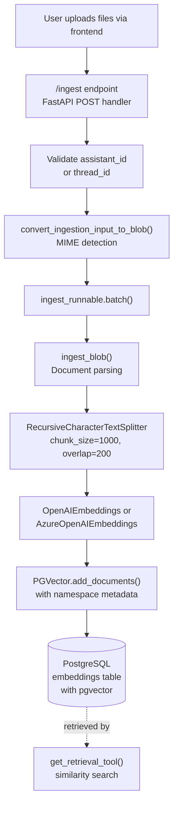
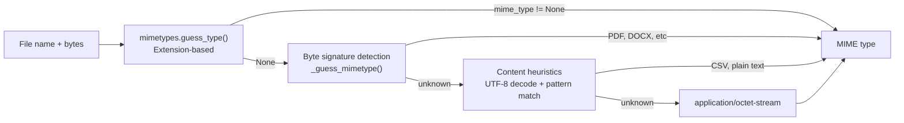
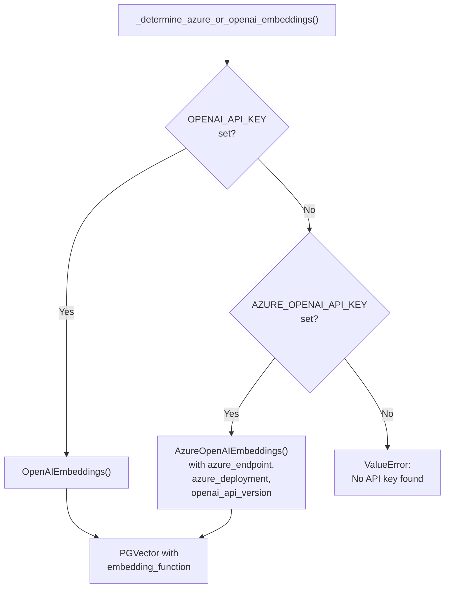
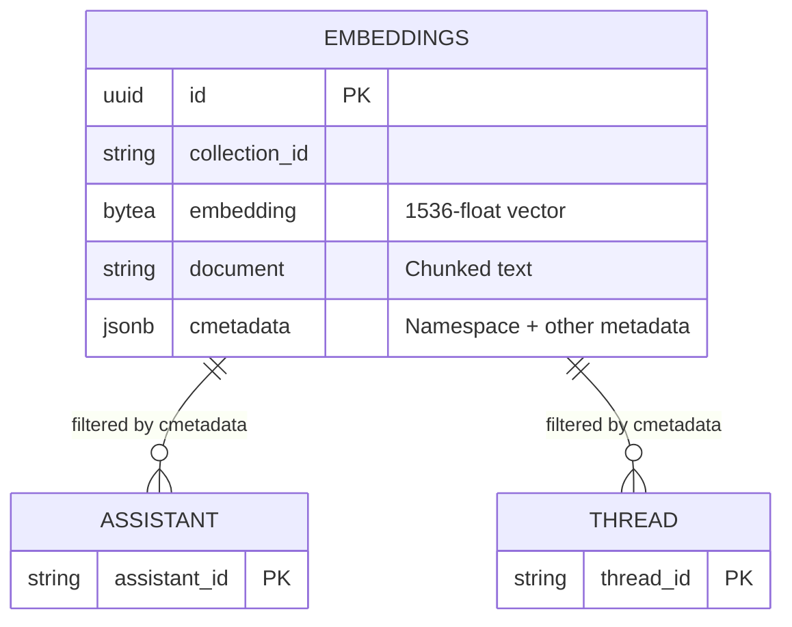
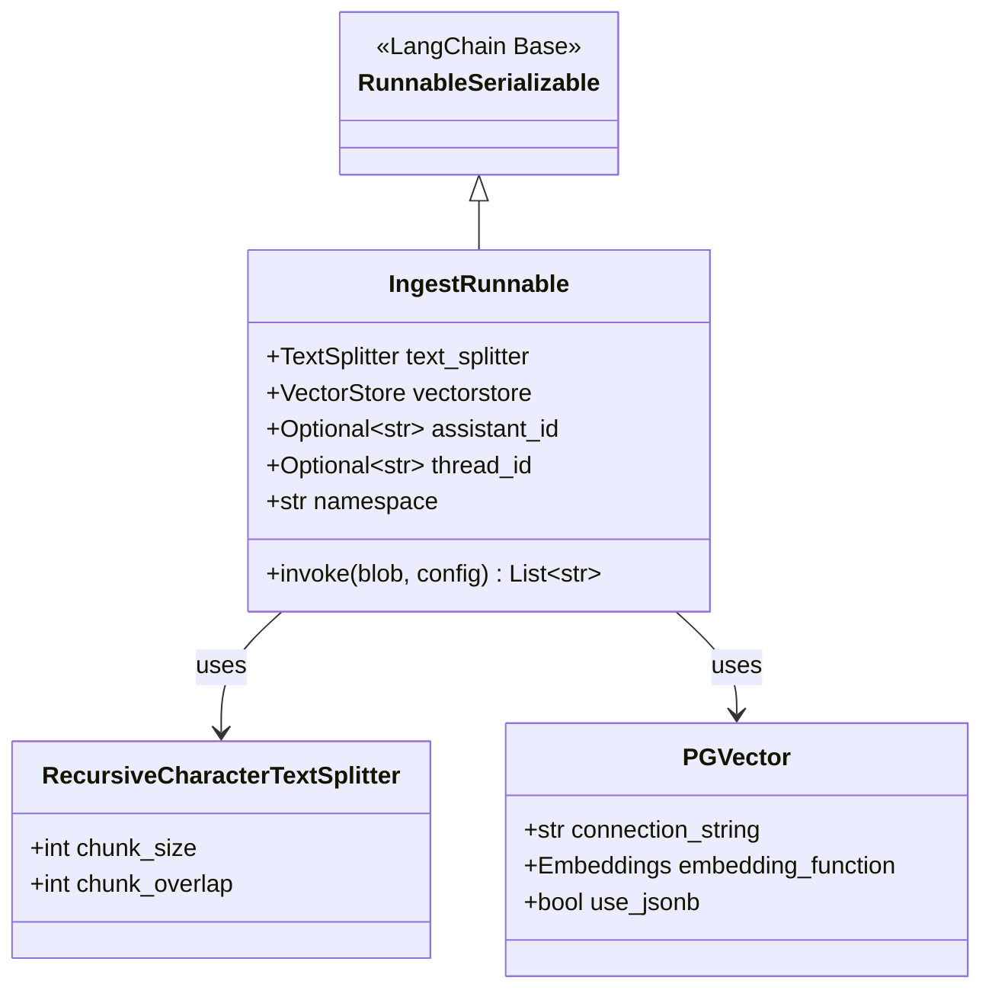
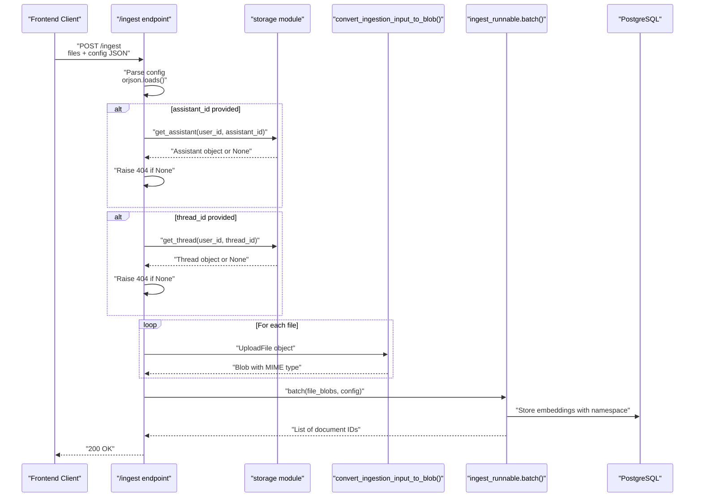
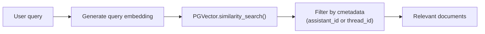

<!-- source: DeepWiki mcp.deepwiki.com · repo langchain-ai/opengpts · page 2.4 File Upload and Vector Storage · fetched 2026-10-26 -->

# File Upload and Vector Storage

<details>
<summary>Relevant source files</summary>

The following files were used as context for generating this wiki page:

- [backend/app/server.py](backend/app/server.py)
- [backend/app/upload.py](backend/app/upload.py)
- [backend/tests/unit_tests/agent_executor/test_upload.py](backend/tests/unit_tests/agent_executor/test_upload.py)

</details>


## Purpose and Scope

This document describes the file upload and vector storage subsystem in OpenGPTs, which enables document ingestion and semantic search capabilities. The system processes uploaded files, chunks them, generates embeddings, and stores them in PostgreSQL with pgvector for retrieval-augmented generation (RAG).

For information about how the retrieval tool queries these stored embeddings during agent execution, see [Cognitive Architectures](#2.2). For details on the RAG execution graph that consumes the retrieval tool, see [Agent System](#2.1).

**Sources:** [backend/app/upload.py:1-171](), [backend/app/server.py:28-48]()

---

## Overview

The file upload and vector storage system provides a pipeline that transforms user-uploaded files into searchable vector embeddings. Files can be associated with either an assistant (for all threads using that assistant) or a specific thread (for context local to that conversation).



**Key Components:**
- **`/ingest` endpoint**: FastAPI route that receives file uploads
- **`IngestRunnable`**: Core abstraction for the ingestion pipeline
- **`_guess_mimetype()`**: MIME type detection from file extension and byte signatures
- **`PGVector`**: LangChain vector store wrapper for PostgreSQL with pgvector
- **`RecursiveCharacterTextSplitter`**: Text chunking with overlap for context preservation

**Sources:** [backend/app/upload.py:1-171](), [backend/app/server.py:28-48]()

---

## File Ingestion Pipeline

### MIME Type Detection

The system employs a two-stage MIME type detection strategy to handle files robustly:



The `_guess_mimetype()` function [backend/app/upload.py:33-66]() implements the following detection logic:

| Detection Method | MIME Types Detected | Implementation |
|-----------------|---------------------|----------------|
| **Extension-based** | All registered types | `mimetypes.guess_type()` |
| **Byte signatures** | PDF, DOCX, DOC, XLS | Magic number prefixes (e.g., `b"%PDF"`) |
| **Content heuristics** | CSV, plain text | UTF-8 decode + character pattern analysis |
| **Fallback** | `application/octet-stream` | When all methods fail |

**Supported byte signatures:**
- PDF: `b"%PDF"`
- ZIP-based formats (DOCX/XLSX): `b"\x50\x4B\x03\x04"`, `b"\x50\x4B\x05\x06"`, `b"\x50\x4B\x07\x08"`
- Legacy Office: `b"\xd0\xcf\x11\xe0\xa1\xb1\x1a\xe1"` (DOC), `b"\x09\x00\xff\x00\x06\x00"` (XLS)

**Sources:** [backend/app/upload.py:33-66](), [backend/tests/unit_tests/agent_executor/test_upload.py:33-50]()

### Blob Conversion

Files are converted from FastAPI's `UploadFile` objects to LangChain's `Blob` objects:

```python
# backend/app/upload.py:69-83
convert_ingestion_input_to_blob(file: UploadFile) -> Blob
```

The conversion process:
1. Reads file data via `file.file.read()`
2. Validates `file.filename` is a string
3. Detects MIME type using `_guess_mimetype()`
4. Creates `Blob.from_data()` with data, path, and MIME type

**Sources:** [backend/app/upload.py:69-83]()

### Document Parsing and Chunking

After blob conversion, documents are processed through the `ingest_blob()` function [backend/app/ingest.py]() which:

1. **Parses** the blob using `MIMETYPE_BASED_PARSER` [backend/app/parsing.py]() - a dictionary mapping MIME types to parser functions
2. **Chunks** the parsed text using `RecursiveCharacterTextSplitter` with:
   - `chunk_size=1000` characters
   - `chunk_overlap=200` characters for context continuity
3. **Adds metadata** including the namespace (assistant_id or thread_id)

**Sources:** [backend/app/upload.py:134-142]()

### Embedding Generation

The system selects between OpenAI and Azure OpenAI embeddings based on environment variables:



The `_determine_azure_or_openai_embeddings()` function [backend/app/upload.py:86-107]() creates a `PGVector` instance with:
- `connection_string`: PostgreSQL connection via `PG_CONNECTION_STRING`
- `embedding_function`: Either `OpenAIEmbeddings()` or `AzureOpenAIEmbeddings()`
- `use_jsonb=True`: Enables JSONB storage for metadata

**Sources:** [backend/app/upload.py:86-107](), [backend/app/upload.py:145-153]()

---

## Vector Storage with pgvector

### Storage Architecture



Documents are stored in the `embeddings` table with:
- **Vector field**: `embedding` column with pgvector type for similarity search
- **Document text**: Original chunked text for retrieval
- **Namespace metadata**: JSON field containing `assistant_id` or `thread_id` for filtering

**Sources:** [backend/app/upload.py:88-104]()

### Connection String Setup

The PostgreSQL connection is constructed from environment variables:

```python
# backend/app/upload.py:145-152
PG_CONNECTION_STRING = PGVector.connection_string_from_db_params(
    driver="psycopg2",
    host=os.environ["POSTGRES_HOST"],
    port=int(os.environ["POSTGRES_PORT"]),
    database=os.environ["POSTGRES_DB"],
    user=os.environ["POSTGRES_USER"],
    password=os.environ["POSTGRES_PASSWORD"],
)
```

**Required environment variables:**

| Variable | Purpose |
|----------|---------|
| `POSTGRES_HOST` | Database host address |
| `POSTGRES_PORT` | Database port (typically 5432) |
| `POSTGRES_DB` | Database name |
| `POSTGRES_USER` | Database user |
| `POSTGRES_PASSWORD` | Database password |

**Sources:** [backend/app/upload.py:145-152]()

---

## The IngestRunnable Class

`IngestRunnable` [backend/app/upload.py:110-143]() is a `RunnableSerializable` that orchestrates the ingestion pipeline:



**Key characteristics:**
- **Type signature**: `RunnableSerializable[BinaryIO, List[str]]` - accepts binary input, returns list of document IDs
- **Namespace enforcement**: Exactly one of `assistant_id` or `thread_id` must be set
- **Configurable fields**: Both IDs are exposed as runtime configuration options

### Namespace Property

The `namespace` property [backend/app/upload.py:124-132]() enforces mutual exclusivity:

```python
@property
def namespace(self) -> str:
    if (self.assistant_id is None and self.thread_id is None) or \
       (self.assistant_id is not None and self.thread_id is not None):
        raise ValueError("Exactly one of assistant_id or thread_id must be provided")
    return self.assistant_id if self.assistant_id is not None else self.thread_id
```

This ensures documents are scoped to either:
- An **assistant** (shared across all threads using that assistant)
- A **thread** (specific to one conversation)

**Sources:** [backend/app/upload.py:110-143]()

---

## API Endpoint

### The `/ingest` Endpoint

The file upload API is exposed at `/ingest` [backend/app/server.py:28-48]():



**Endpoint signature:**
```python
@app.post("/ingest", description="Upload files to the given assistant.")
async def ingest_files(
    files: list[UploadFile], 
    user: AuthedUser, 
    config: str = Form(...)
) -> None
```

**Parameters:**
- `files`: List of uploaded files (multipart/form-data)
- `user`: Authenticated user (injected by auth middleware)
- `config`: JSON string containing `configurable.assistant_id` or `configurable.thread_id`

**Validation logic:**
1. Parse config JSON with `orjson.loads()`
2. If `assistant_id` provided: verify assistant exists via `storage.get_assistant()`
3. If `thread_id` provided: verify thread exists via `storage.get_thread()`
4. Return 404 if validation fails
5. Convert all files to blobs
6. Batch process through `ingest_runnable.batch(file_blobs, config)`

**Sources:** [backend/app/server.py:28-48]()

---

## Namespace Isolation

### Configurable Fields Pattern

The `ingest_runnable` instance [backend/app/upload.py:156-170]() uses LangChain's `configurable_fields()` to enable runtime configuration:

```python
ingest_runnable = IngestRunnable(
    text_splitter=RecursiveCharacterTextSplitter(chunk_size=1000, chunk_overlap=200),
    vectorstore=vstore,
).configurable_fields(
    assistant_id=ConfigurableField(
        id="assistant_id",
        annotation=Optional[str],
        name="Assistant ID",
    ),
    thread_id=ConfigurableField(
        id="thread_id",
        annotation=Optional[str],
        name="Thread ID",
    ),
)
```

This pattern allows the frontend to specify which namespace to use at invocation time:

```javascript
// Example frontend config
{
  "configurable": {
    "assistant_id": "asst_abc123"  // OR "thread_id": "thread_xyz789"
  }
}
```

**Sources:** [backend/app/upload.py:156-170]()

### Query-Time Filtering

When documents are retrieved during agent execution, the retrieval tool filters by namespace:



This ensures:
- Agents configured with an assistant only see documents uploaded to that assistant
- Thread-specific uploads are isolated to that conversation
- Users cannot access documents from other users' assistants or threads

**Sources:** [backend/app/upload.py:115-132]()

---

## Configuration and Setup

### Global Instances

Two global instances are created at module load:

```python
# backend/app/upload.py:145-153
PG_CONNECTION_STRING = PGVector.connection_string_from_db_params(...)
vstore = _determine_azure_or_openai_embeddings()
```

These singletons are shared across all ingestion requests for efficiency.

### Environment Variable Dependencies

| Category | Variables | Required |
|----------|-----------|----------|
| **Database** | `POSTGRES_HOST`, `POSTGRES_PORT`, `POSTGRES_DB`, `POSTGRES_USER`, `POSTGRES_PASSWORD` | Yes |
| **OpenAI** | `OPENAI_API_KEY` | One of OpenAI or Azure |
| **Azure OpenAI** | `AZURE_OPENAI_API_KEY`, `AZURE_OPENAI_API_BASE`, `AZURE_OPENAI_EMBEDDINGS_DEPLOYMENT_NAME`, `AZURE_OPENAI_API_VERSION` | One of OpenAI or Azure |

The system will raise a `ValueError` if neither OpenAI nor Azure credentials are configured [backend/app/upload.py:105-107]().

**Sources:** [backend/app/upload.py:86-107](), [backend/app/upload.py:145-153]()

---

## Testing

The upload system includes unit tests at [backend/tests/unit_tests/agent_executor/test_upload.py:1-51]():

### Test Coverage

| Test | Purpose | Key Assertions |
|------|---------|----------------|
| `test_ingestion_runnable()` | End-to-end ingestion | Verifies document IDs returned |
| `test_mimetype_guessing()` | MIME detection accuracy | Validates detection for 7 file types (DOCX, EPUB, HTML, ODT, PDF, RTF, TXT) |

### MIME Type Detection Test Results

The test suite validates detection for sample files with expected MIME types:

```python
assert {
    "sample.docx": "application/vnd.openxmlformats-officedocument.wordprocessingml.document",
    "sample.epub": "application/epub+zip",
    "sample.html": "text/html",
    "sample.odt": "application/vnd.oasis.opendocument.text",
    "sample.pdf": "application/pdf",
    "sample.rtf": "application/rtf",
    "sample.txt": "text/plain",
} == name_to_mime
```

**Sources:** [backend/tests/unit_tests/agent_executor/test_upload.py:11-50]()

---

## Integration with Agent System

The uploaded and embedded documents are consumed by the retrieval tool [backend/app/agent.py]() which is configured in agents of type `AgentType.GPT_4_WITH_RETRIEVAL` or similar RAG-enabled types. The retrieval tool:

1. Accepts the same `assistant_id`/`thread_id` configuration
2. Performs similarity search using the user's query embedding
3. Returns relevant document chunks as context
4. Passes context to the LLM for answer generation

For complete details on how retrieval integrates with the agent execution loop, see [Cognitive Architectures](#2.2).

**Sources:** [backend/app/upload.py:1-171]()

---

