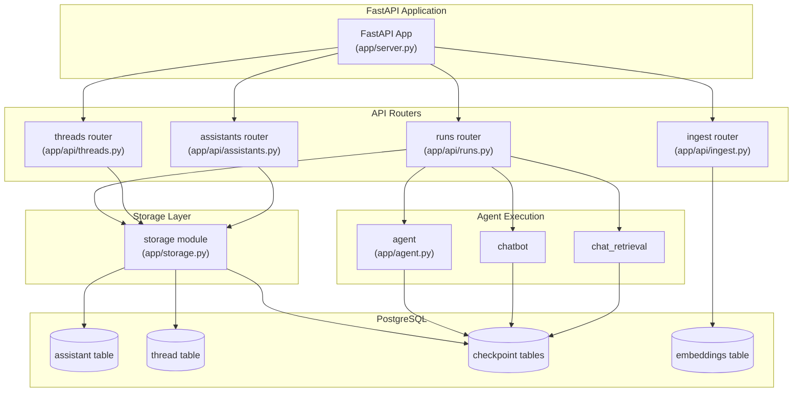
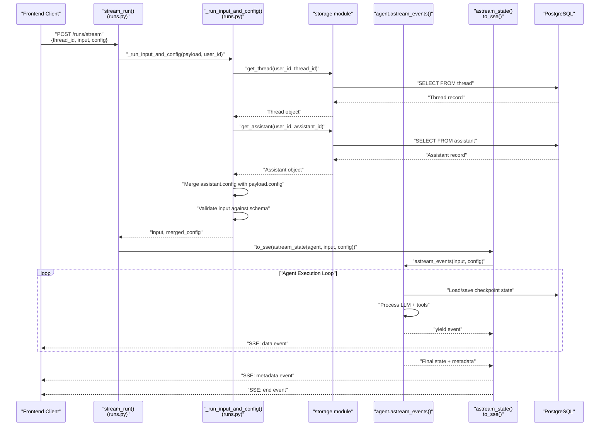
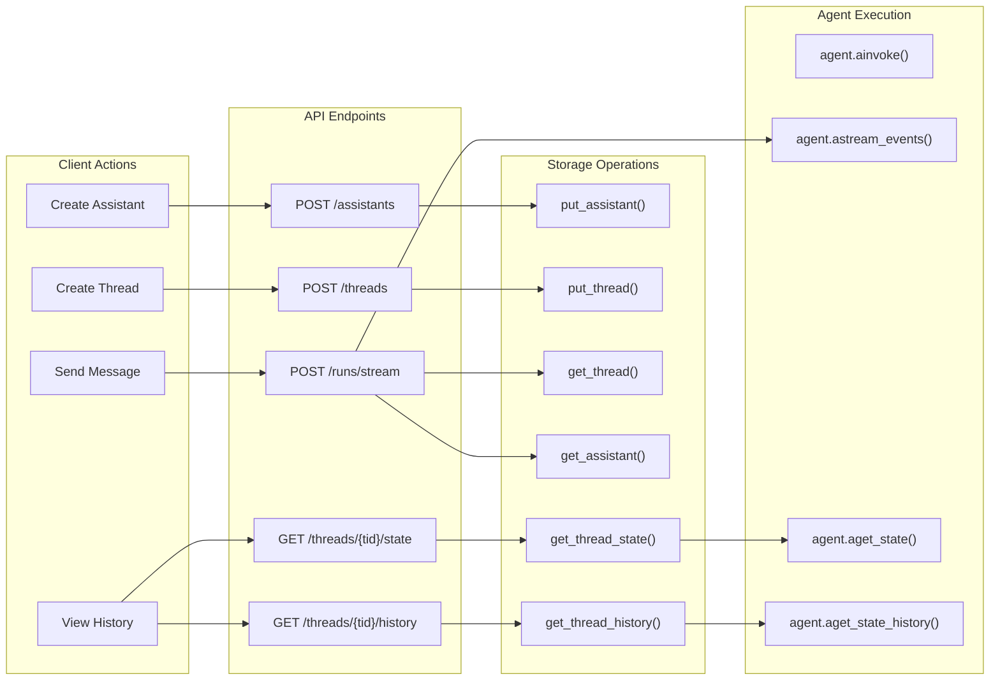

<!-- source: DeepWiki mcp.deepwiki.com · repo langchain-ai/opengpts · page 2.5 API Endpoints · fetched 2026-10-26 -->

# API Endpoints

<details>
<summary>Relevant source files</summary>

The following files were used as context for generating this wiki page:

- [backend/app/api/assistants.py](backend/app/api/assistants.py)
- [backend/app/api/runs.py](backend/app/api/runs.py)
- [backend/app/api/threads.py](backend/app/api/threads.py)
- [backend/app/storage.py](backend/app/storage.py)

</details>


## Purpose and Scope

This document describes all HTTP API endpoints exposed by the OpenGPTs FastAPI backend. These endpoints provide the interface for creating and managing assistants, threads (conversations), and executing agent runs. The API follows RESTful conventions for resource management and uses Server-Sent Events (SSE) for streaming agent execution.

For information about the streaming implementation details, see [Streaming System](#2.6). For the storage layer that these endpoints use, see [Storage and State Management](#2.3). For the agent execution logic, see [Agent System](#2.1).

## API Architecture

The OpenGPTs backend exposes four primary API routers, each handling a distinct domain of functionality:



**Sources:** [backend/app/api/runs.py:1-157](), [backend/app/api/threads.py:1-146](), [backend/app/api/assistants.py:1-90](), [backend/app/storage.py:1-269]()

## Runs API

The Runs API handles agent execution, both synchronous and streaming. All endpoints are prefixed with `/runs`.

### Endpoint: POST /runs

Creates a run and executes it in the background.

**Handler:** `create_run` [backend/app/api/runs.py:70-79]()

**Request Model:** `CreateRunPayload` [backend/app/api/runs.py:21-28]()

| Field | Type | Description |
|-------|------|-------------|
| `thread_id` | `str` | ID of the thread to execute against |
| `input` | `Optional[Union[Sequence[AnyMessage], Dict[str, Any]]]` | Input messages or state dict |
| `config` | `Optional[RunnableConfig]` | Optional configuration overrides |

**Response:** `{"status": "ok"}`

**Authentication:** Requires `AuthedUser` dependency

**Behavior:**
1. Validates thread existence via `get_thread` [backend/app/storage.py:103-113]()
2. Fetches assistant configuration via `get_assistant` [backend/app/storage.py:21-31]()
3. Merges assistant config with request config [backend/app/api/runs.py:40-49]()
4. Validates input against the appropriate schema (agent, chatbot, or chat_retrieval) [backend/app/api/runs.py:52-65]()
5. Executes `agent.ainvoke` as background task [backend/app/api/runs.py:78]()

**Sources:** [backend/app/api/runs.py:70-79](), [backend/app/api/runs.py:31-67]()

### Endpoint: POST /runs/stream

Creates a run and streams execution results via Server-Sent Events.

**Handler:** `stream_run` [backend/app/api/runs.py:82-90]()

**Request Model:** `CreateRunPayload` (same as POST /runs)

**Response:** `EventSourceResponse` with SSE stream

**Event Types:**

| Event | Data | Description |
|-------|------|-------------|
| `data` | JSON object | Intermediate agent state updates |
| `metadata` | `{"run_id": "..."}` | Run metadata including LangSmith run ID |
| `error` | Error message | Execution error details |
| `end` | Empty | Stream completion signal |

**Behavior:**
1. Validates thread and assistant (same as POST /runs)
2. Calls `astream_state` to process agent events [backend/app/stream.py]()
3. Converts events to SSE format via `to_sse` [backend/app/stream.py]()
4. Returns `EventSourceResponse` [backend/app/api/runs.py:90]()

**Sources:** [backend/app/api/runs.py:82-90]()

### Endpoint: GET /runs/input_schema

Returns the JSON schema for valid run inputs.

**Handler:** `input_schema` [backend/app/api/runs.py:93-96]()

**Response:** JSON schema object from `agent.get_input_schema()` [backend/app/api/runs.py:96]()

**Sources:** [backend/app/api/runs.py:93-96]()

### Endpoint: GET /runs/output_schema

Returns the JSON schema for run outputs.

**Handler:** `output_schema` [backend/app/api/runs.py:99-102]()

**Response:** JSON schema object from `agent.get_output_schema()` [backend/app/api/runs.py:102]()

**Sources:** [backend/app/api/runs.py:99-102]()

### Endpoint: GET /runs/config_schema

Returns the JSON schema for run configuration.

**Handler:** `config_schema` [backend/app/api/runs.py:105-108]()

**Response:** JSON schema object from `agent.config_schema()` [backend/app/api/runs.py:108]()

**Sources:** [backend/app/api/runs.py:105-108]()

### Endpoint: POST /runs/feedback

Submits feedback for a run to LangSmith. Only available when tracing is enabled.

**Handler:** `create_run_feedback` [backend/app/api/runs.py:134-156]()

**Request Model:** `FeedbackCreateRequest` [backend/app/api/runs.py:114-132]()

| Field | Type | Description |
|-------|------|-------------|
| `run_id` | `UUID` | LangSmith run ID |
| `key` | `str` | Feedback metric name/tag |
| `score` | `Optional[Union[float, int, bool]]` | Numeric score |
| `value` | `Optional[Union[float, int, bool, str, Dict]]` | Display value |
| `comment` | `Optional[str]` | Explanation text |

**Response:** `{"status": "ok"}`

**Behavior:** Calls `langsmith_client.create_feedback` to log feedback [backend/app/api/runs.py:145-154]()

**Sources:** [backend/app/api/runs.py:111-156]()

## Threads API

The Threads API manages conversation threads. All endpoints are prefixed with `/threads`.

### Endpoint: GET /threads

Lists all threads for the authenticated user.

**Handler:** `list_threads` [backend/app/api/threads.py:32-35]()

**Response:** `List[Thread]`

**Thread Model:** `Thread` schema [backend/app/schema.py]()

| Field | Type | Description |
|-------|------|-------------|
| `thread_id` | `str` | Unique thread identifier |
| `user_id` | `str` | Owner user ID |
| `assistant_id` | `str` | Associated assistant ID |
| `name` | `str` | Thread display name |
| `updated_at` | `datetime` | Last modification timestamp |
| `metadata` | `Optional[dict]` | Additional metadata (e.g., `assistant_type`) |

**Behavior:** Calls `storage.list_threads` [backend/app/storage.py:96-100]()

**Sources:** [backend/app/api/threads.py:32-35](), [backend/app/storage.py:96-100]()

### Endpoint: POST /threads

Creates a new thread with a generated UUID.

**Handler:** `create_thread` [backend/app/api/threads.py:109-120]()

**Request Model:** `ThreadPutRequest` [backend/app/api/threads.py:18-22]()

| Field | Type | Description |
|-------|------|-------------|
| `name` | `str` | Thread display name |
| `assistant_id` | `str` | Assistant to associate |

**Response:** `Thread` object

**Behavior:**
1. Generates new UUID via `uuid4()` [backend/app/api/threads.py:117]()
2. Calls `storage.put_thread` [backend/app/storage.py:213-247]()
3. Stores `assistant_type` in metadata extracted from assistant config [backend/app/storage.py:218-221]()

**Sources:** [backend/app/api/threads.py:109-120](), [backend/app/storage.py:213-247]()

### Endpoint: GET /threads/{tid}

Retrieves a specific thread by ID.

**Handler:** `get_thread` [backend/app/api/threads.py:97-106]()

**Path Parameter:** `tid` (ThreadID) [backend/app/api/threads.py:15]()

**Response:** `Thread` object or 404 error

**Behavior:** Calls `storage.get_thread` [backend/app/storage.py:103-113]()

**Sources:** [backend/app/api/threads.py:97-106](), [backend/app/storage.py:103-113]()

### Endpoint: PUT /threads/{tid}

Updates an existing thread or creates one with the specified ID.

**Handler:** `upsert_thread` [backend/app/api/threads.py:123-135]()

**Path Parameter:** `tid` (ThreadID)

**Request Model:** `ThreadPutRequest`

**Response:** `Thread` object

**Behavior:** Calls `storage.put_thread` with explicit thread ID [backend/app/storage.py:213-247]()

**Sources:** [backend/app/api/threads.py:123-135]()

### Endpoint: DELETE /threads/{tid}

Deletes a thread.

**Handler:** `delete_thread` [backend/app/api/threads.py:138-145]()

**Path Parameter:** `tid` (ThreadID)

**Response:** `{"status": "ok"}`

**Behavior:** Calls `storage.delete_thread` [backend/app/storage.py:250-257]()

**Sources:** [backend/app/api/threads.py:138-145](), [backend/app/storage.py:250-257]()

### Endpoint: GET /threads/{tid}/state

Retrieves the current state of a thread.

**Handler:** `get_thread_state` [backend/app/api/threads.py:38-54]()

**Path Parameter:** `tid` (ThreadID)

**Response:**
```json
{
  "values": <state_values>,
  "next": ["next_node_name"]
}
```

**Behavior:**
1. Fetches thread and validates existence [backend/app/api/threads.py:44-49]()
2. Calls `storage.get_thread_state` [backend/app/storage.py:116-133]()
3. Internally calls `agent.aget_state` with merged config [backend/app/storage.py:118-126]()

**State Format:** `values` can be either a list of messages (for tools agent/chatbot) or a dict with `messages` key (for retrieval agent) [backend/app/storage.py:127-128]()

**Sources:** [backend/app/api/threads.py:38-54](), [backend/app/storage.py:116-133]()

### Endpoint: POST /threads/{tid}/state

Adds or updates state for a thread.

**Handler:** `add_thread_state` [backend/app/api/threads.py:57-75]()

**Path Parameter:** `tid` (ThreadID)

**Request Model:** `ThreadPostRequest` [backend/app/api/threads.py:25-29]()

| Field | Type | Description |
|-------|------|-------------|
| `values` | `Union[Sequence[AnyMessage], Dict[str, Any]]` | New state to add |
| `config` | `Optional[Dict[str, Any]]` | Optional config overrides |

**Behavior:**
1. Validates thread and assistant [backend/app/api/threads.py:64-69]()
2. Calls `storage.update_thread_state` [backend/app/storage.py:136-177]()
3. Determines state format from current state [backend/app/storage.py:144-166]()
4. Calls `agent.aupdate_state` [backend/app/storage.py:168-177]()

**Sources:** [backend/app/api/threads.py:57-75](), [backend/app/storage.py:136-177]()

### Endpoint: GET /threads/{tid}/history

Retrieves all historical states for a thread.

**Handler:** `get_thread_history` [backend/app/api/threads.py:78-94]()

**Path Parameter:** `tid` (ThreadID)

**Response:** List of state snapshots with config and parent references

**Response Format:**
```json
[
  {
    "values": <state_values>,
    "next": ["next_node"],
    "config": {<runnable_config>},
    "parent": {<parent_config>}
  },
  ...
]
```

**Behavior:**
1. Validates thread and assistant [backend/app/api/threads.py:84-89]()
2. Calls `storage.get_thread_history` [backend/app/storage.py:180-198]()
3. Internally uses `agent.aget_state_history` async generator [backend/app/storage.py:189-197]()

**Sources:** [backend/app/api/threads.py:78-94](), [backend/app/storage.py:180-198]()

## Assistants API

The Assistants API manages assistant configurations. All endpoints are prefixed with `/assistants`.

### Endpoint: GET /assistants

Lists all assistants owned by the authenticated user.

**Handler:** `list_assistants` [backend/app/api/assistants.py:27-30]()

**Response:** `List[Assistant]`

**Assistant Model:** `Assistant` schema [backend/app/schema.py]()

| Field | Type | Description |
|-------|------|-------------|
| `assistant_id` | `str` | Unique assistant identifier |
| `user_id` | `str` | Owner user ID |
| `name` | `str` | Assistant display name |
| `config` | `dict` | Complete configuration (LLM, tools, prompts) |
| `updated_at` | `datetime` | Last modification timestamp |
| `public` | `bool` | Whether assistant is publicly shareable |

**Behavior:** Calls `storage.list_assistants` [backend/app/storage.py:12-18]()

**Sources:** [backend/app/api/assistants.py:27-30](), [backend/app/storage.py:12-18]()

### Endpoint: GET /assistants/public

Lists all public assistants across all users.

**Handler:** `list_public_assistants` [backend/app/api/assistants.py:33-36]()

**Response:** `List[Assistant]`

**Authentication:** No authentication required

**Behavior:** Calls `storage.list_public_assistants` [backend/app/storage.py:34-38]()

**Sources:** [backend/app/api/assistants.py:33-36](), [backend/app/storage.py:34-38]()

### Endpoint: POST /assistants

Creates a new assistant with a generated UUID.

**Handler:** `create_assistant` [backend/app/api/assistants.py:51-63]()

**Request Model:** `AssistantPayload` [backend/app/api/assistants.py:14-21]()

| Field | Type | Default | Description |
|-------|------|---------|-------------|
| `name` | `str` | - | Assistant display name |
| `config` | `dict` | - | Full assistant configuration |
| `public` | `bool` | `False` | Public sharing flag |

**Response:** `Assistant` object

**Behavior:**
1. Generates new UUID via `uuid4()` [backend/app/api/assistants.py:59]()
2. Calls `storage.put_assistant` [backend/app/storage.py:41-83]()

**Sources:** [backend/app/api/assistants.py:51-63](), [backend/app/storage.py:41-83]()

### Endpoint: GET /assistants/{aid}

Retrieves a specific assistant by ID.

**Handler:** `get_assistant` [backend/app/api/assistants.py:39-48]()

**Path Parameter:** `aid` (AssistantID) [backend/app/api/assistants.py:24]()

**Response:** `Assistant` object or 404 error

**Access Control:** Returns assistant if it belongs to the user OR if `public` is true [backend/app/storage.py:24-28]()

**Behavior:** Calls `storage.get_assistant` [backend/app/storage.py:21-31]()

**Sources:** [backend/app/api/assistants.py:39-48](), [backend/app/storage.py:21-31]()

### Endpoint: PUT /assistants/{aid}

Updates an existing assistant or creates one with the specified ID.

**Handler:** `upsert_assistant` [backend/app/api/assistants.py:66-79]()

**Path Parameter:** `aid` (AssistantID)

**Request Model:** `AssistantPayload`

**Response:** `Assistant` object

**Behavior:**
1. Calls `storage.put_assistant` with explicit assistant ID [backend/app/storage.py:41-83]()
2. Uses `ON CONFLICT ... DO UPDATE` SQL pattern [backend/app/storage.py:60-67]()

**Sources:** [backend/app/api/assistants.py:66-79](), [backend/app/storage.py:41-83]()

### Endpoint: DELETE /assistants/{aid}

Deletes an assistant.

**Handler:** `delete_assistant` [backend/app/api/assistants.py:82-89]()

**Path Parameter:** `aid` (AssistantID)

**Response:** `{"status": "ok"}`

**Behavior:** Calls `storage.delete_assistant` [backend/app/storage.py:86-93]()

**Sources:** [backend/app/api/assistants.py:82-89](), [backend/app/storage.py:86-93]()

## Request/Response Flow

The following diagram illustrates a typical streaming run request flow, showing how API endpoints interact with storage and agent execution:



**Sources:** [backend/app/api/runs.py:82-90](), [backend/app/api/runs.py:31-67](), [backend/app/storage.py:103-113](), [backend/app/storage.py:21-31]()

## Error Handling

All API endpoints use FastAPI's `HTTPException` for error responses:

| Status Code | Condition | Example Endpoints |
|-------------|-----------|-------------------|
| `404` | Resource not found | Thread/Assistant not found [backend/app/api/threads.py:46](), [backend/app/api/assistants.py:47]() |
| `400` | Invalid request data | Thread has no assistant [backend/app/api/threads.py:49]() |
| `422` | Validation error | Input doesn't match schema [backend/app/api/runs.py:64-65]() |

**Validation Errors:** The `_run_input_and_config` helper validates input against the appropriate schema (agent, chatbot, or chat_retrieval) based on the `type` field in config [backend/app/api/runs.py:52-65](). Invalid inputs raise `RequestValidationError`.

**Authentication:** All endpoints except `GET /assistants/public` require `AuthedUser` dependency, which extracts user identity from the request context.

**Sources:** [backend/app/api/runs.py:31-67](), [backend/app/api/threads.py:38-94](), [backend/app/api/assistants.py:39-48]()

## API Integration Summary



**Sources:** [backend/app/api/runs.py:1-157](), [backend/app/api/threads.py:1-146](), [backend/app/api/assistants.py:1-90](), [backend/app/storage.py:1-269]()

---

