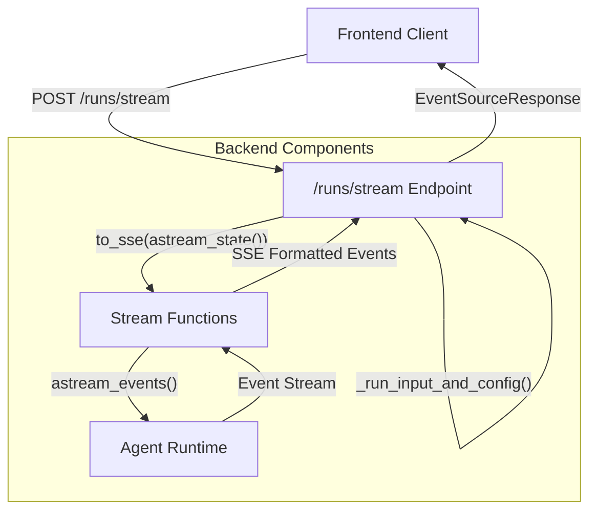
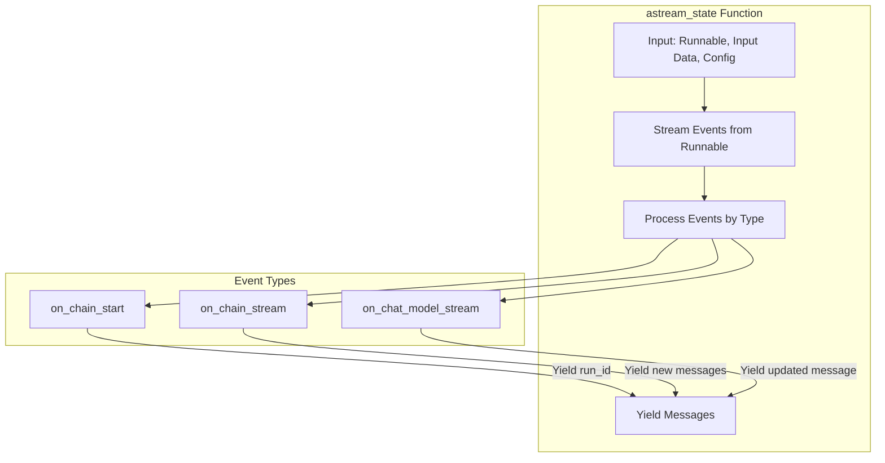
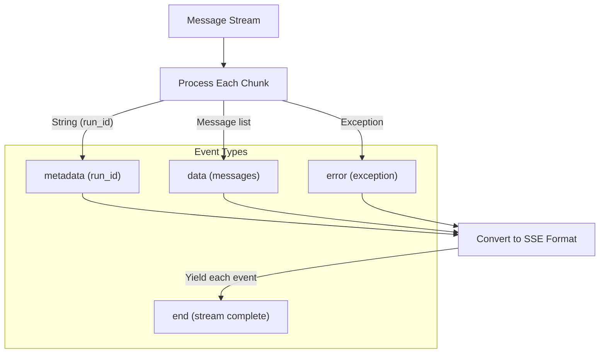
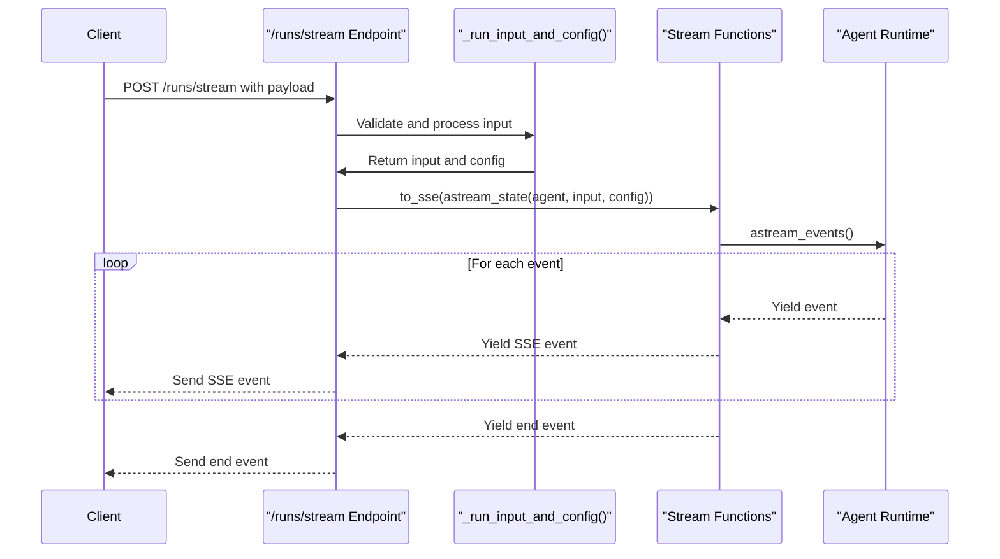
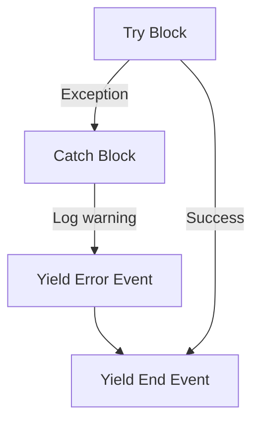
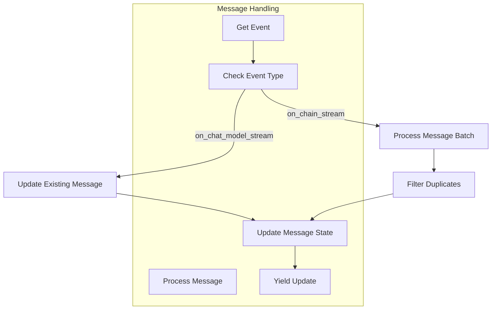

<!-- source: DeepWiki mcp.deepwiki.com · repo langchain-ai/opengpts · page 2.6 Streaming System · fetched 2026-10-26 -->

# Streaming System

Relevant source files

The following files were used as context for generating this wiki page:

- [backend/app/stream.py](backend/app/stream.py)

## Purpose and Scope

The Streaming System in OpenGPTs enables real-time delivery of agent outputs to the client through Server-Sent Events (SSE). This component is crucial for providing a responsive user experience as it allows for incremental updates of agent responses, tool executions, and other state changes without requiring multiple client requests. This document covers the server-side implementation of the streaming mechanism, focusing on how agent outputs are captured, transformed, and delivered as an event stream.

For information about the agent system itself, see [Agent System](#2.1). For details on how the frontend consumes these streams, see [Frontend State Management](#3.3).

## Streaming Architecture Overview

The streaming system connects the agent runtime with the client through a specialized API endpoint that transforms agent events into a standardized SSE format.

Sources: [backend/app/api/runs.py:82-90](), [backend/app/stream.py:14-98]()

## Core Streaming Components

### Message Stream Generation

The `astream_state` function is the core component that captures events from the agent runtime and converts them into a stream of messages.

The `astream_state` function:
1. Accepts a runnable (agent), input data, and configuration
2. Streams events from the runnable using `astream_events`
3. Processes different event types:
   - `on_chain_start`: Captures and yields the root run ID
   - `on_chain_stream`: Captures new messages in the agent state
   - `on_chat_model_stream`: Captures incremental LLM token updates

Sources: [backend/app/stream.py:14-54]()

### SSE Event Conversion

The `to_sse` function transforms the message stream into standardized SSE events for delivery to the client.

The `to_sse` function:
1. Accepts a stream of messages or string identifiers
2. Converts each chunk into an appropriate SSE event type:
   - `metadata`: Contains the run ID for client tracking
   - `data`: Contains serialized message objects
   - `error`: Contains error information (when exceptions occur)
   - `end`: Signals the end of the stream

Sources: [backend/app/stream.py:66-98]()

## Event Structure

The streaming system produces several types of events, each with a specific structure:

| Event Type | Data Structure | Purpose |
|------------|----------------|---------|
| `metadata` | `{"run_id": "<uuid>"}` | Identifies the run for client tracking |
| `data` | Array of message objects | Contains actual content updates |
| `error` | `{"status_code": 500, "message": "Internal Server Error"}` | Communicates stream errors |
| `end` | (empty) | Signals stream completion |

Sources: [backend/app/stream.py:66-98]()

## API Integration

The streaming system is exposed through the `/runs/stream` endpoint, which:

1. Processes the client request
2. Validates input against the appropriate schema
3. Sets up the appropriate configuration
4. Returns an `EventSourceResponse` with the stream data

Sources: [backend/app/api/runs.py:82-90](), [backend/app/stream.py:14-98]()

## Error Handling

The streaming system includes robust error handling to prevent stream failures from disrupting the client experience:

1. Exceptions during stream processing are caught
2. Error events are sent to the client with a generic message (to avoid exposing sensitive information)
3. The stream is properly terminated after error events

Sources: [backend/app/stream.py:85-95]()

## Message Processing

The system carefully manages message state to ensure that:

1. Messages are correctly identified by their IDs
2. Duplicate messages are filtered out
3. Message chunks are properly aggregated
4. New messages are efficiently yielded to the client

This approach ensures optimal performance and bandwidth usage by only sending incremental updates.

Sources: [backend/app/stream.py:30-54]()

## Implementation Details

The streaming system leverages several technical components:

1. **Serialization**: Uses `orjson` for efficient JSON serialization with a custom serializer for message objects
2. **Type Annotations**: Defines clear types like `MessagesStream` to aid in development
3. **Event Streaming**: Uses the `astream_events` method from LangChain runnables
4. **SSE Delivery**: Uses `sse_starlette.EventSourceResponse` for SSE protocol implementation

The system is designed to be efficient and robust, with careful handling of different message types and events.

Sources: [backend/app/stream.py:1-12](), [backend/app/api/runs.py:82-90]()

## Client Integration

When a client connects to the streaming endpoint, it should:

1. Make a POST request to `/runs/stream` with the appropriate payload
2. Set up an EventSource connection to receive server events
3. Process different event types:
   - `metadata`: Store the run ID for reference
   - `data`: Update the UI with new message content
   - `error`: Handle and display error states
   - `end`: Close the connection and finalize the UI state

The server handles all the complexities of event generation, allowing the client to focus on rendering the updates.

Sources: [backend/app/api/runs.py:82-90]()

---

