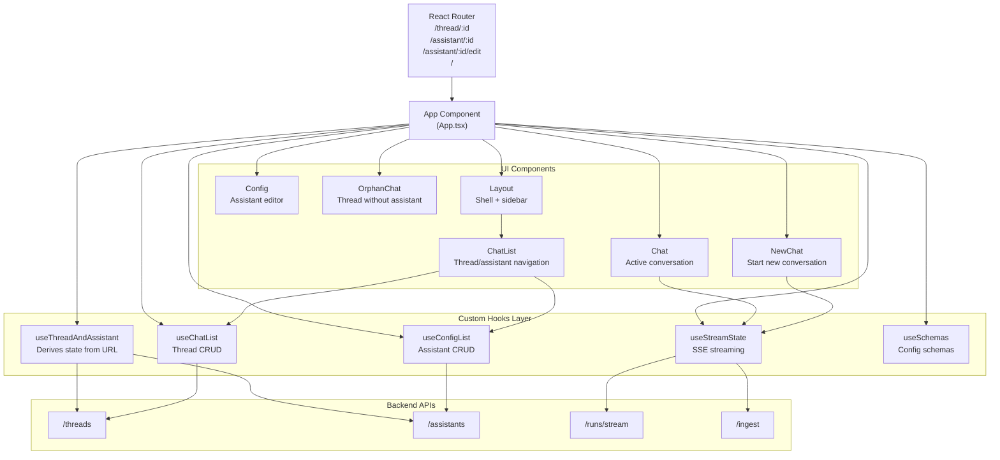
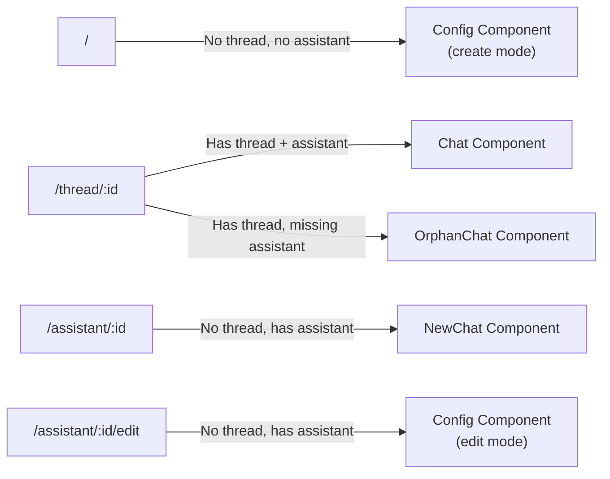
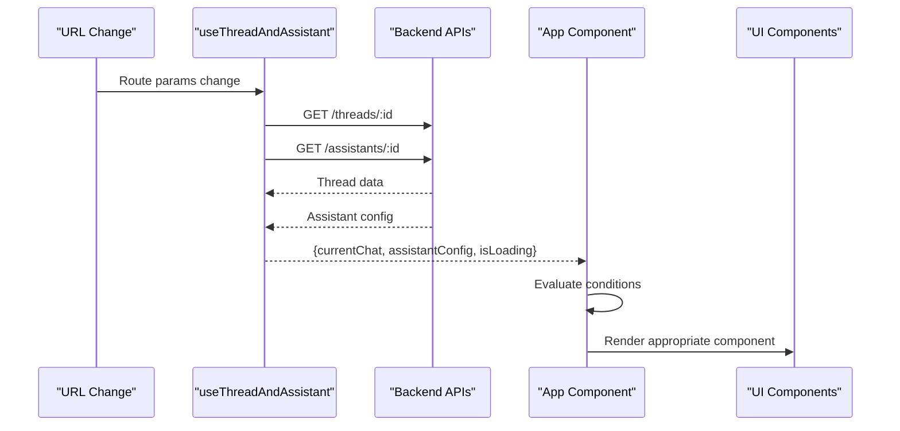
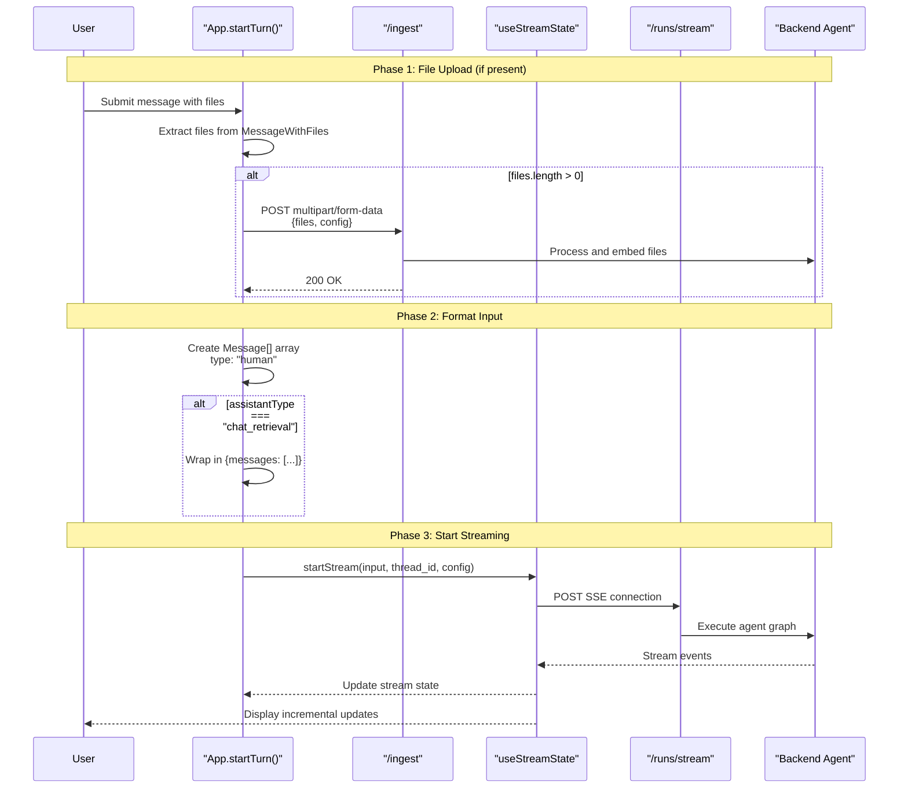
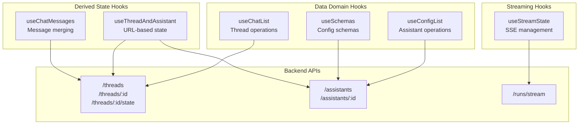
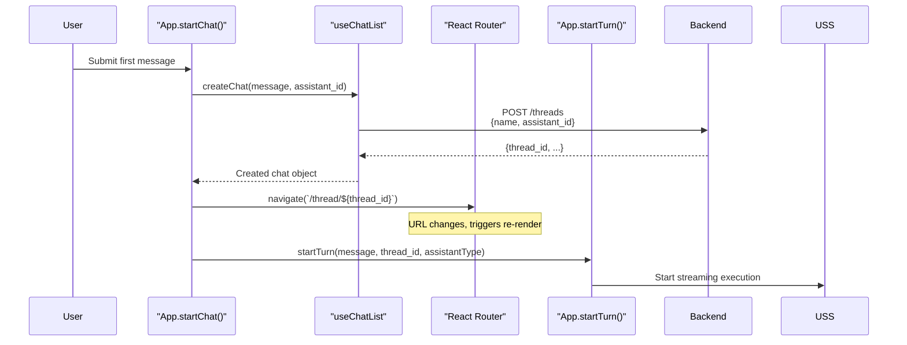
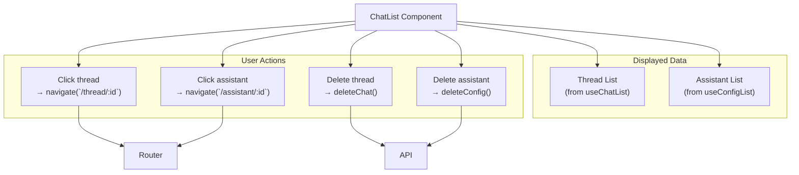

<!-- source: DeepWiki mcp.deepwiki.com · repo langchain-ai/opengpts · page 3 Frontend System · fetched 2026-10-26 -->

# Frontend System

<details>
<summary>Relevant source files</summary>

The following files were used as context for generating this wiki page:

- [frontend/src/App.tsx](frontend/src/App.tsx)

</details>


## Purpose and Scope

This document describes the React-based frontend application that provides the user interface for OpenGPTs. The frontend is responsible for assistant configuration, conversation management, message display, and real-time streaming of agent responses. It communicates with the backend through REST APIs and Server-Sent Events (SSE).

For information about the backend APIs that the frontend consumes, see [Backend System](#2). For details about the agent execution and streaming mechanisms, see [Streaming System](#2.6).

---

## Technology Stack

The frontend is built with the following technologies:

| Technology | Purpose | Key Features |
|-----------|---------|--------------|
| **React 18** | UI framework | Component-based architecture, hooks |
| **TypeScript** | Type safety | Static typing, interface definitions |
| **React Router** | URL-based routing | Path parameters for threads and assistants |
| **Vite** | Build tool | Fast development server, optimized production builds |
| **Tailwind CSS** | Styling | Utility-first CSS framework |
| **Heroicons** | Icons | React icon components |

The application follows a single-page application (SPA) architecture where all UI state is derived from the URL and backend API responses.

**Sources:** `frontend/package.json`, `frontend/vite.config.ts`

---

## Application Architecture

The frontend uses a centralized orchestration pattern where the `App` component serves as the main hub that:

1. Reads route parameters to determine current context
2. Fetches necessary data through custom hooks
3. Conditionally renders appropriate UI components
4. Manages global state like sidebar visibility



**Diagram: Frontend Component and Hook Architecture**

The diagram shows how URL routing drives the entire application state. The `useThreadAndAssistant` hook [frontend/src/hooks/useThreadAndAssistant.ts]() extracts route parameters and fetches the corresponding thread and assistant data, which determines which component the `App` renders.

**Sources:** [frontend/src/App.tsx:1-189](), [frontend/src/main.tsx]()

---

## Routing Structure

The application defines four primary routes that determine the UI state:



**Diagram: URL Routes and Component Rendering Logic**

The routing logic is implemented in [frontend/src/App.tsx:146-184]():

| Condition | Rendered Component | Purpose |
|-----------|-------------------|---------|
| `currentChat && assistantConfig` | `Chat` | Active conversation |
| `currentChat && !assistantConfig` | `OrphanChat` | Thread exists but assistant was deleted |
| `!currentChat && assistantConfig && !props.edit` | `NewChat` | Start new conversation with selected assistant |
| `!currentChat && assistantConfig && props.edit` | `Config` (edit mode) | Modify existing assistant |
| `!currentChat && !assistantConfig && !isLoading` | `Config` (create mode) | Create new assistant |

This conditional rendering ensures that the UI always displays an appropriate view based on the presence or absence of thread and assistant data.

**Sources:** [frontend/src/App.tsx:146-184](), [frontend/src/main.tsx]()

---

## State Management Philosophy

The frontend follows a **URL-as-source-of-truth** pattern where:

1. **URL parameters drive data fetching** - Route params (`:id`) are extracted by `useThreadAndAssistant`
2. **Backend is authoritative** - No local optimistic updates for conversation state
3. **Hooks encapsulate data access** - Each data domain (threads, assistants, schemas) has a dedicated hook
4. **Streaming is separate from persistence** - Real-time updates come via SSE, but final state is fetched from REST endpoints



**Diagram: State Derivation Flow from URL to UI**

The key insight is that navigation (changing the URL) automatically triggers data fetching through the `useThreadAndAssistant` hook, which then causes the `App` component to re-render with updated data.

**Sources:** [frontend/src/App.tsx:29](), [frontend/src/hooks/useThreadAndAssistant.ts]()

---

## Component Overview

### Core UI Components

| Component | File Path | Purpose |
|-----------|-----------|---------|
| `App` | `frontend/src/App.tsx` | Central orchestrator, routing logic, sidebar management |
| `Chat` | `frontend/src/components/Chat.tsx` | Active conversation interface with message display and input |
| `NewChat` | `frontend/src/components/NewChat.tsx` | Assistant selection and first message interface |
| `Config` | `frontend/src/components/Config.tsx` | Assistant configuration form (create/edit) |
| `OrphanChat` | `frontend/src/components/OrphanChat.tsx` | Display for threads with deleted assistants |
| `Layout` | `frontend/src/components/Layout.tsx` | Page shell with responsive sidebar |
| `ChatList` | `frontend/src/components/ChatList.tsx` | Sidebar navigation for threads and assistants |

### Specialized Display Components

| Component | Purpose |
|-----------|---------|
| `MessageViewer` | Renders individual messages with markdown support |
| `DocumentViewer` | Displays file attachments and document metadata |
| `ToolCallViewer` | Visualizes agent tool invocations and results |

For detailed information about the configuration interface, see [Configuration Interface](#3.2). For chat and messaging components, see [Chat and Messaging](#3.3).

**Sources:** [frontend/src/components/]()

---

## Data Flow: Message Submission

The frontend handles message submission through a multi-phase process:



**Diagram: Message Submission Flow with File Handling**

The implementation in [frontend/src/App.tsx:31-81]() shows several key details:

1. **File upload is synchronous** - Files are uploaded via `/ingest` endpoint before streaming begins
2. **Input format varies by assistant type** - RAG assistants require `{messages: [...]}` while others accept `Message[]` directly
3. **Human messages have specific structure** - Each message includes `content`, `type`, `additional_kwargs`, and a unique `id`

**Sources:** [frontend/src/App.tsx:31-81]()

---

## Hook Architecture

The frontend uses specialized custom hooks to encapsulate different aspects of state management:



**Diagram: Custom Hooks and API Endpoints**

### Hook Responsibilities

| Hook | Responsibility | Key Methods |
|------|---------------|-------------|
| `useChatList` | Thread CRUD operations | `createChat`, `updateChat`, `deleteChat` |
| `useConfigList` | Assistant CRUD operations | `saveConfig`, `deleteConfig` |
| `useStreamState` | SSE connection management | `startStream`, `stopStream` |
| `useSchemas` | Fetch configuration schemas | Returns `configSchema`, `configDefaults` |
| `useThreadAndAssistant` | Derive state from URL | Returns `currentChat`, `assistantConfig`, `isLoading` |
| `useChatMessages` | Merge streaming and persisted messages | Returns deduplicated message list |

For detailed information about these hooks, see [State Management and API Integration](#3.4).

**Sources:** [frontend/src/hooks/]()

---

## Chat Initialization Flow

When starting a new conversation, the frontend performs several coordinated operations:



**Diagram: New Conversation Creation Flow**

The `startChat` callback in [frontend/src/App.tsx:83-91]() demonstrates the coordinated sequence:

1. **Create thread** - Call `createChat` which POSTs to `/threads`
2. **Navigate to thread** - Change URL to `/thread/:id`
3. **Start streaming** - Begin agent execution with the initial message

This separation ensures that the thread exists in the database before any streaming begins, preventing race conditions.

**Sources:** [frontend/src/App.tsx:83-91]()

---

## Sidebar and Navigation

The `ChatList` component provides navigation between threads and assistants:



**Diagram: ChatList Sidebar Navigation Structure**

The `Layout` component in [frontend/src/components/Layout.tsx]() provides a responsive shell that:
- Displays the `ChatList` in a sidebar
- Handles mobile/desktop sidebar visibility
- Shows the current assistant name in the header
- Contains the main content area where `Chat`, `NewChat`, or `Config` renders

The sidebar state is managed in [frontend/src/App.tsx:23]() with `useState` and can be toggled via the hamburger menu icon.

**Sources:** [frontend/src/App.tsx:120-145](), [frontend/src/components/Layout.tsx](), [frontend/src/components/ChatList.tsx]()

---

## Error Handling and Edge Cases

The frontend handles several edge cases through conditional rendering:

### Orphaned Threads

When a thread exists but its associated assistant has been deleted, the `OrphanChat` component is rendered [frontend/src/App.tsx:149-151](). This component:
- Displays the conversation history
- Allows reassigning the thread to a different assistant
- Updates the thread's `assistant_id` via `updateChat`

### Loading States

While `useThreadAndAssistant` is fetching data, `isLoading` is true and a loading indicator is displayed [frontend/src/App.tsx:184](). This prevents premature rendering of components that depend on loaded data.

### Stream Interruption

When navigating away from an active chat, the `selectChat` callback [frontend/src/App.tsx:93-110]() calls `stopStream?.(true)` to cleanly terminate the SSE connection before changing routes.

### Empty State

When no assistants exist and no thread is selected, the `Config` component is rendered in create mode [frontend/src/App.tsx:174-183](), allowing the user to create their first assistant.

**Sources:** [frontend/src/App.tsx:93-110](), [frontend/src/App.tsx:146-184](), [frontend/src/components/OrphanChat.tsx]()

---

## Build and Deployment

The frontend is built using Vite and can be deployed in two ways:

### Development Mode

```bash
cd frontend
npm run dev  # Starts dev server on port 5173
```

The development server proxies API requests to the backend running on port 8100.

### Production Build

```bash
cd frontend
npm run build  # Outputs to frontend/dist
```

The production build is copied into the backend's `ui/` directory and served as static files by the FastAPI application. This monolithic deployment approach is implemented in the multi-stage Dockerfile [Dockerfile]().

For detailed deployment information, see [Deployment and Configuration](#1.2).

**Sources:** `frontend/package.json`, `frontend/vite.config.ts`, `Dockerfile`

---

## Summary

The OpenGPTs frontend is a React application that:

1. **Uses URL-driven state** via React Router and `useThreadAndAssistant`
2. **Conditionally renders components** based on the presence of thread and assistant data
3. **Encapsulates data access** through specialized custom hooks
4. **Handles file uploads** before streaming begins via the `/ingest` endpoint
5. **Manages real-time updates** through SSE connections in `useStreamState`
6. **Provides navigation** via a responsive sidebar with `ChatList`

The application architecture emphasizes separation of concerns, with the `App` component serving as a thin orchestration layer that delegates to specialized hooks and components.

For component-specific details, refer to:
- [Application Structure](#3.1) - App component orchestration
- [Configuration Interface](#3.2) - Assistant setup and management
- [Chat and Messaging](#3.3) - Message display and interaction
- [State Management and API Integration](#3.4) - Hook implementations

**Sources:** [frontend/src/App.tsx:1-189](), [frontend/src/main.tsx]()

---

