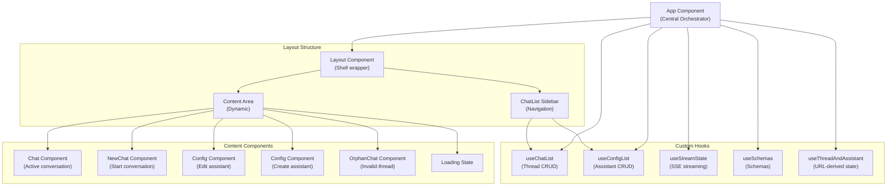
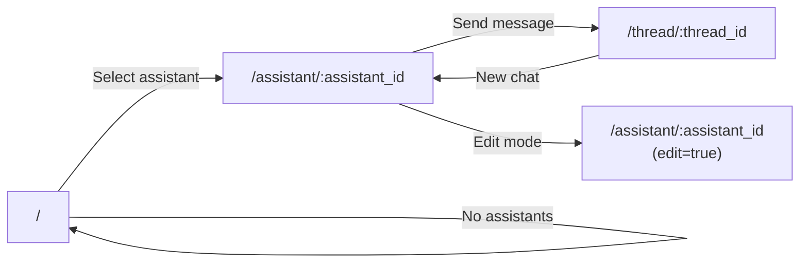
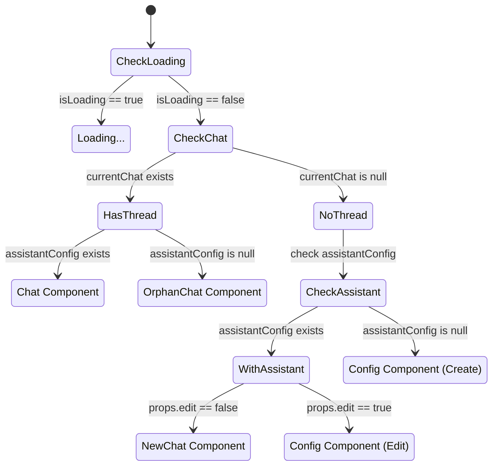
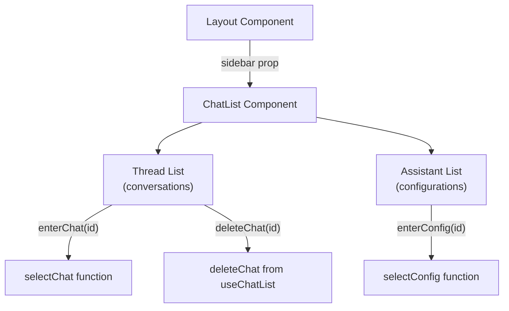
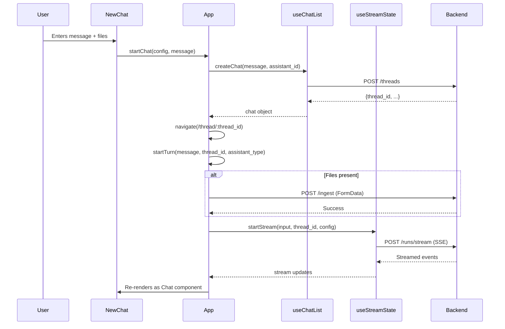

<!-- source: DeepWiki mcp.deepwiki.com · repo langchain-ai/opengpts · page 3.1 Application Structure · fetched 2026-10-26 -->

# Application Structure

<details>
<summary>Relevant source files</summary>

The following files were used as context for generating this wiki page:

- [frontend/src/App.tsx](frontend/src/App.tsx)

</details>


## Purpose and Scope

This document describes the frontend application structure, focusing on the `App` component as the central orchestrator of the user interface. It covers:

- URL-driven state management through React Router
- Conditional rendering logic for six distinct UI states
- Component hierarchy and navigation flow
- Integration of custom hooks for data management

For details on specific UI components like the assistant editor, see [Configuration Interface](#3.2). For message display and streaming, see [Chat and Messaging](#3.3). For the implementation of state management hooks, see [State Management and API Integration](#3.4).

---

## App Component as Central Orchestrator

The `App` component ([frontend/src/App.tsx:21-189]()) serves as the root orchestrator of the application. It coordinates multiple subsystems through custom hooks and determines which UI components to render based on the current application state.

### Component Architecture



**Sources:** [frontend/src/App.tsx:1-189]()

### Local State Management

The `App` component maintains minimal local state, only tracking `sidebarOpen` for mobile sidebar visibility ([frontend/src/App.tsx:23]()):

```typescript
const [sidebarOpen, setSidebarOpen] = useState(false);
```

All other state is managed through specialized hooks ([frontend/src/App.tsx:24-29]()):

| Hook | Purpose | Returns |
|------|---------|---------|
| `useChatList` | Thread management | `chats`, `createChat`, `updateChat`, `deleteChat` |
| `useConfigList` | Assistant management | `configs`, `saveConfig`, `deleteConfig` |
| `useStreamState` | SSE streaming | `startStream`, `stopStream`, `stream` |
| `useSchemas` | Configuration schemas | `configSchema`, `configDefaults` |
| `useThreadAndAssistant` | URL-derived state | `currentChat`, `assistantConfig`, `isLoading` |

**Sources:** [frontend/src/App.tsx:7-29]()

---

## URL-Driven State Management

The application uses React Router to derive application state from URL parameters. The `useThreadAndAssistant` hook extracts the current thread and assistant IDs from the route and fetches their data from the backend.

### Route Structure



### Route Mapping to UI State

The combination of URL parameters determines which component is rendered:

| Route | `currentChat` | `assistantConfig` | `props.edit` | Component Rendered |
|-------|---------------|-------------------|--------------|-------------------|
| `/thread/:id` | ✓ | ✓ | N/A | `Chat` |
| `/thread/:id` | ✓ | ✗ | N/A | `OrphanChat` |
| `/assistant/:id` | ✗ | ✓ | `false` | `NewChat` |
| `/assistant/:id` | ✗ | ✓ | `true` | `Config` (edit) |
| `/` | ✗ | ✗ | N/A | `Config` (create) |
| Any (loading) | — | — | N/A | Loading message |

**Sources:** [frontend/src/App.tsx:29](), [frontend/src/App.tsx:146-185]()

### Navigation Functions

The `App` component provides three navigation functions that modify the URL:

**`selectChat(id: string | null)`** ([frontend/src/App.tsx:93-110]()): Navigates to a thread or returns to assistant selection. Stops any active stream and handles mobile sidebar closure.

**`selectConfig(id: string | null)`** ([frontend/src/App.tsx:112-117]()): Navigates to assistant configuration or root.

**`startChat(config, message)`** ([frontend/src/App.tsx:83-91]()): Creates a new thread via `createChat`, navigates to it, and initiates streaming.

**Sources:** [frontend/src/App.tsx:83-117]()

---

## Conditional Rendering Logic

The `App` component renders different UI components based on the combination of `currentChat`, `assistantConfig`, `isLoading`, and `props.edit` flags.

### Six UI States



### Rendering Logic Implementation

The conditional rendering is implemented as a series of if-statements ([frontend/src/App.tsx:146-185]()):

**1. Active Chat** (lines 146-148):
```typescript
{currentChat && assistantConfig && (
  <Chat startStream={startTurn} stopStream={stopStream} stream={stream} />
)}
```
Renders when both thread and assistant configuration are loaded. Allows the user to view history and send messages.

**2. Orphaned Chat** (lines 149-151):
```typescript
{currentChat && !assistantConfig && (
  <OrphanChat chat={currentChat} updateChat={updateChat} />
)}
```
Renders when a thread exists but its associated assistant configuration has been deleted. Displays the thread history with an option to reassign to a different assistant.

**3. New Chat** (lines 152-162):
```typescript
{!currentChat && assistantConfig && !props.edit && (
  <NewChat
    startChat={startChat}
    configSchema={configSchema}
    configDefaults={configDefaults}
    configs={configs}
    saveConfig={saveConfig}
    enterConfig={selectConfig}
    deleteConfig={deleteConfig}
  />
)}
```
Renders when an assistant is selected but no thread exists. Displays a form to start a new conversation with that assistant.

**4. Config Edit** (lines 163-173):
```typescript
{!currentChat && assistantConfig && props.edit && (
  <Config
    className="mb-6"
    config={assistantConfig}
    configSchema={configSchema}
    configDefaults={configDefaults}
    saveConfig={saveConfig}
    enterConfig={selectConfig}
    edit={props.edit}
  />
)}
```
Renders when navigating to `/assistant/:id` with edit mode enabled. Shows the assistant configuration editor.

**5. Config Create** (lines 174-183):
```typescript
{!currentChat && !assistantConfig && !isLoading && (
  <Config
    className="mb-6"
    config={null}
    configSchema={configSchema}
    configDefaults={configDefaults}
    saveConfig={saveConfig}
    enterConfig={selectConfig}
  />
)}
```
Renders when at the root path with no assistant selected. Shows the configuration editor for creating a new assistant.

**6. Loading** (line 184):
```typescript
{isLoading && <div>Loading...</div>}
```
Renders while `useThreadAndAssistant` is fetching data from the backend.

**Sources:** [frontend/src/App.tsx:146-185]()

---

## Sidebar Navigation

The sidebar contains the `ChatList` component ([frontend/src/App.tsx:136-144]()), which provides navigation between threads and assistants.

### Sidebar Structure



### Sidebar Callbacks

The `ChatList` component receives five callbacks from `App` ([frontend/src/App.tsx:137-143]()):

| Callback | Source Hook | Purpose |
|----------|-------------|---------|
| `enterChat` | `selectChat` (local) | Navigate to thread |
| `deleteChat` | `useChatList` | Delete thread |
| `enterConfig` | `selectConfig` (local) | Navigate to assistant config |
| Data: `chats` | `useChatList` | List of threads |
| Data: `configs` | `useConfigList` | List of assistants |

### Mobile Sidebar Behavior

The sidebar automatically closes on mobile devices when navigating ([frontend/src/App.tsx:105-107]()):

```typescript
if (sidebarOpen) {
  setSidebarOpen(false);
}
```

**Sources:** [frontend/src/App.tsx:136-144](), [frontend/src/App.tsx:23](), [frontend/src/App.tsx:93-110]()

---

## User Interaction Flows

### Starting a New Conversation



**Sources:** [frontend/src/App.tsx:83-91]()

### File Upload Integration

The `startTurn` function handles file uploads before initiating streaming ([frontend/src/App.tsx:31-81]()):

**File Upload Process** (lines 38-52):
1. Extracts files from `message.files`
2. Creates `FormData` and appends files
3. Includes thread ID in config
4. POSTs to `/ingest` endpoint
5. Waits for completion before starting stream

**Input Format Handling** (lines 55-76):
- For most assistant types: Array of message objects `[{content, type: "human", ...}]`
- For `chat_retrieval` type: Object with `messages` field `{messages: [...]}`

**Stream Initiation** (line 78):
```typescript
await startStream(input, thread_id, config);
```

**Sources:** [frontend/src/App.tsx:31-81]()

### Stream Control

The `App` component provides stream control through callbacks:

**Starting a Stream** ([frontend/src/App.tsx:78]()):
```typescript
await startStream(input, thread_id, config);
```

**Stopping a Stream** ([frontend/src/App.tsx:95-96](), [frontend/src/App.tsx:147]()):
- When navigating away: `stopStream?.(true)` (argument indicates navigation)
- Via Chat component: `stopStream` callback passed down

**Sources:** [frontend/src/App.tsx:26](), [frontend/src/App.tsx:78](), [frontend/src/App.tsx:95-96](), [frontend/src/App.tsx:147]()

---

## Layout Integration

The `Layout` component wraps all content and provides the application shell ([frontend/src/App.tsx:120-145]()):

### Layout Props

| Prop | Value | Purpose |
|------|-------|---------|
| `subtitle` | Assistant name with info icon | Displays current assistant in header |
| `sidebarOpen` | `sidebarOpen` state | Controls sidebar visibility |
| `setSidebarOpen` | `setSidebarOpen` callback | Toggles sidebar |
| `sidebar` | `<ChatList ... />` | Sidebar content |
| `children` | Conditionally rendered component | Main content area |

### Header Subtitle

The header displays the current assistant name when available ([frontend/src/App.tsx:121-133]()):

```typescript
subtitle={
  assistantConfig ? (
    <span className="inline-flex gap-1 items-center">
      {assistantConfig.name}
      <InformationCircleIcon
        className="h-5 w-5 cursor-pointer text-indigo-600"
        onClick={() => {
          selectConfig(assistantConfig.assistant_id);
        }}
      />
    </span>
  ) : null
}
```

Clicking the information icon navigates to the assistant configuration page.

**Sources:** [frontend/src/App.tsx:120-145]()

---

