<!-- source: DeepWiki mcp.deepwiki.com · repo langchain-ai/opengpts · page 3.2 Configuration Interface · fetched 2026-10-26 -->

# Configuration Interface

<details>
<summary>Relevant source files</summary>

The following files were used as context for generating this wiki page:

- [frontend/src/components/Config.tsx](frontend/src/components/Config.tsx)
- [frontend/src/hooks/useToolsSchemas.ts](frontend/src/hooks/useToolsSchemas.ts)
- [frontend/src/utils/formTypes.ts](frontend/src/utils/formTypes.ts)
- [frontend/src/utils/simplifySchema.ts](frontend/src/utils/simplifySchema.ts)

</details>


## Purpose and Scope

The Configuration Interface provides a schema-driven form for creating and editing assistant configurations in OpenGPTs. This interface allows users to configure all aspects of an assistant, including agent type, LLM selection, system prompts, tool selection, and file uploads. The interface dynamically renders form fields based on JSON schemas provided by the backend, ensuring that the UI automatically adapts to changes in available configuration options.

For information about how configured assistants execute at runtime, see [Agent System](#2.1) and [Cognitive Architectures](#2.2). For details on the API endpoints that persist assistant configurations, see [API Endpoints](#2.5).

---

## Component Architecture

The Configuration Interface is implemented primarily by the `Config` component, which orchestrates several specialized sub-components to render a complete configuration form.

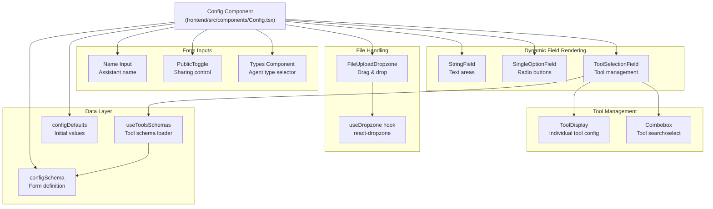

**Sources:** [frontend/src/components/Config.tsx:1-752]()

---

## Schema-Driven Form Generation

The Configuration Interface uses a schema-driven approach where the backend provides JSON schemas that define available configuration options. The `Config` component receives three key schema-related props:

| Prop | Type | Purpose |
|------|------|---------|
| `configSchema` | `Schemas["configSchema"]` | Defines structure, types, and constraints for all configuration fields |
| `configDefaults` | `Schemas["configDefaults"]` | Provides default values for new assistants |
| `config` | `ConfigInterface \| null` | Current assistant configuration (for editing) or null (for creation) |

The schema follows a hierarchical structure with conditional fields based on the selected agent type:

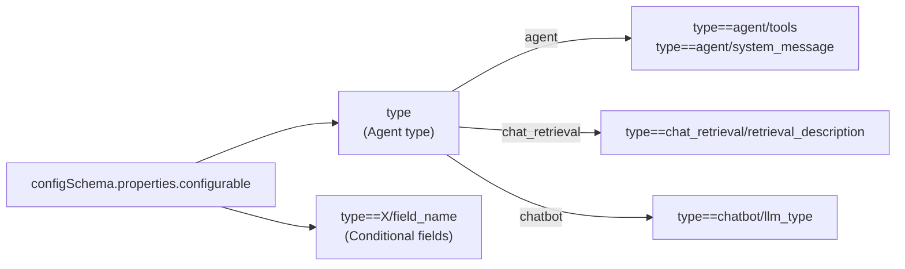

**Conditional Field Pattern:** Fields with keys like `"type==agent/tools"` only render when `values.configurable.type === "agent"`. This pattern is implemented in [frontend/src/components/Config.tsx:663-670]().

**Sources:** [frontend/src/components/Config.tsx:503-514](), [frontend/src/components/Config.tsx:656-670](), [frontend/src/hooks/useSchemas.ts]()

---

## Assistant Naming and Visibility Controls

### Name Input and Save Button

The interface provides a text input for naming the assistant and a save button, which are only rendered in edit mode ([frontend/src/components/Config.tsx:566-589]()):

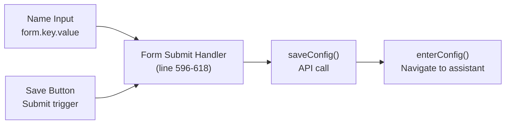

The save button displays "Saving..." while the `inflight` state is true, preventing duplicate submissions.

### Public Sharing Toggle

The `PublicToggle` component ([frontend/src/components/Config.tsx:445-473]()) allows users to mark assistants as public, enabling sharing via a copyable link:

| Component | Visibility | Functionality |
|-----------|-----------|---------------|
| `PublicToggle` | Edit mode only | Switch to set `isPublic` state |
| `PublicLink` | Read-only mode with `config.public === true` | Copy button + hyperlink display |

When an assistant is public, the `PublicLink` component ([frontend/src/components/Config.tsx:415-443]()) renders a copy-to-clipboard button and displays the current URL.

**Sources:** [frontend/src/components/Config.tsx:445-473](), [frontend/src/components/Config.tsx:415-443](), [frontend/src/components/Config.tsx:566-592]()

---

## Agent Type Selection

The `Types` component ([frontend/src/components/Config.tsx:27-88]()) renders a tabbed interface for selecting the agent type. On desktop, it displays as horizontal tabs; on mobile, it renders as a dropdown select:

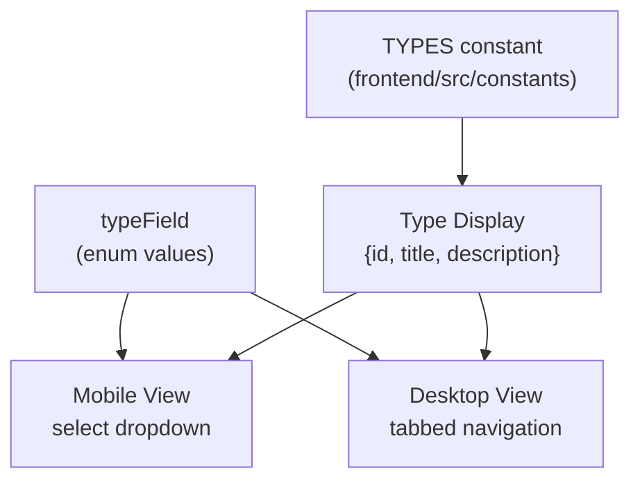

Each agent type from `TYPES` includes:
- `id`: The enum value (e.g., "agent", "chatbot", "chat_retrieval")
- `title`: Display name shown in the UI
- `description`: Explanatory text rendered below the type selector ([frontend/src/components/Config.tsx:635-640]())
- `files`: Boolean indicating if file upload is supported for this type

**Type Selection Flow:**
1. User clicks a tab or selects from dropdown
2. `setValue(option.id)` updates `values.configurable.type` ([frontend/src/components/Config.tsx:625-630]())
3. Conditional fields re-render based on new type
4. Form fields specific to the selected type become visible

**Sources:** [frontend/src/components/Config.tsx:27-88](), [frontend/src/components/Config.tsx:516-521](), [frontend/src/constants]()

---

## Dynamic Configuration Fields

The interface renders different field types based on the schema definition. Field rendering logic is implemented in [frontend/src/components/Config.tsx:656-748]():

### Field Rendering Order

Fields are rendered in a specific order defined by the `ORDER` constant ([frontend/src/components/Config.tsx:479-486]()):

```typescript
const ORDER = [
  "system_message",
  "retrieval_description", 
  "interrupt_before_action",
  "tools",
  "llm_type",
  "agent_type",
]
```

Fields are sorted using `orderBy()` with this array to ensure consistent presentation.

### String Fields

`StringField` ([frontend/src/components/Config.tsx:106-133]()) renders multi-line text areas for string configuration values:

- **Used for:** System messages, retrieval descriptions, custom prompts
- **Features:** 4-row textarea, read-only mode support, placeholder text from schema description
- **Update mechanism:** `onChange` event updates local state via `setValue()`

### Enum Fields (Radio Buttons)

`SingleOptionField` ([frontend/src/components/Config.tsx:135-176]()) renders enum values as radio button groups:

- **Used for:** LLM type selection, agent type selection, binary choices
- **Rendering:** Options sorted alphabetically using `orderBy(props.field.enum)`
- **Special handling:** Boolean fields converted to "Yes"/"No" radio buttons ([frontend/src/components/Config.tsx:711-734]())

### Field Visibility Logic

Field visibility is controlled by two mechanisms:

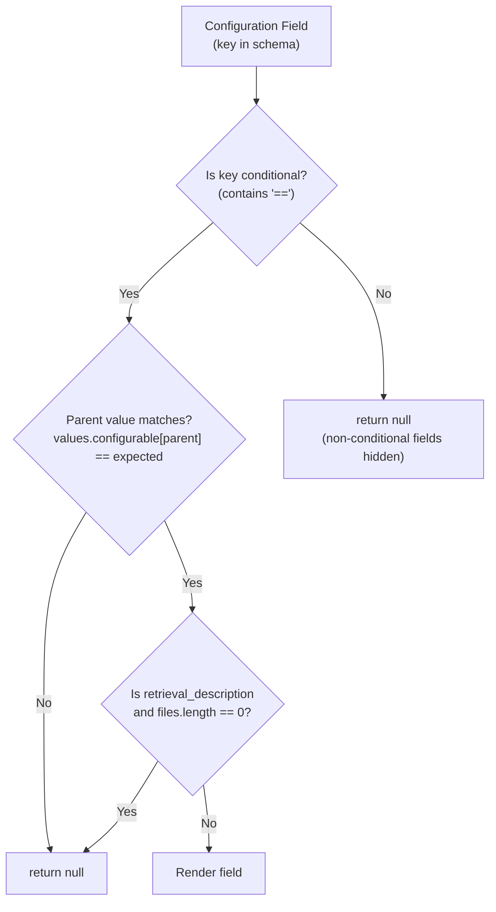

**Sources:** [frontend/src/components/Config.tsx:106-176](), [frontend/src/components/Config.tsx:656-748](), [frontend/src/components/Config.tsx:479-486]()

---

## Tool Selection and Configuration System

### Tool Selection Architecture

The `ToolSelectionField` component ([frontend/src/components/Config.tsx:261-413]()) provides a searchable interface for adding and configuring tools:

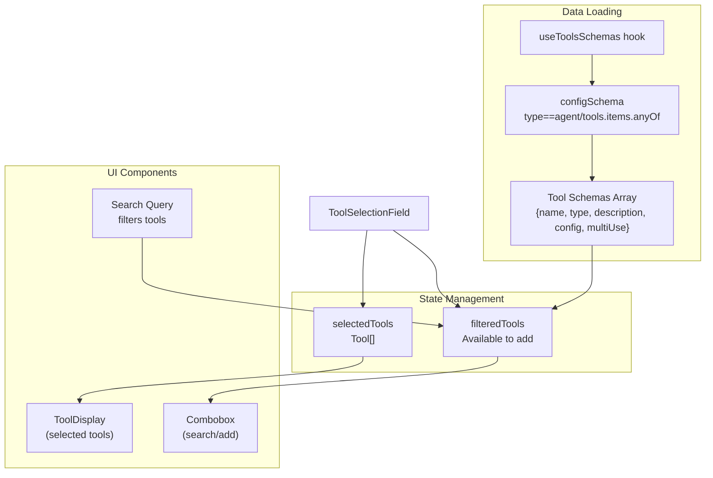

### Tool Schema Processing

Tool schemas are extracted from the configuration schema by `useToolsSchemas` ([frontend/src/hooks/useToolsSchemas.ts:29-65]()):

**Schema Path:** `configSchema.properties.configurable.properties["type==agent/tools"].items.anyOf[]`

Each tool schema in the array contains:

```typescript
interface ToolSchema {
  name: string;           // Tool display name (from properties.name.const)
  type: string;           // Tool type identifier (from properties.type.default)
  description: string;    // Tool description (from properties.description.const)
  multiUse: boolean;      // Can be added multiple times (from properties.multi_use.const)
  config: ToolConfigSchema; // Configuration parameters (from properties.config)
}
```

### Tool Instance Data Model

When a tool is added, it is converted to a `Tool` instance ([frontend/src/utils/formTypes.ts:6-12]()):

```typescript
interface Tool {
  id: string;          // UUID (or "retrieval" for special retrieval tool)
  type: string;        // From ToolSchema.type
  name: string;        // From ToolSchema.name
  description: string; // From ToolSchema.description
  config: ToolConfig;  // Initialized with defaults from schema
}
```

### Tool Addition Flow

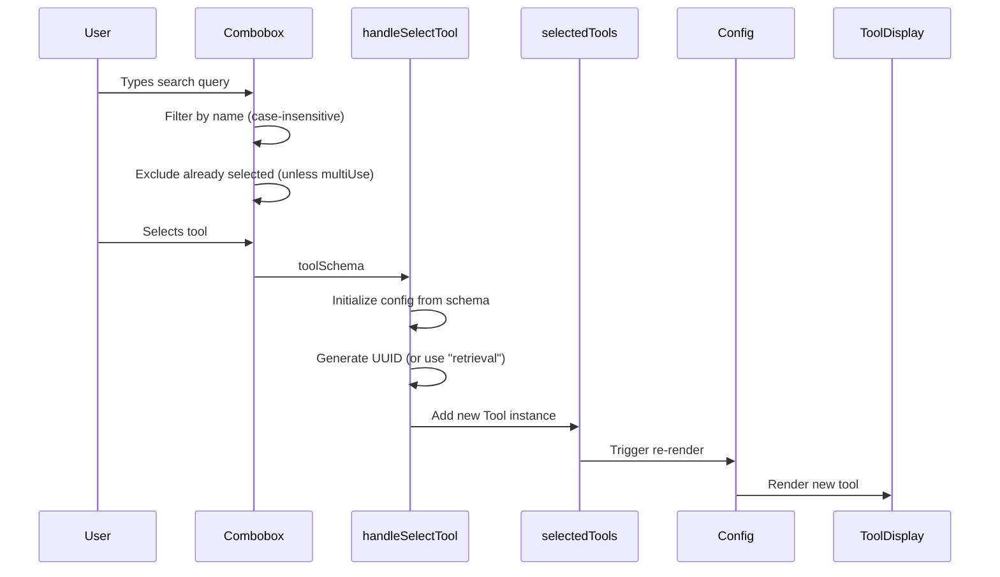

**Key Logic:**
- Config initialization ([frontend/src/components/Config.tsx:281-287]()): Each property in `toolSchema.config.properties` is initialized with its `default` value or empty string
- Retrieval tool special handling ([frontend/src/components/Config.tsx:291]()): Uses fixed id `"retrieval"` instead of UUID
- Query clearing ([frontend/src/components/Config.tsx:299]()): Search query resets after selection

### Tool Display and Configuration

The `ToolDisplay` component ([frontend/src/components/Config.tsx:178-259]()) renders each selected tool with:

1. **Expandable Disclosure Panel:**
   - Collapse/expand button if tool has config properties ([frontend/src/components/Config.tsx:196-203]())
   - Rocket icon for tools without config ([frontend/src/components/Config.tsx:204-208]())
   - Default open state in edit mode ([frontend/src/components/Config.tsx:191]())

2. **Tool Metadata:**
   - Name label ([frontend/src/components/Config.tsx:210]())
   - Markdown-rendered description ([frontend/src/components/Config.tsx:211-218]())

3. **Configuration Inputs:**
   - Text input for each config property ([frontend/src/components/Config.tsx:233-251]())
   - Property name as label
   - `onChange` handler updates tool config via `onUpdateToolConfig` callback

4. **Remove Button:**
   - Trash icon button ([frontend/src/components/Config.tsx:220-229]())
   - Hidden in read-only mode
   - Retrieval tool cannot be removed (read-only) ([frontend/src/components/Config.tsx:354]())

### Retrieval Tool Auto-Management

The retrieval tool has special behavior tied to file uploads ([frontend/src/components/Config.tsx:304-320]()):

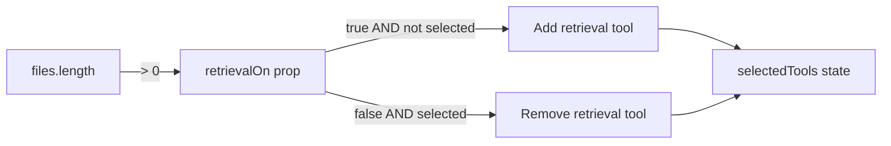

This `useEffect` ensures that:
- When files are present, retrieval tool is automatically added if not already selected
- When all files are removed, retrieval tool is automatically removed
- The id `"retrieval"` is used as a constant identifier for this tool

**Sources:** [frontend/src/components/Config.tsx:261-413](), [frontend/src/components/Config.tsx:178-259](), [frontend/src/hooks/useToolsSchemas.ts:29-65](), [frontend/src/utils/formTypes.ts:6-16]()

---

## File Upload Integration

### Dropzone Configuration

File uploads use the `react-dropzone` library with configuration defined in `DROPZONE_CONFIG` constant ([frontend/src/constants]()). The interface integrates file handling through:

1. **Dropzone State Management** ([frontend/src/components/Config.tsx:522]()):
   ```typescript
   const dropzone = useDropzone(DROPZONE_CONFIG);
   ```

2. **File State Synchronization** ([frontend/src/components/Config.tsx:554-562]()):
   - Monitors `dropzone.acceptedFiles` for changes
   - Merges new files with existing files (deduplicates by `fileId`)
   - `fileId` computed as `${file.name}-${file.size}-${file.lastModified}` ([frontend/src/components/Config.tsx:475-477]())

3. **Conditional Rendering** ([frontend/src/components/Config.tsx:642-649]()):
   - Only shown when creating new assistant (`!props.config`)
   - Only shown for agent types with `typeSpec.files === true`

### File Upload Component

The `FileUploadDropzone` component renders:
- Drag-and-drop zone for file selection
- List of selected files with remove buttons
- File metadata display (name, size)

### Integration with Retrieval

Files uploaded through this interface are:

1. **Sent to backend** during form submission ([frontend/src/components/Config.tsx:609-615]()):
   ```typescript
   const assistantId = await props.saveConfig(
     key,
     vals!,
     files,  // Files array passed here
     isPublic,
     props.config?.assistant_id,
   );
   ```

2. **Processed by `/ingest` endpoint** (see [File Upload and Vector Storage](#2.4))

3. **Trigger automatic retrieval tool addition** (as described in previous section)

4. **Enable retrieval_description field** ([frontend/src/components/Config.tsx:671-676]()): This field only renders when `files.length > 0`

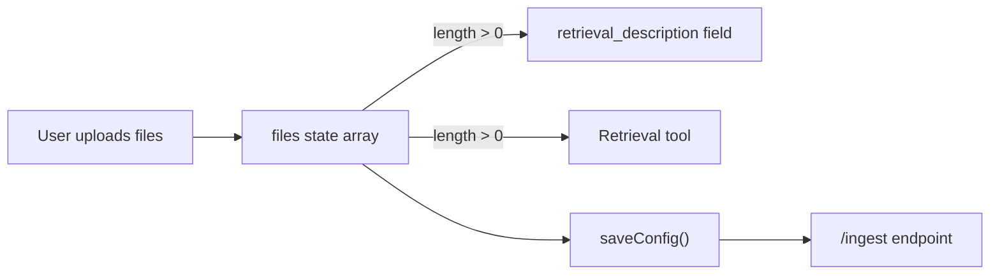

**Sources:** [frontend/src/components/Config.tsx:554-562](), [frontend/src/components/Config.tsx:642-649](), [frontend/src/components/Config.tsx:671-676](), [frontend/src/components/FileUpload.tsx]()

---

## Form Submission and State Management

### State Initialization and Updates

The component maintains configuration state through several `useState` and `useEffect` hooks:

| State Variable | Type | Purpose |
|----------------|------|---------|
| `values` | `ConfigInterface["config"]` | Current form field values |
| `selectedTools` | `Tool[]` | Selected tools with their configurations |
| `files` | `File[]` | Uploaded files awaiting submission |
| `isPublic` | `boolean` | Public sharing toggle state |
| `inflight` | `boolean` | Submission in progress indicator |

**State Initialization Pattern** ([frontend/src/components/Config.tsx:512-514](), [frontend/src/components/Config.tsx:551-553]()):
```typescript
const [values, setValues] = useState(
  assignDefaults(props.config?.config, props.configDefaults)
);

useEffect(() => {
  setValues(assignDefaults(props.config?.config, props.configDefaults));
}, [props.config, props.configDefaults]);
```

The `assignDefaults` function ([frontend/src/components/Config.tsx:488-501]()) merges provided config with defaults to ensure all required fields have values.

### Tools State Synchronization

Tools are synchronized between the schema-based config and the component state ([frontend/src/components/Config.tsx:525-532]()):

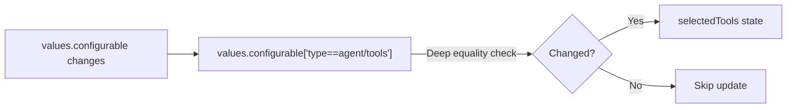

This prevents unnecessary re-renders while ensuring state stays synchronized.

### Form Submission Flow

The form submission handler ([frontend/src/components/Config.tsx:596-618]()) performs the following operations:

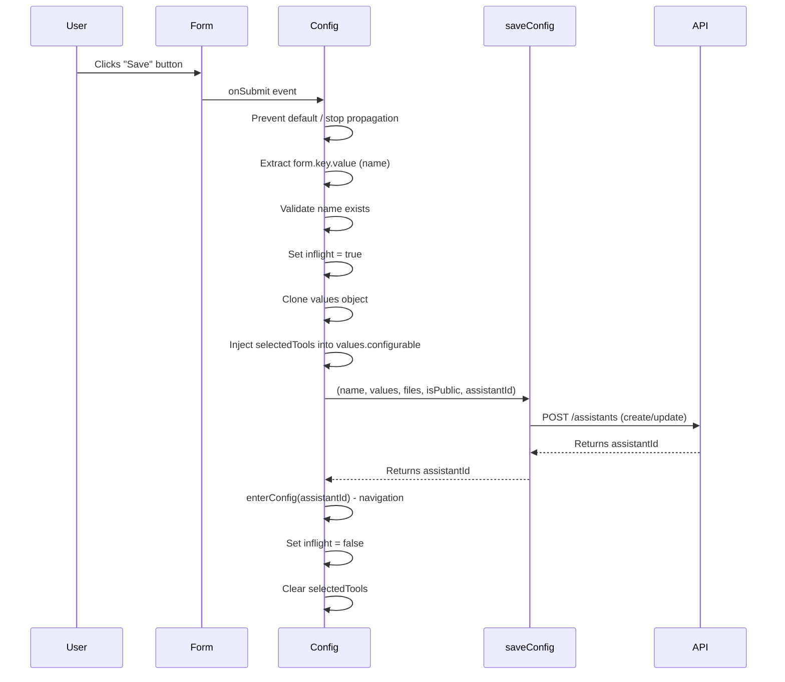

**Key Operations:**

1. **Name Validation** ([frontend/src/components/Config.tsx:600-601]()): Form cannot submit without a name
2. **State Cloning** ([frontend/src/components/Config.tsx:603-607]()): Deep clone prevents mutation of original state
3. **Tools Injection** ([frontend/src/components/Config.tsx:606]()): Selected tools array is inserted into `values.configurable["type==agent/tools"]`
4. **API Call** ([frontend/src/components/Config.tsx:609-615]()): `saveConfig` handles the HTTP request and file upload
5. **Navigation** ([frontend/src/components/Config.tsx:616]()): `enterConfig` navigates to the newly created/updated assistant

### Read-Only Mode

The interface supports a read-only viewing mode ([frontend/src/components/Config.tsx:564]()):

```typescript
const readonly = !!props.config && !props.edit && !inflight;
```

In read-only mode:
- All form inputs are disabled ([frontend/src/components/Config.tsx:127-128](), [frontend/src/components/Config.tsx:161](), etc.)
- Save controls are replaced with public link display ([frontend/src/components/Config.tsx:590-592]())
- Tool removal buttons are hidden ([frontend/src/components/Config.tsx:220-229]())
- Entire form area has reduced opacity ([frontend/src/components/Config.tsx:650-654]())

**Sources:** [frontend/src/components/Config.tsx:488-501](), [frontend/src/components/Config.tsx:512-532](), [frontend/src/components/Config.tsx:564-618]()

---

## Schema Simplification Pipeline

Before the configuration schema reaches the `Config` component, it undergoes processing through the `simplifySchema` utility ([frontend/src/utils/simplifySchema.ts:6-25]()):

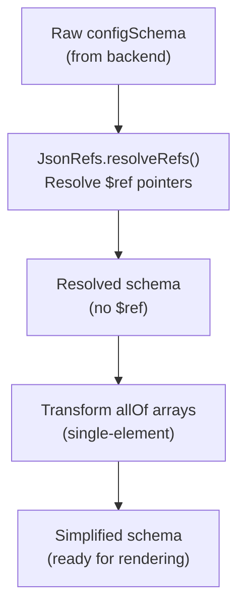

**Purpose:** The jsonforms library (originally considered for this project) doesn't support root `$ref` or certain `allOf` patterns. The simplification process:

1. **Resolves References** ([frontend/src/utils/simplifySchema.ts:7-8]()): Uses `JsonRefs.resolveRefs()` to inline all `$ref` pointers
2. **Flattens Single-Element `allOf`** ([frontend/src/utils/simplifySchema.ts:10-21]()): If a property has `allOf` with one element, merges that element's properties with the parent, preserving `title`, `description`, and `default`

This transformation ensures the schema has a flat, predictable structure that the dynamic field rendering logic can traverse reliably.

**Sources:** [frontend/src/utils/simplifySchema.ts:6-25](), [frontend/src/utils/json-refs.ts]()

---

## Integration with Backend Configuration System

### Configuration Persistence

The Configuration Interface integrates with the backend storage layer through the `saveConfig` function passed as a prop:

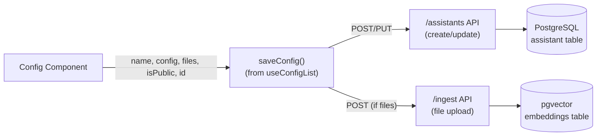

### Configuration Structure Mapping

The form data maps to backend configuration structures:

| Frontend Field Path | Backend Field | Agent Type |
|---------------------|---------------|------------|
| `values.configurable.type` | Top-level agent type routing | All |
| `values.configurable["type==agent/system_message"]` | `ConfigurableAgent` system prompt | agent |
| `values.configurable["type==agent/tools"]` | `ConfigurableAgent` tools list | agent |
| `values.configurable["type==chatbot/llm_type"]` | `ConfigurableChatBot` LLM selection | chatbot |
| `values.configurable["type==chat_retrieval/retrieval_description"]` | `ConfigurableRetrieval` instructions | chat_retrieval |

### Schema Source

The configuration schemas rendered by this interface are generated by the backend's configurable objects:

- `ConfigurableAgent` ([backend/app/agent.py]()) defines the `type==agent/*` fields
- `ConfigurableChatBot` ([backend/app/chatbot.py]()) defines the `type==chatbot/*` fields  
- `ConfigurableRetrieval` ([backend/app/retrieval.py]()) defines the `type==chat_retrieval/*` fields

These objects use LangChain's `RunnableBinding` with `ConfigurableField` and `ConfigurableFieldMultiOption` to declare their schemas, which are automatically exposed via the `/config_schema` endpoint.

**Sources:** [frontend/src/components/Config.tsx:596-618](), [backend/app/agent.py](), [backend/app/chatbot.py](), [backend/app/retrieval.py]()

---

