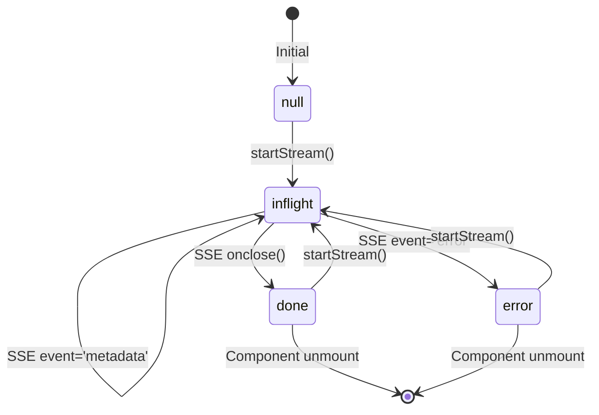
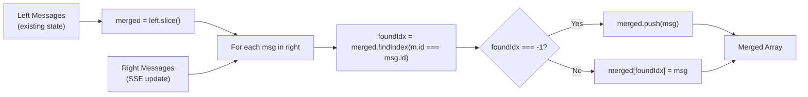
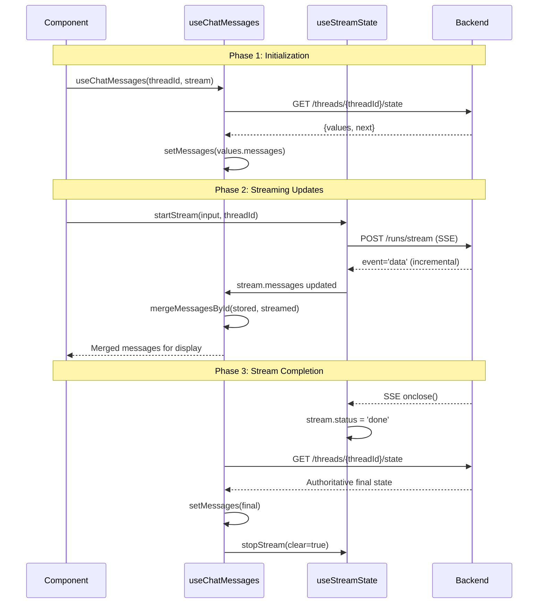
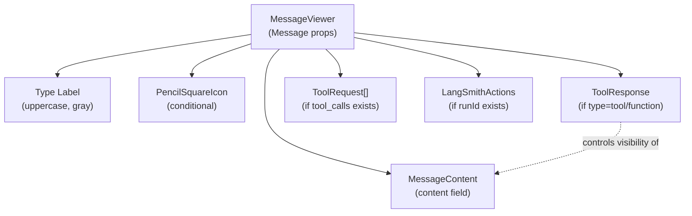
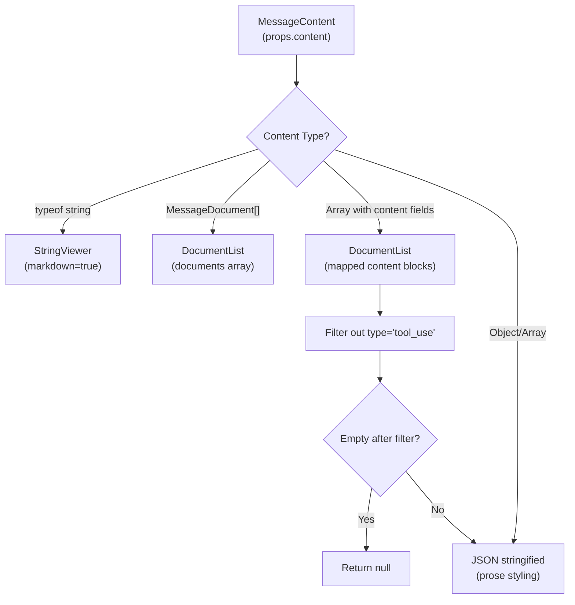
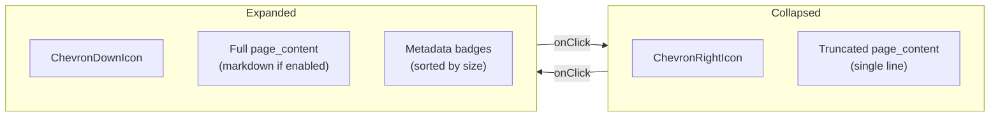
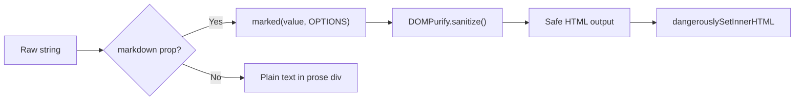
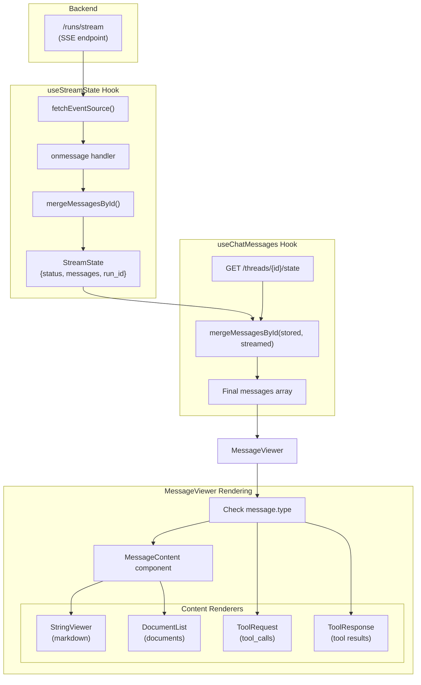

<!-- source: DeepWiki mcp.deepwiki.com · repo langchain-ai/opengpts · page 3.3 Chat and Messaging · fetched 2026-10-26 -->

# Chat and Messaging

Relevant source files

The following files were used as context for generating this wiki page:

- [frontend/src/components/Document.tsx](frontend/src/components/Document.tsx)
- [frontend/src/components/FileUpload.tsx](frontend/src/components/FileUpload.tsx)
- [frontend/src/components/Message.tsx](frontend/src/components/Message.tsx)
- [frontend/src/components/String.tsx](frontend/src/components/String.tsx)
- [frontend/src/hooks/useChatMessages.ts](frontend/src/hooks/useChatMessages.ts)
- [frontend/src/hooks/useStreamState.tsx](frontend/src/hooks/useStreamState.tsx)
- [frontend/src/types.ts](frontend/src/types.ts)

This page covers the frontend message display and streaming system in OpenGPTs. It documents how messages flow from the backend SSE stream to the UI, how different message types are rendered, and the components responsible for displaying text, documents, and tool calls. For backend streaming implementation, see [2.6](#2.6). For the overall state management architecture, see [3.4](#3.4).

## Message Data Structures

The messaging system uses three primary TypeScript interfaces to represent different aspects of messages:

| Type | Purpose | Key Fields |
|------|---------|------------|
| `Message` | Core message structure | `id`, `type`, `content`, `tool_calls`, `name` |
| `ToolCall` | Tool invocation metadata | `id`, `name`, `args` |
| `MessageDocument` | Document/retrieval results | `page_content`, `metadata` |

The `Message.content` field supports three distinct formats:
- **String**: Plain text or markdown content from LLM responses
- **MessageDocument[]**: Array of retrieved documents from RAG queries
- **Object**: Complex structured data (e.g., Anthropic's content blocks)

The `Message.type` field determines rendering behavior and includes values like `"human"`, `"ai"`, `"tool"`, `"function"`, and `"system"`.

**Sources:** [frontend/src/types.ts:1-29]()

---

## Streaming Architecture

### useStreamState Hook

The `useStreamState` hook manages the SSE connection to the backend and maintains real-time streaming state. It exposes three values:

| Property | Type | Purpose |
|----------|------|---------|
| `stream` | `StreamState \| null` | Current stream status and messages |
| `startStream` | Function | Initiates SSE connection to `/runs/stream` |
| `stopStream` | Function | Aborts connection and finalizes state |

**Diagram: StreamState Lifecycle**

The hook processes three SSE event types:

1. **`event='data'`**: Contains incremental message updates. The hook calls `mergeMessagesById()` to merge new messages with existing state [frontend/src/hooks/useStreamState.tsx:42-49]()
2. **`event='metadata'`**: Provides the `run_id` for LangSmith tracing [frontend/src/hooks/useStreamState.tsx:50-56]()
3. **`event='error'`**: Signals backend execution failure [frontend/src/hooks/useStreamState.tsx:57-63]()

The `mergeMessagesById()` function implements the merging strategy:

**Diagram: Message Merging Algorithm in mergeMessagesById()**

This ensures that messages with matching `id` fields are replaced (updated), while new messages are appended.

**Sources:** [frontend/src/hooks/useStreamState.tsx:1-132]()

---

## Message Fetching and Two-Phase State Management

### useChatMessages Hook

The `useChatMessages` hook implements a two-phase state strategy that combines streaming updates with authoritative backend state fetches:

**Diagram: Two-Phase Message State Management Flow**

The hook uses `usePrevious()` to detect stream completion and triggers a final state fetch [frontend/src/hooks/useChatMessages.ts:51-68](). This ensures consistency between streamed intermediate results and the final backend state.

The `next` array indicates which nodes in the LangGraph are pending execution, enabling the frontend to show "waiting for approval" states for human-in-the-loop workflows.

**Sources:** [frontend/src/hooks/useChatMessages.ts:1-79]()

---

## Message Display System

### MessageViewer Component

The `MessageViewer` component is the primary message rendering container. It handles five message types with distinct visual treatments:

| Message Type | Display Behavior | Component |
|--------------|------------------|-----------|
| `"human"` | User input with edit button | `MessageContent` |
| `"ai"` | LLM response with markdown | `MessageContent` |
| `"tool"` / `"function"` | Collapsible tool result | `ToolResponse` + `MessageContent` |
| `"tool_calls"` | Tool invocation request | `ToolRequest` (from `tool_calls` array) |

**Diagram: MessageViewer Component Structure**

The component implements collapsible tool results through the `open` state [frontend/src/components/Message.tsx:71-78](). Document-type tool results are always expanded (`contentIsDocuments` check), while JSON/text results can be toggled.

**Sources:** [frontend/src/components/Message.tsx:64-124]()

---

### MessageContent Component

The `MessageContent` component routes different content types to specialized renderers:

**Diagram: MessageContent Rendering Decision Tree**

The `isDocumentContent()` type guard checks for the `MessageDocument` structure [frontend/src/components/Message.tsx:12-19](), while the second array check handles Anthropic's content block format [frontend/src/components/Message.tsx:29-43]().

Empty content (whitespace-only strings or empty objects) returns `null` to avoid rendering blank message boxes [frontend/src/components/Message.tsx:22-25](), [frontend/src/components/Message.tsx:53-59]().

**Sources:** [frontend/src/components/Message.tsx:12-62]()

---

## Document Display

### DocumentViewer Component

The `DocumentViewer` component renders individual retrieved documents with expandable metadata. It has two states:

**Collapsed State:**
- Shows truncated `page_content` (single line, newlines replaced with spaces)
- `ChevronRightIcon` indicates expandability
- Hover background provides visual feedback

**Expanded State:**
- Full `page_content` with markdown rendering
- `ChevronDownIcon` indicates collapse action
- Metadata displayed as labeled badges below content

**Diagram: DocumentViewer State Transition**

Metadata is sorted by complexity (line count, then character length) to display simpler values first [frontend/src/components/Document.tsx:26-51](). URL values are automatically converted to clickable links using `isValidHttpUrl()` validation [frontend/src/components/Document.tsx:7-17]().

### DocumentList Component

The `DocumentList` wrapper renders multiple documents in a bordered container with dividers. It's used for:
- RAG tool results (from vector search)
- Anthropic content blocks (after mapping)

**Sources:** [frontend/src/components/Document.tsx:1-131]()

---

## Tool Call Visualization

Tool interactions are displayed using two specialized components defined in `Tool.tsx` (not provided in files but referenced):

| Component | Purpose | Trigger |
|-----------|---------|---------|
| `ToolRequest` | Shows outbound tool invocation | `message.tool_calls` array |
| `ToolResponse` | Shows inbound tool result header | `message.type === "tool"` |

The `ToolResponse` component includes a collapsible header with the tool name and optional expand/collapse functionality [frontend/src/components/Message.tsx:104-110](). When `contentIsDocuments` is true, the toggle is disabled since documents are always expanded.

Each `ToolCall` in the `tool_calls` array is rendered as a separate `ToolRequest` [frontend/src/components/Message.tsx:111-113](), showing the tool name and arguments.

**Sources:** [frontend/src/components/Message.tsx:104-113]()

---

## Markdown Rendering

### StringViewer Component

The `StringViewer` component provides secure markdown-to-HTML rendering using two libraries:

| Library | Purpose | Configuration |
|---------|---------|---------------|
| `marked` | Markdown parsing | GFM enabled, line breaks converted to ` ` |
| `DOMPurify` | XSS sanitization | Removes dangerous HTML/JS |

**Diagram: StringViewer Markdown Processing Pipeline**

The `OPTIONS` configuration enables GitHub Flavored Markdown (GFM) and converts single line breaks to ` ` tags [frontend/src/components/String.tsx:5-8](). This ensures code blocks, tables, and other GFM features render correctly.

Both markdown and plain text modes apply the `prose` CSS class from Tailwind Typography for consistent styling.

**Sources:** [frontend/src/components/String.tsx:1-28]()

---

## Complete Message Rendering Flow

The following diagram shows how a message flows from the backend stream through hooks and components to final UI rendering:

**Diagram: End-to-End Message Rendering Pipeline**

Key architectural decisions:

1. **Dual merge points**: Messages are merged once in `useStreamState` (for incremental updates) and again in `useChatMessages` (combining streaming with fetched state)
2. **Type-based routing**: The `message.type` field determines which sub-components render
3. **Content polymorphism**: `MessageContent` inspects the content structure at runtime to choose the appropriate renderer
4. **Collapsible tool results**: Tool messages default to collapsed to reduce visual clutter, except when content is documents

**Sources:** [frontend/src/hooks/useStreamState.tsx:36-82](), [frontend/src/hooks/useChatMessages.ts:70-77](), [frontend/src/components/Message.tsx:64-124](), [frontend/src/components/Message.tsx:21-62]()

---

