<!-- source: DeepWiki mcp.deepwiki.com · repo langchain-ai/opengpts · page 3.4 State Management and API Integration · fetched 2026-10-26 -->

# State Management and API Integration

<details>
<summary>Relevant source files</summary>

The following files were used as context for generating this wiki page:

- [frontend/src/App.tsx](frontend/src/App.tsx)
- [frontend/src/hooks/useChatMessages.ts](frontend/src/hooks/useChatMessages.ts)
- [frontend/src/hooks/useStreamState.tsx](frontend/src/hooks/useStreamState.tsx)

</details>


This document details the state management approach and API integration patterns in the OpenGPTs frontend. It covers the custom React hooks that manage application state, their communication with backend REST and SSE endpoints, and data synchronization strategies. For information about the frontend components that use this state, see page 3.3. For backend API implementation details, see page 2.5.

## Overview

The OpenGPTs frontend utilizes a custom hooks-based state management approach rather than external state management libraries. State hooks encapsulate both local state logic and API communication, providing a clean separation between UI components and backend integration.

**Frontend State Management and API Communication Architecture**

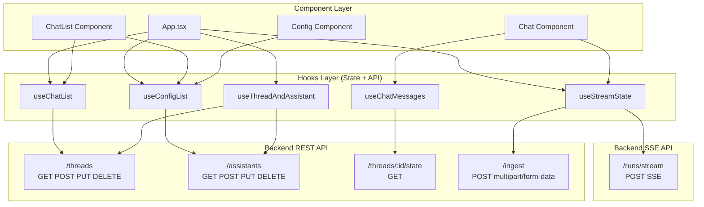

Sources: [frontend/src/App.tsx:1-189](), [frontend/src/hooks/useStreamState.tsx](), [frontend/src/hooks/useChatMessages.ts](), [frontend/src/hooks/useChatList.ts](), [frontend/src/hooks/useConfigList.ts](), [frontend/src/hooks/useThreadAndAssistant.ts]()

## Core State Hooks and API Endpoints

The frontend architecture is built around five primary custom hooks that encapsulate both state management and API communication:

| Hook | Purpose | Backend Endpoints | Request Methods | Response Handling |
|------|---------|------------------|----------------|-------------------|
| `useStreamState` | Real-time streaming responses | `/runs/stream`<br/>`/ingest` | POST (SSE)<br/>POST (multipart) | SSE event processing, AbortController |
| `useChatMessages` | Message history for a thread | `/threads/:id/state` | GET | JSON fetch, merge with stream |
| `useChatList` | CRUD for chat threads | `/threads/` | GET, POST, PUT, DELETE | JSON REST operations |
| `useConfigList` | CRUD for assistant configs | `/assistants/` | GET, POST, PUT, DELETE | JSON + multipart for files |
| `useThreadAndAssistant` | Route-based data fetching | `/threads/:id`<br/>`/assistants/:id` | GET | React Router params → API |

Sources: [frontend/src/hooks/useStreamState.tsx:36-82](), [frontend/src/hooks/useChatMessages.ts:5-12](), [frontend/src/hooks/useChatList.ts](), [frontend/src/hooks/useConfigList.ts](), [frontend/src/hooks/useThreadAndAssistant.ts]()

### Hook Dependencies and Data Flow

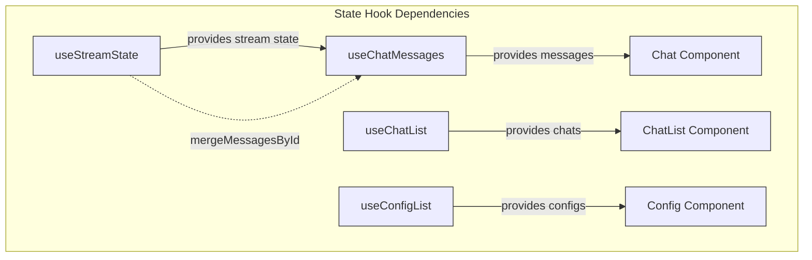

Sources: [frontend/src/hooks/useChatMessages.ts:73](), [frontend/src/hooks/useStreamState.tsx:114-131]()

## Streaming State and SSE Integration

The `useStreamState` hook manages real-time communication with the backend via Server-Sent Events (SSE), coordinating file uploads and stream lifecycle.

### Stream State Structure

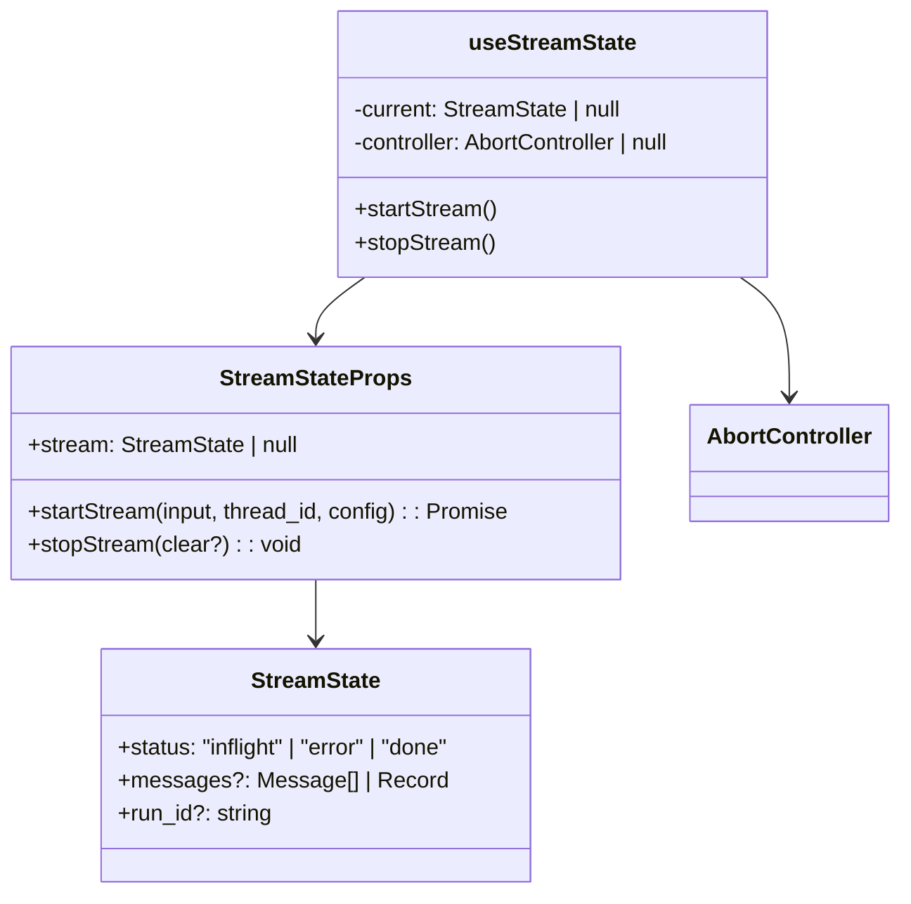

Sources: [frontend/src/hooks/useStreamState.tsx:6-20](), [frontend/src/hooks/useStreamState.tsx:22-24]()

### API Communication Flow

**useStreamState API Integration**

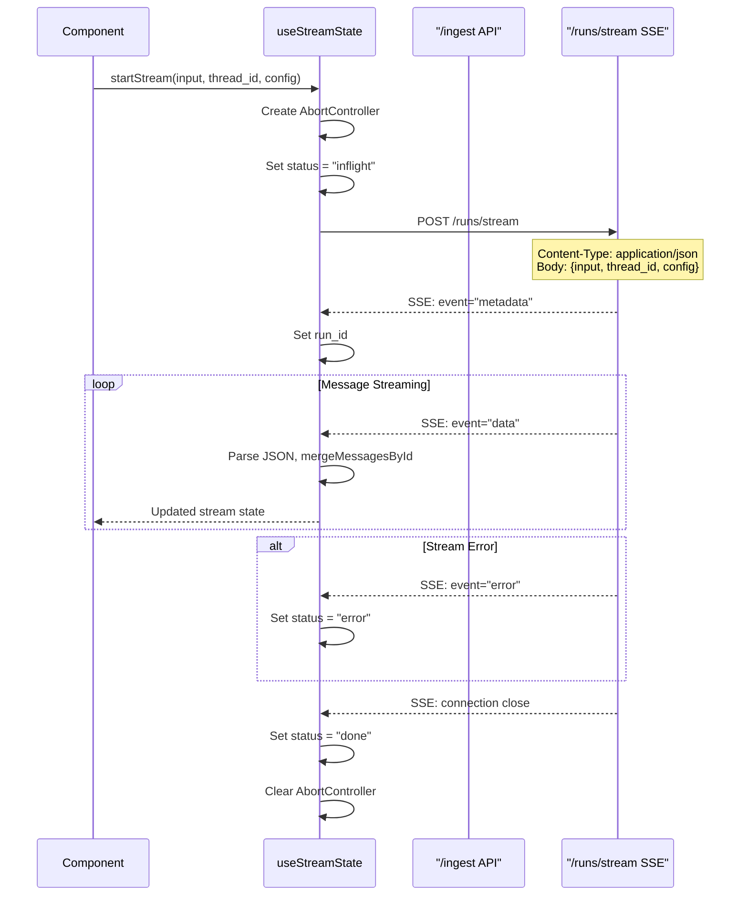

Sources: [frontend/src/hooks/useStreamState.tsx:26-82]()

### SSE Event Processing

The `useStreamState` hook uses `@microsoft/fetch-event-source` to establish an SSE connection to `/runs/stream`. The request payload includes:

```typescript
POST /runs/stream
Content-Type: application/json
{
  input: Message[] | Record<string, any> | null,
  thread_id: string,
  config?: Record<string, unknown>
}
```

**SSE Event Handlers**

| Event Type | JSON Payload | State Update | Purpose |
|------------|-------------|--------------|---------|
| `data` | `{messages: Message[]}` | Merge into `stream.messages` | Incremental message updates |
| `metadata` | `{run_id: string}` | Set `stream.run_id` | Track execution run |
| `error` | (any) | Set `status = "error"` | Mark stream failure |
| connection close | N/A | Set `status = "done"` | Complete stream |

Sources: [frontend/src/hooks/useStreamState.tsx:42-72]()

### Stream Lifecycle and Abort Control

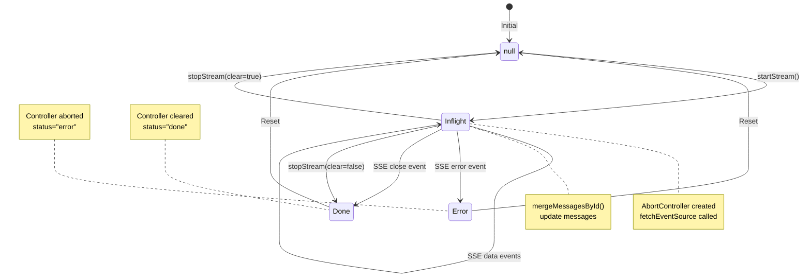

Sources: [frontend/src/hooks/useStreamState.tsx:22-105]()

The `AbortController` enables manual stream cancellation. When `stopStream()` is called, the controller aborts the fetch, triggering the `onclose` handler. The `clear` parameter determines whether to preserve or discard messages.

Sources: [frontend/src/hooks/useStreamState.tsx:87-105]()

### Message Merging

A key utility function in the streaming architecture is `mergeMessagesById`, which combines messages from different sources while preserving uniqueness by ID:

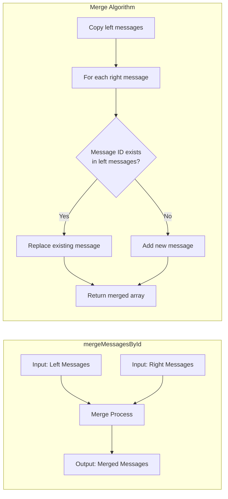

Sources: [frontend/src/hooks/useStreamState.tsx:114-131]()

## Message Synchronization with Backend State

The `useChatMessages` hook implements a two-phase synchronization strategy: real-time streaming updates merged with periodic authoritative state fetches.

### API Integration Pattern

**useChatMessages API Communication**

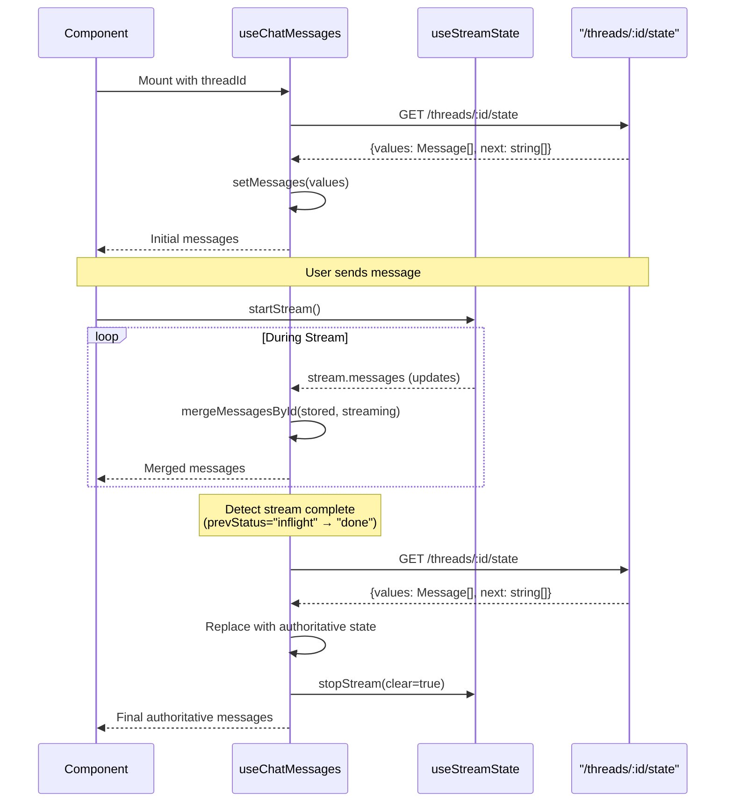

Sources: [frontend/src/hooks/useChatMessages.ts:5-12](), [frontend/src/hooks/useChatMessages.ts:31-68]()

### State API Response Structure

**GET /threads/:id/state Response**

```json
{
  "values": [
    {
      "id": "message-uuid",
      "type": "human" | "ai" | "tool",
      "content": "string",
      "additional_kwargs": {},
      ...
    }
  ],
  "next": ["node_name_1", "node_name_2"]
}
```

The `values` field can be either a flat `Message[]` array or an object with a `messages` property, depending on the assistant type. The `next` array indicates which LangGraph nodes can execute next (used for interrupts).

Sources: [frontend/src/hooks/useChatMessages.ts:5-12](), [frontend/src/hooks/useChatMessages.ts:32-40]()

### Message Merge Logic

The hook uses `mergeMessagesById` to combine stored and streaming messages:

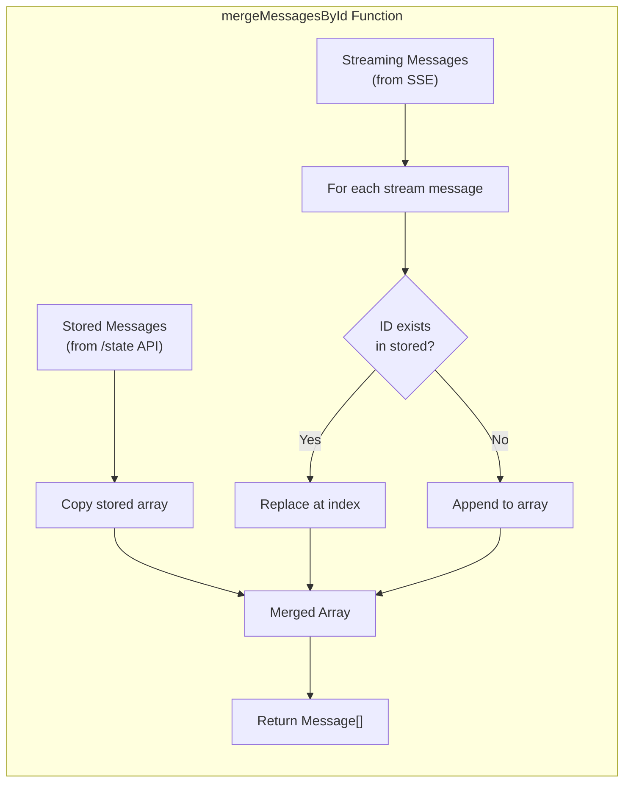

Sources: [frontend/src/hooks/useStreamState.tsx:114-131]()

This ensures streaming updates overwrite stored messages by ID while preserving messages not yet streamed. After stream completion, a fresh fetch provides the authoritative final state.

Sources: [frontend/src/hooks/useChatMessages.ts:51-68](), [frontend/src/hooks/useChatMessages.ts:70-77]()

## Thread Management and REST CRUD

The `useChatList` hook manages the list of chat threads via REST CRUD operations on the `/threads` endpoint.

### REST API Operations

**useChatList REST API Integration**

| Operation | HTTP Method | Endpoint | Request Body | Response | Local State Update |
|-----------|------------|----------|--------------|----------|-------------------|
| Fetch all | GET | `/threads/` | N/A | `Chat[]` | Replace `chats` array |
| Create | POST | `/threads/` | `{name, assistant_id}` | `Chat` | Prepend to `chats` |
| Update | PUT | `/threads/:id` | `{name, assistant_id}` | `Chat` | Replace in `chats` |
| Delete | DELETE | `/threads/:id` | N/A | 204 No Content | Remove from `chats` |

Sources: [frontend/src/hooks/useChatList.ts:31-97]()

### Thread Data Model

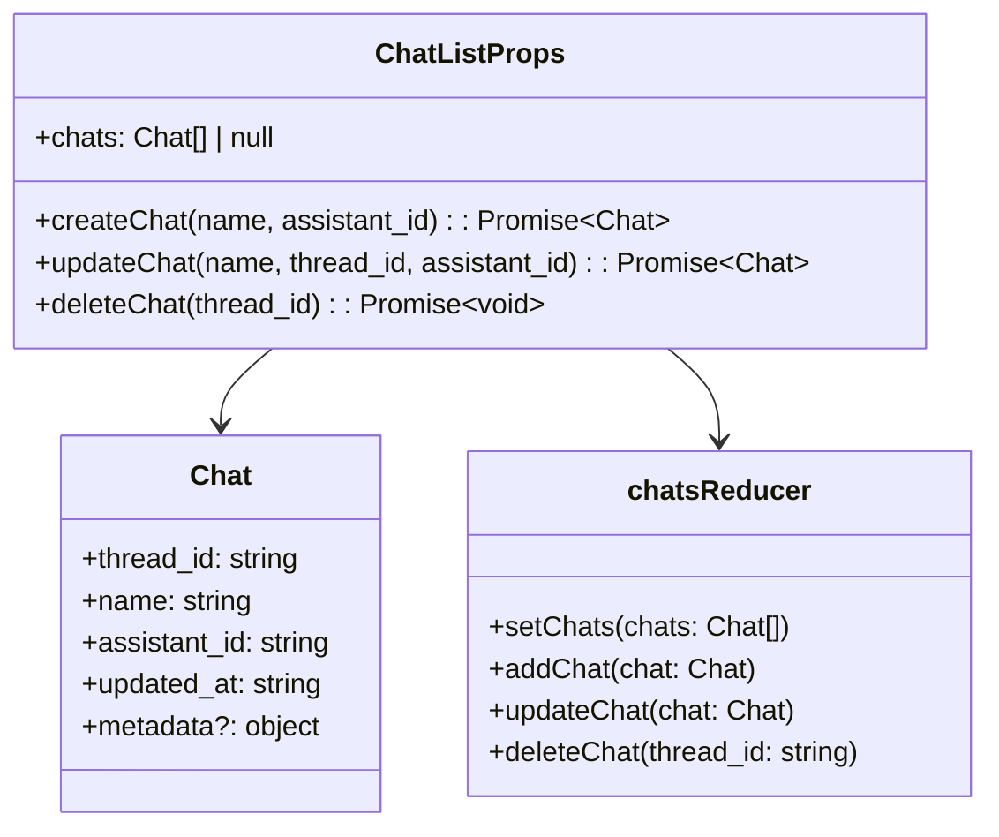

Sources: [frontend/src/hooks/useChatList.ts:1-15](), [frontend/src/hooks/useChatList.ts:16-29]()

The hook uses a reducer pattern to manage state updates. All operations update both the backend via REST API and the local state via reducer dispatch. Chats are automatically sorted by `updated_at` in descending order.

Sources: [frontend/src/hooks/useChatList.ts:31-97]()

## Assistant Configuration and File Upload

The `useConfigList` hook manages assistant configurations with support for multipart file uploads and public sharing.

### REST API Operations with File Support

**useConfigList REST API Integration**

| Operation | HTTP Method | Endpoint | Content-Type | Request Body | Response |
|-----------|------------|----------|--------------|--------------|----------|
| Fetch all | GET | `/assistants/` | application/json | N/A | `Config[]` |
| Create | POST | `/assistants/` | multipart/form-data | `{files, config, public}` | `Config` |
| Update | PUT | `/assistants/:id` | multipart/form-data | `{files, config, public}` | `Config` |
| Delete | DELETE | `/assistants/:id` | application/json | N/A | 204 No Content |

Sources: [frontend/src/hooks/useConfigList.ts:51-124]()

### Configuration Data Model

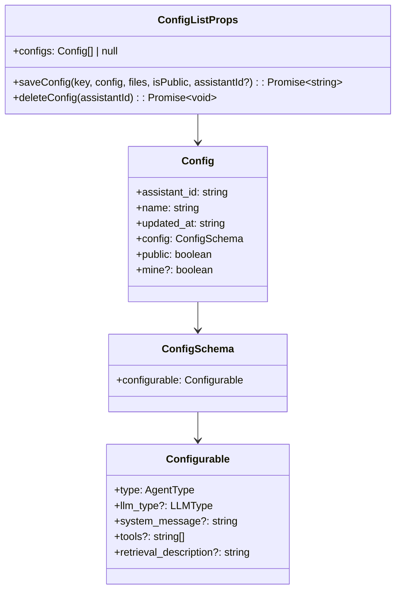

Sources: [frontend/src/hooks/useConfigList.ts:5-23]()

### Multipart File Upload Flow

When saving a configuration with files, the hook constructs a `FormData` object:

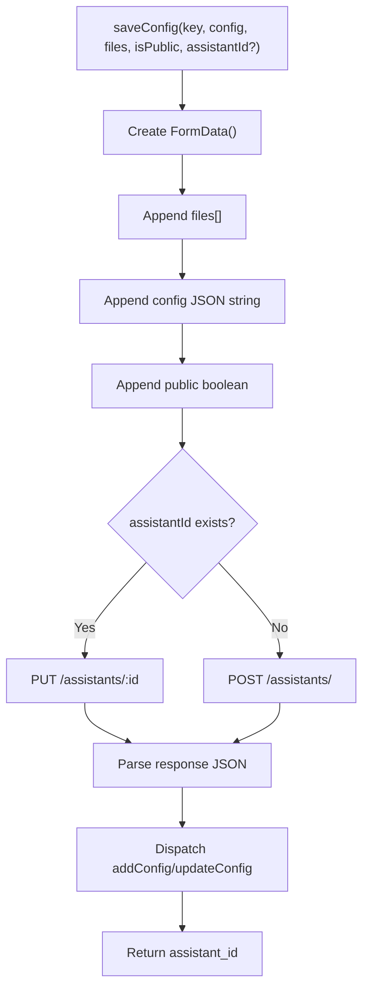

Sources: [frontend/src/hooks/useConfigList.ts:51-124]()

The backend processes the multipart request, stores files via the ingest pipeline, and returns the updated configuration. The hook then updates local state via the reducer.

Sources: [frontend/src/hooks/useConfigList.ts:51-124]()

## Integration with UI Components

The state hooks are integrated into UI components to provide a reactive user experience. For example, the `ChatList` component uses both `useChatList` and `useConfigList` to display a list of chats and their associated assistant configurations.

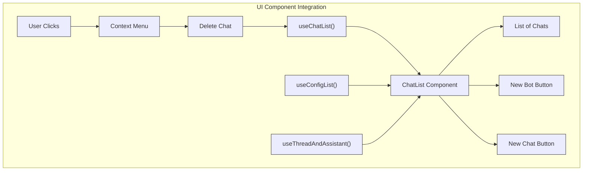

Sources: [frontend/src/components/ChatList.tsx:4-7](), [frontend/src/components/ChatList.tsx:9-15]()

## Conclusion

The state management architecture in OpenGPTs provides a clean, modular approach to managing application state using custom React hooks. Each hook is responsible for a specific domain of the application, with clear interfaces and separation of concerns. This approach enables a responsive user experience while maintaining code maintainability.

The key strengths of this architecture include:

1. **Separation of concerns**: Each hook manages a specific part of the application state
2. **Reactivity**: State updates automatically trigger UI updates
3. **Composability**: Hooks can be composed together to build complex features
4. **API integration**: Hooks handle communication with the backend API

For information on how these state hooks are used in UI components, see [Chat Interface](#3.1) and [Configuration Components](#3.2).