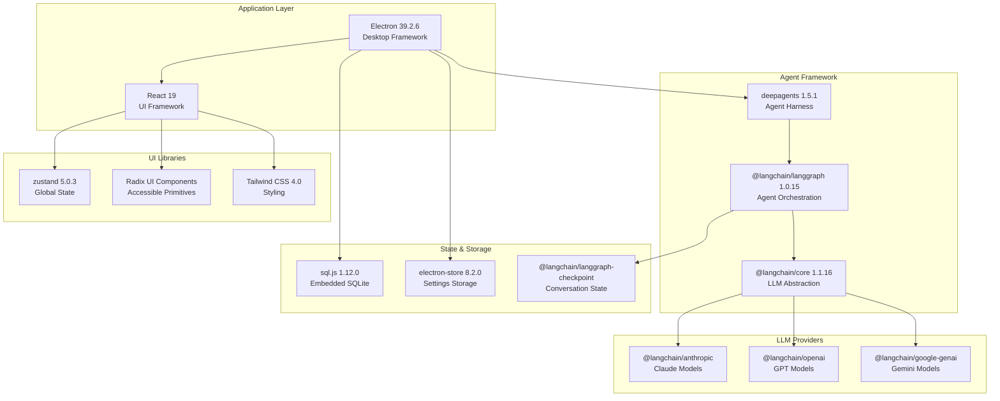
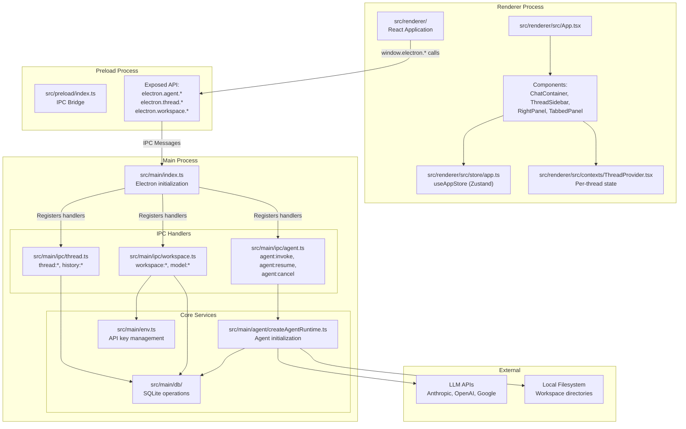
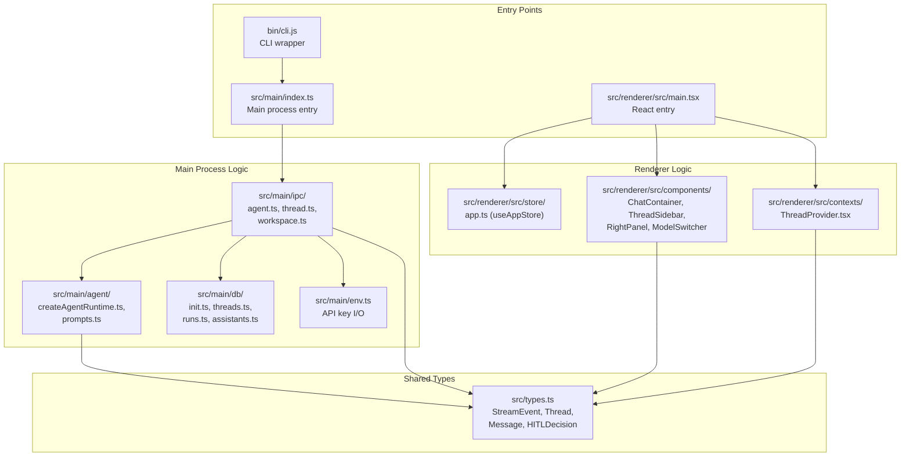
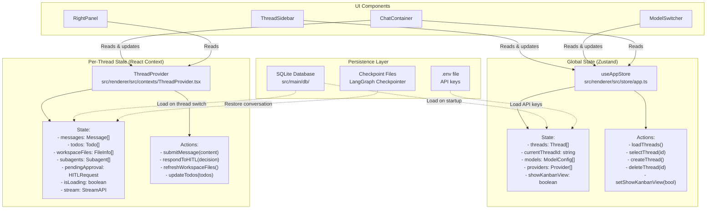
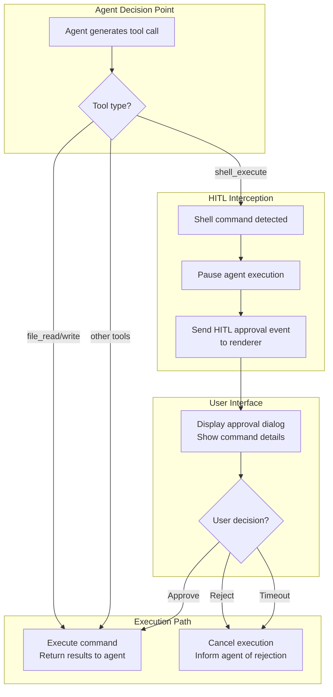
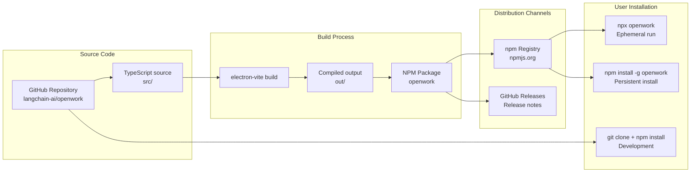

<!-- source: DeepWiki mcp.deepwiki.com · repo langchain-ai/openwork · page 1 Overview · fetched 2026-10-26 -->

# Overview

<details>
<summary>Relevant source files</summary>

The following files were used as context for generating this wiki page:

- [README.md](README.md)
- [package-lock.json](package-lock.json)
- [package.json](package.json)

</details>


## Purpose and Scope

This document provides a comprehensive introduction to the openwork project, explaining its purpose, architecture, and core capabilities. It covers the high-level system design, technology stack, and key components that enable AI agents to interact with filesystems through a desktop interface.

For detailed information about specific subsystems, see:
- Electron process architecture: [Electron Process Model](#2.1)
- Agent execution details: [Agent System](#3)
- UI components: [User Interface](#7)
- Development workflow: [Development and Deployment](#8)

## What is Openwork

Openwork is a desktop interface for [deepagentsjs](https://github.com/langchain-ai/deepagentsjs), providing a tactical environment where AI agents can perform filesystem operations, execute shell commands, and delegate work to subagents. The application gives users direct visibility into agent reasoning through real-time streaming of thoughts, tool calls, and execution results.

**Key characteristics:**
- **Desktop-native**: Built with Electron, runs as a native application on Windows, macOS, and Linux
- **Multi-provider**: Supports Anthropic Claude, OpenAI GPT, and Google Gemini models
- **Safety-first**: Human-in-the-loop approval required for shell commands and file modifications
- **Workspace-oriented**: Each conversation thread operates within a designated filesystem workspace
- **Persistent**: Conversations maintain state across sessions using LangGraph checkpointing

**Distribution**: Openwork is distributed as an npm package and can be run via `npx openwork` or installed globally.

Sources: [package.json:1-109](), [README.md:1-58]()

## Core Capabilities

### Agent Capabilities

| Capability | Description | Safety Mechanism |
|------------|-------------|------------------|
| **Filesystem Planning** | Agents can read, write, and modify files within workspace boundaries | Path validation, HITL approval |
| **Shell Execution** | Execute shell commands for tasks like installing dependencies or running scripts | Mandatory HITL approval |
| **Subagent Delegation** | Spawn child agents to handle subtasks independently | Parent tracks child progress |
| **Multi-turn Reasoning** | Maintain conversation context with checkpointing | Automatic state persistence |
| **Workspace Management** | Associate threads with specific filesystem directories | Per-thread workspace isolation |

### User Capabilities

| Feature | Description |
|---------|-------------|
| **Multi-thread Management** | Create and switch between multiple conversation threads |
| **Real-time Streaming** | View agent reasoning, tool calls, and results as they happen |
| **Task Tracking** | Monitor generated todos and their progress |
| **File Exploration** | Browse workspace files and view changes |
| **Model Switching** | Change LLM provider and model mid-conversation |
| **Kanban View** | Overview of all threads with task progress visualization |

Sources: [README.md:10-16]()

## Technology Stack Overview

### Core Technologies



**Supported Models (as of package.json):**

| Provider | Models Available |
|----------|-----------------|
| **Anthropic** | Claude Opus 4.5, Sonnet 4.5, Haiku 4.5, Opus 4.1, Sonnet 4 |
| **OpenAI** | GPT-5.2, 5.1, o3, o3 Mini, o4 Mini, o1, GPT-4.1, 4o |
| **Google** | Gemini 3 Pro Preview, 3 Flash Preview, 2.5 Pro, 2.5 Flash, 2.5 Flash Lite |

**Build System:**
- `electron-vite` for building Electron applications with Vite
- TypeScript for type safety across all processes
- Separate tsconfigs for Node.js (main/preload) and web (renderer) environments

Sources: [package.json:48-84](), [package.json:85-107](), [README.md:43-47]()

## System Architecture

### Three-Process Model

Openwork follows Electron's security-first architecture with three distinct processes:



**Process Responsibilities:**

| Process | Security Context | Responsibilities | Technology |
|---------|-----------------|------------------|------------|
| **Main** | Full Node.js access | Agent runtime, database, file I/O, IPC handlers | Node.js, TypeScript |
| **Preload** | Context bridge only | Secure IPC interface exposure | Electron contextBridge |
| **Renderer** | Web sandbox | UI rendering, user interaction, state management | React, Zustand |

For detailed information on process isolation and security, see [Electron Process Model](#2.1).

Sources: [src/main/index.ts](), [src/preload/index.ts](), [src/renderer/src/App.tsx]()

## Key Components and Data Flow

### Application File Structure



Sources: [bin/cli.js](), [src/main/index.ts](), [src/renderer/src/main.tsx]()

### Agent Execution Flow

```mermaid
sequenceDiagram
    participant User
    participant ChatContainer["ChatContainer<br/>(renderer)"]
    participant ElectronAPI["window.electron.agent<br/>(preload)"]
    participant AgentHandlers["agent.ts IPC handlers<br/>(main)"]
    participant CreateAgentRuntime["createAgentRuntime()<br/>(main)"]
    participant LLM["LLM Provider API"]
    participant LocalSandbox["LocalSandbox<br/>deepagents"]
    
    User->>ChatContainer: "Submit message"
    ChatContainer->>ElectronAPI: "streamAgent(threadId, message)"
    ElectronAPI->>AgentHandlers: "agent:invoke IPC event"
    
    AgentHandlers->>CreateAgentRuntime: "createAgentRuntime(threadId, workspace, modelId)"
    CreateAgentRuntime->>CreateAgentRuntime: "Load checkpoint for thread"
    CreateAgentRuntime->>CreateAgentRuntime: "Initialize LocalSandbox with workspace"
    CreateAgentRuntime-->>AgentHandlers: "Agent runtime instance"
    
    AgentHandlers->>LLM: "Stream request"
    
    loop "Agent Loop"
        LLM-->>AgentHandlers: "Tool calls"
        AgentHandlers->>LocalSandbox: "Execute tool (file read/write/shell)"
        
        alt "Shell command"
            AgentHandlers->>ChatContainer: "StreamEvent: hitl_approval"
            User->>ChatContainer: "Approve/Reject"
            ChatContainer->>ElectronAPI: "respondHITL(decision)"
            ElectronAPI->>AgentHandlers: "agent:hitl IPC event"
        end
        
        LocalSandbox-->>AgentHandlers: "Tool results"
        AgentHandlers->>ChatContainer: "StreamEvent: tool_result"
        AgentHandlers->>LLM: "Continue with results"
    end
    
    LLM-->>AgentHandlers: "Final response"
    AgentHandlers->>CreateAgentRuntime: "Save checkpoint"
    AgentHandlers->>ChatContainer: "StreamEvent: done"
```

**Key Components:**

1. **`createAgentRuntime()`** [src/main/agent/createAgentRuntime.ts](): Factory function that initializes:
   - LangGraph agent with selected model
   - `LocalSandbox` configured with thread's workspace
   - Checkpoint saver for state persistence
   - System prompt with workspace context

2. **IPC Handlers** [src/main/ipc/agent.ts]():
   - `agent:invoke` - Start new agent run
   - `agent:resume` - Continue interrupted run
   - `agent:cancel` - Abort running agent
   - `agent:hitl` - Process HITL approval/rejection

3. **StreamEvent Types** [src/types.ts]():
   - `human_message` - User input
   - `ai_message` - Agent response
   - `tool_call` - Agent invoking tool
   - `tool_result` - Tool execution result
   - `hitl_approval` - Shell command awaiting approval
   - `subagent_start`/`subagent_end` - Subagent lifecycle
   - `token_usage` - Token consumption tracking

For detailed agent execution pipeline, see [Agent Streaming and Execution Pipeline](#3.2).

Sources: [src/main/agent/createAgentRuntime.ts](), [src/main/ipc/agent.ts](), [src/types.ts]()

## State Management Architecture

### Two-Tier State System



**State Persistence:**

| State Type | Storage Location | Persistence Mechanism | Access Pattern |
|------------|-----------------|----------------------|----------------|
| Thread list | SQLite `threads` table | Auto-save on create/delete | Load once at startup, update on change |
| Thread messages | SQLite `runs` table + checkpoints | Save after each agent turn | Load on thread switch, stream during run |
| API keys | `.env` file in user data directory | Manual save via settings | Load at startup, update on change |
| Workspace path | SQLite `threads.workspace_path` | Save on workspace selection | Load with thread data |
| UI preferences | `electron-store` | Auto-save on change | Load at startup |

For detailed state management patterns, see [State Management Architecture](#2.3).

Sources: [src/renderer/src/store/app.ts](), [src/renderer/src/contexts/ThreadProvider.tsx]()

## Security and Safety Model

### Human-in-the-Loop (HITL) System



**Security Boundaries:**

| Boundary | Mechanism | Enforcement Point |
|----------|-----------|------------------|
| **Process isolation** | Electron's process model | OS-level |
| **Workspace isolation** | Path validation in `LocalSandbox` | [src/main/agent/createAgentRuntime.ts]() |
| **Shell command approval** | HITL interrupt | [src/main/ipc/agent.ts]() |
| **API key protection** | Main process only | [src/main/env.ts]() |
| **IPC context bridge** | Preload script whitelist | [src/preload/index.ts]() |

**Warning from README:**

> openwork gives AI agents direct access to your filesystem and the ability to execute shell commands. Always review tool calls before approving them, and only run in workspaces you trust.

For detailed HITL implementation, see [Human-in-the-Loop (HITL) System](#3.3).

Sources: [README.md:14-15](), [src/main/ipc/agent.ts](), [src/main/agent/createAgentRuntime.ts]()

## Distribution and Installation

### Package Distribution Model



**Installation Methods:**

| Method | Command | Use Case | Electron Handling |
|--------|---------|----------|------------------|
| **npx** | `npx openwork` | One-time run, testing | Auto-downloaded as dependency |
| **Global** | `npm install -g openwork` | Regular use, CLI available | Installed in global node_modules |
| **Source** | `git clone && npm install && npm run dev` | Development, contributing | Dev dependency |

**Binary Entry Point:**
The package defines a CLI entry at [bin/cli.js]() which simply requires the compiled main process entry point [out/main/index.js](). This enables the `openwork` command when installed globally.

**System Requirements:**
- Node.js 18+ [package.json:35-37]()
- Operating System: Windows, macOS, or Linux (via Electron)

For detailed build and release process, see [Build and Release Pipeline](#8.3).

Sources: [package.json:1-14](), [README.md:17-37](), [bin/cli.js]()

## Getting Started

### Quick Start

```bash
# Run immediately without installation
npx openwork

# Or install globally for repeated use
npm install -g openwork
openwork
```

### First-Time Setup

1. **Launch Application**: Run `openwork` command
2. **Configure API Keys**: Click the model switcher and add API keys for desired providers
3. **Create Thread**: Click "New Thread" in the sidebar
4. **Select Workspace**: Choose a directory for the agent to operate in
5. **Start Conversation**: Type a message to begin interacting with the agent

### Development Setup

```bash
# Clone repository
git clone https://github.com/langchain-ai/openwork.git
cd openwork

# Install dependencies
npm install

# Run in development mode with hot reload
npm run dev

# Type checking
npm run typecheck

# Build for production
npm run build
```

For detailed development workflow, see [Project Setup and Configuration](#8.1).

Sources: [README.md:17-37](), [package.json:38-46]()

---

