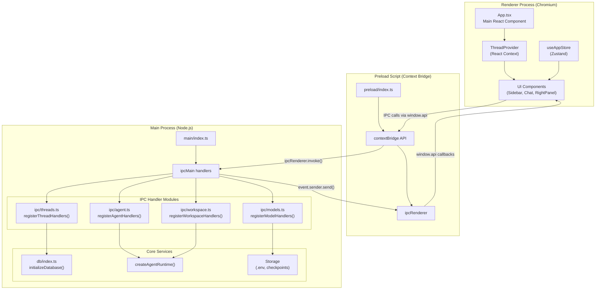
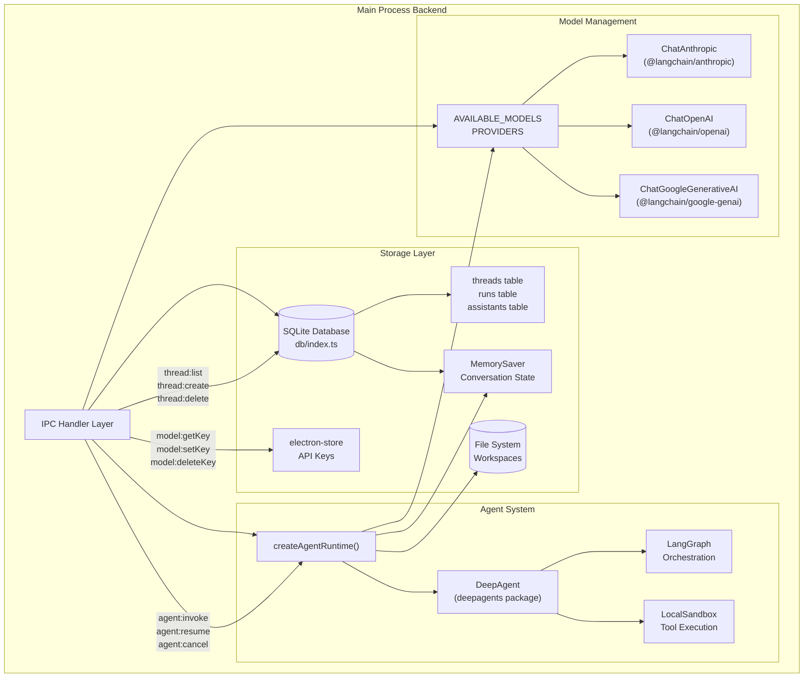
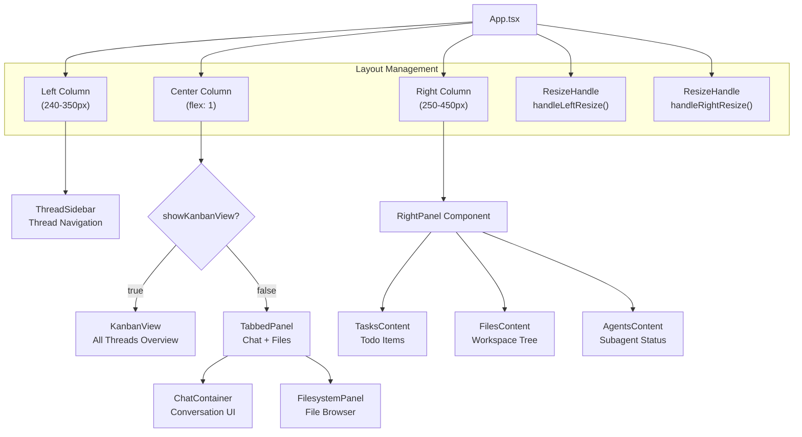

<!-- source: DeepWiki mcp.deepwiki.com · repo langchain-ai/openwork · page 2 Architecture · fetched 2026-10-26 -->

# Architecture

<details>
<summary>Relevant source files</summary>

The following files were used as context for generating this wiki page:

- [bin/cli.js](bin/cli.js)
- [package-lock.json](package-lock.json)
- [package.json](package.json)
- [src/main/index.ts](src/main/index.ts)
- [src/renderer/src/App.tsx](src/renderer/src/App.tsx)

</details>


## Purpose and Scope

This document provides a high-level overview of the openwork system architecture. It explains the overall structure of the application, the primary subsystems, and how they interact to enable AI agent functionality through a desktop interface. 

For detailed information about specific architectural components:
- Process model and security boundaries: see [Electron Process Model](#2.1)
- Inter-process communication mechanisms: see [IPC Communication System](#2.2)  
- Application and thread state management: see [State Management Architecture](#2.3)
- Agent execution and runtime details: see [Agent System](#3)
- User interface structure and components: see [User Interface](#7)

---

## System Overview

openwork is an **Electron-based desktop application** that provides a graphical interface for the `deepagents` library. The application runs as a native desktop process on macOS, Windows, and Linux, packaging a Node.js backend with a React-based frontend into a single executable environment.

The architecture follows Electron's multi-process security model:
- **Main Process**: Node.js environment running the agent runtime, database, and system integrations
- **Preload Script**: Security boundary that exposes controlled IPC channels to the renderer
- **Renderer Process**: Chromium-based web environment running the React UI

The application is distributed as an npm package and launched via a CLI wrapper at [bin/cli.js:1-65]() that spawns the Electron process with [out/main/index.js]() as the entry point.

**Sources**: [package.json:1-109](), [bin/cli.js:1-65](), [src/main/index.ts:1-103]()

---

## Electron Process Architecture



**Three-Process Model**

The application separates concerns across three isolated processes:

| Process | Runtime | Purpose | Entry Point |
|---------|---------|---------|-------------|
| **Main** | Node.js | Backend logic, agent execution, file system access | [src/main/index.ts:1-103]() |
| **Preload** | Node.js (restricted) | Security bridge exposing controlled APIs | [src/preload/index.ts:1-200]() |
| **Renderer** | Chromium (web) | React UI, user interactions | [src/renderer/src/main.tsx:1-20]() |

The main process initializes at [src/main/index.ts:50-96]() by:
1. Creating the `BrowserWindow` with preload script injection
2. Initializing the SQLite database via `initializeDatabase()`
3. Registering IPC handlers for agent, thread, model, and workspace operations
4. Loading the React application into the renderer

The preload script at [src/preload/index.ts:1-200]() exposes a `window.api` object to the renderer via `contextBridge`, providing type-safe access to IPC channels without exposing the full Node.js environment.

**Sources**: [src/main/index.ts:1-103](), [src/preload/index.ts:1-200](), [src/renderer/src/main.tsx:1-20]()

---

## Core Subsystems



**Agent System**

The agent subsystem provides the core AI functionality. The `createAgentRuntime()` function at [src/main/agent/runtime.ts:100-200]() instantiates a `DeepAgent` with:
- **LLM selection**: Based on `modelId` parameter, creates `ChatAnthropic`, `ChatOpenAI`, or `ChatGoogleGenerativeAI`
- **LocalSandbox**: Provides tool execution environment with file system access restricted to the thread's workspace
- **Checkpointer**: `MemorySaver` instance for conversation state persistence
- **System prompt**: `BASE_SYSTEM_PROMPT` with workspace-specific instructions

Agent execution is initiated via the `agent:invoke` IPC channel at [src/main/ipc/agent.ts:50-150](), which creates a streaming response that flows back to the renderer through `agent:stream:{threadId}` events.

**Storage Layer**

Persistent state is managed across three storage mechanisms:

1. **SQLite Database** ([src/main/db/index.ts:1-200]()): Stores thread metadata, run history, and assistant configurations in the `threads`, `runs`, and `assistants` tables
2. **Checkpointer Files**: Conversation state snapshots written by LangGraph's `MemorySaver` to enable resumption
3. **Environment Store** ([src/main/storage/env.ts:1-100]()): API keys stored in a `.env` file using `electron-store`

The database is initialized via `initializeDatabase()` at [src/main/db/index.ts:20-80](), creating tables if they don't exist.

**Model Management**

Multi-provider LLM support is configured through:
- `AVAILABLE_MODELS` array at [src/shared/constants/models.ts:1-100](): Defines all supported models with display names and context limits
- `PROVIDERS` map at [src/shared/constants/models.ts:100-150](): Maps provider names to configuration and icons
- `getApiKey()` / `setApiKey()` functions at [src/main/storage/env.ts:10-60](): Manage API key storage with environment variable fallback

Model selection occurs in the UI via the `ModelSwitcher` component, which updates thread-specific state and triggers agent runtime reconfiguration.

**Sources**: [src/main/agent/runtime.ts:1-300](), [src/main/ipc/agent.ts:1-200](), [src/main/db/index.ts:1-200](), [src/shared/constants/models.ts:1-150](), [src/main/storage/env.ts:1-100]()

---

## Data Flow: Message Submission to Agent Response

```mermaid
sequenceDiagram
    participant User
    participant ChatContainer["ChatContainer.tsx"]
    participant API["window.api<br/>(preload bridge)"]
    participant AgentIPC["ipc/agent.ts"]
    participant Runtime["createAgentRuntime()"]
    participant DeepAgent
    participant LLM["LLM Provider"]
    participant DB["SQLite DB"]
    participant ThreadState["ThreadProvider"]
    
    User->>ChatContainer: Submit message
    ChatContainer->>API: api.streamAgent(threadId, message)
    API->>AgentIPC: ipcMain.handle("agent:invoke")
    
    AgentIPC->>Runtime: createAgentRuntime(config)
    Runtime->>DB: Load checkpoint
    DB-->>Runtime: Previous state
    Runtime->>DeepAgent: Initialize with MemorySaver
    
    loop Agent Execution Loop
        DeepAgent->>LLM: Stream request
        LLM-->>DeepAgent: AI message + tool_calls
        
        alt Tool requires approval
            DeepAgent->>AgentIPC: Emit HITL interrupt
            AgentIPC->>API: event.sender.send("agent:stream")
            API->>ThreadState: Update pendingApproval
            ThreadState->>User: Display approval UI
            User-->>ThreadState: Approve/Reject
            ThreadState->>API: api.submitDecision()
            API->>AgentIPC: ipcMain.handle("agent:decision")
            AgentIPC->>DeepAgent: Resume with decision
        end
        
        DeepAgent->>DeepAgent: Execute tools
        DeepAgent->>DB: Save checkpoint
        DeepAgent->>AgentIPC: Emit stream events
        AgentIPC->>API: event.sender.send("agent:stream")
        API->>ThreadState: Update messages/todos/subagents
        ThreadState->>ChatContainer: Re-render with updates
    end
    
    DeepAgent-->>AgentIPC: Final response
    AgentIPC->>DB: Save run record
    AgentIPC->>API: Send done event
    API->>ThreadState: Mark complete
    ThreadState->>ChatContainer: Re-render
```

**Event Flow Summary**

1. **User Input**: User submits message through `ChatContainer` at [src/renderer/src/components/chat/ChatContainer.tsx:200-250]()
2. **IPC Invocation**: `window.api.streamAgent()` calls `ipcMain.handle("agent:invoke")` at [src/main/ipc/agent.ts:50-100]()
3. **Runtime Creation**: `createAgentRuntime()` instantiates `DeepAgent` with workspace and model configuration
4. **Streaming Execution**: Agent streams events back via `event.sender.send("agent:stream:{threadId}")` at [src/main/ipc/agent.ts:150-200]()
5. **State Updates**: `ThreadProvider` at [src/renderer/src/lib/thread-context.tsx:100-200]() processes stream events and updates local state
6. **UI Rendering**: React components re-render with updated messages, tasks, and subagent status

The streaming architecture enables real-time UI updates as the agent works, showing token usage, task progress, and file modifications as they occur.

**Sources**: [src/renderer/src/components/chat/ChatContainer.tsx:1-400](), [src/main/ipc/agent.ts:1-300](), [src/renderer/src/lib/thread-context.tsx:1-500](), [src/main/agent/runtime.ts:1-300]()

---

## Application Layout Structure



The application implements a three-column layout at [src/renderer/src/App.tsx:122-204]():

| Column | Width | Purpose |
|--------|-------|---------|
| **Left** | 240-350px (resizable) | `ThreadSidebar` for thread navigation |
| **Center** | Flexible (min-w-0) | `TabbedPanel` (chat/files) or `KanbanView` |
| **Right** | 250-450px (resizable) | `RightPanel` with tasks, files, agents sections |

The layout adapts to zoom levels by calculating zoom compensation at [src/renderer/src/App.tsx:30-53]() to maintain consistent spacing around macOS traffic lights. Panel widths are managed via React state with resize handlers at [src/renderer/src/App.tsx:65-85]() that update on drag.

The center panel conditionally renders based on `showKanbanView` from `useAppStore()`:
- **Thread View**: `TabbedPanel` with `ChatContainer` (default tab) and `FilesystemPanel` (files tab)
- **Kanban View**: Full-width `KanbanView` displaying all threads with status columns

**Sources**: [src/renderer/src/App.tsx:1-208](), [src/renderer/src/components/sidebar/ThreadSidebar.tsx:1-200](), [src/renderer/src/components/panels/RightPanel.tsx:1-300]()

---

## Build and Distribution Architecture

The application uses **electron-vite** for building and **npm** for distribution:

| Build Target | Output | Configuration |
|--------------|--------|---------------|
| **Main Process** | `out/main/index.js` | [electron-vite.config.ts]() - Node.js bundle with TypeScript compilation |
| **Preload Script** | `out/preload/index.js` | [electron-vite.config.ts]() - Isolated context bridge bundle |
| **Renderer** | `out/renderer/index.html` + assets | [electron-vite.config.ts]() - React app with Vite bundling and Tailwind CSS |

The build process at [package.json:46]() runs:
1. **Type Checking**: `npm run typecheck` validates TypeScript across all processes
2. **Compilation**: `electron-vite build` creates production bundles in `out/`
3. **Packaging**: Files are packaged as npm module with `bin/cli.js` as entry point

Distribution is handled through npm registry at [.github/workflows/release.yml:1-100](). When a `v*.*.*` tag is pushed, GitHub Actions:
1. Validates version format and secrets
2. Runs `npm ci` and type checking
3. Executes `npm run build`
4. Publishes to npm with public access
5. Creates GitHub Release with installation instructions

Users install via `npm install -g openwork` or run directly with `npx openwork`, which invokes the CLI wrapper at [bin/cli.js:35-60]() to spawn the Electron process.

**Sources**: [package.json:38-46](), [bin/cli.js:1-65](), [electron-vite.config.ts:1-100](), [.github/workflows/release.yml:1-100]()

---

