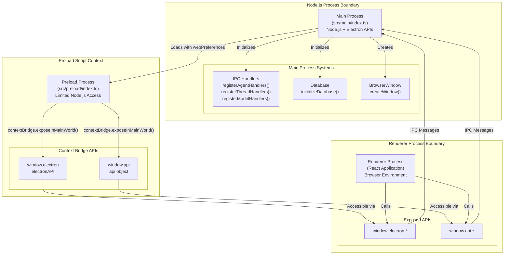
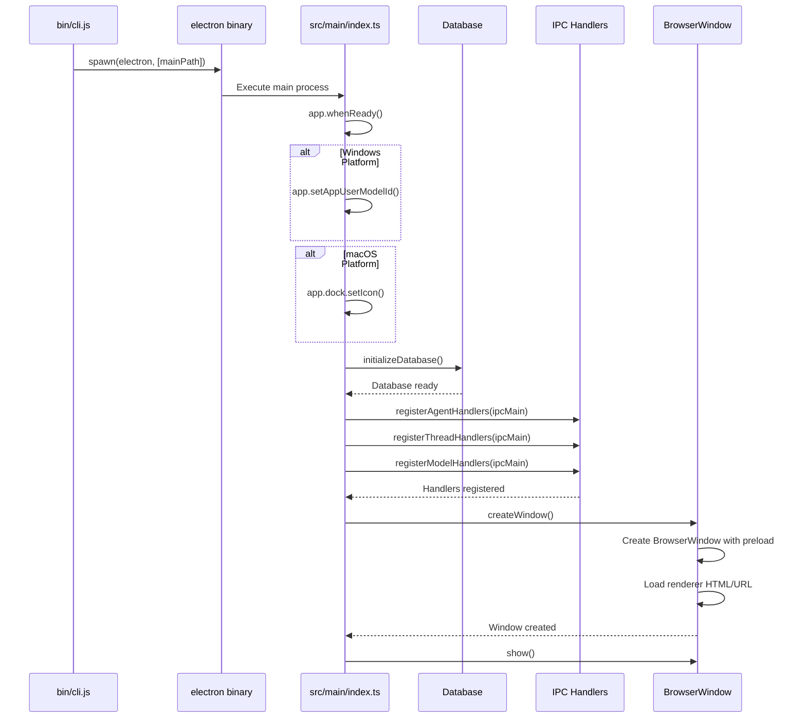
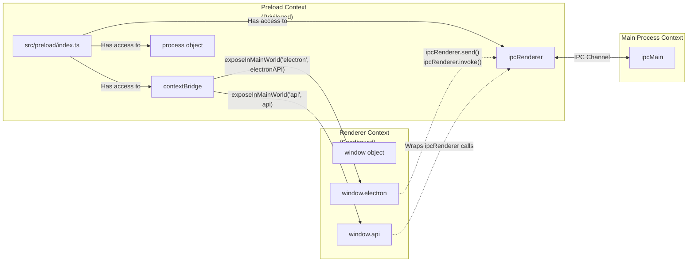
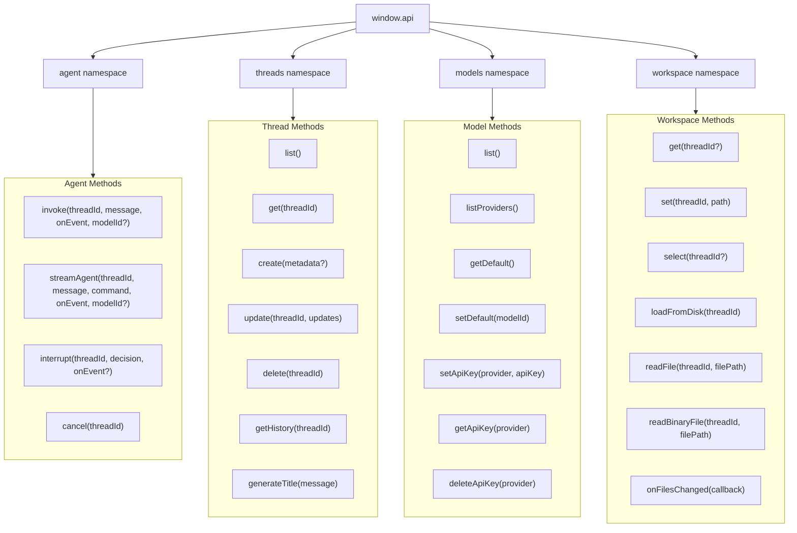
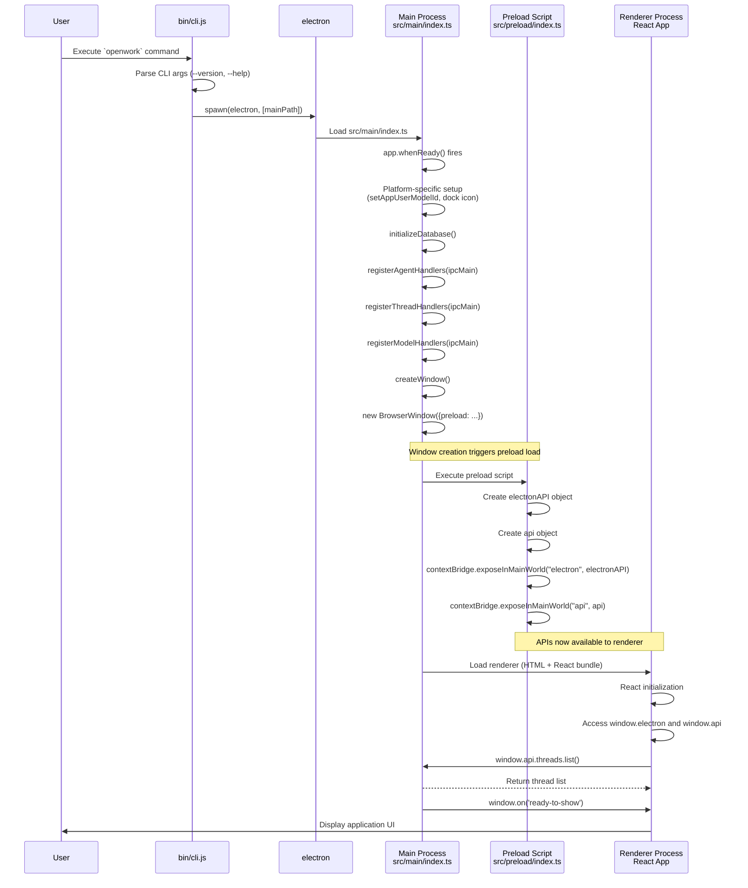
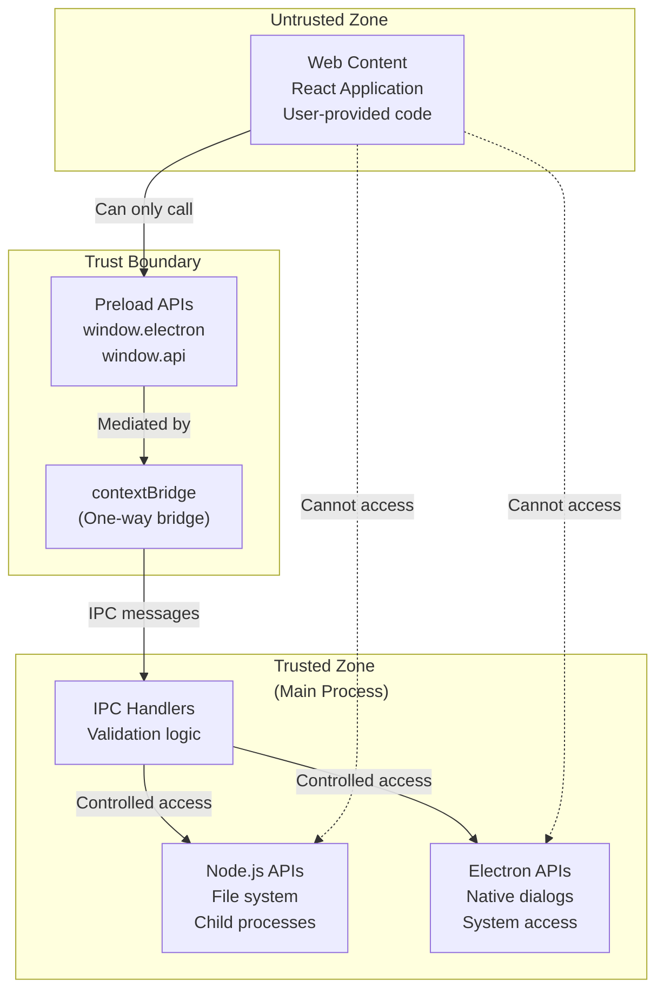

<!-- source: DeepWiki mcp.deepwiki.com · repo langchain-ai/openwork · page 2.1 Electron Process Model · fetched 2026-10-26 -->

# Electron Process Model

<details>
<summary>Relevant source files</summary>

The following files were used as context for generating this wiki page:

- [bin/cli.js](bin/cli.js)
- [src/main/index.ts](src/main/index.ts)
- [src/preload/index.d.ts](src/preload/index.d.ts)
- [src/preload/index.ts](src/preload/index.ts)

</details>


## Purpose and Scope

This document details the three-process architecture that forms the foundation of openwork's Electron application. It explains the responsibilities of each process (main, preload, renderer), how they are initialized, and the security boundaries enforced between them. For information about the IPC communication mechanisms that enable inter-process communication, see [IPC Communication System](#2.2).

---

## Process Architecture Overview

Openwork follows Electron's multi-process architecture with three distinct processes that execute in isolated contexts:



**Sources:** [src/main/index.ts:1-103](), [src/preload/index.ts:1-232]()

---

## Main Process

The main process is the Node.js backend that controls the application lifecycle and manages native operating system interactions. It has full access to Node.js APIs and Electron's main process modules.

### Responsibilities

| Responsibility | Implementation |
|---------------|----------------|
| Application lifecycle | `app.whenReady()`, `app.on('window-all-closed')` |
| Window management | `createWindow()` creates `BrowserWindow` |
| IPC handler registration | `registerAgentHandlers()`, `registerThreadHandlers()`, `registerModelHandlers()` |
| Database initialization | `initializeDatabase()` |
| File system access | Exposed via workspace IPC handlers |
| Native API access | Shell operations, dialog boxes, system notifications |

### Entry Point and Initialization



The main process begins execution at [src/main/index.ts:50-96]() when `app.whenReady()` fires. The initialization sequence is:

1. **Platform Configuration** [src/main/index.ts:52-67](): Sets app user model ID on Windows and dock icon on macOS
2. **Database Initialization** [src/main/index.ts:82](): Calls `initializeDatabase()` to prepare SQLite
3. **IPC Handler Registration** [src/main/index.ts:85-87](): Registers handlers for agent, thread, and model operations
4. **Window Creation** [src/main/index.ts:89](): Creates the main `BrowserWindow` with preload configuration

### Window Configuration

The `createWindow()` function [src/main/index.ts:13-48]() configures the `BrowserWindow` with specific security and UI parameters:

```typescript
// Key configuration from src/main/index.ts:14-26
{
  width: 1440,
  height: 900,
  minWidth: 1200,
  minHeight: 700,
  titleBarStyle: "hiddenInset",          // Custom title bar on macOS
  trafficLightPosition: { x: 16, y: 16 }, // macOS window controls
  webPreferences: {
    preload: join(__dirname, "../preload/index.js"),  // Critical for security
    sandbox: false                         // Allows Node.js access in preload
  }
}
```

The `preload` configuration is essential—it specifies the preload script that will execute in a privileged context before the renderer process loads.

**Sources:** [src/main/index.ts:13-48](), [src/main/index.ts:50-96](), [bin/cli.js:1-65]()

---

## Preload Process

The preload script runs in a special isolated context that has access to both Electron's `contextBridge` API and a subset of Node.js APIs. It acts as a security boundary, exposing only authorized APIs to the renderer process.

### Context Isolation Model



Context isolation is enforced at [src/preload/index.ts:219-231]():

```typescript
if (process.contextIsolated) {
  try {
    contextBridge.exposeInMainWorld("electron", electronAPI)
    contextBridge.exposeInMainWorld("api", api)
  } catch (error) {
    console.error(error)
  }
} else {
  // Fallback for non-isolated contexts
  window.electron = electronAPI
  window.api = api
}
```

The `contextBridge.exposeInMainWorld()` method creates a secure, one-way bridge that prevents the renderer from directly accessing Node.js or Electron APIs.

### Exposed API Surface

The preload script exposes two distinct API namespaces:

#### `window.electron` - Low-Level IPC Interface

[src/preload/index.ts:5-21]() defines `electronAPI`, which provides basic IPC primitives:

| Method | Purpose | Returns |
|--------|---------|---------|
| `ipcRenderer.send()` | Fire-and-forget message to main | `void` |
| `ipcRenderer.on()` | Subscribe to channel events | Cleanup function |
| `ipcRenderer.once()` | Subscribe to single event | `void` |
| `ipcRenderer.invoke()` | Request-response pattern | `Promise<unknown>` |

#### `window.api` - High-Level Domain APIs

[src/preload/index.ts:24-216]() defines the `api` object, which provides domain-specific interfaces:



Each method in the `api` object wraps `ipcRenderer` calls with typed parameters and return values defined in [src/preload/index.d.ts:16-95]().

### Stream Event Handling Pattern

The agent streaming methods (`invoke`, `streamAgent`, `interrupt`) implement a subscription pattern [src/preload/index.ts:27-79]():

```typescript
// Pattern used for agent streaming (src/preload/index.ts:32-48)
invoke: (threadId, message, onEvent, modelId?) => {
  const channel = `agent:stream:${threadId}`
  
  const handler = (_, data: StreamEvent) => {
    onEvent(data)
    if (data.type === "done" || data.type === "error") {
      ipcRenderer.removeListener(channel, handler)
    }
  }
  
  ipcRenderer.on(channel, handler)
  ipcRenderer.send("agent:invoke", { threadId, message, modelId })
  
  return () => {
    ipcRenderer.removeListener(channel, handler)
  }
}
```

This pattern:
1. Creates a per-thread channel: `agent:stream:${threadId}`
2. Registers an event listener that forwards `StreamEvent` data to the callback
3. Sends the initial IPC message to start the agent
4. Returns a cleanup function to unsubscribe
5. Auto-unsubscribes when receiving `done` or `error` events

**Sources:** [src/preload/index.ts:1-232](), [src/preload/index.d.ts:1-103]()

---

## Renderer Process

The renderer process is a Chromium-based browser environment that runs the React application. It has no direct access to Node.js or Electron APIs—all system interactions must go through the APIs exposed by the preload script.

### Capabilities and Restrictions

| Capability | Status | Access Method |
|------------|--------|---------------|
| DOM manipulation | ✓ Full access | Direct browser APIs |
| React rendering | ✓ Full access | React 19 framework |
| Network requests | ✓ Full access | `fetch()`, WebSocket |
| Local storage | ✓ Full access | `localStorage`, `sessionStorage` |
| Node.js modules | ✗ No access | Must use `window.api` |
| File system | ✗ No access | Must use `window.api.workspace.*` |
| IPC | ✗ No direct access | Must use `window.electron.ipcRenderer` or `window.api` |
| Process spawning | ✗ No access | Must use agent IPC handlers |

### API Access Pattern

The renderer accesses main process functionality through the type-safe APIs defined in [src/preload/index.d.ts:97-102]():

```typescript
declare global {
  interface Window {
    electron: ElectronAPI
    api: CustomAPI
  }
}
```

Example usage pattern in the renderer:

```typescript
// Creating a new thread
const thread = await window.api.threads.create({ title: "New Chat" })

// Streaming agent responses
const cleanup = window.api.agent.invoke(
  threadId,
  userMessage,
  (event: StreamEvent) => {
    // Handle streaming events
    if (event.type === "message") {
      // Update UI with message
    }
  },
  modelId
)

// Later: cleanup to remove listener
cleanup()
```

The renderer process loads from [src/main/index.ts:39-43]():
- **Development**: Loads from `ELECTRON_RENDERER_URL` (Vite dev server)
- **Production**: Loads from `../renderer/index.html` (built bundle)

**Sources:** [src/preload/index.d.ts:97-102](), [src/main/index.ts:39-43]()

---

## Process Initialization Flow



### Startup Sequence Details

1. **CLI Wrapper Execution** [bin/cli.js:35-43]()
   - Resolves Electron binary path
   - Spawns Electron process with `out/main/index.js` as entry point
   - Forwards SIGINT/SIGTERM signals to child process

2. **Main Process Initialization** [src/main/index.ts:50-96]()
   - Sets process title and platform-specific configurations
   - Initializes SQLite database
   - Registers all IPC handlers before window creation
   - Creates `BrowserWindow` with preload configuration

3. **Preload Script Execution** [src/preload/index.ts:219-231]()
   - Executes in isolated context before renderer loads
   - Creates API wrapper objects
   - Uses `contextBridge` to expose APIs to renderer
   - Provides type-safe interfaces via TypeScript definitions

4. **Renderer Process Loading** [src/main/index.ts:39-43]()
   - Loads HTML file and JavaScript bundles
   - React application initializes
   - Components can immediately access `window.api`
   - Makes initial IPC calls to load application state

**Sources:** [bin/cli.js:35-65](), [src/main/index.ts:50-96](), [src/preload/index.ts:219-231]()

---

## Security Model

The three-process architecture enforces strict security boundaries through Electron's context isolation and the preload bridge pattern.

### Security Boundaries



### Key Security Features

| Feature | Implementation | Purpose |
|---------|---------------|---------|
| Context Isolation | `process.contextIsolated` check [src/preload/index.ts:219]() | Prevents renderer from accessing preload globals |
| Context Bridge | `contextBridge.exposeInMainWorld()` [src/preload/index.ts:221-222]() | One-way API exposure with no prototype pollution |
| Sandbox Disabled | `sandbox: false` [src/main/index.ts:25]() | Allows preload to access Node.js (controlled security trade-off) |
| IPC Channel Validation | Handler registration in main process | Only registered channels can be invoked |
| Type Safety | TypeScript definitions [src/preload/index.d.ts]() | Compile-time validation of API usage |

### Why Sandbox is Disabled

The configuration sets `sandbox: false` [src/main/index.ts:25]() to allow the preload script to access Node.js APIs like `path` and `process`. This is a controlled trade-off:

- **Risk**: Preload has more privileges than a sandboxed preload would
- **Mitigation**: Preload script is part of the trusted application code, not user content
- **Benefit**: Enables preload to construct IPC messages with proper type handling and parameter validation

The renderer process itself remains isolated and cannot access Node.js APIs regardless of the sandbox setting—only the preload script has this access.

### IPC Channel Namespacing

The preload script uses consistent channel naming patterns to organize IPC communication:

| Namespace | Pattern | Example |
|-----------|---------|---------|
| Agent operations | `agent:*` | `agent:invoke`, `agent:cancel` |
| Agent streaming | `agent:stream:{threadId}` | `agent:stream:abc123` |
| Thread operations | `threads:*` | `threads:list`, `threads:create` |
| Model operations | `models:*` | `models:list`, `models:setApiKey` |
| Workspace operations | `workspace:*` | `workspace:get`, `workspace:loadFromDisk` |

This namespacing allows the main process to organize IPC handlers into separate modules (see [IPC Communication System](#2.2)) while maintaining a clear separation of concerns.

**Sources:** [src/preload/index.ts:219-231](), [src/main/index.ts:23-26](), [src/preload/index.d.ts:1-103]()

---

