<!-- source: DeepWiki mcp.deepwiki.com · repo langchain-ai/openwork · page 2.2 IPC Communication System · fetched 2026-10-26 -->

# IPC Communication System

<details>
<summary>Relevant source files</summary>

The following files were used as context for generating this wiki page:

- [src/main/ipc/agent.ts](src/main/ipc/agent.ts)
- [src/preload/index.d.ts](src/preload/index.d.ts)
- [src/preload/index.ts](src/preload/index.ts)
- [src/renderer/src/lib/electron-transport.ts](src/renderer/src/lib/electron-transport.ts)

</details>


## Purpose and Scope

The IPC Communication System enables secure communication between OpenWork's renderer process (React UI) and main process (Node.js backend). This system uses Electron's IPC mechanisms to expose privileged operations—such as file system access, database queries, and AI model invocation—to the UI while maintaining process isolation for security.

This document covers the IPC channel architecture, handler registration, and the specialized `ElectronIPCTransport` bridge that adapts LangGraph's streaming SDK to work over Electron IPC. For information about the Electron process architecture itself, see [Electron Process Model](#2.1). For details on state management in the renderer, see [Global State Management](#2.3).

---

## IPC Channel Architecture

OpenWork organizes IPC communication into four primary channel categories, each handling a specific domain of functionality:

| Channel Prefix | Purpose | Handler File |
|---------------|---------|--------------|
| `threads:*` | Thread CRUD operations, history retrieval | `src/main/db.ts` |
| `agent:*` | Agent invocation, streaming, resumption, cancellation | `src/main/ipc/agent.ts` |
| `models:*` | Model listing, API key management, default model selection | `src/main/ipc/models.ts` |
| `workspace:*` | Workspace selection, file operations, directory scanning | `src/main/ipc/models.ts` |

### Channel Naming Convention

IPC channels follow a `domain:action` pattern:
- **Request-response**: `ipcMain.handle('models:list', ...)` → `ipcRenderer.invoke('models:list')`
- **One-way events**: `ipcMain.on('agent:invoke', ...)` → `ipcRenderer.send('agent:invoke', ...)`
- **Response channels**: `agent:stream:${threadId}` for streaming responses back to renderer

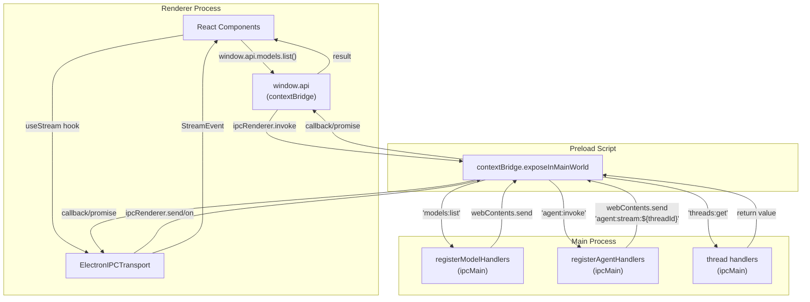

**Sources:** [src/main/ipc/models.ts:192-504](), [src/main/ipc/agent.ts:11-279]()

---

## Handler Registration Patterns

### Request-Response Handlers

Request-response handlers use `ipcMain.handle()` for bidirectional communication with a return value. These are invoked from the renderer using `ipcRenderer.invoke()`.

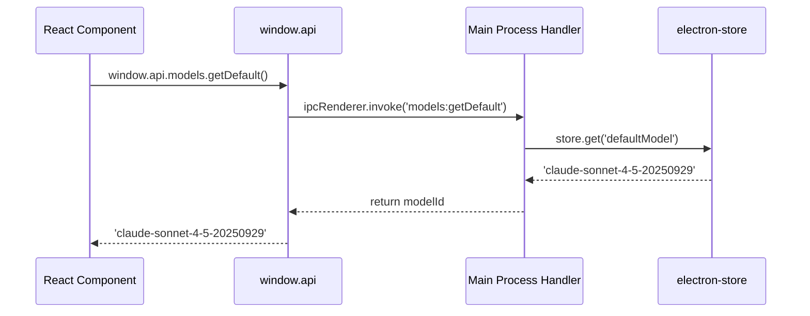

**Example handlers:**
- `models:getDefault` - Returns default model ID from `electron-store` [src/main/ipc/models.ts:203-205]()
- `models:setApiKey` - Stores API key in `.env` file via `setApiKey()` [src/main/ipc/models.ts:213-218]()
- `workspace:select` - Opens native directory picker dialog [src/main/ipc/models.ts:293-323]()
- `agent:cancel` - Aborts active agent stream [src/main/ipc/agent.ts:272-278]()

### Event-Based Streaming Handlers

Streaming handlers use `ipcMain.on()` for one-way event sending, with responses sent back via `webContents.send()` to a specific channel. This pattern supports long-running operations with incremental updates.

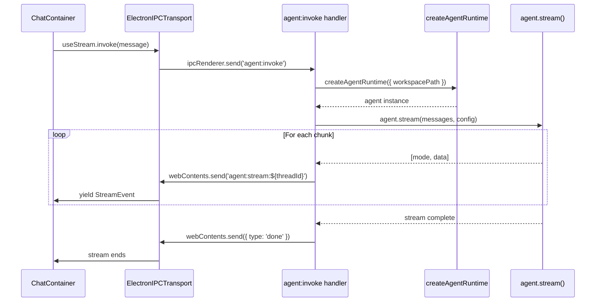

**Key streaming handler:** `agent:invoke` initiates agent execution and streams results back via `agent:stream:${threadId}` channel [src/main/ipc/agent.ts:15-109]()

**Sources:** [src/main/ipc/agent.ts:11-279](), [src/main/ipc/models.ts:192-504]()

---

## Model and Provider Handlers

The `registerModelHandlers` function in [src/main/ipc/models.ts:192]() registers handlers for model configuration and workspace management.

### Model Configuration Handlers

| Handler | Type | Purpose | Return Value |
|---------|------|---------|--------------|
| `models:list` | handle | Lists all available models with API key availability | `ModelConfig[]` |
| `models:getDefault` | handle | Retrieves default model ID | `string` |
| `models:setDefault` | handle | Saves default model ID to `electron-store` | `void` |
| `models:listProviders` | handle | Lists providers with API key status | `Provider[]` |

**Model availability check:** The `models:list` handler augments `AVAILABLE_MODELS` with runtime API key status by calling `hasApiKey(model.provider)` for each model [src/main/ipc/models.ts:194-200]().

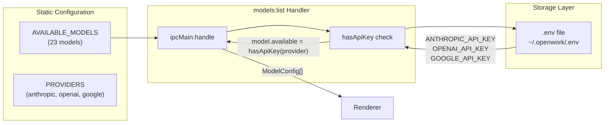

### API Key Handlers

| Handler | Type | Purpose | Storage |
|---------|------|---------|---------|
| `models:setApiKey` | handle | Stores API key for provider | `~/.openwork/.env` |
| `models:getApiKey` | handle | Retrieves API key (`.env` or `process.env`) | `~/.openwork/.env` |
| `models:deleteApiKey` | handle | Removes API key from `.env` | `~/.openwork/.env` |

The API key handlers delegate to the `storage` module:
- `setApiKey(provider, apiKey)` writes to `.env` file and `process.env` [src/main/storage.ts:77-87]()
- `getApiKey(provider)` checks `.env` file first, then falls back to `process.env` [src/main/storage.ts:65-75]()
- Environment variable names are mapped via `ENV_VAR_NAMES`: `{ anthropic: 'ANTHROPIC_API_KEY', ... }` [src/main/storage.ts:9-13]()

### Workspace Handlers

| Handler | Type | Purpose | Thread-Specific |
|---------|------|---------|-----------------|
| `workspace:get` | handle | Retrieves workspace path from thread metadata | Yes |
| `workspace:set` | handle | Saves workspace path to thread metadata, starts file watcher | Yes |
| `workspace:select` | handle | Opens directory picker, saves selection | Yes |
| `workspace:loadFromDisk` | handle | Recursively scans directory, returns file tree | Yes |
| `workspace:readFile` | handle | Reads text file content with path validation | Yes |
| `workspace:readBinaryFile` | handle | Reads binary file as base64 | Yes |

**Thread metadata storage:** Workspace paths are stored in the `thread.metadata` JSON field as `{ workspacePath: string }` [src/main/ipc/models.ts:244-257]().

**Security validation:** File read operations validate that resolved paths are within the workspace boundary [src/main/ipc/models.ts:419-424]():
```typescript
const resolvedPath = path.resolve(fullPath)
const resolvedWorkspace = path.resolve(workspacePath)
if (!resolvedPath.startsWith(resolvedWorkspace)) {
  return { success: false, error: 'Access denied: path outside workspace' }
}
```

**Sources:** [src/main/ipc/models.ts:192-504](), [src/main/storage.ts:1-104]()

---

## Agent Handlers

The `registerAgentHandlers` function in [src/main/ipc/agent.ts:11]() manages agent execution lifecycle with streaming support.

### Agent Execution Flow

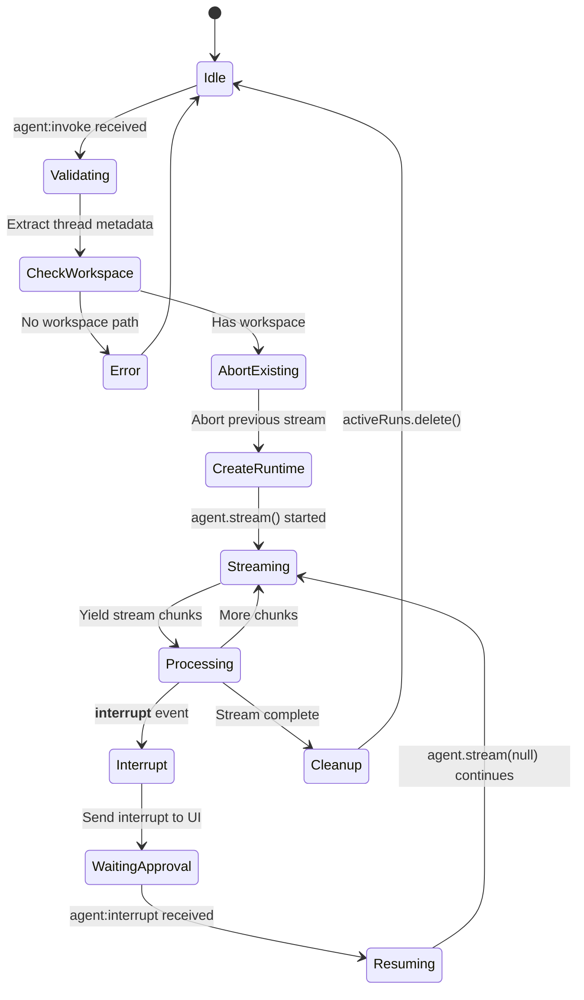

### Active Stream Management

The agent system maintains an `activeRuns` Map to track and cancel concurrent streams [src/main/ipc/agent.ts:9]():

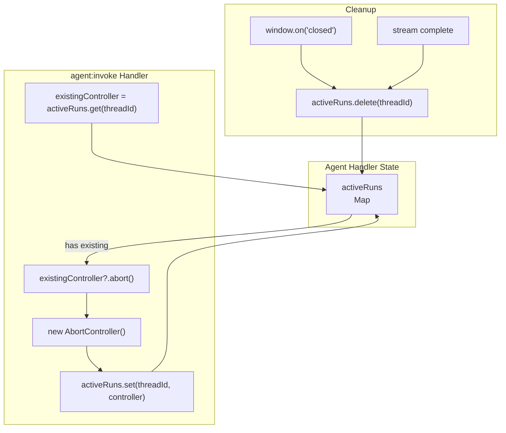

**Concurrent stream prevention:** Before starting a new stream, the handler aborts any existing stream for the thread to prevent checkpoint corruption [src/main/ipc/agent.ts:33-38]().

### Stream Event Emission

Agent handlers emit events to a thread-specific channel `agent:stream:${threadId}` [src/main/ipc/agent.ts:18]():

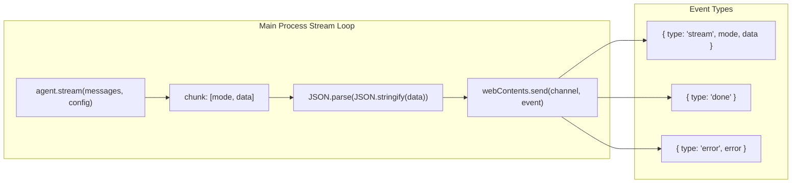

**LangGraph streaming modes:** Agent streams use both `'messages'` (for real-time token streaming) and `'values'` (for full state with todos/files/subagents) [src/main/ipc/agent.ts:76]().

### HITL (Human-in-the-Loop) Handlers

| Handler | Purpose | Flow |
|---------|---------|------|
| `agent:interrupt` | Handles user approval/rejection of interrupted operations | Receives `HITLDecision`, resumes stream with `agent.stream(null)` or terminates |
| `agent:resume` | Resumes execution after interrupt with decision | Creates `Command({ resume: { decisions: [...] } })` and streams |

**Interrupt approval flow:** When an interrupt occurs, the main process sends an event with `type: 'interrupt'` to the renderer. The renderer displays an approval dialog, then calls `agent:interrupt` with the user's decision [src/main/ipc/agent.ts:194-268]().

**Sources:** [src/main/ipc/agent.ts:1-279]()

---

## ElectronIPCTransport Bridge

The `ElectronIPCTransport` class in [src/renderer/src/lib/electron-transport.ts:58]() implements the `UseStreamTransport` interface from `@langchain/langgraph-sdk/react`, enabling the LangGraph SDK's `useStream` hook to work over Electron IPC instead of HTTP.

### Transport Interface Implementation

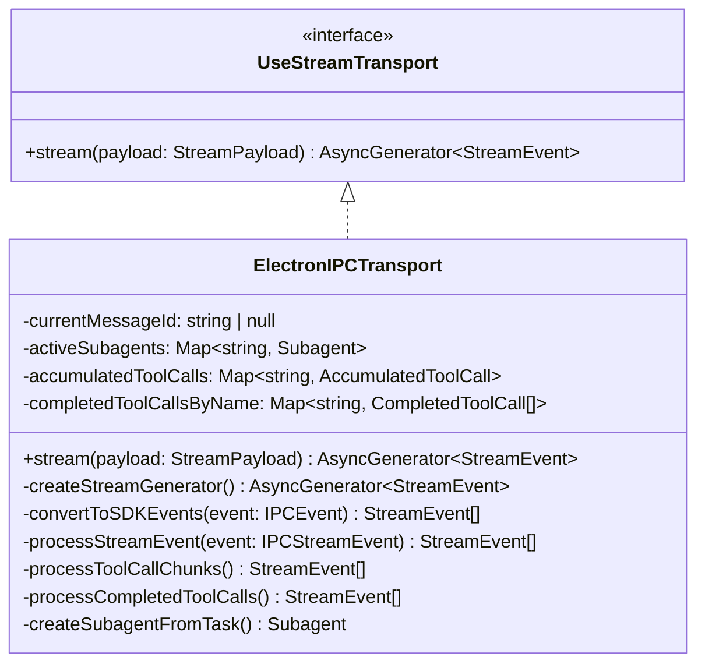

### Stream Lifecycle

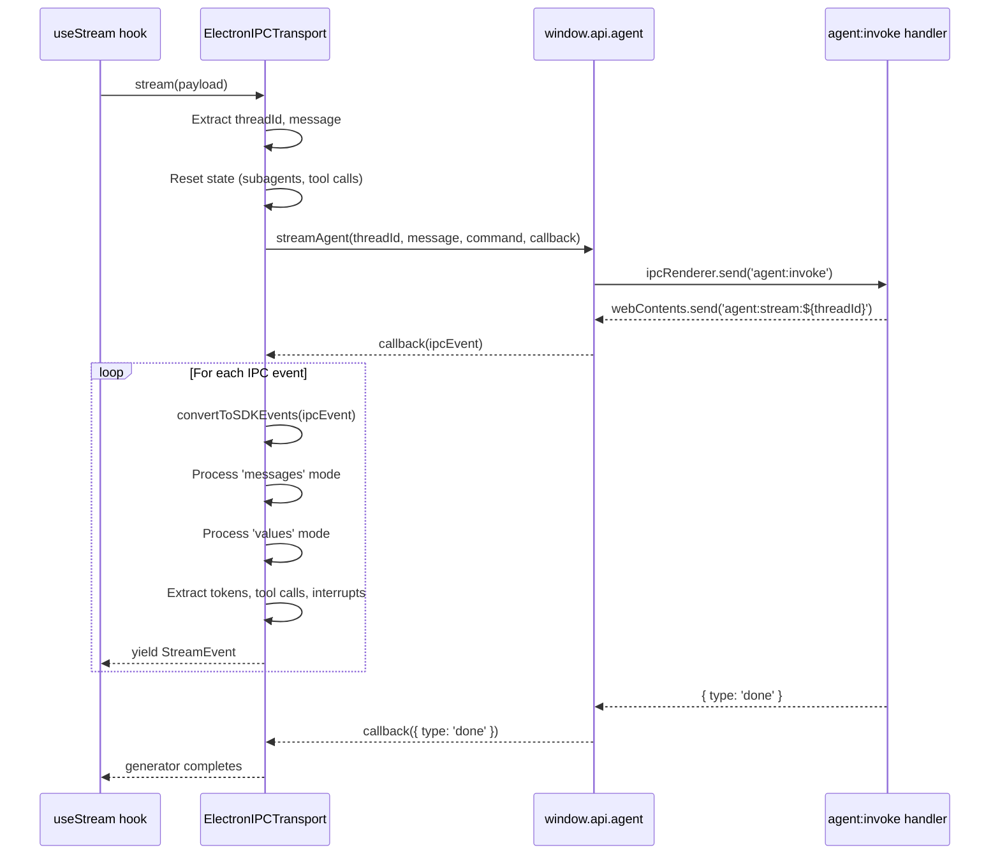

**Key responsibilities:**
1. Convert `StreamPayload` (SDK format) to IPC `agent:invoke` call [src/renderer/src/lib/electron-transport.ts:71-102]()
2. Bridge IPC events to SDK `StreamEvent` format [src/renderer/src/lib/electron-transport.ts:213-359]()
3. Track subagent state from tool call chunks [src/renderer/src/lib/electron-transport.ts:658-700]()
4. Handle message chunk accumulation for streaming tokens [src/renderer/src/lib/electron-transport.ts:60-61]()

### Event Queue Management

The transport uses an event queue with promise-based resolution to bridge synchronous IPC callbacks to asynchronous generator yields [src/renderer/src/lib/electron-transport.ts:118-122]():

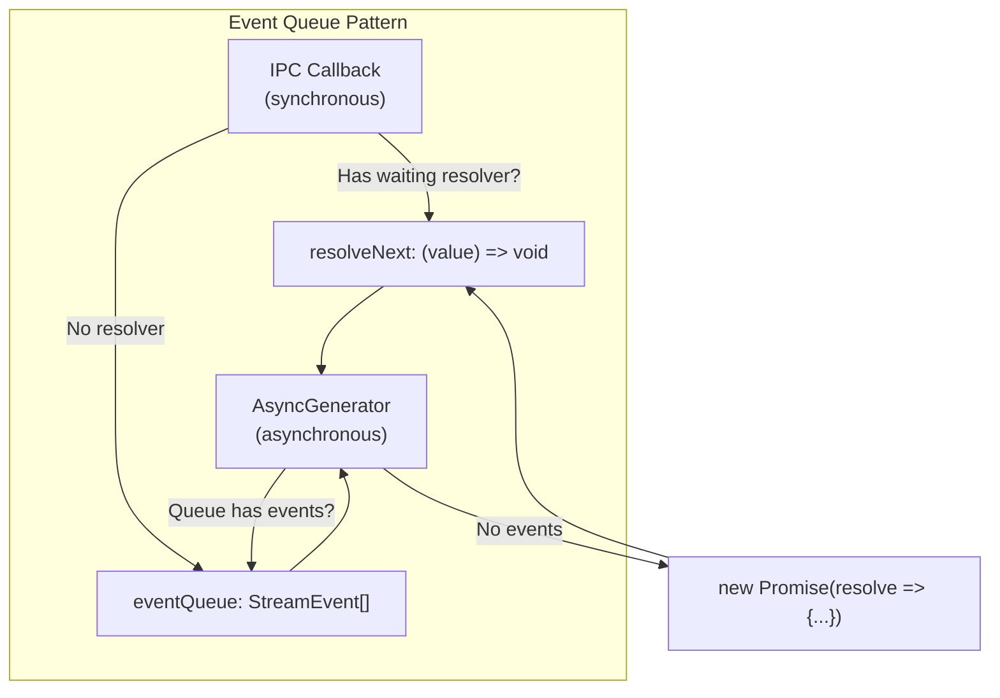

**Abort handling:** The transport respects `AbortSignal` from the payload and cleans up IPC listeners when aborted [src/renderer/src/lib/electron-transport.ts:159-169]().

**Sources:** [src/renderer/src/lib/electron-transport.ts:1-794]()

---

## Stream Event Processing

The transport converts two types of raw stream events from LangGraph into SDK-compatible events:

### LangChain Message Serialization

LangGraph streams messages using LangChain's serialization format with `lc: 1` marker and `kwargs` object [src/renderer/src/lib/electron-transport.ts:11-26]():

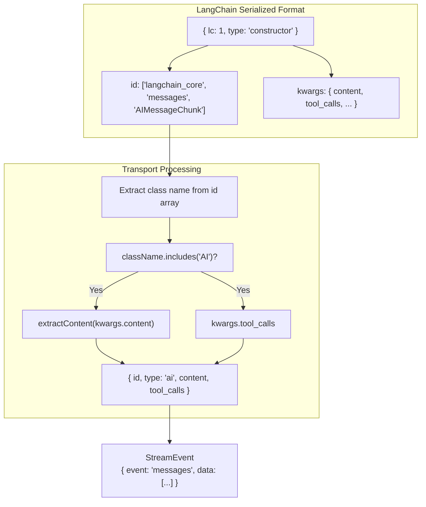

**Message type detection:** The transport determines message type (AI vs Tool) by checking if the class name in `msg.id` array includes 'AI' or 'ToolMessage' [src/renderer/src/lib/electron-transport.ts:374-382]().

### Stream Modes and Event Types

| Stream Mode | Source | Purpose | Emitted Events |
|-------------|--------|---------|----------------|
| `'messages'` | Real-time chunks from LLM | Token-by-token streaming | `messages` events with incremental content |
| `'values'` | Full state snapshots | Todos, files, subagents, interrupts | `values` events, `custom` events for workspace/subagents/interrupts |

**Event conversion table:**

| IPC Event Type | SDK Event Type | Data Transformation |
|----------------|----------------|---------------------|
| `{ type: 'stream', mode: 'messages' }` | `messages` | Extract tokens from `kwargs.content`, accumulate by message ID |
| `{ type: 'stream', mode: 'values' }` | `values` | Extract todos, transform LangChain messages to plain objects |
| `values.__interrupt__` | `custom` (interrupt) | Extract `actionRequests` and `reviewConfigs` from HITL format |
| Task tool calls | `custom` (subagents) | Create `Subagent` objects, track by tool_call_id |
| `{ type: 'done' }` | `done` | Pass through with thread_id |
| `{ type: 'error' }` | `error` | Pass through with error code/message |

### Subagent Tracking

The transport tracks active subagents by maintaining state across stream events:

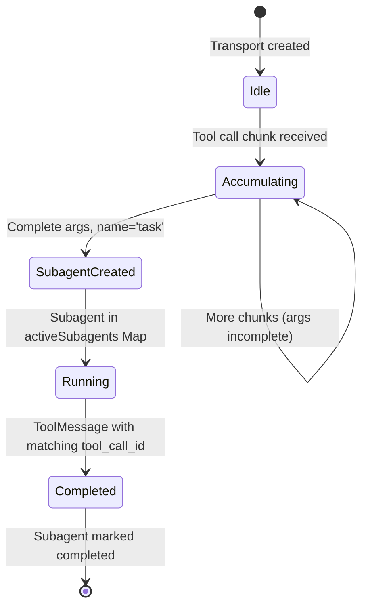

**Streaming tool call accumulation:** Tool call arguments are streamed incrementally as JSON strings. The transport accumulates these in `accumulatedToolCalls` until valid JSON is parseable [src/renderer/src/lib/electron-transport.ts:658-697]():

```typescript
// Get or create accumulated tool call
let accumulated = this.accumulatedToolCalls.get(chunk.id)
if (!accumulated) {
  accumulated = { id: chunk.id, name: chunk.name || '', args: '' }
}
// Accumulate args
accumulated.args += chunk.args
// Try to parse when complete
const args = JSON.parse(accumulated.args)
```

**Subagent lifecycle events:**
1. **Start:** AIMessage with `tool_calls` where `name === 'task'` creates subagent [src/renderer/src/lib/electron-transport.ts:714-721]()
2. **Completion:** ToolMessage with matching `tool_call_id` marks subagent completed [src/renderer/src/lib/electron-transport.ts:730-742]()

### HITL Interrupt Processing

The transport handles two interrupt formats:

1. **LangChain HITL format** (`__interrupt__` array from values mode) [src/renderer/src/lib/electron-transport.ts:591-629]():
```typescript
state.__interrupt__[0].value = {
  actionRequests: [{ name: string, id: string, args: {...} }],
  reviewConfigs: [{ actionName: string, allowedDecisions: [...] }]
}
```

2. **Legacy format** (direct tool_call property) [src/renderer/src/lib/electron-transport.ts:319-332]():
```typescript
interrupt = {
  id: string,
  tool_call: { id, name, args },
  allowed_decisions: ['approve', 'reject', 'edit']
}
```

**Tool call ID lookup:** For HITL interrupts, the transport looks up the `tool_call.id` from `completedToolCallsByName` since the `actionRequest` doesn't include it [src/renderer/src/lib/electron-transport.ts:603-612]().

**Sources:** [src/renderer/src/lib/electron-transport.ts:209-634]()

---

## Security and Isolation

### contextBridge Isolation

The preload script uses Electron's `contextBridge` to expose a limited, secure API surface to the renderer process. This prevents the renderer from directly accessing Node.js APIs like `fs`, `child_process`, or `require`.

**Key security properties:**
- Renderer cannot access `ipcRenderer` directly; must go through `window.api`
- All privileged operations (file access, database, API keys) are gated by IPC handlers
- No eval or arbitrary code execution from renderer to main

### Path Validation

File operations validate that resolved paths are within the workspace boundary to prevent directory traversal attacks [src/main/ipc/models.ts:419-424]():

```typescript
const resolvedPath = path.resolve(fullPath)
const resolvedWorkspace = path.resolve(workspacePath)
if (!resolvedPath.startsWith(resolvedWorkspace)) {
  return { success: false, error: 'Access denied: path outside workspace' }
}
```

### API Key Storage

API keys are stored in `~/.openwork/.env` file separate from application code [src/main/storage.ts:6]():
- Not included in version control (should be in `.gitignore`)
- Not accessible from renderer process directly
- Only retrievable via IPC handlers that validate requests
- Environment variables (`ANTHROPIC_API_KEY`, `OPENAI_API_KEY`, `GOOGLE_API_KEY`) as fallback [src/main/storage.ts:9-13]()

**Sources:** [src/main/ipc/models.ts:419-424](), [src/main/storage.ts:1-104]()

---

## IPC Communication Patterns Summary

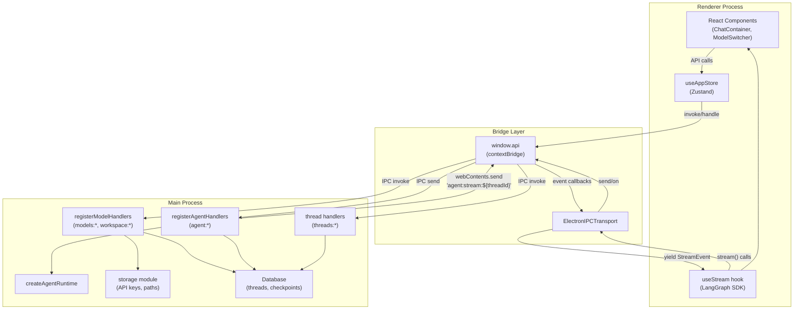

**Sources:** [src/main/ipc/models.ts:1-512](), [src/main/ipc/agent.ts:1-279](), [src/renderer/src/lib/electron-transport.ts:1-794]()

---

