<!-- source: DeepWiki mcp.deepwiki.com · repo langchain-ai/openwork · page 2.3 State Management Architecture · fetched 2026-10-26 -->

# State Management Architecture

<details>
<summary>Relevant source files</summary>

The following files were used as context for generating this wiki page:

- [src/renderer/src/App.tsx](src/renderer/src/App.tsx)
- [src/renderer/src/components/chat/ChatContainer.tsx](src/renderer/src/components/chat/ChatContainer.tsx)
- [src/renderer/src/components/panels/FilesystemPanel.tsx](src/renderer/src/components/panels/FilesystemPanel.tsx)
- [src/renderer/src/components/sidebar/ThreadSidebar.tsx](src/renderer/src/components/sidebar/ThreadSidebar.tsx)
- [src/renderer/src/lib/thread-context.tsx](src/renderer/src/lib/thread-context.tsx)

</details>


## Purpose and Scope

This document describes the state management architecture used throughout the openwork application. The system implements a **two-tier approach**: global application state managed by Zustand, and per-thread state managed by React Context. The architecture is designed to handle multiple concurrent threads, real-time streaming updates, and efficient re-render optimization.

For information about thread persistence and checkpointing, see [Thread Persistence and Checkpointing](#6.2). For details about the IPC communication layer that transports state updates, see [IPC Communication System](#2.2).

---

## Two-Tier State Architecture

The application separates concerns between **application-wide state** and **thread-specific state**. This separation enables efficient state updates, prevents unnecessary re-renders, and provides clear ownership boundaries for different types of data.

### Architecture Diagram

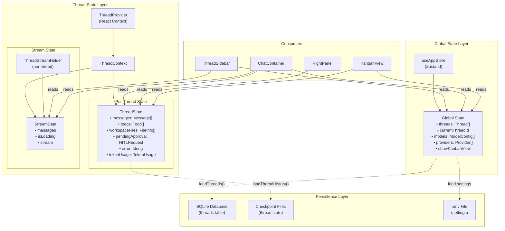

**Sources:** [src/renderer/src/lib/thread-context.tsx:82-96](), [src/renderer/src/App.tsx:19-21](), Diagram 3 from system architecture

---

## Global Application State

Global state is managed using **Zustand** via the `useAppStore` hook. This store maintains application-wide data that is shared across all threads and UI components.

### Global State Schema

| State Property | Type | Purpose |
|---------------|------|---------|
| `threads` | `Thread[]` | List of all threads with metadata (title, updated_at, etc.) |
| `currentThreadId` | `string \| null` | Currently selected thread ID |
| `models` | `ModelConfig[]` | Available LLM models and configurations |
| `providers` | `Provider[]` | LLM provider settings (Anthropic, OpenAI, Google) |
| `showKanbanView` | `boolean` | Toggle between thread view and kanban overview |

### Global State Actions

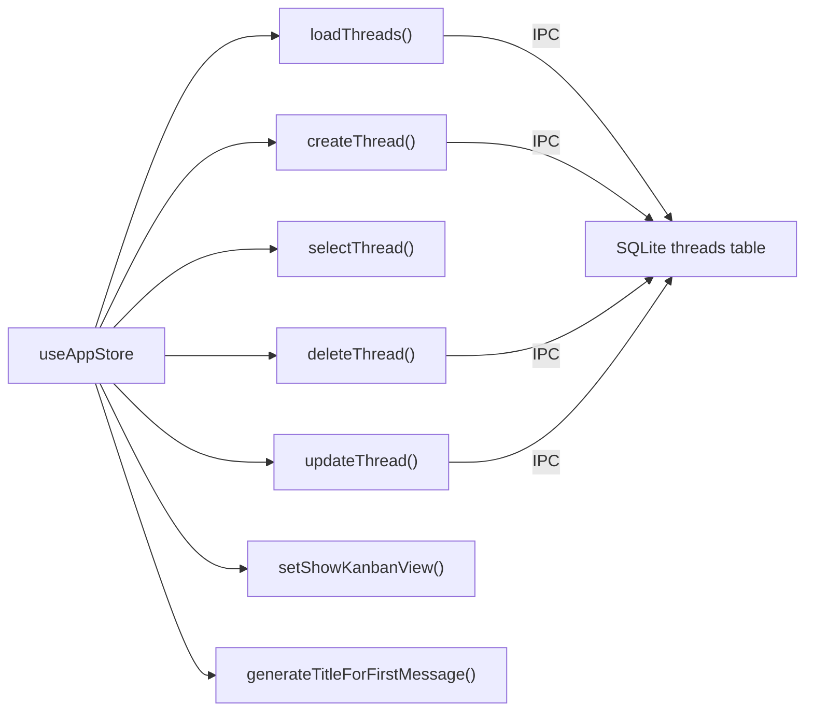

### Usage Pattern

Components access global state by importing `useAppStore`:

```typescript
const { threads, currentThreadId, selectThread, createThread } = useAppStore()
```

**Sources:** [src/renderer/src/components/chat/ChatContainer.tsx:38](), [src/renderer/src/components/sidebar/ThreadSidebar.tsx:129-137](), [src/renderer/src/App.tsx:20]()

---

## Per-Thread State Management

Each thread maintains its own isolated state through the **ThreadProvider** context. This state includes conversation history, task lists, workspace files, and runtime metadata. The provider supports multiple concurrent threads, with each thread's state managed independently.

### ThreadState Interface

```mermaid
graph TB
    ThreadState["ThreadState Interface"]
    
    ThreadState --> messages["messages: Message[]<br/>(conversation history)"]
    ThreadState --> todos["todos: Todo[]<br/>(task list)"]
    ThreadState --> workspaceFiles["workspaceFiles: FileInfo[]<br/>(file tree)"]
    ThreadState --> workspacePath["workspacePath: string | null"]
    ThreadState --> subagents["subagents: Subagent[]<br/>(delegation tracking)"]
    ThreadState --> pendingApproval["pendingApproval: HITLRequest | null<br/>(HITL interrupt)"]
    ThreadState --> error["error: string | null"]
    ThreadState --> currentModel["currentModel: string"]
    ThreadState --> openFiles["openFiles: OpenFile[]<br/>(open tabs)"]
    ThreadState --> activeTab["activeTab: string"]
    ThreadState --> fileContents["fileContents: Record<string, string>"]
    ThreadState --> tokenUsage["tokenUsage: TokenUsage | null"]
    ThreadState --> draftInput["draftInput: string<br/>(unsent message)"]
```

**Sources:** [src/renderer/src/lib/thread-context.tsx:36-50]()

### ThreadProvider Implementation

The `ThreadProvider` component manages a registry of thread states and coordinates their lifecycle:

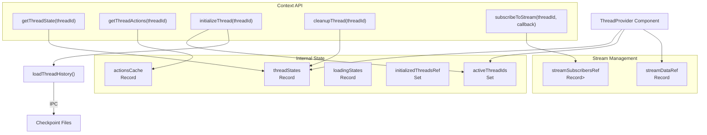

**Sources:** [src/renderer/src/lib/thread-context.tsx:223-260](), [src/renderer/src/lib/thread-context.tsx:685-718]()

### ThreadActions Interface

All state mutations are performed through a standardized `ThreadActions` interface, which provides type-safe methods for updating thread state:

| Action | Signature | Purpose |
|--------|-----------|---------|
| `appendMessage` | `(message: Message) => void` | Add or update a message in history |
| `setMessages` | `(messages: Message[]) => void` | Replace entire message array |
| `setTodos` | `(todos: Todo[]) => void` | Update task list |
| `setWorkspaceFiles` | `(files: FileInfo[] \| updater) => void` | Update workspace file tree |
| `setWorkspacePath` | `(path: string \| null) => void` | Set workspace directory |
| `setSubagents` | `(subagents: Subagent[]) => void` | Update subagent tracking |
| `setPendingApproval` | `(request: HITLRequest \| null) => void` | Set/clear HITL approval request |
| `setError` | `(error: string \| null) => void` | Set error message |
| `clearError` | `() => void` | Clear error state |
| `setCurrentModel` | `(modelId: string) => void` | Change active model |
| `openFile` | `(path: string, name: string) => void` | Open file in tab |
| `closeFile` | `(path: string) => void` | Close file tab |
| `setActiveTab` | `(tab: string) => void` | Switch active tab |
| `setFileContents` | `(path: string, content: string) => void` | Cache file contents |
| `setDraftInput` | `(input: string) => void` | Save draft message |

**Sources:** [src/renderer/src/lib/thread-context.tsx:63-79](), [src/renderer/src/lib/thread-context.tsx:439-537]()

---

## Stream State and Subscription Pattern

Stream state is managed separately from persistent thread state to optimize re-renders. The application uses React's `useSyncExternalStore` to enable components to subscribe to specific stream updates without triggering Provider re-renders.

### Stream Data Architecture

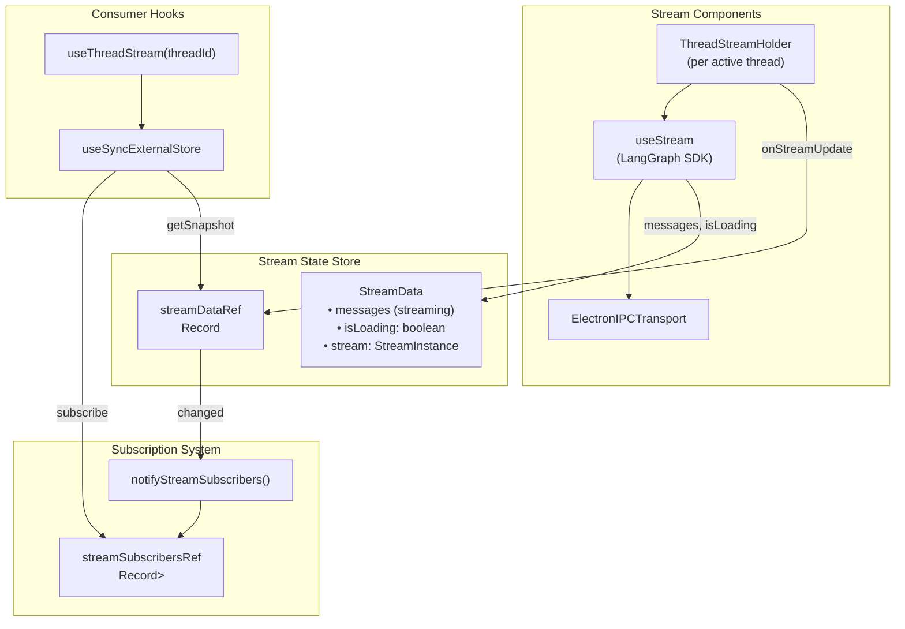

**Sources:** [src/renderer/src/lib/thread-context.tsx:52-60](), [src/renderer/src/lib/thread-context.tsx:147-221](), [src/renderer/src/lib/thread-context.tsx:769-780]()

### ThreadStreamHolder Component

Each active thread has a corresponding `ThreadStreamHolder` component that manages the LangGraph stream connection:

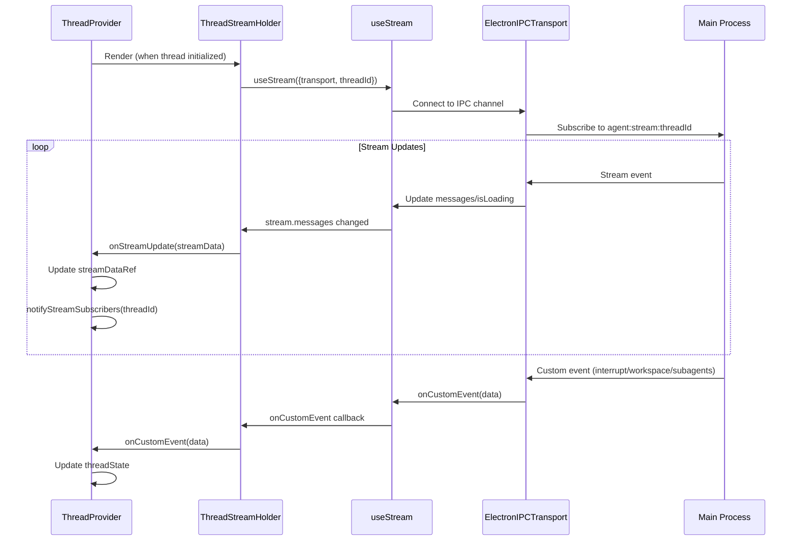

**Sources:** [src/renderer/src/lib/thread-context.tsx:147-221](), [src/renderer/src/lib/thread-context.tsx:242-254](), [src/renderer/src/lib/thread-context.tsx:358-437]()

### Subscription Pattern Usage

Components subscribe to stream updates using `useThreadStream`, which leverages `useSyncExternalStore` for efficient reactivity:

```typescript
// In ChatContainer.tsx
const streamData = useThreadStream(threadId)
const stream = streamData.stream
const isLoading = streamData.isLoading
```

This pattern ensures:
- **No Provider Re-renders**: Stream updates don't trigger ThreadProvider re-renders
- **Selective Subscriptions**: Only components that call `useThreadStream` re-render on stream changes
- **Consistent Snapshots**: `useSyncExternalStore` guarantees tearing-free reads

**Sources:** [src/renderer/src/components/chat/ChatContainer.tsx:61-63](), [src/renderer/src/lib/thread-context.tsx:769-780]()

---

## State Lifecycle

Thread state follows a managed lifecycle from initialization through cleanup, with persistence hooks at key points.

### Lifecycle Diagram

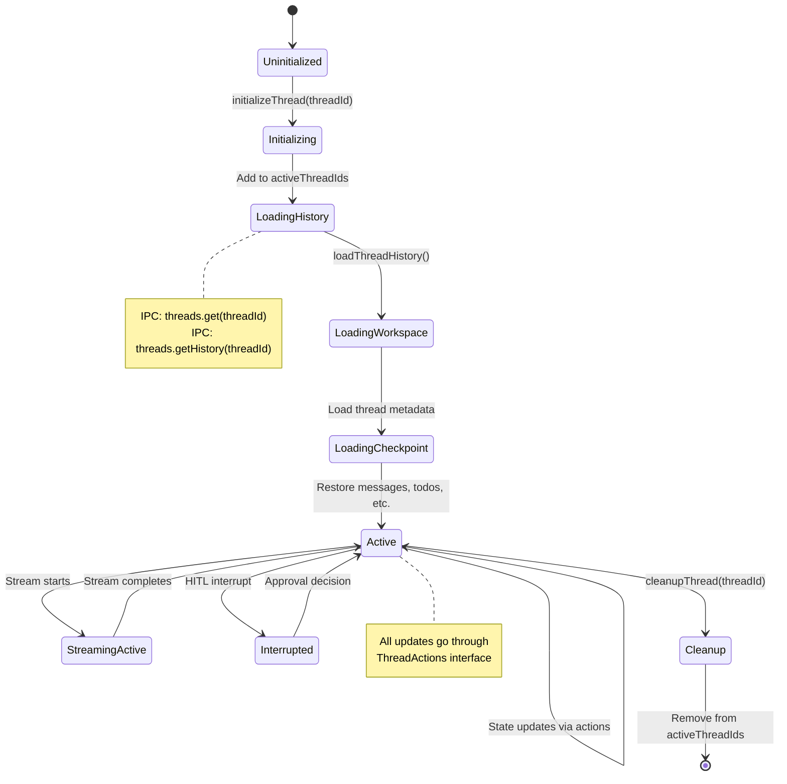

**Sources:** [src/renderer/src/lib/thread-context.tsx:685-701](), [src/renderer/src/lib/thread-context.tsx:539-683](), [src/renderer/src/lib/thread-context.tsx:703-718]()

### Initialization Sequence

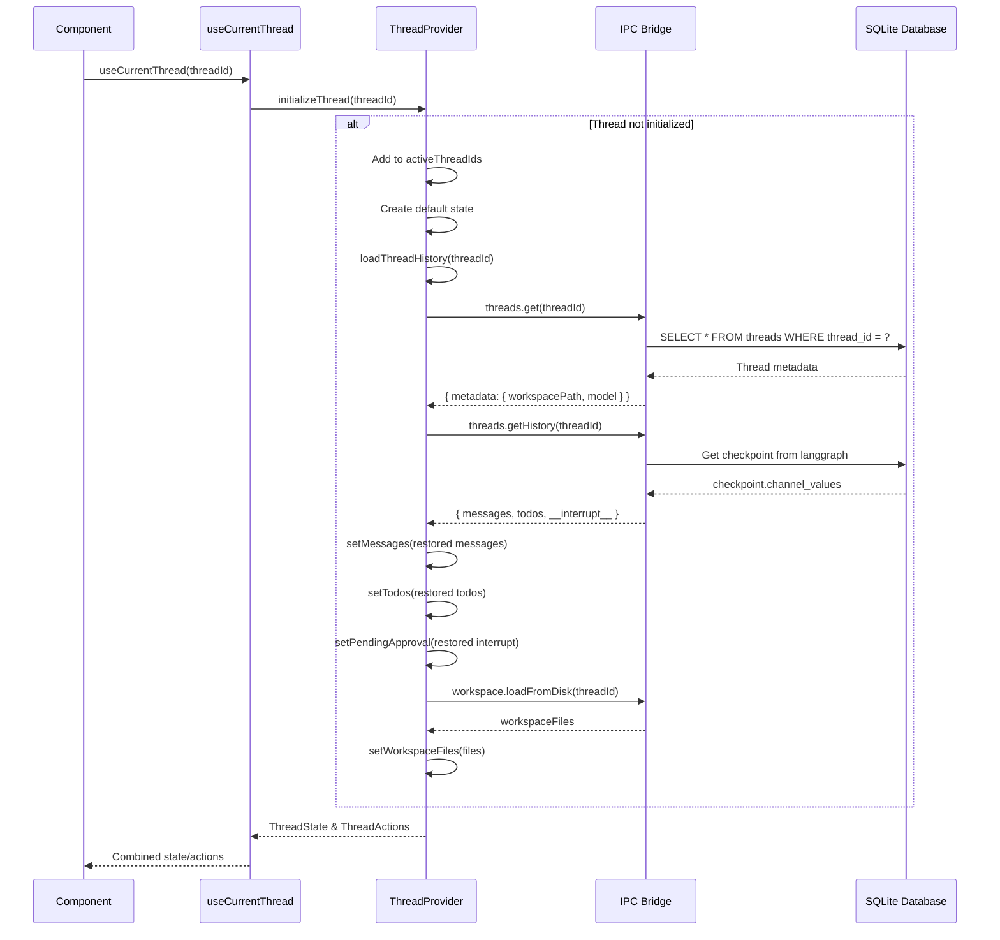

**Sources:** [src/renderer/src/lib/thread-context.tsx:685-701](), [src/renderer/src/lib/thread-context.tsx:539-683]()

### Cleanup Process

When a thread is no longer needed (e.g., thread deleted), cleanup ensures no memory leaks:

1. Remove from `initializedThreadsRef`
2. Delete from `actionsCache`
3. Delete from `streamDataRef`
4. Delete from `streamSubscribersRef`
5. Remove from `activeThreadIds` (unmounts `ThreadStreamHolder`)
6. Remove from `threadStates`

**Sources:** [src/renderer/src/lib/thread-context.tsx:703-718]()

---

## Custom Hooks

The architecture provides several custom hooks for accessing state in different contexts.

### Hook Hierarchy

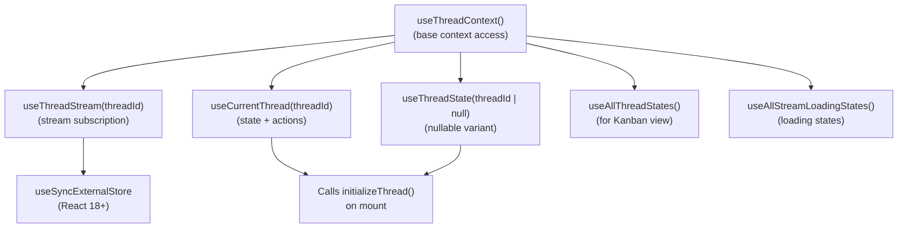

### Hook Reference Table

| Hook | Return Type | Purpose | Auto-initializes? |
|------|-------------|---------|-------------------|
| `useThreadContext()` | `ThreadContextValue` | Access raw context API | No |
| `useThreadStream(threadId)` | `StreamData` | Subscribe to stream updates | No |
| `useCurrentThread(threadId)` | `ThreadState & ThreadActions` | Access thread state and actions | Yes |
| `useThreadState(threadId \| null)` | `(ThreadState & ThreadActions) \| null` | Nullable thread state access | Yes |
| `useAllThreadStates()` | `Record<string, ThreadState>` | Get all initialized thread states | No |
| `useAllStreamLoadingStates()` | `Record<string, boolean>` | Get all loading states | No |

**Sources:** [src/renderer/src/lib/thread-context.tsx:762-823]()

### Usage Examples from Codebase

**ChatContainer**: Combines global and thread state
```typescript
const { threads, loadThreads, generateTitleForFirstMessage } = useAppStore()
const { messages, todos, error, workspacePath, tokenUsage, currentModel, 
        setTodos, appendMessage, setError, clearError } = useCurrentThread(threadId)
const streamData = useThreadStream(threadId)
```

**ThreadSidebar**: Reads global state and stream status
```typescript
const { threads, currentThreadId, createThread, selectThread, 
        deleteThread, updateThread } = useAppStore()
// Inside ThreadStatusIcon component:
const { isLoading } = useThreadStream(threadId)
const { pendingApproval } = useCurrentThread(threadId)
```

**FilesystemPanel**: Accesses thread-specific workspace state
```typescript
const { currentThreadId } = useAppStore()
const threadState = useThreadState(currentThreadId)
const workspaceFiles = threadState?.workspaceFiles ?? []
const setWorkspaceFiles = threadState?.setWorkspaceFiles
```

**Sources:** [src/renderer/src/components/chat/ChatContainer.tsx:38-58](), [src/renderer/src/components/sidebar/ThreadSidebar.tsx:18-30](), [src/renderer/src/components/panels/FilesystemPanel.tsx:19-24]()

---

## State Persistence and Restoration

Thread state is persisted to disk through multiple mechanisms, enabling conversation continuity across application restarts.

### Persistence Architecture

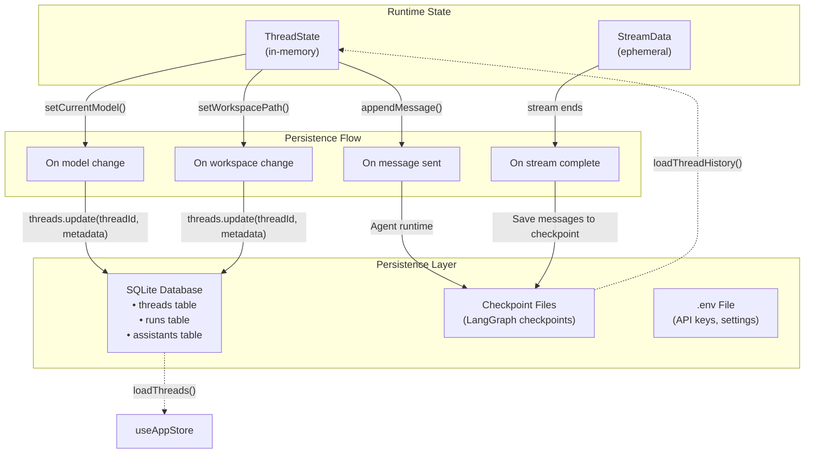

**Sources:** [src/renderer/src/lib/thread-context.tsx:481-491](), [src/renderer/src/lib/thread-context.tsx:539-683]()

### Checkpoint Restoration

When a thread is initialized, the system restores state from LangGraph checkpoints:

1. **Fetch checkpoint**: Call `threads.getHistory(threadId)` via IPC
2. **Extract channel values**: Parse `checkpoint.channel_values`
3. **Restore messages**: Convert LangChain message format to `Message[]`
4. **Restore todos**: Extract task list from checkpoint
5. **Restore interrupts**: Check for pending HITL approvals in `__interrupt__`
6. **Restore workspace**: Load workspace path from thread metadata
7. **Load workspace files**: Call `workspace.loadFromDisk(threadId)`

**Sources:** [src/renderer/src/lib/thread-context.tsx:565-677]()

### Message Persistence Flow

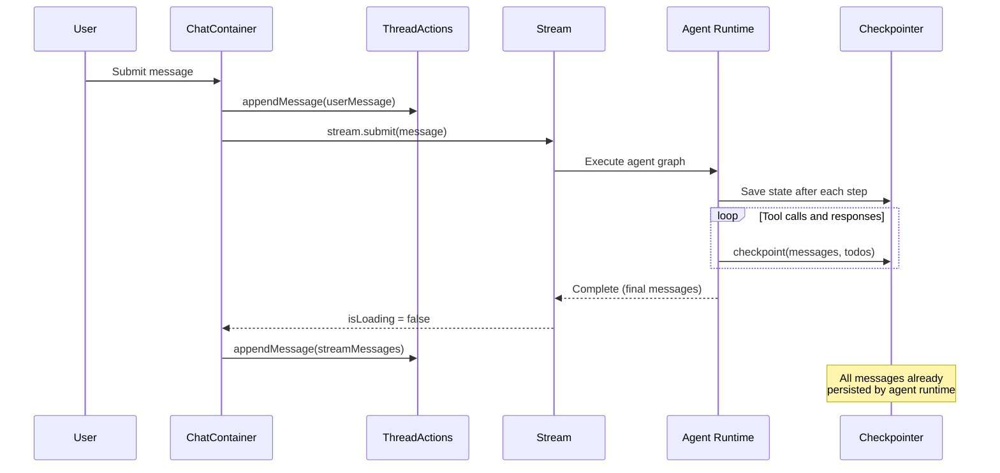

The key insight is that **most persistence happens automatically** through the agent runtime's checkpointing system. The UI layer only persists metadata (model, workspace path) explicitly.

**Sources:** [src/renderer/src/components/chat/ChatContainer.tsx:221-269](), [src/renderer/src/components/chat/ChatContainer.tsx:98-126]()

---

## State Update Patterns

### Optimistic Updates vs Synchronous Updates

The architecture uses different update patterns depending on the data type:

| Data Type | Update Pattern | Reason |
|-----------|---------------|--------|
| Messages | Optimistic (UI first) | Immediate feedback, confirmed by checkpoint |
| Todos | Stream-driven | Agent controls task list during execution |
| Workspace Files | IPC-confirmed | Must reflect actual disk state |
| Pending Approval | Stream event | HITL interrupt requires agent coordination |
| Token Usage | Accumulative | Keep highest values seen during conversation |

### Token Usage Tracking

Token usage updates use a **maximum accumulation** strategy to preserve context window information:

```typescript
// Only update if new input tokens are higher than previous
if (newInputTokens >= prevInputTokens || !prev.tokenUsage) {
  return {
    tokenUsage: {
      inputTokens: newInputTokens,
      outputTokens: data.usage!.outputTokens || 0,
      totalTokens: data.usage!.totalTokens || 0,
      cacheReadTokens: data.usage!.cacheReadTokens,
      cacheCreationTokens: data.usage!.cacheCreationTokens,
      lastUpdated: new Date()
    }
  }
}
```

This prevents the UI from losing accumulated context when tool calls don't report token usage.

**Sources:** [src/renderer/src/lib/thread-context.tsx:400-432]()

### Error Handling and User-Friendly Messages

Errors are parsed into user-friendly messages before being stored in thread state:

```typescript
const parseErrorMessage = (error: Error | string): string => {
  // Context window exceeded: "prompt is too long: X tokens > Y maximum"
  // Rate limit: "rate_limit" or "429"
  // Authentication: "401" or "invalid_api_key"
  // Return user-friendly version
}
```

**Sources:** [src/renderer/src/lib/thread-context.tsx:315-345]()

---

## Integration Points

### Component Integration Pattern

Components follow a consistent pattern when integrating with state:

1. **Access global state**: `useAppStore()` for thread list, current thread ID
2. **Access thread state**: `useCurrentThread(threadId)` for thread-specific data
3. **Subscribe to streams**: `useThreadStream(threadId)` for real-time updates
4. **Perform actions**: Use destructured action methods from `useCurrentThread`

**Example from ChatContainer:**

```typescript
// 1. Global state
const { threads, loadThreads, generateTitleForFirstMessage } = useAppStore()

// 2. Thread state + actions
const { messages, todos, error, workspacePath, tokenUsage,
        setTodos, appendMessage, setError, clearError } = useCurrentThread(threadId)

// 3. Stream subscription
const streamData = useThreadStream(threadId)

// 4. Use actions
const handleSubmit = async (e: React.FormEvent) => {
  appendMessage(userMessage)
  await stream.submit(...)
}
```

**Sources:** [src/renderer/src/components/chat/ChatContainer.tsx:33-96]()

### Display Message Merging

Messages displayed in the UI are merged from two sources:

```typescript
const displayMessages = useMemo(() => {
  const threadMessageIds = new Set(threadMessages.map((m) => m.id))
  
  // Filter streaming messages not yet in persisted history
  const streamingMsgs = streamData.messages
    .filter(m => m.id && !threadMessageIds.has(m.id))
    .map(convertStreamMessage)
  
  return [...threadMessages, ...streamingMsgs]
}, [threadMessages, streamData.messages])
```

This ensures:
- **No duplicates**: Streaming messages disappear once persisted
- **Immediate feedback**: New messages appear instantly from stream
- **Consistent history**: Persisted messages remain stable

**Sources:** [src/renderer/src/components/chat/ChatContainer.tsx:128-152]()

---

## Performance Considerations

### Re-render Optimization

1. **Separate stream state**: Stream updates don't trigger ThreadProvider re-renders
2. **useSyncExternalStore**: Only components subscribed to streams re-render on stream changes
3. **Actions cache**: ThreadActions objects are cached to maintain referential equality
4. **Memoized snapshots**: `getStreamData` and `getThreadState` use cached references

### Memory Management

1. **Cleanup on thread deletion**: `cleanupThread()` removes all references
2. **Stream holder lifecycle**: ThreadStreamHolder unmounts when thread removed from `activeThreadIds`
3. **Subscriber cleanup**: Unsubscribe callbacks properly remove listeners

### State Update Batching

React automatically batches state updates within event handlers and effects. The architecture leverages this by:
- Grouping related updates in single `updateThreadState` calls
- Using functional updaters to avoid intermediate renders
- Deferring non-critical updates to separate effects

**Sources:** [src/renderer/src/lib/thread-context.tsx:242-254](), [src/renderer/src/lib/thread-context.tsx:439-537](), [src/renderer/src/lib/thread-context.tsx:769-780]()

---

