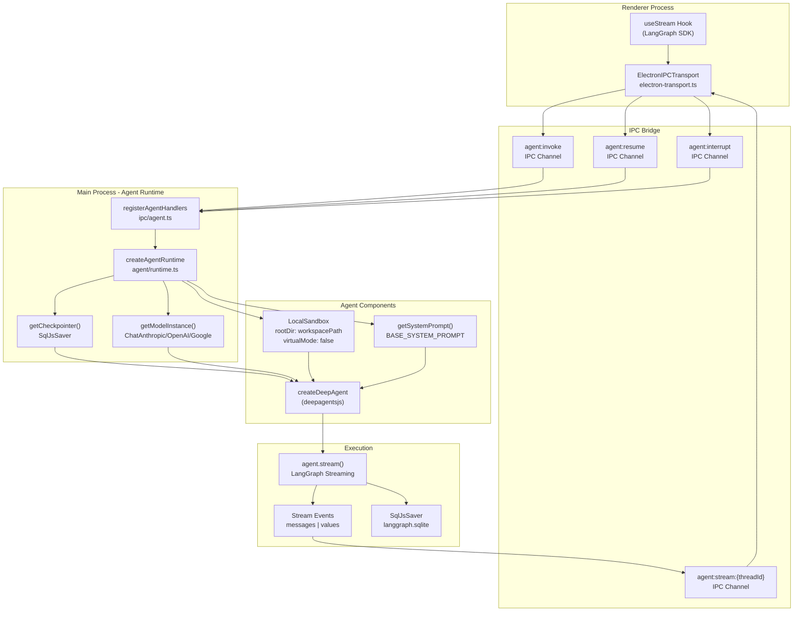
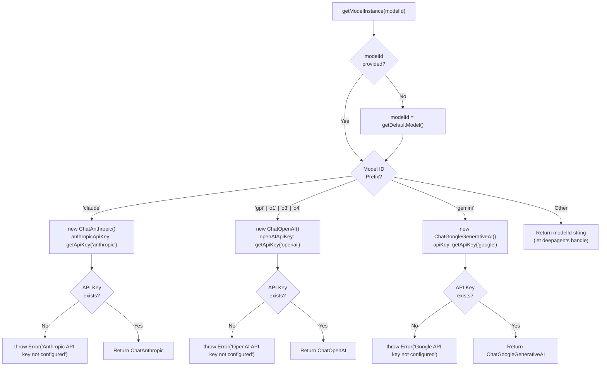
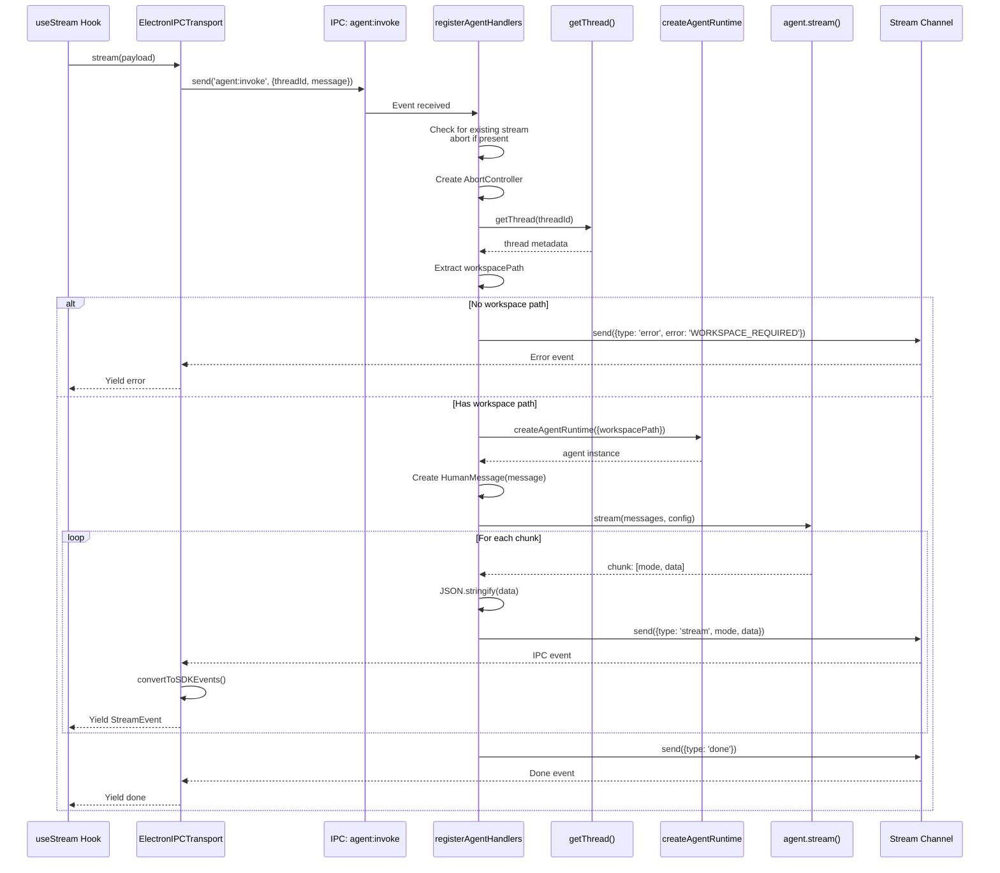
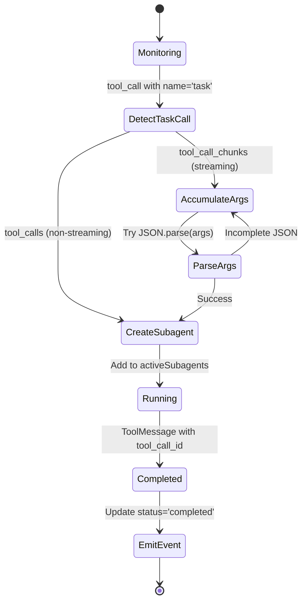
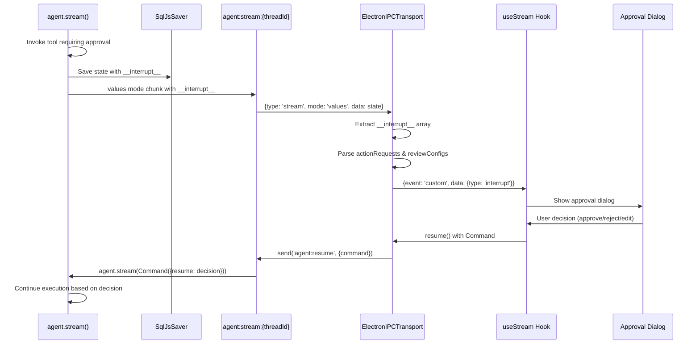

<!-- source: DeepWiki mcp.deepwiki.com · repo langchain-ai/openwork · page 3 Agent System · fetched 2026-10-26 -->

# Agent System

<details>
<summary>Relevant source files</summary>

The following files were used as context for generating this wiki page:

- [src/main/agent/runtime.ts](src/main/agent/runtime.ts)
- [src/main/agent/system-prompt.ts](src/main/agent/system-prompt.ts)
- [src/main/ipc/agent.ts](src/main/ipc/agent.ts)
- [src/renderer/src/lib/electron-transport.ts](src/renderer/src/lib/electron-transport.ts)

</details>


## Overview

The Agent System is responsible for creating, configuring, and executing AI agents within OpenWork. This system integrates the deepagentsjs framework with LangGraph orchestration to provide autonomous coding capabilities with human oversight. The system handles agent initialization, streaming execution, event processing, and human-in-the-loop (HITL) approval workflows.

This page covers the agent execution lifecycle from creation to completion. For model configuration and API key management, see [Model and Provider Management](#4). For workspace integration and file operations, see [Workspace and File System](#5). For details on how agents communicate with the UI via IPC, see [IPC Communication System](#2.2).

**Sources:** [src/main/agent/runtime.ts:1-171](), [src/main/ipc/agent.ts:1-280]()

## Core Agent Architecture

The agent system consists of three main layers: the agent runtime layer that creates and configures agents, the IPC handler layer that manages execution lifecycle, and the transport layer that bridges Electron IPC with the LangGraph SDK streaming interface.



**Sources:** [src/main/agent/runtime.ts:108-160](), [src/main/ipc/agent.ts:11-109](), [src/renderer/src/lib/electron-transport.ts:58-102]()

## Agent Runtime Components

The `createAgentRuntime` function assembles the complete agent by integrating four essential components:

| Component | Type | Purpose | Configuration |
|-----------|------|---------|---------------|
| **Model** | `ChatAnthropic` / `ChatOpenAI` / `ChatGoogleGenerativeAI` | LLM that powers agent reasoning | Determined by `modelId` parameter or default model setting |
| **Checkpointer** | `SqlJsSaver` | Persists agent state and conversation history | Singleton instance using `langgraph.sqlite` database |
| **Sandbox** | `LocalSandbox` | Provides file system access and tool execution environment | `rootDir: workspacePath`, `virtualMode: false`, `timeout: 120000ms` |
| **System Prompt** | `string` | Defines agent behavior, constraints, and operational guidelines | Generated by `getSystemPrompt()` with workspace-specific paths |

**Sources:** [src/main/agent/runtime.ts:97-160]()

### Model Instance Selection

The `getModelInstance` function determines the appropriate LLM provider based on model ID prefix:



**Sources:** [src/main/agent/runtime.ts:51-95]()

### Checkpointer Singleton

The checkpointer is managed as a singleton to ensure consistent state persistence across agent invocations:

```typescript
// Singleton pattern at src/main/agent/runtime.ts:40-48
let checkpointer: SqlJsSaver | null = null

export async function getCheckpointer(): Promise<SqlJsSaver> {
  if (!checkpointer) {
    checkpointer = new SqlJsSaver(getCheckpointDbPath())
    await checkpointer.initialize()
  }
  return checkpointer
}
```

The checkpointer stores agent state in the `langgraph.sqlite` database, including conversation messages, todos, files, and subagent information. This enables agent resumption and HITL workflows.

**Sources:** [src/main/agent/runtime.ts:39-48]()

### LocalSandbox Configuration

The `LocalSandbox` provides the agent's execution environment for file operations:

| Configuration | Value | Description |
|---------------|-------|-------------|
| `rootDir` | `workspacePath` | Absolute path to the workspace directory |
| `virtualMode` | `false` | Use absolute system paths (not virtualized relative paths) |
| `timeout` | `120000` | 2 minute timeout for shell commands |
| `maxOutputBytes` | `100000` | ~100KB maximum output size |

Setting `virtualMode: false` means agents receive and operate on fully qualified absolute paths (e.g., `/Users/name/project/src/index.ts`) rather than relative paths. This matches the behavior of shell commands and prevents path ambiguity.

**Sources:** [src/main/agent/runtime.ts:126-131]()

## Agent Invocation Pipeline

The agent invocation flow begins when the user sends a message and continues through streaming execution until completion or interruption.



**Sources:** [src/main/ipc/agent.ts:14-109](), [src/renderer/src/lib/electron-transport.ts:71-102]()

### Workspace Path Validation

Before agent execution begins, the system validates that a workspace path is configured for the thread. This is a critical requirement since agents cannot perform file operations without a workspace context:

```typescript
// At src/main/ipc/agent.ts:51-63
const thread = getThread(threadId)
const metadata = thread?.metadata ? JSON.parse(thread.metadata) : {}
const workspacePath = metadata.workspacePath as string | undefined

if (!workspacePath) {
  window.webContents.send(channel, {
    type: 'error',
    error: 'WORKSPACE_REQUIRED',
    message: 'Please select a workspace folder before sending messages.'
  })
  return
}
```

**Sources:** [src/main/ipc/agent.ts:51-63]()

### Stream Configuration

The agent stream is configured with multiple stream modes to capture different aspects of execution:

| Parameter | Value | Purpose |
|-----------|-------|---------|
| `configurable.thread_id` | `threadId` | Associates execution with specific conversation thread |
| `signal` | `AbortController.signal` | Enables cancellation of in-flight requests |
| `streamMode` | `['messages', 'values']` | Stream both incremental message tokens and full state snapshots |
| `recursionLimit` | `1000` | Maximum recursion depth for agent loops |

The dual-mode streaming enables real-time UI updates (via `messages`) while also providing complete state synchronization (via `values`).

**Sources:** [src/main/ipc/agent.ts:71-79]()

### Active Stream Management

The system maintains an `activeRuns` map to track and manage concurrent streams:

```typescript
// At src/main/ipc/agent.ts:8-9
const activeRuns = new Map<string, AbortController>()
```

Before starting a new stream, any existing stream for the same thread is aborted to prevent checkpoint corruption:

```typescript
// At src/main/ipc/agent.ts:33-38
const existingController = activeRuns.get(threadId)
if (existingController) {
  console.log('[Agent] Aborting existing stream for thread:', threadId)
  existingController.abort()
  activeRuns.delete(threadId)
}
```

This ensures only one agent execution occurs per thread at a time, maintaining checkpoint consistency.

**Sources:** [src/main/ipc/agent.ts:8-38]()

## Stream Event Processing

The `ElectronIPCTransport` converts raw IPC events from the main process into standardized LangGraph SDK `StreamEvent` objects that the `useStream` hook can consume.

### Event Type Mapping

The transport processes multiple event types from the main process:

| IPC Event Type | SDK Event Type | Purpose | Data Structure |
|----------------|----------------|---------|----------------|
| `stream` | `messages`, `values`, `custom` | Raw LangGraph stream chunks | `{ mode: string, data: unknown }` |
| `token` | `messages` | Legacy token streaming | `{ messageId, token }` |
| `tool_call` | `custom` | Tool call chunks | `{ messageId, tool_calls }` |
| `values` | `values`, `custom` | Full state snapshot | `{ todos, files, subagents, interrupt }` |
| `error` | `error` | Execution error | `{ error: string }` |
| `done` | `done` | Stream completion | `{ thread_id: string }` |

**Sources:** [src/renderer/src/lib/electron-transport.ts:213-359]()

### Stream Mode Processing

The transport distinguishes between two LangGraph stream modes:

#### Messages Mode

Provides real-time token streaming for immediate UI feedback. Messages are serialized LangChain message chunks with the structure:

```typescript
// Serialized message format
{
  lc: 1,
  type: "constructor",
  id: ["langchain_core", "messages", "AIMessageChunk"],
  kwargs: {
    id: string,
    content: string | Array<{type: string, text?: string}>,
    tool_calls?: ToolCall[],
    tool_call_chunks?: ToolCallChunk[]
  }
}
```

The transport extracts message metadata to determine the message type (AI vs Tool) and processes content and tool calls:

```typescript
// At src/renderer/src/lib/electron-transport.ts:368-433
if (mode === 'messages') {
  const [msgChunk, metadata] = data as [SerializedMessageChunk, MessageMetadata]
  const kwargs = msgChunk?.kwargs || {}
  const classId = Array.isArray(msgChunk?.id) ? msgChunk.id : []
  const className = classId[classId.length - 1] || ''
  
  const isAIMessage = className.includes('AI') || className.includes('AIMessageChunk')
  const isToolMessage = className.includes('ToolMessage') && !!kwargs.tool_call_id
  // ... process based on message type
}
```

**Sources:** [src/renderer/src/lib/electron-transport.ts:11-26](), [src/renderer/src/lib/electron-transport.ts:368-433]()

#### Values Mode

Provides full state snapshots containing complete conversation history, todos, files, and interrupt requests:

```typescript
// Values mode state structure
{
  messages?: SerializedMessageChunk[],
  todos?: Array<{id?: string, content?: string, status?: string}>,
  files?: Record<string, unknown> | Array<{path: string, is_dir?: boolean, size?: number}>,
  workspacePath?: string,
  __interrupt__?: Array<{
    value?: {
      actionRequests?: Array<{name: string, id: string, args: Record<string, unknown>}>,
      reviewConfigs?: Array<{actionName: string, allowedDecisions: string[]}>
    }
  }>
}
```

The transport filters out `HumanMessage` instances since user input is already displayed in the UI:

```typescript
// At src/renderer/src/lib/electron-transport.ts:520-546
const transformedMessages = state.messages
  ?.filter((msg) => {
    const classId = Array.isArray(msg.id) ? msg.id : []
    const className = classId[classId.length - 1] || ''
    return !className.includes('Human')
  })
  .map((msg) => {
    // Transform to UI message format
  })
```

**Sources:** [src/renderer/src/lib/electron-transport.ts:461-630]()

### Subagent Detection and Tracking

The transport monitors tool calls to detect when the agent delegates to subagents via the `task` tool:



The transport maintains two tracking structures:

1. **`accumulatedToolCalls`**: Accumulates streaming tool call chunks until complete
2. **`activeSubagents`**: Maps tool call IDs to `Subagent` objects with status tracking

```typescript
// At src/renderer/src/lib/electron-transport.ts:658-700
private processToolCallChunks(chunks: Array<{id?: string, name?: string, args?: string}>): StreamEvent[] {
  for (const chunk of chunks) {
    let accumulated = this.accumulatedToolCalls.get(chunk.id)
    if (!accumulated) {
      accumulated = { id: chunk.id, name: chunk.name || '', args: '' }
      this.accumulatedToolCalls.set(chunk.id, accumulated)
    }
    accumulated.args += chunk.args
    
    if (accumulated.name === 'task') {
      try {
        const args = JSON.parse(accumulated.args)
        if (!this.activeSubagents.has(chunk.id) && args.subagent_type) {
          const subagent = this.createSubagentFromTask(chunk.id, args)
          this.activeSubagents.set(chunk.id, subagent)
        }
      } catch {
        // Args not complete yet
      }
    }
  }
}
```

**Sources:** [src/renderer/src/lib/electron-transport.ts:39-70](), [src/renderer/src/lib/electron-transport.ts:658-742]()

## Human-in-the-Loop (HITL) System

The HITL system pauses agent execution to request human approval for potentially dangerous operations, primarily shell command execution.

### HITL Configuration

HITL is enabled in the agent configuration via the `interruptOn` parameter:

```typescript
// At src/main/agent/runtime.ts:154-156
const agent = createDeepAgent({
  model,
  checkpointer,
  backend,
  systemPrompt,
  filesystemSystemPrompt,
  interruptOn: { execute: true }  // Require human approval for shell commands
})
```

This configuration causes the agent to pause execution before invoking the `execute` tool (shell commands) and emit an interrupt event.

**Sources:** [src/main/agent/runtime.ts:147-156]()

### Interrupt Event Flow

When the agent requires approval, it emits an interrupt through the checkpoint system:



**Sources:** [src/renderer/src/lib/electron-transport.ts:590-630](), [src/main/ipc/agent.ts:111-191]()

### Interrupt Data Structure

The interrupt data follows the LangChain HITL middleware format:

```typescript
// Interrupt structure in values mode at src/renderer/src/lib/electron-transport.ts:470-476
__interrupt__: Array<{
  value?: {
    actionRequests?: Array<{
      name: string,        // Tool name (e.g., 'execute')
      id: string,          // Action request ID
      args: Record<string, unknown>  // Tool arguments
    }>,
    reviewConfigs?: Array<{
      actionName: string,          // Tool name
      allowedDecisions: string[]   // ['approve', 'reject', 'edit']
    }>
  }
}>
```

The transport converts this into a standardized interrupt event:

```typescript
// At src/renderer/src/lib/electron-transport.ts:614-628
{
  event: 'custom',
  data: {
    type: 'interrupt',
    request: {
      id: toolCallId || crypto.randomUUID(),
      tool_call: {
        id: toolCallId,
        name: firstAction.name,
        args: firstAction.args || {}
      },
      allowed_decisions: reviewConfig?.allowedDecisions || ['approve', 'reject', 'edit']
    }
  }
}
```

**Sources:** [src/renderer/src/lib/electron-transport.ts:590-630]()

### Tool Call ID Resolution

The interrupt mechanism requires mapping the action request to the original tool call ID. The transport maintains a `completedToolCallsByName` map to track tool calls:

```typescript
// At src/renderer/src/lib/electron-transport.ts:69
private completedToolCallsByName: Map<string, CompletedToolCall[]> = new Map()

// Track tool calls as they complete (src/renderer/src/lib/electron-transport.ts:424-431)
if (kwargs.tool_calls?.length) {
  for (const tc of kwargs.tool_calls) {
    if (tc.id && tc.name) {
      const existing = this.completedToolCallsByName.get(tc.name) || []
      existing.push({ id: tc.id, name: tc.name, args: tc.args || {} })
      this.completedToolCallsByName.set(tc.name, existing)
    }
  }
}

// Resolve tool call ID during interrupt (src/renderer/src/lib/electron-transport.ts:606-612)
const trackedToolCalls = this.completedToolCallsByName.get(firstAction.name)
if (trackedToolCalls && trackedToolCalls.length > 0) {
  const lastTracked = trackedToolCalls[trackedToolCalls.length - 1]
  toolCallId = lastTracked.id
}
```

**Sources:** [src/renderer/src/lib/electron-transport.ts:424-431](), [src/renderer/src/lib/electron-transport.ts:603-612]()

### Resume and Interrupt Handlers

The system provides two IPC handlers for continuing execution after interruption:

#### agent:resume Handler

Used by the LangGraph SDK's automatic resume mechanism via `Command`:

```typescript
// At src/main/ipc/agent.ts:112-191
ipcMain.on('agent:resume', async (event, {threadId, command}) => {
  const decisionType = command?.resume?.decision || 'approve'
  const resumeValue = { decisions: [{ type: decisionType }] }
  const stream = await agent.stream(new Command({ resume: resumeValue }), config)
  // ... forward stream events
})
```

The `Command` object tells LangGraph to resume from the checkpoint with the specified decision.

**Sources:** [src/main/ipc/agent.ts:111-191]()

#### agent:interrupt Handler

Legacy handler for direct interrupt responses:

```typescript
// At src/main/ipc/agent.ts:194-269
ipcMain.on('agent:interrupt', async (event, {threadId, decision}) => {
  if (decision.type === 'approve') {
    // Resume by streaming with null input (continues from checkpoint)
    const stream = await agent.stream(null, config)
    // ... forward stream events
  } else if (decision.type === 'reject') {
    // Send done event - agent sees no resumption happened
    window.webContents.send(channel, { type: 'done' })
  }
})
```

**Sources:** [src/main/ipc/agent.ts:194-269]()

## System Prompt and Agent Behavior

The agent's behavior is defined by a system prompt that provides operational guidelines, tool usage patterns, and best practices.

### System Prompt Generation

The `getSystemPrompt` function generates a complete system prompt by combining workspace-specific path information with the base operational guidelines:

```typescript
// At src/main/agent/runtime.ts:24-37
function getSystemPrompt(workspacePath: string): string {
  const workingDirSection = `
### File System and Paths

**IMPORTANT - Path Handling:**
- All file paths use fully qualified absolute system paths
- The workspace root is: \`${workspacePath}\`
- Example: \`${workspacePath}/src/index.ts\`, \`${workspacePath}/README.md\`
- To list the workspace root, use \`ls("${workspacePath}")\`
- Always use full absolute paths for all file operations
`
  
  return workingDirSection + BASE_SYSTEM_PROMPT
}
```

This approach ensures the agent always knows the exact workspace path and uses absolute paths consistently with `virtualMode: false`.

**Sources:** [src/main/agent/runtime.ts:16-37]()

### Filesystem Tool Prompt

The agent receives specialized instructions for filesystem operations:

```typescript
// At src/main/agent/runtime.ts:136-145
const filesystemSystemPrompt = `You have access to a filesystem. All file paths use fully qualified absolute system paths.

- ls: list files in a directory (e.g., ls("${workspacePath}"))
- read_file: read a file from the filesystem
- write_file: write to a file in the filesystem
- edit_file: edit a file in the filesystem
- glob: find files matching a pattern (e.g., "**/*.py")
- grep: search for text within files

The workspace root is: ${workspacePath}`
```

This prompt explicitly lists available filesystem tools and reinforces the absolute path requirement.

**Sources:** [src/main/agent/runtime.ts:135-145]()

### Base System Prompt

The `BASE_SYSTEM_PROMPT` constant (imported from `./system-prompt`) defines the agent's:

- Core operational guidelines and best practices
- Tool usage patterns and preferences
- File operation strategies (when to edit vs. rewrite)
- Subagent delegation guidelines
- Error handling and recovery procedures

The exact content is not shown in the provided files but is referenced throughout the runtime configuration.

**Sources:** [src/main/agent/runtime.ts:16]()

## Agent Lifecycle Management

### Cleanup and Resource Management

The runtime provides cleanup functions for proper resource disposal:

```typescript
// At src/main/agent/runtime.ts:165-170
export async function closeRuntime(): Promise<void> {
  if (checkpointer) {
    await checkpointer.close()
    checkpointer = null
  }
}
```

This ensures the SQLite database connection is properly closed when the application shuts down.

**Sources:** [src/main/agent/runtime.ts:164-170]()

### Stream Cancellation

Users can cancel in-flight agent executions via the `agent:cancel` handler:

```typescript
// At src/main/ipc/agent.ts:272-278
ipcMain.handle('agent:cancel', async (_event, {threadId}) => {
  const controller = activeRuns.get(threadId)
  if (controller) {
    controller.abort()
    activeRuns.delete(threadId)
  }
})
```

The `AbortController` signal propagates through the streaming pipeline, cleanly terminating execution and cleanup.

**Sources:** [src/main/ipc/agent.ts:271-279]()

### Window Lifecycle Integration

The system automatically aborts streams when the application window closes to prevent orphaned processes:

```typescript
// At src/main/ipc/agent.ts:44-48
const onWindowClosed = (): void => {
  console.log('[Agent] Window closed, aborting stream for thread:', threadId)
  abortController.abort()
}
window.once('closed', onWindowClosed)

// Cleanup in finally block (src/main/ipc/agent.ts:105-106)
window.removeListener('closed', onWindowClosed)
```

**Sources:** [src/main/ipc/agent.ts:44-48](), [src/main/ipc/agent.ts:104-107]()

## Type Definitions

### Key Type Exports

The runtime exports several type definitions for use throughout the application:

| Type | Definition | Purpose |
|------|------------|---------|
| `AgentRuntime` | `ReturnType<typeof createAgentRuntime>` | Type of the configured agent instance |
| `DeepAgent` | `ReturnType<typeof createDeepAgent>` | Type of the deepagents framework agent |
| `CreateAgentRuntimeOptions` | `{ modelId?: string, workspacePath: string }` | Configuration options for runtime creation |

**Sources:** [src/main/agent/runtime.ts:97-162]()

### Stream Event Types

The transport processes various event types defined in shared type definitions:

```typescript
// StreamEvent types (inferred from src/renderer/src/lib/electron-transport.ts:3)
type StreamEvent = 
  | { event: 'metadata', data: { run_id: string, thread_id: string } }
  | { event: 'messages', data: [Message, MessageMetadata] }
  | { event: 'values', data: Record<string, unknown> }
  | { event: 'custom', data: { type: string, [key: string]: unknown } }
  | { event: 'error', data: { error: string, message?: string } }
  | { event: 'done', data: { thread_id: string } }
```

**Sources:** [src/renderer/src/lib/electron-transport.ts:1-5]()

---

