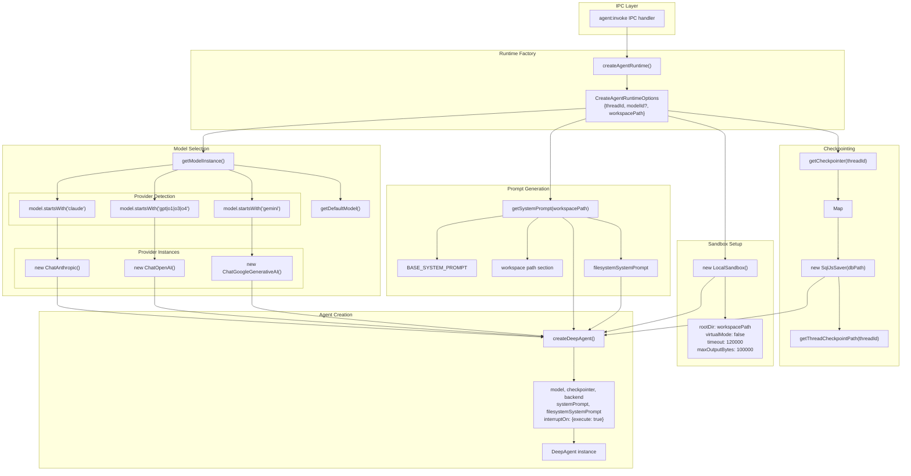
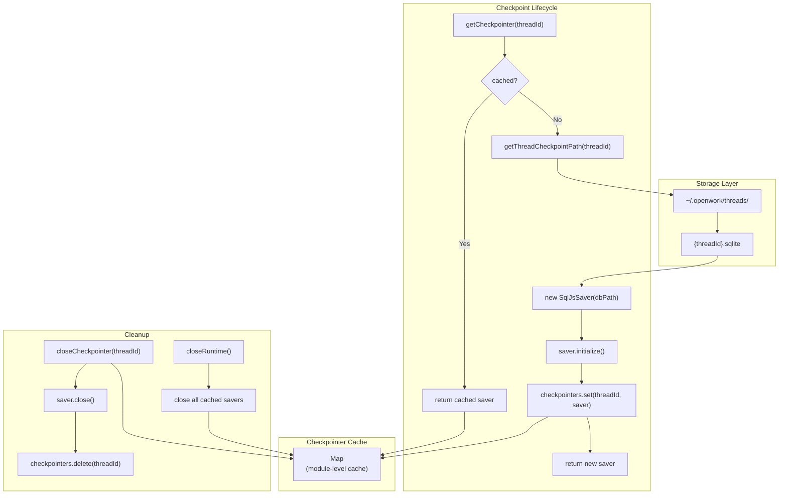
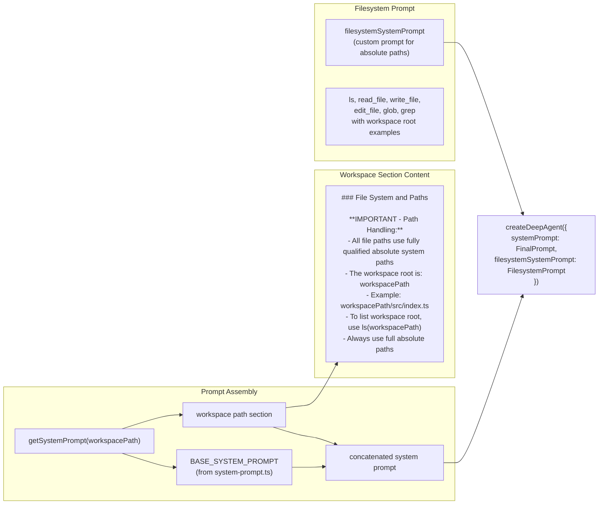
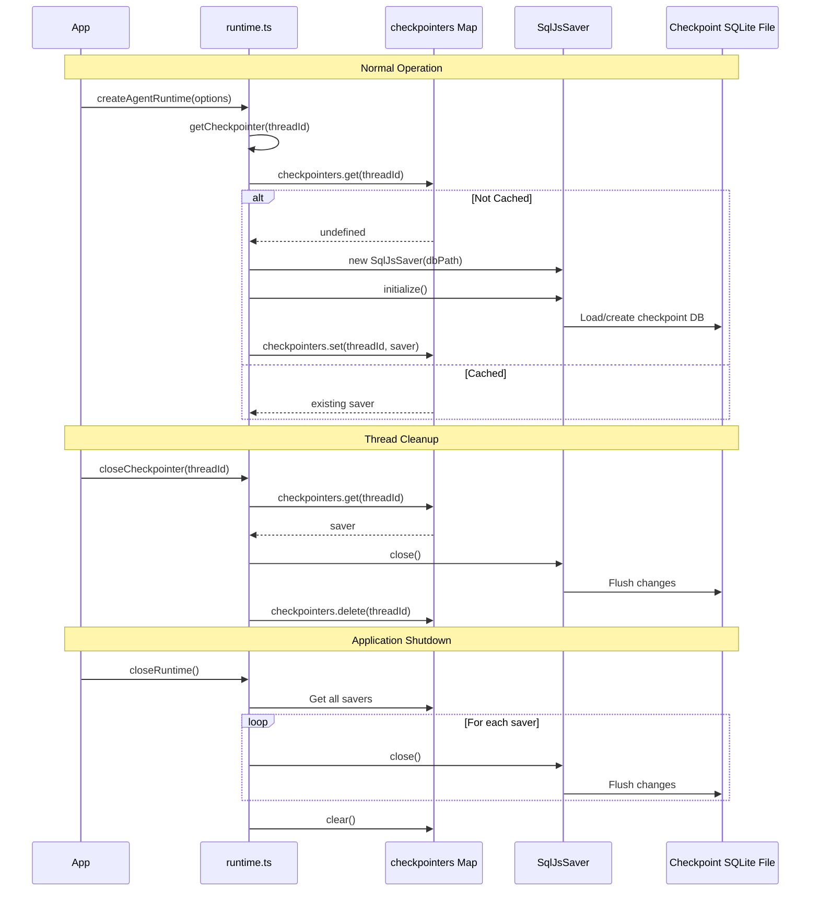

<!-- source: DeepWiki mcp.deepwiki.com · repo langchain-ai/openwork · page 3.1 Agent Runtime and Initialization · fetched 2026-10-26 -->

# Agent Runtime and Initialization

<details>
<summary>Relevant source files</summary>

The following files were used as context for generating this wiki page:

- [src/main/agent/runtime.ts](src/main/agent/runtime.ts)
- [src/main/agent/system-prompt.ts](src/main/agent/system-prompt.ts)
- [src/main/db/index.ts](src/main/db/index.ts)
- [src/main/storage.ts](src/main/storage.ts)

</details>


This document describes the agent runtime creation and initialization system in openwork. It covers the `createAgentRuntime` function, LLM provider selection, sandbox configuration, and per-thread checkpointing infrastructure. For information about the agent execution pipeline and streaming, see [Agent Streaming and Execution Pipeline](#3.2). For system prompt configuration, see [System Prompts and Agent Behavior](#3.4).

## Purpose and Scope

The agent runtime initialization system is responsible for:

- Creating configured `DeepAgent` instances with appropriate LLM models
- Setting up per-thread checkpointers for conversation state persistence
- Configuring `LocalSandbox` instances for file system operations
- Generating workspace-specific system prompts
- Managing runtime lifecycle and resource cleanup

All runtime creation logic is centralized in [src/main/agent/runtime.ts](). The system ensures each thread has its own isolated checkpoint storage while sharing model and sandbox configuration.

## Runtime Creation Architecture



**Runtime Creation Flow**: The `createAgentRuntime` function orchestrates initialization by assembling model instances, checkpointers, sandbox configuration, and system prompts into a configured `DeepAgent`. Provider detection happens via string prefix matching on model IDs, API keys are retrieved from storage, and per-thread checkpointers are cached for reuse.

Sources: [src/main/agent/runtime.ts:110-179]()

## CreateAgentRuntime Options

The `createAgentRuntime` function accepts a configuration object with the following structure:

| Field | Type | Required | Description |
|-------|------|----------|-------------|
| `threadId` | `string` | **Yes** | Thread identifier for checkpoint isolation. Each thread gets its own checkpoint database. |
| `modelId` | `string` | No | Model identifier (e.g., `"claude-sonnet-4-5-20250929"`). Defaults to configured default model if not provided. |
| `workspacePath` | `string` | **Yes** | Absolute path to workspace directory. Agent file operations are rooted at this path. |

Both `threadId` and `workspacePath` are mandatory. The function throws descriptive errors if either is missing:

```typescript
if (!threadId) {
  throw new Error("Thread ID is required for checkpointing.")
}

if (!workspacePath) {
  throw new Error(
    "Workspace path is required. Please select a workspace folder before running the agent."
  )
}
```

Sources: [src/main/agent/runtime.ts:110-133]()

## Model Selection and Provider Detection

```mermaid
flowchart TD
    Start["getModelInstance(modelId?)"]
    GetDefault["getDefaultModel()"]
    CheckModelId{modelId provided?}
    
    Start --> CheckModelId
    CheckModelId -->|No| GetDefault
    CheckModelId -->|Yes| UseProvided["use modelId"]
    GetDefault --> UseProvided
    
    UseProvided --> ClaudeCheck{starts with<br/>'claude'?}
    ClaudeCheck -->|Yes| GetAnthropicKey["getApiKey('anthropic')"]
    ClaudeCheck -->|No| GPTCheck{starts with<br/>'gpt|o1|o3|o4'?}
    
    GetAnthropicKey --> AnthropicKeyCheck{API key exists?}
    AnthropicKeyCheck -->|Yes| CreateAnthropic["new ChatAnthropic({<br/>model,<br/>anthropicApiKey<br/>})"]
    AnthropicKeyCheck -->|No| ThrowAnthropicError["throw 'Anthropic API key<br/>not configured'"]
    
    GPTCheck -->|Yes| GetOpenAIKey["getApiKey('openai')"]
    GPTCheck -->|No| GeminiCheck{starts with<br/>'gemini'?}
    
    GetOpenAIKey --> OpenAIKeyCheck{API key exists?}
    OpenAIKeyCheck -->|Yes| CreateOpenAI["new ChatOpenAI({<br/>model,<br/>openAIApiKey<br/>})"]
    OpenAIKeyCheck -->|No| ThrowOpenAIError["throw 'OpenAI API key<br/>not configured'"]
    
    GeminiCheck -->|Yes| GetGoogleKey["getApiKey('google')"]
    GeminiCheck -->|No| DefaultString["return model string"]
    
    GetGoogleKey --> GoogleKeyCheck{API key exists?}
    GoogleKeyCheck -->|Yes| CreateGoogle["new ChatGoogleGenerativeAI({<br/>model,<br/>apiKey<br/>})"]
    GoogleKeyCheck -->|No| ThrowGoogleError["throw 'Google API key<br/>not configured'"]
    
    CreateAnthropic --> Return["return model instance"]
    CreateOpenAI --> Return
    CreateGoogle --> Return
    DefaultString --> Return
```

**Model Provider Resolution**: The `getModelInstance` function determines the LLM provider by examining the model ID prefix. It constructs the appropriate `ChatAnthropic`, `ChatOpenAI`, or `ChatGoogleGenerativeAI` instance with API keys retrieved from storage. If no model ID is provided, `getDefaultModel()` supplies the system default.

Provider detection logic:

| Model Prefix | Provider | Chat Class | API Key Source |
|-------------|----------|------------|----------------|
| `claude` | Anthropic | `ChatAnthropic` | `getApiKey("anthropic")` |
| `gpt`, `o1`, `o3`, `o4` | OpenAI | `ChatOpenAI` | `getApiKey("openai")` |
| `gemini` | Google | `ChatGoogleGenerativeAI` | `getApiKey("google")` |
| Other | Default | String passthrough | None |

API keys are retrieved from the `.env` file at `~/.openwork/.env` with fallback to `process.env`. See [API Key Management](#4.2) for details on storage and retrieval.

Sources: [src/main/agent/runtime.ts:62-108](), [src/main/storage.ts:86-96]()

## Checkpointing Infrastructure



**Per-Thread Checkpoint Isolation**: Each thread maintains its own checkpoint database at `~/.openwork/threads/{threadId}.sqlite`. The `getCheckpointer` function implements a module-level cache (`Map<string, SqlJsSaver>`) to avoid repeatedly initializing the same checkpointer. On first access, a new `SqlJsSaver` is created, initialized, and cached. Subsequent calls for the same thread return the cached instance.

Checkpoint paths are generated by `getThreadCheckpointPath(threadId)` which combines the thread directory with the thread ID:

```typescript
export function getThreadCheckpointPath(threadId: string): string {
  return join(getThreadCheckpointDir(), `${threadId}.sqlite`)
}

export function getThreadCheckpointDir(): string {
  const dir = join(getOpenworkDir(), "threads")
  if (!existsSync(dir)) {
    mkdirSync(dir, { recursive: true })
  }
  return dir
}
```

The `SqlJsSaver` class (from `@langchain/langgraph-checkpoint`) persists conversation state including messages, tool calls, and agent memory. See [Thread Persistence and Checkpointing](#6.2) for database schema details.

Resource cleanup is handled by:
- `closeCheckpointer(threadId)`: Closes and removes a specific thread's checkpointer from cache
- `closeRuntime()`: Closes all cached checkpointers and clears the cache

Sources: [src/main/agent/runtime.ts:39-59](), [src/main/agent/runtime.ts:184-188](), [src/main/storage.ts:32-42]()

## LocalSandbox Configuration

The `LocalSandbox` instance provides isolated file system and shell command execution for the agent. It is configured with the following parameters:

```typescript
const backend = new LocalSandbox({
  rootDir: workspacePath,
  virtualMode: false,
  timeout: 120_000,
  maxOutputBytes: 100_000
})
```

| Parameter | Value | Description |
|-----------|-------|-------------|
| `rootDir` | `workspacePath` | Absolute path to workspace directory. All file operations are resolved relative to this root. |
| `virtualMode` | `false` | Disables path virtualization. File operations use fully qualified absolute paths for consistency with shell commands. |
| `timeout` | `120000` (120s) | Maximum execution time for shell commands in milliseconds. Commands exceeding this duration are terminated. |
| `maxOutputBytes` | `100000` (~100KB) | Maximum stdout/stderr output size. Output exceeding this limit is truncated to prevent memory exhaustion. |

The `virtualMode: false` setting is critical for consistency. When disabled, file paths are absolute system paths (e.g., `/Users/name/project/src/file.ts`) rather than workspace-relative paths (e.g., `src/file.ts`). This ensures shell commands and file operations use the same path conventions, preventing confusion when commands like `ls` or `cat` reference files.

The `LocalSandbox` implements the filesystem and shell execution tools that the agent uses. See [Agent Streaming and Execution Pipeline](#3.2) for details on tool call execution. For HITL approval of shell commands, see [Human-in-the-Loop (HITL) System](#3.3).

Sources: [src/main/agent/runtime.ts:145-150]()

## System Prompt Generation



**Dynamic Prompt Construction**: The agent receives two system prompts:

1. **Main System Prompt**: Generated by `getSystemPrompt(workspacePath)`, which prepends a workspace path section to `BASE_SYSTEM_PROMPT`. The workspace section emphasizes that all file paths must be fully qualified absolute paths and provides concrete examples using the actual workspace path.

2. **Filesystem System Prompt**: A custom prompt passed as `filesystemSystemPrompt` that describes filesystem tools with absolute path examples matching the workspace root.

Example workspace section for `workspacePath="/Users/alice/myproject"`:

```
### File System and Paths

**IMPORTANT - Path Handling:**
- All file paths use fully qualified absolute system paths
- The workspace root is: `/Users/alice/myproject`
- Example: `/Users/alice/myproject/src/index.ts`, `/Users/alice/myproject/README.md`
- To list the workspace root, use `ls("/Users/alice/myproject")`
- Always use full absolute paths for all file operations
```

The `BASE_SYSTEM_PROMPT` contains behavioral guidelines, tool usage instructions, and best practices. See [System Prompts and Agent Behavior](#3.4) for full prompt content.

Sources: [src/main/agent/runtime.ts:18-37](), [src/main/agent/runtime.ts:152-164]()

## Agent Creation and Configuration

The final step assembles all components into a `DeepAgent` instance:

```typescript
const agent = createDeepAgent({
  model,
  checkpointer,
  backend,
  systemPrompt,
  filesystemSystemPrompt,
  interruptOn: { execute: true }
} as Parameters<typeof createDeepAgent>[0])
```

Configuration breakdown:

| Parameter | Source | Purpose |
|-----------|--------|---------|
| `model` | `getModelInstance(modelId)` | LLM provider instance or model string |
| `checkpointer` | `getCheckpointer(threadId)` | Per-thread `SqlJsSaver` for state persistence |
| `backend` | `new LocalSandbox(...)` | Filesystem and shell execution environment |
| `systemPrompt` | `getSystemPrompt(workspacePath)` | Main behavioral instructions with workspace context |
| `filesystemSystemPrompt` | Custom string | Filesystem tool descriptions with absolute path examples |
| `interruptOn` | `{ execute: true }` | Enables HITL approval for all `execute` (shell command) tool calls |

The `interruptOn: { execute: true }` configuration is critical for security. It ensures every shell command triggers the human-in-the-loop approval flow before execution. See [Human-in-the-Loop (HITL) System](#3.3) for approval handling.

The returned `DeepAgent` instance is typed as `ReturnType<typeof createDeepAgent>` and stored as `AgentRuntime` type alias. This agent object provides methods for streaming execution, which are invoked by the IPC handler. See [Agent Streaming and Execution Pipeline](#3.2) for execution flow.

Sources: [src/main/agent/runtime.ts:166-178]()

## Runtime Type Definitions

The runtime module exports these key types:

```typescript
export type AgentRuntime = ReturnType<typeof createDeepAgent>
export type DeepAgent = ReturnType<typeof createDeepAgent>

export interface CreateAgentRuntimeOptions {
  threadId: string
  modelId?: string
  workspacePath: string
}
```

- `AgentRuntime` and `DeepAgent`: Identical types representing the runtime instance returned by `createDeepAgent`. Used throughout the codebase to type-check agent operations.
- `CreateAgentRuntimeOptions`: Configuration interface for `createAgentRuntime`, documenting required and optional parameters.

These types ensure type safety when passing agent instances between functions and provide IDE autocomplete for agent methods.

Sources: [src/main/agent/runtime.ts:110-121](), [src/main/agent/runtime.ts:181]()

## Resource Cleanup and Lifecycle Management



**Cleanup Functions**:

1. **`closeCheckpointer(threadId)`**: Closes a specific thread's checkpointer and removes it from cache. Use when a thread is deleted or when explicitly closing a conversation.

2. **`closeRuntime()`**: Closes all cached checkpointers and clears the cache. Called during application shutdown to ensure all checkpoint data is flushed to disk.

Both functions ensure checkpoint databases are properly closed, preventing data corruption and releasing file handles. The `SqlJsSaver.close()` method writes any pending changes to the SQLite file before closing the database connection.

Checkpoint cleanup is automatically triggered by the application lifecycle:
- Thread deletion calls `closeCheckpointer(threadId)` and deletes the checkpoint file via `deleteThreadCheckpoint(threadId)`
- Application exit calls `closeRuntime()` to flush all open checkpointers

Sources: [src/main/agent/runtime.ts:53-59](), [src/main/agent/runtime.ts:184-188](), [src/main/storage.ts:44-49]()

---

