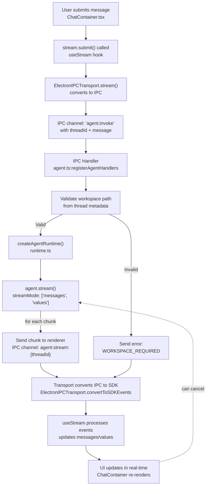
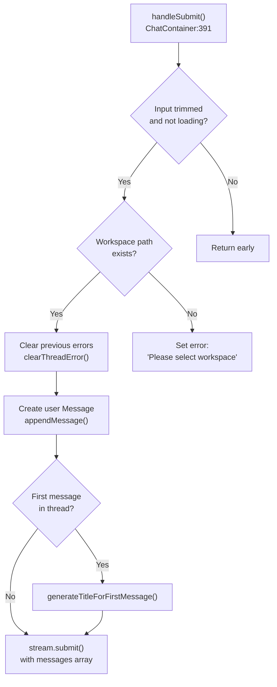
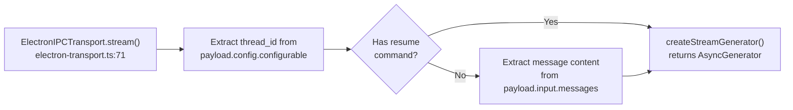
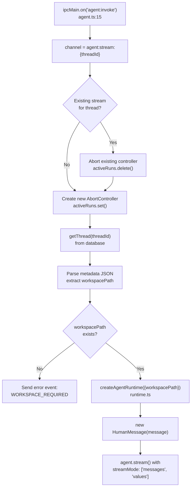
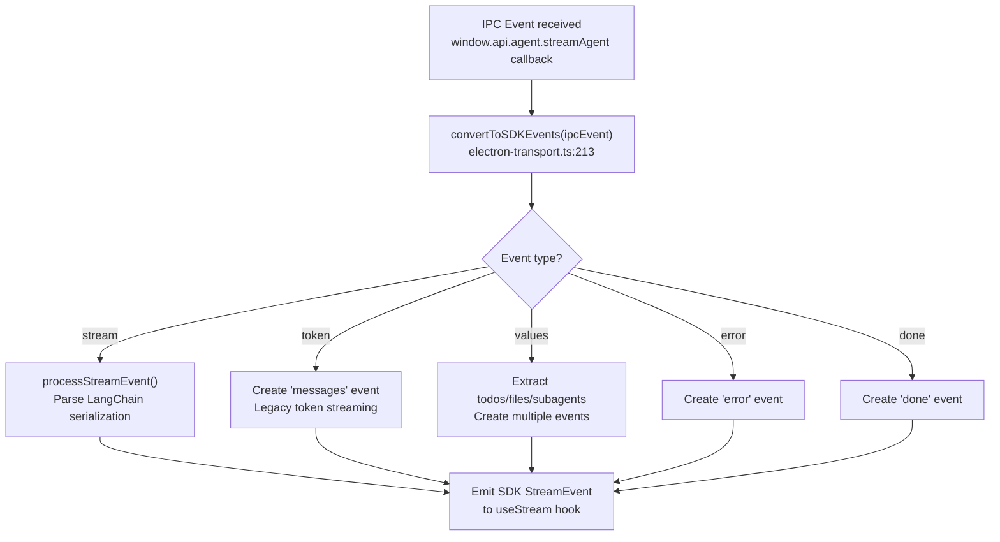
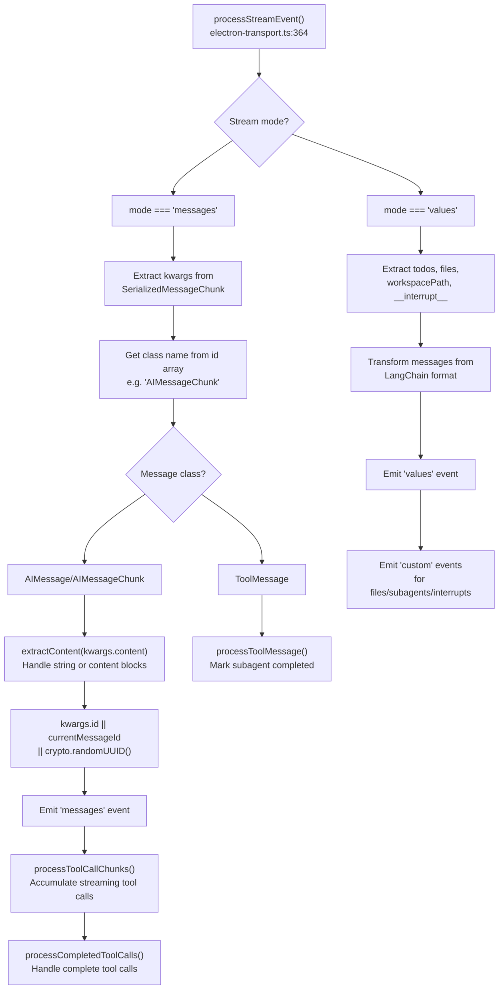
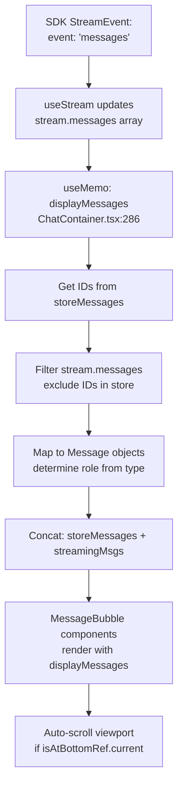
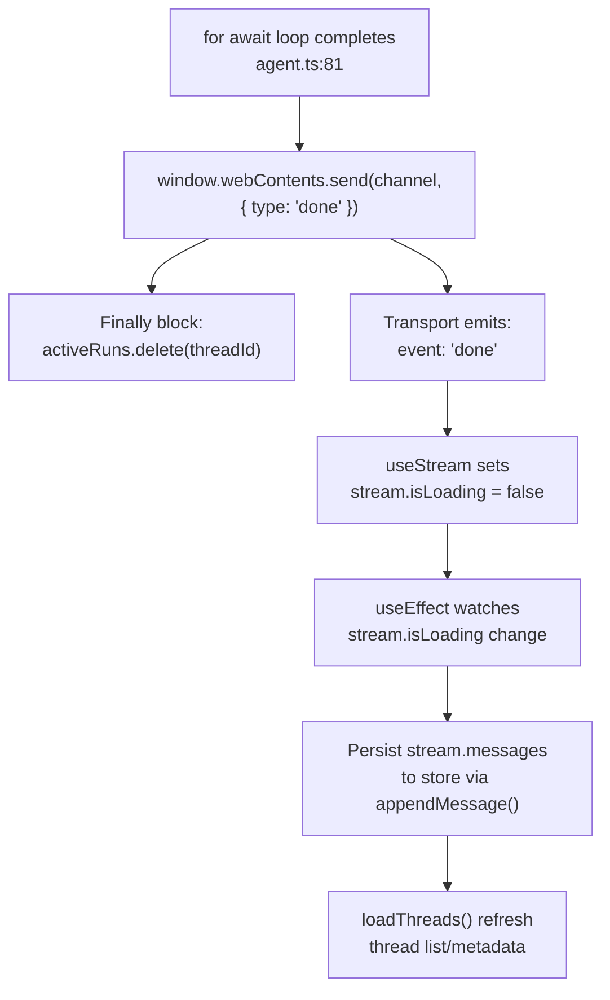
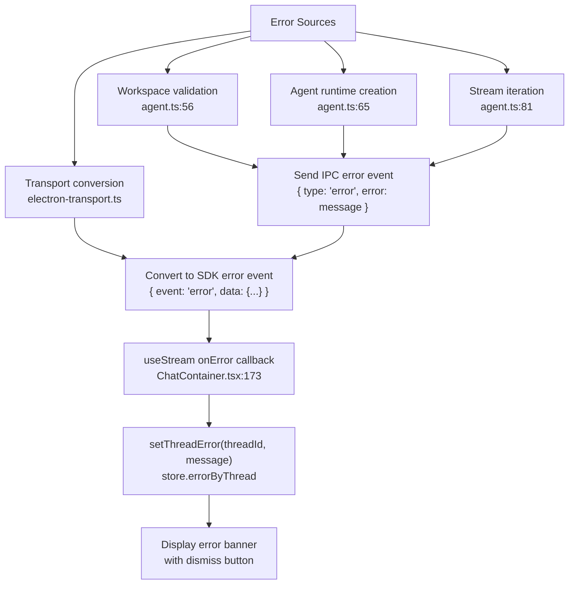
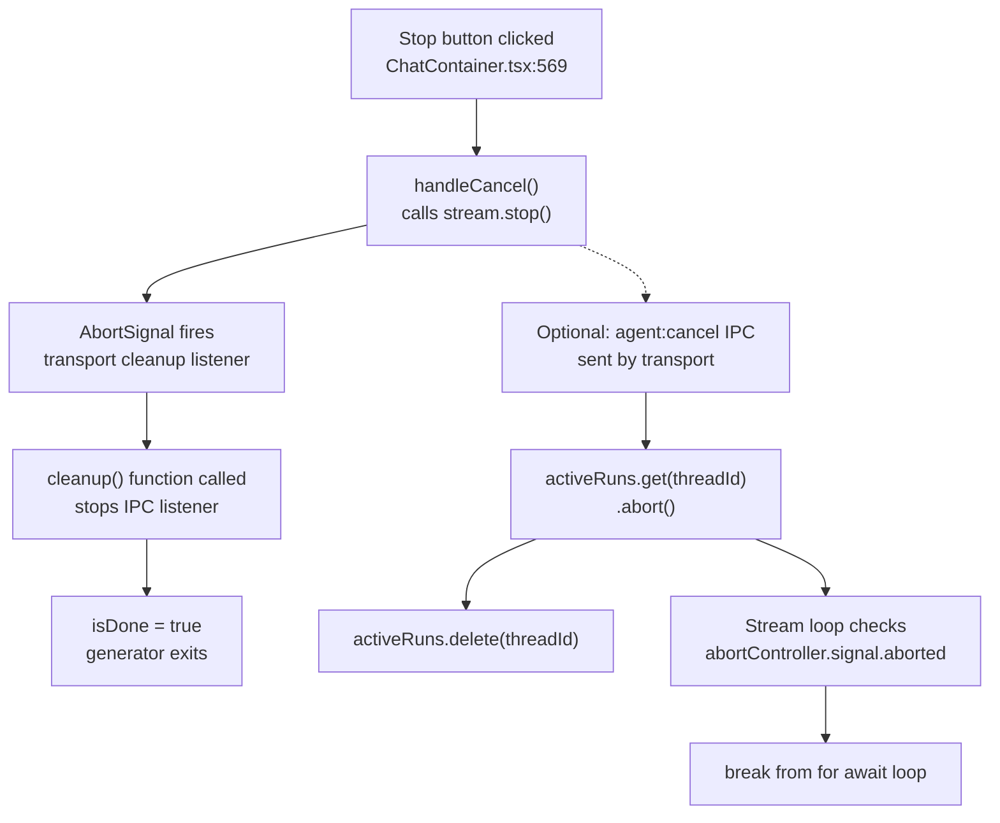

<!-- source: DeepWiki mcp.deepwiki.com · repo langchain-ai/openwork · page 3.2 Agent Streaming and Execution Pipeline · fetched 2026-10-26 -->

# Agent Streaming Execution Pipeline

<details>
<summary>Relevant source files</summary>

The following files were used as context for generating this wiki page:

- [src/main/ipc/agent.ts](src/main/ipc/agent.ts)
- [src/renderer/src/components/chat/ChatContainer.tsx](src/renderer/src/components/chat/ChatContainer.tsx)
- [src/renderer/src/lib/electron-transport.ts](src/renderer/src/lib/electron-transport.ts)

</details>


## Purpose and Scope

This document describes the complete execution pipeline for agent invocations, from user message submission through streaming response delivery and UI updates. It covers the IPC communication flow between renderer and main processes, the `ElectronIPCTransport` bridge layer, stream event processing, and real-time state synchronization.

For agent initialization and runtime configuration, see [Agent Runtime and Initialization](#3.1). For human-in-the-loop approval workflows, see [Human-in-the-Loop (HITL) System](#3.3). For workspace validation requirements, see [Workspace Selection and Management](#5.1).

## Execution Flow Overview

The agent streaming pipeline consists of five major stages: **invocation**, **streaming**, **transport**, **event processing**, and **UI update**. The pipeline is asynchronous and bidirectional, allowing real-time token streaming while maintaining conversational state.



**Sources:** [src/renderer/src/components/chat/ChatContainer.tsx:391-442](), [src/main/ipc/agent.ts:14-109](), [src/renderer/src/lib/electron-transport.ts:71-102]()

## Agent Invocation Process

### User Message Submission

Message submission begins in `ChatContainer` when the user submits the form. The component performs validation checks before initiating the stream:



The `stream.submit()` call is provided by the `useStream` hook from `@langchain/langgraph-sdk/react`, which uses the custom `ElectronIPCTransport` instead of HTTP:

**Sources:** [src/renderer/src/components/chat/ChatContainer.tsx:391-442](), [src/renderer/src/components/chat/ChatContainer.tsx:165-178]()

### Transport Layer Conversion

The `ElectronIPCTransport` implements the `UseStreamTransport` interface and converts SDK calls to Electron IPC:

| SDK Method | IPC Action | Channel |
|------------|-----------|---------|
| `stream(payload)` | Sends `agent:invoke` with message | Creates stream generator |
| `submit(input, opts)` | Routes to `agent:invoke` or `agent:resume` | Based on command presence |

The transport's `stream()` method validates the payload and creates an async generator that bridges IPC events:



The generator calls `window.api.agent.streamAgent()`, which sends the IPC message to the main process and sets up a listener on the response channel:

**Sources:** [src/renderer/src/lib/electron-transport.ts:71-102](), [src/renderer/src/lib/electron-transport.ts:111-207]()

### Main Process Handler

The main process receives the invocation on the `agent:invoke` channel and executes the agent:



The handler uses dual stream modes to capture both real-time message tokens (`messages` mode) and full state updates (`values` mode):

**Sources:** [src/main/ipc/agent.ts:14-109](), [src/main/ipc/agent.ts:50-79]()

## Stream Event Processing

### Dual Stream Mode Architecture

The agent streams with two modes simultaneously, producing tuples of `[mode, data]`:

| Stream Mode | Content | Frequency | Purpose |
|------------|---------|-----------|---------|
| `messages` | Message chunks with tokens | High (per token) | Real-time typing effect |
| `values` | Full state snapshots | Low (per node completion) | State synchronization (todos, files) |

The main process forwards these chunks via IPC as serialized JSON:

**Sources:** [src/main/ipc/agent.ts:70-94]()

### IPC Event Format

Stream chunks are sent to the renderer process on channel `agent:stream:${threadId}` with this structure:

```typescript
// IPC event format
{
  type: 'stream',
  mode: 'messages' | 'values',
  data: JSON.parse(JSON.stringify(chunkData))  // Serialized for IPC transfer
}
```

The `ElectronIPCTransport` receives these IPC events and converts them to SDK-compatible `StreamEvent` objects:



**Sources:** [src/renderer/src/lib/electron-transport.ts:209-359]()

### LangChain Message Deserialization

LangGraph serializes messages in a special format that must be parsed by the transport:

```typescript
// LangChain serialization format
{
  lc: 1,
  type: "constructor",
  id: ["langchain_core", "messages", "AIMessageChunk"],
  kwargs: {
    id: "msg_123",
    content: "token text",
    tool_calls: [...],
    tool_call_chunks: [...]
  }
}
```

The `processStreamEvent()` method extracts data from this format:



**Sources:** [src/renderer/src/lib/electron-transport.ts:364-634](), [src/renderer/src/lib/electron-transport.ts:11-26]()

## Real-Time State Updates

### Message Streaming and Display

The `useStream` hook processes `messages` events and updates its internal state. `ChatContainer` combines store messages with streaming messages for display:



The component tracks scroll position to determine whether to auto-scroll on new messages:

**Sources:** [src/renderer/src/components/chat/ChatContainer.tsx:286-322](), [src/renderer/src/components/chat/ChatContainer.tsx:346-380]()

### Todos Synchronization

Todos are synchronized from the `values` stream mode through the `stream.values` property:

```mermaid
flowchart LR
    ValuesEvent["SDK StreamEvent:<br/>event: 'values'<br/>data: { todos: [...] }"]
    UseStreamValues["useStream updates<br/>stream.values object"]
    
    UseEffect["useEffect listener<br/>ChatContainer.tsx:201"]
    CastType["Cast stream.values as<br/>AgentStreamValues"]
    GetTodos["Extract streamTodos<br/>from agentValues?.todos"]
    CheckArray{Array.isArray<br/>(streamTodos)?}
    MapTodos["Map to Todo objects<br/>with id/content/status"]
    SetTodos["setTodos() updates<br/>store.todos"]
    
    TodoPanel["TodoPanel renders<br/>todos from store"]
    ChatTodos["ChatTodos displays<br/>during streaming"]
    
    ValuesEvent --> UseStreamValues
    UseStreamValues --> UseEffect
    UseEffect --> CastType
    CastType --> GetTodos
    GetTodos --> CheckArray
    CheckArray -->|Yes| MapTodos
    MapTodos --> SetTodos
    SetTodos --> TodoPanel
    SetTodos --> ChatTodos
```

The todos array is only set when explicitly provided in the stream to avoid clearing the list with `undefined`:

**Sources:** [src/renderer/src/components/chat/ChatContainer.tsx:198-211](), [src/renderer/src/lib/electron-transport.ts:249-258]()

### Workspace Files Tracking

Files are emitted as custom events and merged with existing workspace state:

```mermaid
flowchart TD
    CustomEvent["SDK StreamEvent:<br/>event: 'custom'<br/>data.type: 'workspace'"]
    OnCustomEvent["onCustomEvent callback<br/>ChatContainer.tsx:170"]
    HandleCustom["handleCustomEvent(data)<br/>ChatContainer.tsx:95"]
    
    CheckType{data.type?}
    
    WorkspaceCase["type === 'workspace'"]
    CheckFiles{Array.isArray<br/>(data.files)?}
    MergeFiles["setWorkspaceFiles((prev) => {})<br/>Create Map, merge by path"]
    SetPath["setWorkspacePath(data.path)<br/>if path provided"]
    
    MessageCase["type === 'message'"]
    AppendMsg["appendMessage(storeMsg)"]
    
    SubagentCase["type === 'subagents'"]
    SetSubagents["setSubagents(mappedArray)"]
    
    InterruptCase["type === 'interrupt'"]
    SetPending["setPendingApproval(request)"]
    
    CustomEvent --> OnCustomEvent
    OnCustomEvent --> HandleCustom
    HandleCustom --> CheckType
    
    CheckType --> WorkspaceCase
    WorkspaceCase --> CheckFiles
    CheckFiles -->|Yes| MergeFiles
    MergeFiles --> SetPath
    
    CheckType --> MessageCase
    MessageCase --> AppendMsg
    
    CheckType --> SubagentCase
    SubagentCase --> SetSubagents
    
    CheckType --> InterruptCase
    InterruptCase --> SetPending
```

The merge strategy uses a Map to avoid duplicate files when multiple events provide the same file path:

**Sources:** [src/renderer/src/components/chat/ChatContainer.tsx:95-163](), [src/renderer/src/components/chat/ChatContainer.tsx:122-140]()

### Subagent Lifecycle Tracking

The transport layer maintains state for active subagents by tracking tool calls and tool messages:

| Event | Action | Transport State |
|-------|--------|-----------------|
| Tool call: `name: 'task'` | Create subagent with status `'running'` | Add to `activeSubagents` Map |
| Tool message with matching `tool_call_id` | Update status to `'completed'` | Update in `activeSubagents` Map |
| Emit to UI | Send custom event `type: 'subagents'` | Array from Map values |

The subagent detection logic handles both streaming (tool call chunks) and non-streaming (complete tool calls):

**Sources:** [src/renderer/src/lib/electron-transport.ts:658-725](), [src/renderer/src/lib/electron-transport.ts:727-742]()

## Stream Completion and Persistence

When the agent finishes execution, the main process sends a `done` event:



The persistence effect runs when `stream.isLoading` transitions from `true` to `false`, copying all streaming messages to the store:

**Sources:** [src/main/ipc/agent.ts:96-108](), [src/renderer/src/components/chat/ChatContainer.tsx:246-283]()

## Error Handling

Errors can occur at multiple stages of the pipeline:



Error messages are stored per-thread in the store and displayed in the chat UI with a dismiss action:

**Sources:** [src/main/ipc/agent.ts:56-63](), [src/main/ipc/agent.ts:98-103](), [src/renderer/src/components/chat/ChatContainer.tsx:173-177](), [src/renderer/src/components/chat/ChatContainer.tsx:526-546]()

## Stream Cancellation

Users can cancel an active stream by clicking the stop button. Cancellation propagates through multiple layers:



The `AbortController` pattern ensures graceful cancellation across the IPC boundary:

**Sources:** [src/renderer/src/components/chat/ChatContainer.tsx:464-466](), [src/renderer/src/lib/electron-transport.ts:159-169](), [src/main/ipc/agent.ts:32-42](), [src/main/ipc/agent.ts:82]()

---

