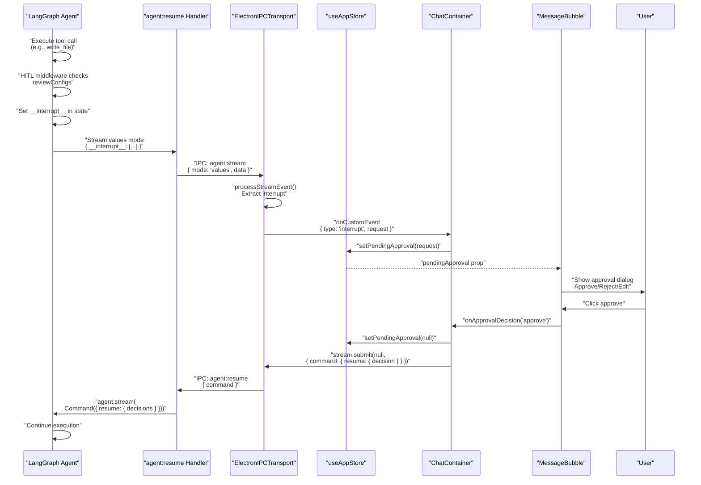
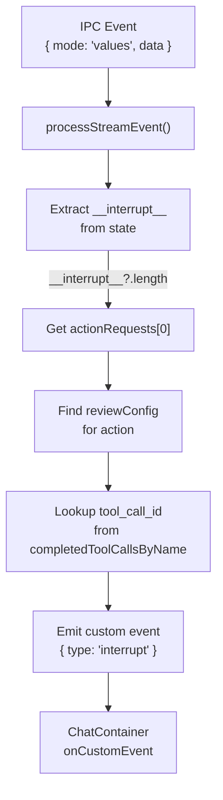
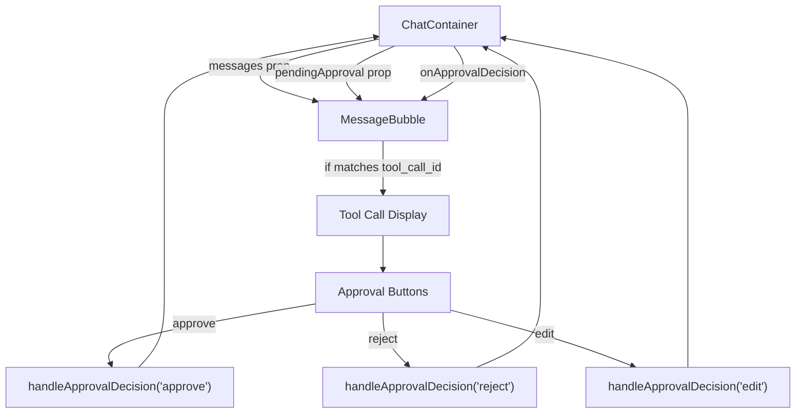
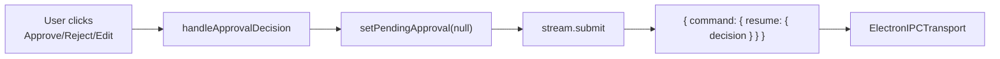
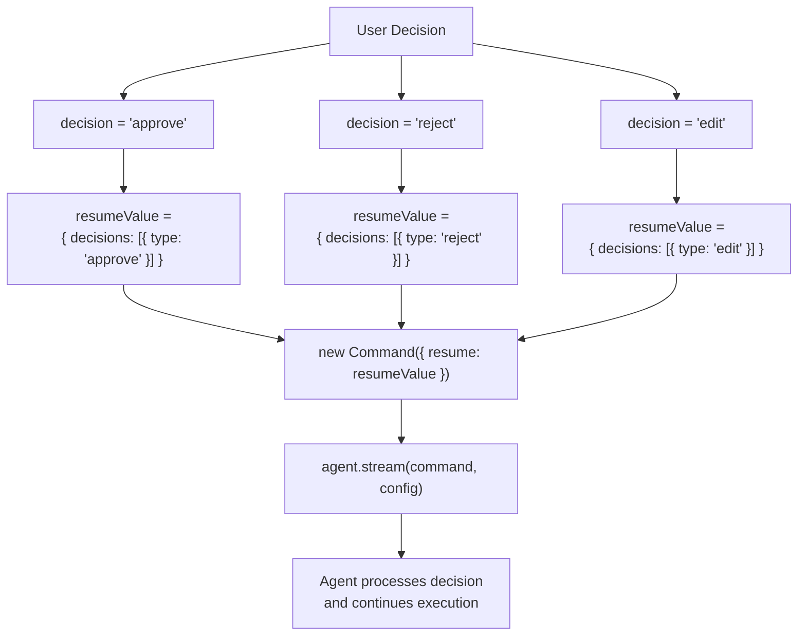

<!-- source: DeepWiki mcp.deepwiki.com · repo langchain-ai/openwork · page 3.3 Human-in-the-Loop (HITL) System · fetched 2026-10-26 -->

# Human-in-the-Loop (HITL) System

<details>
<summary>Relevant source files</summary>

The following files were used as context for generating this wiki page:

- [src/main/ipc/agent.ts](src/main/ipc/agent.ts)
- [src/renderer/src/components/chat/ChatContainer.tsx](src/renderer/src/components/chat/ChatContainer.tsx)
- [src/renderer/src/lib/electron-transport.ts](src/renderer/src/lib/electron-transport.ts)

</details>


## Purpose and Scope

This document describes the Human-in-the-Loop (HITL) system in OpenWork, which enables agents to pause execution and request explicit human approval before performing potentially dangerous or sensitive operations. The system handles the complete interrupt-approval-resume cycle, from agent-initiated interrupts to user decisions and execution resumption.

For information about agent execution without interrupts, see [Agent Streaming Execution Pipeline](#3.2). For system prompts that guide when agents should request approval, see [System Prompts and Agent Behavior](#3.4).

**Sources:** [src/renderer/src/components/chat/ChatContainer.tsx:1-590](), [src/main/ipc/agent.ts:1-280](), [src/renderer/src/lib/electron-transport.ts:1-794]()

---

## System Overview

The HITL system implements a bidirectional flow where the agent can interrupt its execution to request approval, wait for a human decision, and then resume with that decision. This mechanism is powered by LangGraph's HITL middleware on the backend and a custom approval UI on the frontend.

**Key characteristics:**
- **Blocking execution**: Agent pauses completely until a decision is received
- **Tool call context**: Interrupts include the specific tool call requiring approval
- **Multiple decision types**: Users can approve, reject, or edit the operation
- **State preservation**: Agent state is checkpointed during interrupts

**Sources:** [src/renderer/src/components/chat/ChatContainer.tsx:69-84](), [src/main/ipc/agent.ts:111-191]()

---

## End-to-End Interrupt Flow



**Interrupt Request Flow:**
1. LangGraph HITL middleware intercepts tool calls requiring approval
2. Sets `__interrupt__` array in agent state with action requests
3. Main process streams values mode to renderer via IPC
4. `ElectronIPCTransport` converts to SDK format custom event
5. `ChatContainer` stores in `pendingApproval` state
6. `MessageBubble` displays approval UI for matching tool call

**Resume Flow:**
7. User makes decision (approve/reject/edit)
8. `ChatContainer.handleApprovalDecision` clears pending state
9. Calls `stream.submit` with resume command
10. Transport sends to `agent:resume` IPC handler
11. Main process creates `Command({ resume: ... })` and continues stream
12. Agent processes decision and resumes execution

**Sources:** [src/renderer/src/components/chat/ChatContainer.tsx:95-196](), [src/main/ipc/agent.ts:111-191](), [src/renderer/src/lib/electron-transport.ts:461-631]()

---

## Agent Interrupt Generation

The agent generates interrupts through LangGraph's built-in HITL middleware, which examines tool calls and determines if they require approval based on `reviewConfigs`.

### Interrupt Data Structure

When an interrupt occurs, LangGraph sets the `__interrupt__` field in the agent state:

```typescript
interface AgentState {
  __interrupt__?: Array<{
    value?: {
      actionRequests?: Array<{
        name: string       // Tool name (e.g., "write_file")
        id: string         // Action request ID
        args: Record<string, unknown>  // Tool arguments
      }>
      reviewConfigs?: Array<{
        actionName: string
        allowedDecisions: string[]  // e.g., ["approve", "reject", "edit"]
      }>
    }
  }>
}
```

The interrupt contains:
- **actionRequests**: Array of tool calls requiring approval
- **reviewConfigs**: Configuration for each action including allowed decisions
- **args**: Complete tool call arguments for display/editing

**Sources:** [src/renderer/src/lib/electron-transport.ts:469-476](), [src/renderer/src/lib/electron-transport.ts:590-630]()

### IPC Streaming

The main process streams the interrupt via the `values` stream mode:

| Stream Mode | Purpose | Contains Interrupt |
|-------------|---------|-------------------|
| `messages` | Real-time token streaming | No |
| `values` | Full state snapshots | Yes (in `__interrupt__`) |

The agent runtime uses both modes simultaneously to provide real-time feedback while also transmitting complete state:

```typescript
// In agent:invoke handler
const stream = await agent.stream(
  { messages: [humanMessage] },
  {
    configurable: { thread_id: threadId },
    streamMode: ['messages', 'values'],  // Both modes
    recursionLimit: 1000
  }
)
```

**Sources:** [src/main/ipc/agent.ts:71-79](), [src/main/ipc/agent.ts:159-161]()

---

## Transport Layer Processing

The `ElectronIPCTransport` class bridges IPC events to the LangGraph SDK format, handling interrupt extraction and conversion.

### Interrupt Extraction from Values Mode



The transport maintains a mapping of tool calls to match interrupt requests with the actual tool call IDs:

```typescript
// Track completed tool calls for HITL matching
private completedToolCallsByName: Map<string, CompletedToolCall[]> = new Map()

// When processing AI message tool_calls
for (const tc of kwargs.tool_calls) {
  if (tc.id && tc.name) {
    const existing = this.completedToolCallsByName.get(tc.name) || []
    existing.push({ id: tc.id, name: tc.name, args: tc.args || {} })
    this.completedToolCallsByName.set(tc.name, existing)
  }
}

// When processing interrupt
const trackedToolCalls = this.completedToolCallsByName.get(firstAction.name)
const toolCallId = trackedToolCalls?.[trackedToolCalls.length - 1]?.id
```

**Why tracking is needed**: LangGraph's `__interrupt__` provides action requests with `name` and `args` but not the `tool_call_id`. The transport tracks tool calls as they're emitted to match them with interrupt requests.

**Sources:** [src/renderer/src/lib/electron-transport.ts:65-76](), [src/renderer/src/lib/electron-transport.ts:424-431](), [src/renderer/src/lib/electron-transport.ts:590-630]()

### Converting to SDK Format

The transport emits a custom event that the SDK's `onCustomEvent` handler receives:

```typescript
// Custom event emitted by transport
{
  event: 'custom',
  data: {
    type: 'interrupt',
    request: {
      id: toolCallId || crypto.randomUUID(),
      tool_call: {
        id: toolCallId,
        name: firstAction.name,        // e.g., "write_file"
        args: firstAction.args || {}   // e.g., { path: "...", content: "..." }
      },
      allowed_decisions: ['approve', 'reject', 'edit']
    }
  }
}
```

**Sources:** [src/renderer/src/lib/electron-transport.ts:614-628]()

---

## UI Approval Dialog

The approval dialog is rendered by `MessageBubble` when a tool call matches the pending approval request.

### State Management

`ChatContainer` maintains the `pendingApproval` state and passes it down:

```typescript
const {
  pendingApproval,
  setPendingApproval,
  // ... other state
} = useAppStore()

// Handle custom events from stream
const handleCustomEvent = useCallback((data: CustomEventData): void => {
  switch (data.type) {
    case 'interrupt':
      if (data.request) {
        setPendingApproval(data.request as Parameters<typeof setPendingApproval>[0])
      }
      break
    // ... other cases
  }
}, [setPendingApproval, /* ... */])
```

**Sources:** [src/renderer/src/components/chat/ChatContainer.tsx:69-84](), [src/renderer/src/components/chat/ChatContainer.tsx:155-160]()

### Approval Dialog Component Structure



`MessageBubble` receives:
- **messages**: All messages in the conversation
- **toolResults**: Map of tool call IDs to results
- **pendingApproval**: Current interrupt request (or null)
- **onApprovalDecision**: Callback for user decisions

The component matches pending approval with tool calls:
```typescript
// In MessageBubble (simplified)
message.tool_calls?.forEach(toolCall => {
  const needsApproval = 
    pendingApproval && 
    pendingApproval.tool_call.id === toolCall.id

  if (needsApproval) {
    // Render approval buttons
    <div className="approval-dialog">
      <div>Tool: {toolCall.name}</div>
      <div>Args: {JSON.stringify(toolCall.args)}</div>
      <button onClick={() => onApprovalDecision('approve')}>Approve</button>
      <button onClick={() => onApprovalDecision('reject')}>Reject</button>
    </div>
  }
})
```

**Sources:** [src/renderer/src/components/chat/ChatContainer.tsx:504-512]()

---

## Resume Mechanism

After the user makes a decision, the system resumes agent execution using LangGraph's `Command` API.

### Decision Handling



The `handleApprovalDecision` callback:

```typescript
const handleApprovalDecision = useCallback(async (decision: 'approve' | 'reject' | 'edit') => {
  if (!pendingApproval) return

  // Clear pending approval first
  setPendingApproval(null)

  // Submit with a resume command
  try {
    await stream.submit(
      null,  // No message needed for resume
      { command: { resume: { decision } } }
    )
  } catch (err) {
    console.error('[ChatContainer] Resume command failed:', err)
  }
}, [pendingApproval, setPendingApproval, stream])
```

**Key points:**
- Clears `pendingApproval` immediately to hide dialog
- Passes `null` as message (no new input needed)
- Includes `command.resume` with the decision

**Sources:** [src/renderer/src/components/chat/ChatContainer.tsx:181-196]()

### Transport Routing

`ElectronIPCTransport` detects the resume command and routes to the appropriate IPC handler:

```typescript
async stream(payload: StreamPayload): Promise<AsyncGenerator<StreamEvent>> {
  // Check if this is a resume command
  const hasResumeCommand = payload.command?.resume !== undefined
  
  // Extract message content
  const messageContent = /* ... */
  
  // Only require message content if not resuming
  if (!messageContent && !hasResumeCommand) {
    return this.createErrorGenerator('MISSING_MESSAGE', 'Message content is required')
  }

  // Pass command to stream generator
  return this.createStreamGenerator(threadId, messageContent, payload.command, payload.signal)
}
```

The transport checks for `payload.command?.resume` and allows empty message content when resuming.

**Sources:** [src/renderer/src/lib/electron-transport.ts:83-102]()

### IPC Resume Handler

The main process `agent:resume` handler processes the decision and resumes the agent:

```typescript
ipcMain.on('agent:resume', async (event, { threadId, command }) => {
  // Get workspace path from thread metadata
  const thread = getThread(threadId)
  const workspacePath = /* extract from metadata */

  // Create agent runtime
  const agent = await createAgentRuntime({ workspacePath })
  
  // Extract decision and format for LangGraph
  const decisionType = command?.resume?.decision || 'approve'
  const resumeValue = { decisions: [{ type: decisionType }] }
  
  // Stream with Command containing the resume value
  const stream = await agent.stream(
    new Command({ resume: resumeValue }),
    {
      configurable: { thread_id: threadId },
      streamMode: ['messages', 'values'],
      recursionLimit: 1000
    }
  )

  // Forward stream events back to renderer
  for await (const chunk of stream) {
    window.webContents.send(channel, {
      type: 'stream',
      mode,
      data: JSON.parse(JSON.stringify(data))
    })
  }
})
```

**Decision format transformation:**
- UI sends: `{ decision: 'approve' }`
- Handler converts to: `{ decisions: [{ type: 'approve' }] }`
- LangGraph expects array of decision objects

**Sources:** [src/main/ipc/agent.ts:111-191]()

---

## Data Structures and Types

### HITLDecision Type

```typescript
// Main process type
type HITLDecision = {
  type: 'approve' | 'reject' | 'edit'
}
```

**Sources:** [src/main/ipc/agent.ts:6]()

### PendingApproval State

The `pendingApproval` state in the store holds the interrupt request:

```typescript
interface PendingApproval {
  id: string
  tool_call: {
    id: string
    name: string              // e.g., "write_file", "edit_file"
    args: Record<string, unknown>  // Tool-specific arguments
  }
  allowed_decisions: string[]  // e.g., ["approve", "reject", "edit"]
}
```

**State flow:**
1. Set by `setPendingApproval(request)` when interrupt received
2. Passed to `MessageBubble` as prop
3. Cleared by `setPendingApproval(null)` when decision made

**Sources:** [src/renderer/src/components/chat/ChatContainer.tsx:69](), [src/renderer/src/components/chat/ChatContainer.tsx:157]()

### CustomEventData Interface

The transport's custom event interface includes interrupt data:

```typescript
interface CustomEventData {
  type?: string
  message?: MessageEventData
  files?: FileEventData[]
  path?: string
  subagents?: SubagentEventData[]
  request?: unknown  // Interrupt request object
}
```

When `type === 'interrupt'`, the `request` field contains the `PendingApproval` structure.

**Sources:** [src/renderer/src/components/chat/ChatContainer.tsx:52-59]()

---

## Decision Processing Flow



**Decision effects:**
- **approve**: Tool call executes with original arguments
- **reject**: Tool call is skipped, agent receives error/cancellation
- **edit**: Tool call executes with modified arguments (implementation varies)

**Sources:** [src/main/ipc/agent.ts:163-168]()

---

## Abort and Cleanup

The system handles cleanup when interrupts are abandoned:

### Active Run Tracking

```typescript
// Track active runs for cancellation
const activeRuns = new Map<string, AbortController>()

// On resume
const existingController = activeRuns.get(threadId)
if (existingController) {
  existingController.abort()  // Cancel existing stream
  activeRuns.delete(threadId)
}

const abortController = new AbortController()
activeRuns.set(threadId, abortController)
```

**Cleanup scenarios:**
1. User submits new message before approving → abort existing, start new
2. User switches threads → abort on window close
3. User cancels via stop button → `agent:cancel` handler aborts

**Sources:** [src/main/ipc/agent.ts:8-10](), [src/main/ipc/agent.ts:145-152]()

### Window Close Handling

```typescript
// Abort the stream if the window is closed/destroyed
const onWindowClosed = (): void => {
  console.log('[Agent] Window closed, aborting stream for thread:', threadId)
  abortController.abort()
}
window.once('closed', onWindowClosed)

// Clean up listener when stream completes
finally {
  window.removeListener('closed', onWindowClosed)
  activeRuns.delete(threadId)
}
```

**Sources:** [src/main/ipc/agent.ts:44-106]()

---

## Error Handling

### Interrupt Processing Errors

If interrupt processing fails, the system degrades gracefully:

```typescript
// In transport processStreamEvent
if (state.__interrupt__?.length) {
  const interruptValue = state.__interrupt__[0]?.value
  const actionRequests = interruptValue?.actionRequests

  if (actionRequests?.length) {
    // Try to find tool call ID from tracked calls
    const trackedToolCalls = this.completedToolCallsByName.get(firstAction.name)
    
    // Fallback to generated ID if not found
    const toolCallId = trackedToolCalls?.[trackedToolCalls.length - 1]?.id 
      || crypto.randomUUID()
    
    // Emit event even if tool_call_id is synthetic
    events.push({ event: 'custom', data: { type: 'interrupt', request: { ... } } })
  }
}
```

**Fallback behavior:**
- Missing tool call ID → Generate synthetic UUID
- Missing review config → Default to `['approve', 'reject', 'edit']`
- Empty action requests → No interrupt event emitted

**Sources:** [src/renderer/src/lib/electron-transport.ts:603-628]()

### Resume Errors

Resume failures are caught and logged, with error events sent to the renderer:

```typescript
try {
  const stream = await agent.stream(new Command({ resume: resumeValue }), config)
  // ... stream processing
} catch (error) {
  console.error('[Agent] Resume error:', error)
  window.webContents.send(channel, {
    type: 'error',
    error: error instanceof Error ? error.message : 'Unknown error'
  })
}
```

**Sources:** [src/main/ipc/agent.ts:181-187]()

---

## Integration with Checkpointing

The HITL system relies on LangGraph's checkpoint mechanism to preserve state during interrupts:

1. **Before interrupt**: Agent state is checkpointed with `__interrupt__` set
2. **During pause**: Checkpoint persists in `langgraph.sqlite`
3. **On resume**: `Command({ resume: ... })` loads checkpoint and continues
4. **After completion**: New checkpoint created with cleared `__interrupt__`

The thread ID ensures the correct checkpoint is loaded:

```typescript
const config = {
  configurable: { thread_id: threadId },  // Load checkpoint for this thread
  signal: abortController.signal,
  streamMode: ['messages', 'values'],
  recursionLimit: 1000
}

const stream = await agent.stream(new Command({ resume: resumeValue }), config)
```

**Sources:** [src/main/ipc/agent.ts:156-161]()

---

