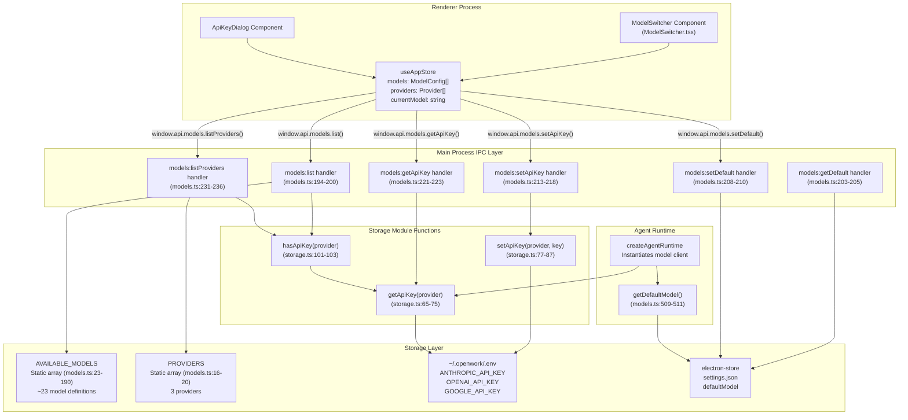
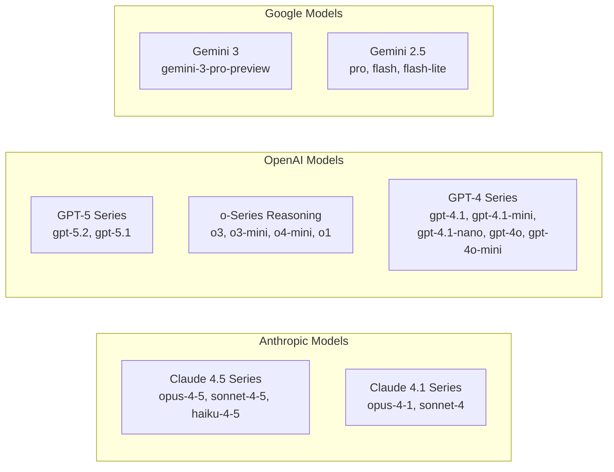
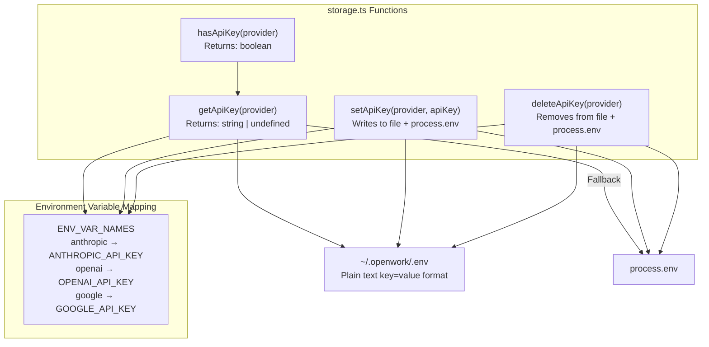
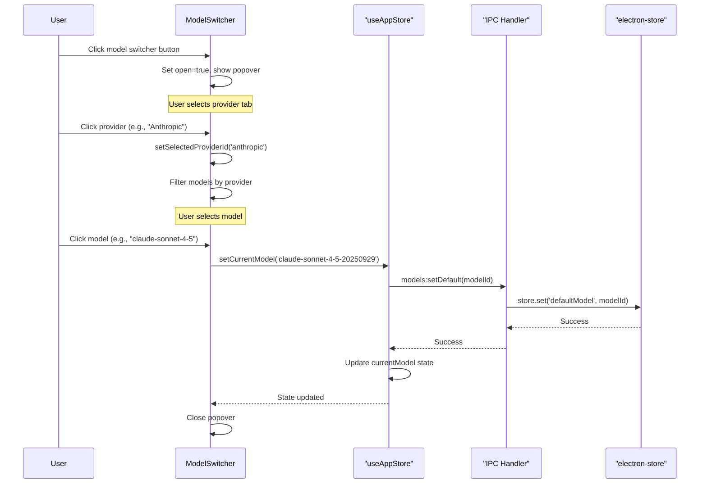
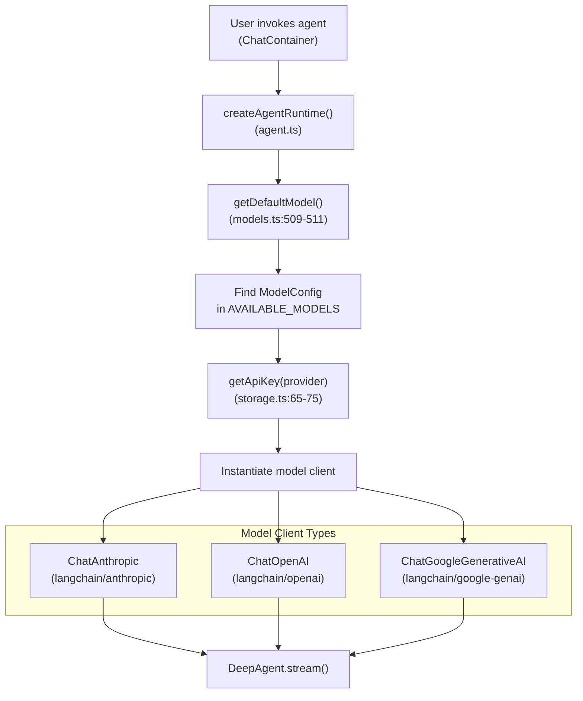
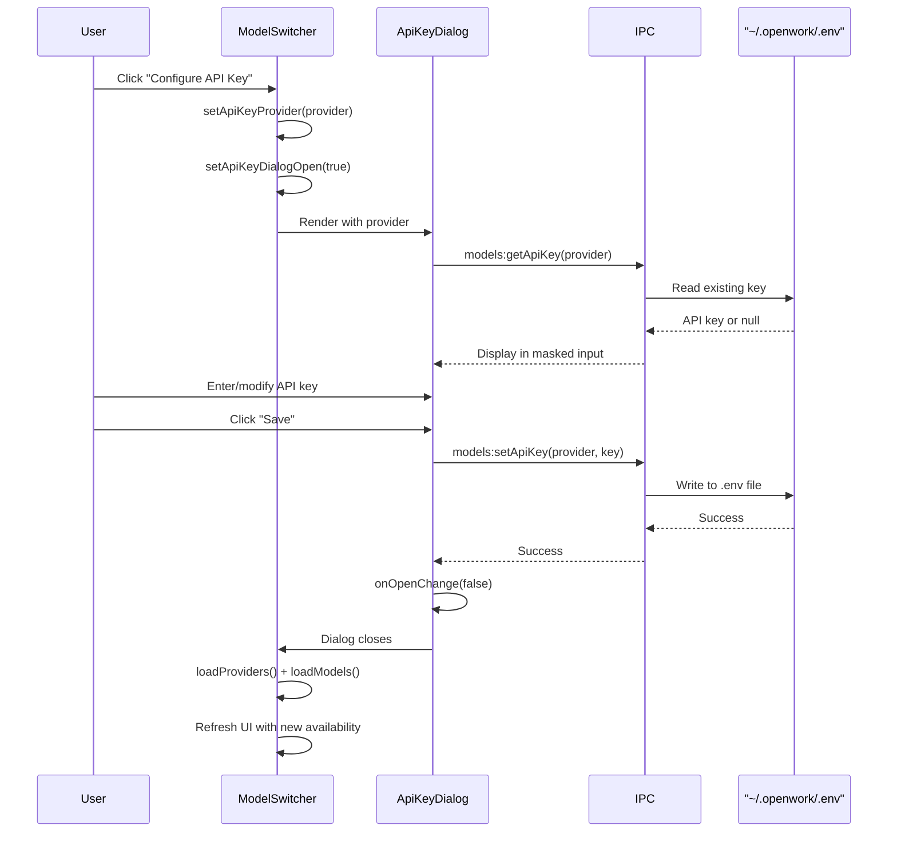

<!-- source: DeepWiki mcp.deepwiki.com · repo langchain-ai/openwork · page 4 Model and Provider Management · fetched 2026-10-26 -->

# Model and Provider Management

<details>
<summary>Relevant source files</summary>

The following files were used as context for generating this wiki page:

- [src/main/ipc/models.ts](src/main/ipc/models.ts)
- [src/main/types.ts](src/main/types.ts)
- [src/renderer/src/components/chat/ModelSwitcher.tsx](src/renderer/src/components/chat/ModelSwitcher.tsx)
- [src/renderer/src/types.ts](src/renderer/src/types.ts)

</details>


This document covers the system responsible for configuring, storing, and accessing AI language models and their associated providers within OpenWork. The Model and Provider Management system handles three primary concerns: (1) defining the catalog of available models, (2) securely storing and retrieving API credentials, and (3) exposing model selection interfaces to both the UI and agent runtime.

For information about how selected models are instantiated and used during agent execution, see [Agent Runtime and Initialization](#3.1). For workspace-related configuration, see [Workspace Selection and Management](#5.1).

---

## System Architecture

The Model and Provider Management system follows a three-tier architecture: storage (`.env` file and `electron-store`), IPC API layer (handlers in main process), and UI components (renderer process). The storage tier maintains both static model definitions and dynamic runtime state, while the IPC layer enforces separation between renderer and main process privileges.



**Sources:** [src/main/ipc/models.ts:1-512](), [src/main/storage.ts:1-104](), [src/renderer/src/components/chat/ModelSwitcher.tsx:1-246]()

---

## Provider Configuration

Providers represent the AI API vendors that supply language models. The system defines three supported providers in the `PROVIDERS` constant, each with an identifier used throughout the codebase.

### Provider Data Structure

The `Provider` type includes runtime API key status:

| Field | Type | Description |
|-------|------|-------------|
| `id` | `ProviderId` | One of: `'anthropic'`, `'openai'`, `'google'`, `'ollama'` |
| `name` | `string` | Human-readable display name |
| `hasApiKey` | `boolean` | Whether an API key is configured (computed at runtime) |

**Sources:** [src/main/types.ts:27-34](), [src/renderer/src/types.ts:27-33]()

### Provider Definitions

The static provider list is defined at [src/main/ipc/models.ts:16-20]():

```typescript
const PROVIDERS: Omit<Provider, 'hasApiKey'>[] = [
  { id: 'anthropic', name: 'Anthropic' },
  { id: 'openai', name: 'OpenAI' },
  { id: 'google', name: 'Google' }
]
```

The `models:listProviders` IPC handler augments this static list with dynamic API key status by calling `hasApiKey(provider.id)` for each provider [src/main/ipc/models.ts:231-236]().

**Sources:** [src/main/ipc/models.ts:16-20](), [src/main/ipc/models.ts:231-236]()

---

## Model Catalog

The model catalog is a hardcoded array of model configurations that defines all models available in OpenWork. Each entry contains metadata about the model and its provider association.

### ModelConfig Structure

| Field | Type | Description |
|-------|------|-------------|
| `id` | `string` | Unique identifier used in code (e.g., `'claude-sonnet-4-5-20250929'`) |
| `name` | `string` | Display name (e.g., `'Claude Sonnet 4.5'`) |
| `provider` | `ProviderId` | Provider identifier (`'anthropic'`, `'openai'`, `'google'`) |
| `model` | `string` | API model identifier passed to the provider's SDK |
| `description` | `string?` | Optional description shown in UI |
| `available` | `boolean` | Computed availability based on API key presence |

**Sources:** [src/main/types.ts:36-44](), [src/renderer/src/types.ts:35-42]()

### AVAILABLE_MODELS Array

The `AVAILABLE_MODELS` constant contains 23 model definitions spanning three model generations (as of January 2026):



The default model is `'claude-sonnet-4-5-20250929'`, chosen for its balance of intelligence, speed, and cost for agent workloads [src/main/ipc/models.ts:204]().

**Example model definition** [src/main/ipc/models.ts:34-40]():

```typescript
{
  id: 'claude-sonnet-4-5-20250929',
  name: 'Claude Sonnet 4.5',
  provider: 'anthropic',
  model: 'claude-sonnet-4-5-20250929',
  description: 'Best balance of intelligence, speed, and cost for agents',
  available: true
}
```

**Sources:** [src/main/ipc/models.ts:23-190]()

---

## API Key Storage and Security

API keys are stored in a dedicated `.env` file located at `~/.openwork/.env`, separate from application configuration to facilitate security practices like `.gitignore` exclusion.

### Storage Module

The `storage.ts` module provides key management functions:



**Sources:** [src/main/storage.ts:1-104]()

### Key Management Functions

**`getApiKey(provider: string): string | undefined`** [src/main/storage.ts:65-75]()

Retrieves an API key for a provider. First checks the `.env` file via `parseEnvFile()`, then falls back to `process.env`. This allows keys to be provided either through the OpenWork UI or via system environment variables.

**`setApiKey(provider: string, apiKey: string): void`** [src/main/storage.ts:77-87]()

Persists an API key by:
1. Parsing existing `.env` file content
2. Updating the key in the parsed object
3. Writing back to `.env` file via `writeEnvFile()`
4. Setting `process.env[envVarName]` for immediate availability

**`deleteApiKey(provider: string): void`** [src/main/storage.ts:89-99]()

Removes a key from both the `.env` file and `process.env`.

**`hasApiKey(provider: string): boolean`** [src/main/storage.ts:101-103]()

Returns `true` if `getApiKey(provider)` returns a non-empty value.

### Environment Variable Naming

The mapping from provider ID to environment variable name [src/main/storage.ts:9-13]():

| Provider ID | Environment Variable |
|-------------|---------------------|
| `anthropic` | `ANTHROPIC_API_KEY` |
| `openai` | `OPENAI_API_KEY` |
| `google` | `GOOGLE_API_KEY` |

**Sources:** [src/main/storage.ts:9-13](), [src/main/storage.ts:65-103]()

---

## IPC Handler API Reference

The main process exposes six IPC handlers for model and provider operations. All handlers are registered in `registerModelHandlers(ipcMain: IpcMain)` [src/main/ipc/models.ts:192-504]().

### models:list

**Handler:** [src/main/ipc/models.ts:194-200]()

**Request:** None

**Response:** `ModelConfig[]`

Returns the `AVAILABLE_MODELS` array with each model's `available` field set based on whether its provider has an API key configured. Calls `hasApiKey(model.provider)` for each model.

### models:getDefault

**Handler:** [src/main/ipc/models.ts:203-205]()

**Request:** None

**Response:** `string`

Returns the currently selected default model ID from `electron-store`. Defaults to `'claude-sonnet-4-5-20250929'` if not set.

### models:setDefault

**Handler:** [src/main/ipc/models.ts:208-210]()

**Request:** `modelId: string`

**Response:** `void`

Persists the selected model ID to `electron-store` at key `'defaultModel'`.

### models:setApiKey

**Handler:** [src/main/ipc/models.ts:213-218]()

**Request:** `{ provider: string, apiKey: string }`

**Response:** `void`

Delegates to `setApiKey(provider, apiKey)` from the storage module, which writes to `~/.openwork/.env`.

### models:getApiKey

**Handler:** [src/main/ipc/models.ts:221-223]()

**Request:** `provider: string`

**Response:** `string | null`

Retrieves the API key for a provider via `getApiKey(provider)`, returning `null` if not found.

### models:listProviders

**Handler:** [src/main/ipc/models.ts:231-236]()

**Request:** None

**Response:** `Provider[]`

Returns the `PROVIDERS` array with each provider's `hasApiKey` field computed via `hasApiKey(provider.id)`.

**Sources:** [src/main/ipc/models.ts:192-236]()

---

## Model Selection Flow

The model selection flow involves the `ModelSwitcher` component coordinating with the Zustand store to update both local UI state and persisted settings.



**Sources:** [src/renderer/src/components/chat/ModelSwitcher.tsx:49-245]()

### ModelSwitcher Component

The `ModelSwitcher` component [src/renderer/src/components/chat/ModelSwitcher.tsx:49-245]() presents a two-column popover interface:

1. **Left column:** Provider list with visual indicators
   - Provider icons (SVG components for Anthropic, OpenAI, Google)
   - Warning icon if `hasApiKey === false`
   - Selected provider highlighted with `bg-muted`

2. **Right column:** Model list filtered by selected provider
   - Displays model IDs in monospace font
   - Check icon next to currently selected model
   - "Configure API Key" button if no API key exists
   - "Edit API Key" link at bottom if API key exists

### State Management

The component uses several local state variables:

- `open`: Boolean controlling popover visibility
- `selectedProviderId`: Currently selected provider tab
- `apiKeyDialogOpen`: Boolean for API key dialog
- `apiKeyProvider`: Provider for which to configure API key

It also consumes Zustand store state:

- `models`: Array of `ModelConfig` objects
- `providers`: Array of `Provider` objects with `hasApiKey` status
- `currentModel`: String ID of selected model

**Sources:** [src/renderer/src/components/chat/ModelSwitcher.tsx:49-115]()

### Provider Icons

Provider icons are implemented as inline SVG components [src/renderer/src/components/chat/ModelSwitcher.tsx:11-40]():

```typescript
const PROVIDER_ICONS: Record<ProviderId, React.FC<{ className?: string }>> = {
  anthropic: AnthropicIcon,
  openai: OpenAIIcon,
  google: GoogleIcon,
  ollama: () => null
}
```

Each icon is a simple SVG path element with `currentColor` fill for theming.

**Sources:** [src/renderer/src/components/chat/ModelSwitcher.tsx:11-40]()

---

## Runtime Model Instantiation

When the agent runtime initializes, it retrieves the default model configuration and instantiates the appropriate LangChain chat model client.



**Sources:** [src/main/ipc/models.ts:509-511](), [src/main/storage.ts:65-75]()

### getDefaultModel Function

The `getDefaultModel()` function [src/main/ipc/models.ts:509-511]() is exported for use by the agent runtime:

```typescript
export function getDefaultModel(): string {
  return store.get('defaultModel', 'claude-sonnet-4-5-20250929') as string
}
```

This function retrieves the persisted model ID from `electron-store`, with a hardcoded default fallback.

### Model Client Instantiation

The agent runtime determines which model client to instantiate based on the `provider` field of the selected model's `ModelConfig`. The API key retrieved via `getApiKey(provider)` is passed to the client constructor along with the `model` field specifying the exact model variant.

The three supported client types are:
- `ChatAnthropic` (from `@langchain/anthropic`)
- `ChatOpenAI` (from `@langchain/openai`)
- `ChatGoogleGenerativeAI` (from `@langchain/google-genai`)

**Sources:** [src/main/ipc/models.ts:509-511](), Inferred from model provider types

---

## API Key Configuration Dialog

The `ApiKeyDialog` component (referenced but not provided in source files) presents a modal for entering, viewing, and deleting API keys. It is triggered from the `ModelSwitcher` component when users click "Configure API Key" or "Edit API Key" [src/renderer/src/components/chat/ModelSwitcher.tsx:102-114]().

### Dialog Lifecycle



When the dialog closes, the `ModelSwitcher` refreshes both providers and models lists to reflect the new API key availability [src/renderer/src/components/chat/ModelSwitcher.tsx:107-114]().

**Sources:** [src/renderer/src/components/chat/ModelSwitcher.tsx:102-114](), [src/renderer/src/components/chat/ModelSwitcher.tsx:238-243]()

---

## Extending the Model Catalog

To add new models or providers, developers must modify the static configuration arrays in `src/main/ipc/models.ts`.

### Adding a New Model

1. Add a new `ModelConfig` object to the `AVAILABLE_MODELS` array [src/main/ipc/models.ts:23-190]()
2. Set `provider` to an existing `ProviderId` or add a new provider first
3. Set `model` to the exact string expected by the provider's API
4. Set `available: true` (availability is recomputed based on API keys)

### Adding a New Provider

1. Add the provider ID to the `ProviderId` union type in type definitions [src/main/types.ts:28]()
2. Add a new provider object to the `PROVIDERS` array [src/main/ipc/models.ts:16-20]()
3. Add environment variable mapping in `ENV_VAR_NAMES` [src/main/storage.ts:9-13]()
4. Add an icon component in `ModelSwitcher.tsx` [src/renderer/src/components/chat/ModelSwitcher.tsx:35-40]()
5. Update agent runtime to handle new client type (implementation-specific)

**Sources:** [src/main/ipc/models.ts:16-20](), [src/main/ipc/models.ts:23-190](), [src/main/storage.ts:9-13](), [src/main/types.ts:28]()

---

## Security Considerations

### Credential Isolation

API keys are stored in `~/.openwork/.env` rather than `electron-store`'s `settings.json` to facilitate security practices:

1. The `.env` file can be excluded from backups
2. File permissions can be restricted (e.g., `chmod 600`)
3. The file location is consistent with common development practices

### Process Environment Fallback

The `getApiKey()` function falls back to `process.env` [src/main/storage.ts:74](), allowing users to provide credentials via system environment variables instead of storing them in the `.env` file. This supports scenarios where credential management is handled externally (e.g., enterprise secrets management).

### Renderer Process Isolation

API keys are never exposed to the renderer process. The `models:getApiKey` IPC handler returns the key only when explicitly requested (e.g., for display in the API key dialog), and model instantiation occurs entirely in the main process. The renderer only sees model availability booleans computed via `hasApiKey()`.

**Sources:** [src/main/storage.ts:65-75](), [src/main/ipc/models.ts:221-223]()

---

