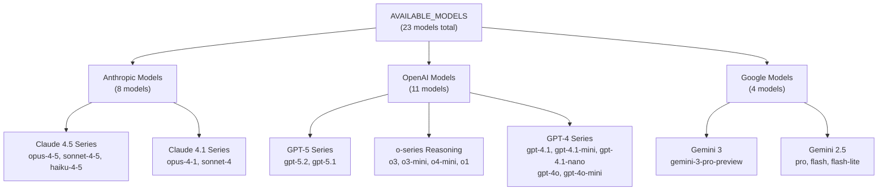
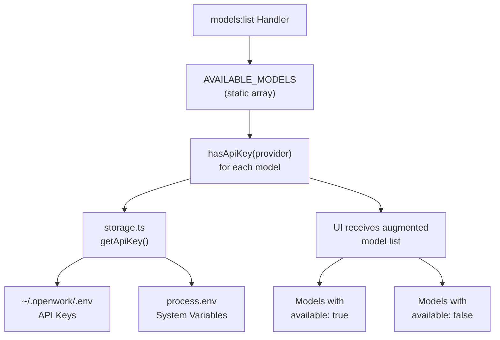
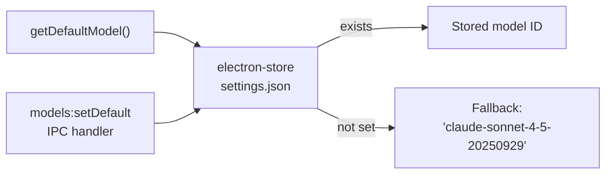
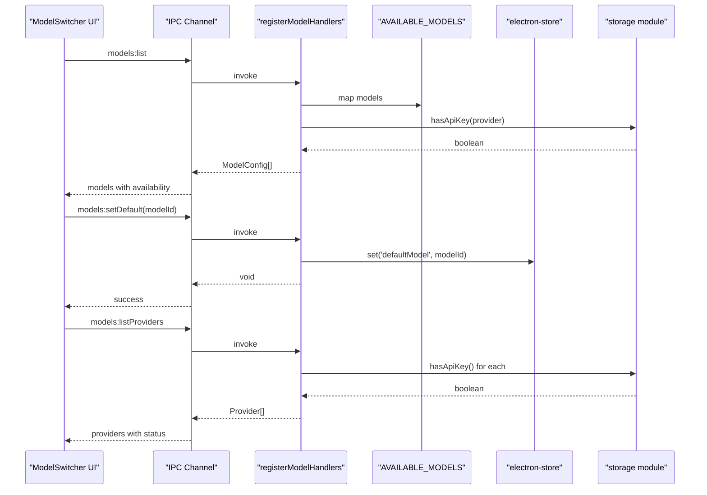
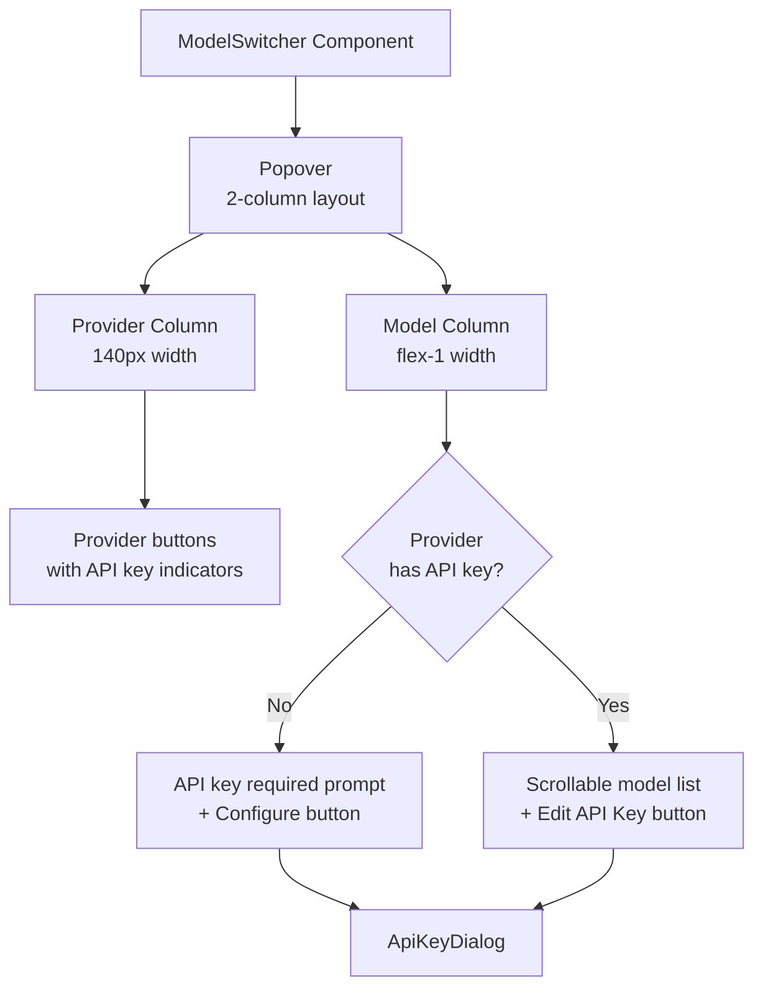
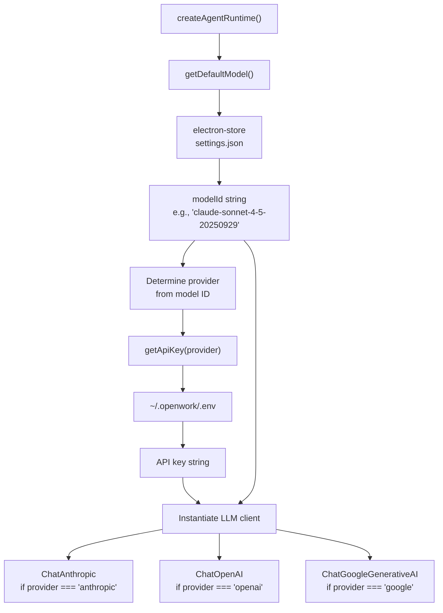

<!-- source: DeepWiki mcp.deepwiki.com · repo langchain-ai/openwork · page 4.1 Model Configuration System · fetched 2026-10-26 -->

# Model Configuration System

<details>
<summary>Relevant source files</summary>

The following files were used as context for generating this wiki page:

- [src/main/ipc/models.ts](src/main/ipc/models.ts)
- [src/main/types.ts](src/main/types.ts)
- [src/renderer/src/components/chat/ModelSwitcher.tsx](src/renderer/src/components/chat/ModelSwitcher.tsx)
- [src/renderer/src/types.ts](src/renderer/src/types.ts)

</details>


## Purpose and Scope

This document describes the model configuration system that defines which AI models are available in OpenWork, manages their metadata, and determines runtime availability based on API key configuration. The system maintains a static catalog of supported models and dynamically augments it with availability status.

For information about API key storage and credential management, see [API Key Management](#4.2). For details on how models are instantiated during agent execution, see [Agent Runtime and Initialization](#3.1).

## Overview

The model configuration system provides a centralized registry of supported AI models from multiple providers (Anthropic, OpenAI, Google). It consists of:

- **Static Model Definitions**: Hardcoded array of ~23 model configurations with metadata
- **Provider Registry**: List of supported AI providers
- **Runtime Availability**: Dynamic calculation based on API key presence
- **Default Model Selection**: Persistent storage of user's preferred model
- **IPC Interface**: Handlers for querying and managing model configurations

Sources: [src/main/ipc/models.ts:1-512]()

## Static Model Definitions

### AVAILABLE_MODELS Array

The `AVAILABLE_MODELS` constant defines all supported models. This array is the single source of truth for model metadata and is located in the main process for security reasons (preventing renderer process tampering).

**Location**: [src/main/ipc/models.ts:23-190]()

**Structure**: Each entry in `AVAILABLE_MODELS` is a `ModelConfig` object with the following properties:

| Property | Type | Description |
|----------|------|-------------|
| `id` | `string` | Unique identifier for UI selection |
| `name` | `string` | Human-readable display name |
| `provider` | `ProviderId` | Provider identifier (`'anthropic'`, `'openai'`, `'google'`, `'ollama'`) |
| `model` | `string` | Actual model identifier passed to the LLM API |
| `description` | `string` | Brief capability description |
| `available` | `boolean` | Static availability flag (always `true` in config) |

Sources: [src/main/types.ts:36-44](), [src/renderer/src/types.ts:35-42]()

### Model Catalog by Provider

The configuration includes models from three major providers as of January 2026:



Sources: [src/main/ipc/models.ts:23-190]()

**Example Configurations**:

**Claude Sonnet 4.5** (default model):
```typescript
{
  id: 'claude-sonnet-4-5-20250929',
  name: 'Claude Sonnet 4.5',
  provider: 'anthropic',
  model: 'claude-sonnet-4-5-20250929',
  description: 'Best balance of intelligence, speed, and cost for agents',
  available: true
}
```

**GPT-5.2**:
```typescript
{
  id: 'gpt-5.2',
  name: 'GPT-5.2',
  provider: 'openai',
  model: 'gpt-5.2',
  description: 'Latest flagship with enhanced coding and agentic capabilities',
  available: true
}
```

**Gemini 2.5 Flash**:
```typescript
{
  id: 'gemini-2.5-flash',
  name: 'Gemini 2.5 Flash',
  provider: 'google',
  model: 'gemini-2.5-flash',
  description: 'Lightning-fast with balance of intelligence and latency',
  available: true
}
```

Sources: [src/main/ipc/models.ts:34-40](), [src/main/ipc/models.ts:68-74](), [src/main/ipc/models.ts:175-181]()

## Provider Configuration

### PROVIDERS Array

The `PROVIDERS` constant defines supported AI providers. This is a minimal configuration since provider-specific logic (like API key environment variable names) is handled separately.

**Location**: [src/main/ipc/models.ts:16-20]()

```typescript
const PROVIDERS: Omit<Provider, 'hasApiKey'>[] = [
  { id: 'anthropic', name: 'Anthropic' },
  { id: 'openai', name: 'OpenAI' },
  { id: 'google', name: 'Google' }
]
```

The `hasApiKey` property is intentionally omitted from the static configuration and is added at runtime by checking the storage system.

Sources: [src/main/ipc/models.ts:16-20](), [src/main/types.ts:27-34]()

## Runtime Model Availability

### Dynamic Availability Calculation

While all models have `available: true` in the static configuration, the system calculates actual runtime availability by checking for API keys. This happens in the `models:list` IPC handler:



**Implementation**: [src/main/ipc/models.ts:194-200]()

```typescript
ipcMain.handle('models:list', async () => {
  // Check which models have API keys configured
  return AVAILABLE_MODELS.map((model) => ({
    ...model,
    available: hasApiKey(model.provider)
  }))
})
```

The `hasApiKey()` function checks both the `.env` file in `~/.openwork/` and the system's `process.env` for the appropriate environment variable (`ANTHROPIC_API_KEY`, `OPENAI_API_KEY`, or `GOOGLE_API_KEY`).

Sources: [src/main/ipc/models.ts:194-200](), [src/main/storage.ts:101-103](), [src/main/storage.ts:8-13]()

## Default Model Selection

### Persistent Storage

The system maintains a user's default model selection in the electron-store settings file. The default model is used when creating new threads or when no explicit model is specified.

**Storage Location**: `~/.openwork/settings.json`

**Default Value**: `'claude-sonnet-4-5-20250929'`



**IPC Handlers**:

**Get Default Model**: [src/main/ipc/models.ts:203-205]()
```typescript
ipcMain.handle('models:getDefault', async () => {
  return store.get('defaultModel', 'claude-sonnet-4-5-20250929') as string
})
```

**Set Default Model**: [src/main/ipc/models.ts:208-210]()
```typescript
ipcMain.handle('models:setDefault', async (_event, modelId: string) => {
  store.set('defaultModel', modelId)
})
```

**Export Function**: [src/main/ipc/models.ts:509-511]()
```typescript
export function getDefaultModel(): string {
  return store.get('defaultModel', 'claude-sonnet-4-5-20250929') as string
}
```

This exported function is used by the agent runtime to determine which model to instantiate when creating an agent.

Sources: [src/main/ipc/models.ts:203-210](), [src/main/ipc/models.ts:509-511]()

## IPC Handler System

### Model Configuration Handlers

The system exposes six IPC handlers for model and provider management, all registered in `registerModelHandlers()`:

**Handler Registration**: [src/main/ipc/models.ts:192-236]()

| Handler | Purpose | Returns |
|---------|---------|---------|
| `models:list` | List all models with runtime availability | `ModelConfig[]` |
| `models:getDefault` | Get user's default model ID | `string` |
| `models:setDefault` | Set user's default model | `void` |
| `models:listProviders` | List providers with API key status | `Provider[]` |
| `models:setApiKey` | Store API key for a provider | `void` |
| `models:getApiKey` | Retrieve API key for a provider | `string \| null` |
| `models:deleteApiKey` | Remove API key for a provider | `void` |

### Handler Data Flow



Sources: [src/main/ipc/models.ts:192-236]()

## UI Integration

### ModelSwitcher Component

The `ModelSwitcher` component provides the primary UI for model selection. It displays a two-column popover: providers on the left, models on the right.

**Component Architecture**:



**State Management**: [src/renderer/src/components/chat/ModelSwitcher.tsx:49-62]()

```typescript
const { 
  models,           // ModelConfig[] from store
  providers,        // Provider[] from store
  currentModel,     // string (model ID)
  loadModels,       // () => Promise<void>
  loadProviders,    // () => Promise<void>
  setCurrentModel   // (modelId: string) => void
} = useAppStore()
```

**Provider Display**: [src/renderer/src/components/chat/ModelSwitcher.tsx:148-169]()

Each provider button shows:
- Provider icon (SVG component)
- Provider name
- Warning indicator if `hasApiKey === false`

**Model Selection**: [src/renderer/src/components/chat/ModelSwitcher.tsx:196-213]()

Models are filtered by selected provider and displayed in a scrollable list with:
- Font-mono styling for technical model IDs
- Checkmark indicator for currently selected model
- Click handler that calls `setCurrentModel(modelId)`

Sources: [src/renderer/src/components/chat/ModelSwitcher.tsx:1-245]()

### Provider Icons

The component defines inline SVG icons for each provider, avoiding external dependencies:

| Provider | Icon Component | Location |
|----------|----------------|----------|
| Anthropic | `AnthropicIcon` | [src/renderer/src/components/chat/ModelSwitcher.tsx:11-17]() |
| OpenAI | `OpenAIIcon` | [src/renderer/src/components/chat/ModelSwitcher.tsx:19-25]() |
| Google | `GoogleIcon` | [src/renderer/src/components/chat/ModelSwitcher.tsx:27-33]() |

These are mapped to provider IDs in the `PROVIDER_ICONS` record:

[src/renderer/src/components/chat/ModelSwitcher.tsx:35-40]()

Sources: [src/renderer/src/components/chat/ModelSwitcher.tsx:11-40]()

## Integration with Agent Runtime

### Model Instantiation Flow

When the agent runtime is created, it uses the model configuration system to instantiate the appropriate LLM client:



The agent runtime maps model IDs to their corresponding LangChain chat model classes and initializes them with the retrieved API key. This separation ensures that:

1. Model configuration is managed independently of agent execution
2. API keys are retrieved securely from storage at runtime
3. The UI can present model options before any agent execution occurs

Sources: [src/main/ipc/models.ts:509-511](), [src/main/ipc/models.ts:507]()

## Type Definitions

### ModelConfig Interface

**Main Process**: [src/main/types.ts:36-44]()
**Renderer Process**: [src/renderer/src/types.ts:35-42]()

```typescript
export interface ModelConfig {
  id: string              // Unique identifier (e.g., 'claude-sonnet-4-5-20250929')
  name: string            // Display name (e.g., 'Claude Sonnet 4.5')
  provider: ProviderId    // Provider enum value
  model: string           // Actual model string for API
  description?: string    // Capability description
  available: boolean      // Runtime availability flag
}
```

### Provider Interface

**Main Process**: [src/main/types.ts:27-34]()
**Renderer Process**: [src/renderer/src/types.ts:26-33]()

```typescript
export type ProviderId = 'anthropic' | 'openai' | 'google' | 'ollama'

export interface Provider {
  id: ProviderId
  name: string
  hasApiKey: boolean
}
```

The type definitions are duplicated across main and renderer processes because Electron enforces process isolation. Both definitions must remain synchronized manually.

Sources: [src/main/types.ts:27-44](), [src/renderer/src/types.ts:26-42]()

## Configuration Management Best Practices

### Adding New Models

To add a new model to the system:

1. **Add to AVAILABLE_MODELS**: Insert a new `ModelConfig` entry in [src/main/ipc/models.ts:23-190]()
2. **Specify provider**: Use existing `ProviderId` or add new provider to `PROVIDERS` array
3. **Set metadata**: Include `id`, `name`, `model`, `description`, and `available: true`
4. **Test API key flow**: Ensure the provider's API key environment variable is in `ENV_VAR_NAMES` map at [src/main/storage.ts:8-13]()

### Adding New Providers

To add a new AI provider:

1. **Update ProviderId**: Add to type union in [src/main/types.ts:28]() and [src/renderer/src/types.ts:27]()
2. **Add to PROVIDERS**: Insert entry in [src/main/ipc/models.ts:16-20]()
3. **Add API key mapping**: Update `ENV_VAR_NAMES` in [src/main/storage.ts:8-13]()
4. **Add UI icon**: Create icon component in [src/renderer/src/components/chat/ModelSwitcher.tsx:11-40]()
5. **Update agent runtime**: Add instantiation logic for the new provider's LLM client

Sources: [src/main/ipc/models.ts:16-190](), [src/main/storage.ts:8-13](), [src/main/types.ts:28]()

---

