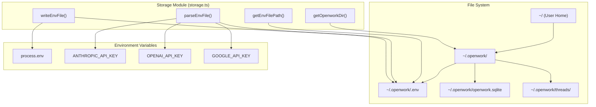
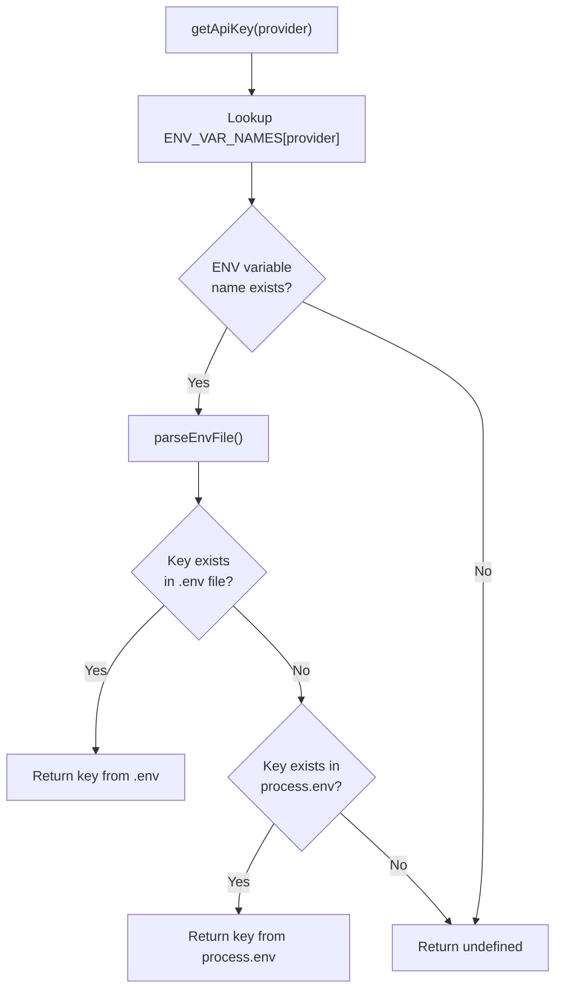
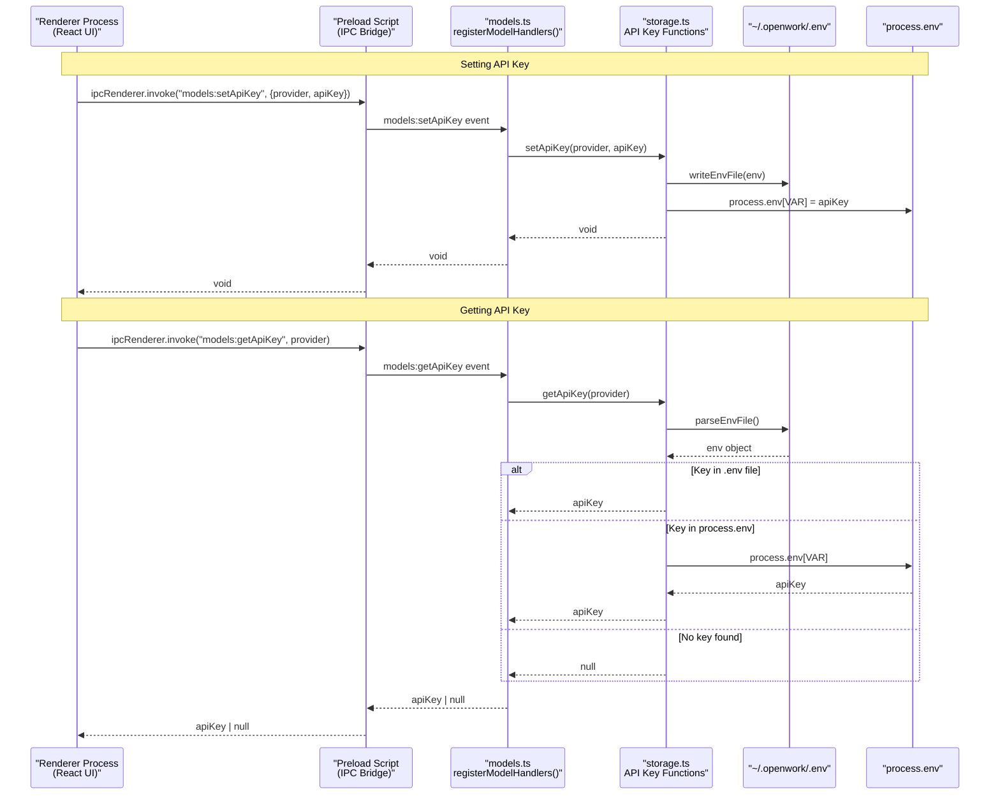
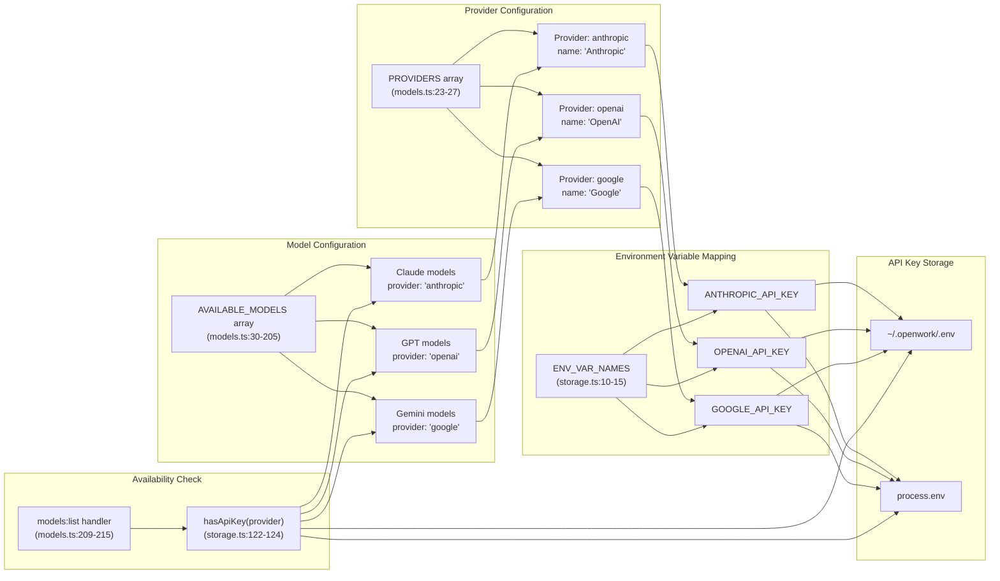

<!-- source: DeepWiki mcp.deepwiki.com · repo langchain-ai/openwork · page 4.2 API Key Management · fetched 2026-10-26 -->

# API Key Management

<details>
<summary>Relevant source files</summary>

The following files were used as context for generating this wiki page:

- [src/main/db/index.ts](src/main/db/index.ts)
- [src/main/ipc/models.ts](src/main/ipc/models.ts)
- [src/main/storage.ts](src/main/storage.ts)

</details>


## Purpose and Scope

This document describes the API key management system in openwork, which securely stores and retrieves API keys for LLM providers (Anthropic, OpenAI, Google). API keys are persisted to disk in a `.env` file within the user's home directory and are made available to the agent runtime for authenticating with LLM services.

For information about model selection and configuration, see [Model Configuration System](#4.1). For information about how API keys are used during agent execution, see [Agent Runtime and Initialization](#3.1).

---

## Storage Architecture

### Storage Location

API keys are stored in a plain text `.env` file located at `~/.openwork/.env`. The openwork directory is created automatically if it does not exist.

**Key Path Constants:**
- `OPENWORK_DIR`: `~/.openwork` ([src/main/storage.ts:6]())
- `ENV_FILE`: `~/.openwork/.env` ([src/main/storage.ts:7]())

The `getOpenworkDir()` function ensures the directory exists before any file operations [src/main/storage.ts:17-22]().

### Environment Variable Naming

Each provider maps to a specific environment variable name defined in the `ENV_VAR_NAMES` record [src/main/storage.ts:10-15]():

| Provider ID | Environment Variable Name |
|-------------|---------------------------|
| `anthropic` | `ANTHROPIC_API_KEY` |
| `openai` | `OPENAI_API_KEY` |
| `google` | `GOOGLE_API_KEY` |
| `ollama` | *(none - no API key required)* |

### File Format

The `.env` file uses a simple `KEY=VALUE` format with one entry per line:

```
ANTHROPIC_API_KEY=sk-ant-...
OPENAI_API_KEY=sk-...
GOOGLE_API_KEY=AIza...
```

Comments (lines starting with `#`) and empty lines are ignored during parsing [src/main/storage.ts:63-66]().

**Diagram: Storage Architecture**



Sources: [src/main/storage.ts:1-53]()

---

## API Key Retrieval Precedence

The `getApiKey()` function implements a two-tier precedence system [src/main/storage.ts:86-96]():

1. **Primary Source**: Read from `~/.openwork/.env` file
2. **Fallback Source**: Read from `process.env` (system environment variables)

This design allows users to configure API keys persistently via the UI (which writes to the `.env` file) or temporarily via environment variables for development or CI/CD scenarios.

**Diagram: API Key Retrieval Flow**



Sources: [src/main/storage.ts:86-96]()

---

## Core API Key Operations

### parseEnvFile()

Reads and parses the `.env` file into a key-value object [src/main/storage.ts:56-74]().

**Implementation Details:**
- Returns empty object if file does not exist
- Skips comment lines (starting with `#`) and empty lines
- Parses each line as `KEY=VALUE` by finding the first `=` character
- Trims whitespace from both keys and values

### writeEnvFile()

Writes a key-value object back to the `.env` file [src/main/storage.ts:77-83]().

**Implementation Details:**
- Ensures the openwork directory exists via `getOpenworkDir()`
- Filters out entries with empty/falsy values
- Formats as `KEY=VALUE\n` for each entry
- Overwrites the entire file atomically

### getApiKey()

Retrieves an API key for a given provider with fallback precedence [src/main/storage.ts:86-96]().

**Parameters:**
- `provider` (string): Provider ID (e.g., `"anthropic"`, `"openai"`, `"google"`)

**Returns:**
- `string | undefined`: The API key if found, otherwise `undefined`

**Precedence:**
1. Value from `~/.openwork/.env` (via `parseEnvFile()`)
2. Value from `process.env[ENV_VAR_NAME]`

### setApiKey()

Stores an API key for a provider in both the `.env` file and the current process environment [src/main/storage.ts:98-108]().

**Parameters:**
- `provider` (string): Provider ID
- `apiKey` (string): API key value to store

**Side Effects:**
- Writes to `~/.openwork/.env` file (persisted across sessions)
- Sets `process.env[ENV_VAR_NAME]` (available in current session)

### deleteApiKey()

Removes an API key for a provider from both the `.env` file and process environment [src/main/storage.ts:110-120]().

**Parameters:**
- `provider` (string): Provider ID

**Side Effects:**
- Removes entry from `~/.openwork/.env` file
- Deletes `process.env[ENV_VAR_NAME]`

### hasApiKey()

Checks whether an API key exists for a given provider [src/main/storage.ts:122-124]().

**Parameters:**
- `provider` (string): Provider ID

**Returns:**
- `boolean`: `true` if an API key is available (from either source), `false` otherwise

**Implementation:**
```typescript
return !!getApiKey(provider)
```

Sources: [src/main/storage.ts:56-124]()

---

## IPC Interface

API key operations are exposed to the renderer process via IPC handlers registered in `registerModelHandlers()` [src/main/ipc/models.ts:207-248]().

### models:setApiKey

Sets an API key for a provider.

**Handler:** [src/main/ipc/models.ts:228-230]()

**Parameters:**
- `SetApiKeyParams`:
  - `provider` (string): Provider ID
  - `apiKey` (string): API key value

**Implementation:**
```typescript
ipcMain.handle("models:setApiKey", async (_event, { provider, apiKey }: SetApiKeyParams) => {
  setApiKey(provider, apiKey)
})
```

### models:getApiKey

Retrieves an API key for a provider.

**Handler:** [src/main/ipc/models.ts:233-235]()

**Parameters:**
- `provider` (string): Provider ID

**Returns:**
- `string | null`: API key if available, otherwise `null`

### models:deleteApiKey

Deletes an API key for a provider.

**Handler:** [src/main/ipc/models.ts:238-240]()

**Parameters:**
- `provider` (string): Provider ID

**Implementation:**
```typescript
ipcMain.handle("models:deleteApiKey", async (_event, provider: string) => {
  deleteApiKey(provider)
})
```

### models:listProviders

Lists all providers with their API key availability status.

**Handler:** [src/main/ipc/models.ts:243-248]()

**Returns:**
- `Provider[]`: Array of provider objects with `hasApiKey` boolean flag

**Implementation:**
```typescript
ipcMain.handle("models:listProviders", async () => {
  return PROVIDERS.map((provider) => ({
    ...provider,
    hasApiKey: hasApiKey(provider.id)
  }))
})
```

**Diagram: IPC Handler Flow**



Sources: [src/main/ipc/models.ts:207-248](), [src/main/storage.ts:86-120]()

---

## Provider Configuration

### PROVIDERS Array

The `PROVIDERS` constant defines the supported LLM providers [src/main/ipc/models.ts:23-27]():

```typescript
const PROVIDERS: Omit<Provider, "hasApiKey">[] = [
  { id: "anthropic", name: "Anthropic" },
  { id: "openai", name: "OpenAI" },
  { id: "google", name: "Google" }
]
```

**Note:** Ollama is included in `ENV_VAR_NAMES` but not in `PROVIDERS` because it does not require API key configuration (local deployment).

### Model Availability

Model availability is determined by API key presence. The `models:list` IPC handler checks API key status for each model's provider [src/main/ipc/models.ts:209-215]():

```typescript
ipcMain.handle("models:list", async () => {
  return AVAILABLE_MODELS.map((model) => ({
    ...model,
    available: hasApiKey(model.provider)
  }))
})
```

Models belonging to a provider without a configured API key are marked as unavailable in the UI, preventing selection until the user provides credentials.

**Diagram: Provider and Model Relationship**



Sources: [src/main/ipc/models.ts:23-27](), [src/main/ipc/models.ts:209-215](), [src/main/storage.ts:10-15](), [src/main/storage.ts:122-124]()

---

## Integration with Agent Runtime

When the agent runtime is created, it retrieves the appropriate API key for the selected model's provider using `getApiKey()`. This function is re-exported from the models module for use in agent initialization [src/main/ipc/models.ts:519]().

The agent runtime passes the API key to LangChain's provider-specific clients (e.g., `ChatAnthropic`, `ChatOpenAI`, `ChatGoogleGenerativeAI`), which use it to authenticate API requests during agent execution.

**Key Export:**
```typescript
export { getApiKey } from "../storage"
```

For details on how the agent runtime configures LLM clients with API keys, see [Agent Runtime and Initialization](#3.1).

Sources: [src/main/ipc/models.ts:519]()

---

## Security Considerations

### File Permissions

The `.env` file is stored in plain text without encryption. On Unix-like systems, file permissions should be set to restrict access to the owner only (e.g., `chmod 600 ~/.openwork/.env`). This is not enforced by openwork but is recommended for security.

### No Encryption at Rest

API keys are stored unencrypted. This design prioritizes simplicity and compatibility with standard `.env` file conventions. Users working with sensitive production API keys should use environment variables (which are not persisted to disk) or implement additional security measures at the operating system level.

### Precedence for Development

The precedence system (`.env` file first, then `process.env`) allows developers to override persisted API keys by setting environment variables before launching the application, useful for testing with different accounts without modifying the stored configuration.

Sources: [src/main/storage.ts:86-96]()

---

