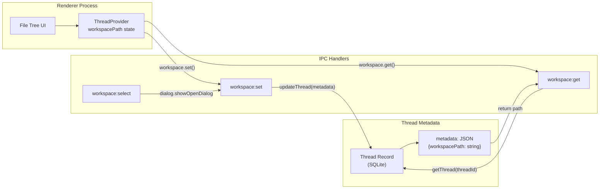
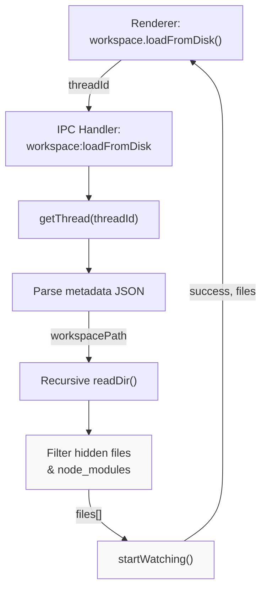
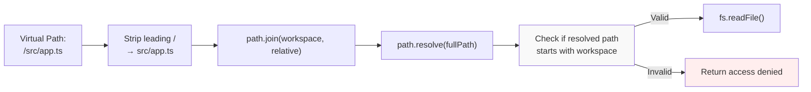
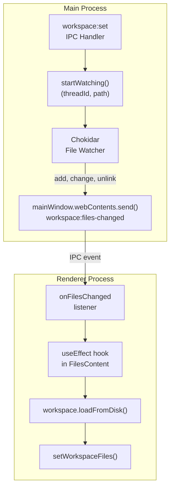
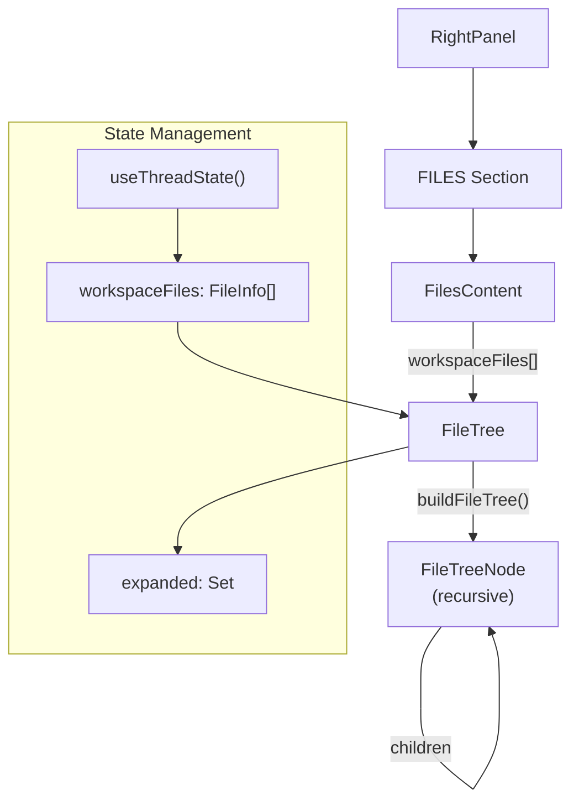
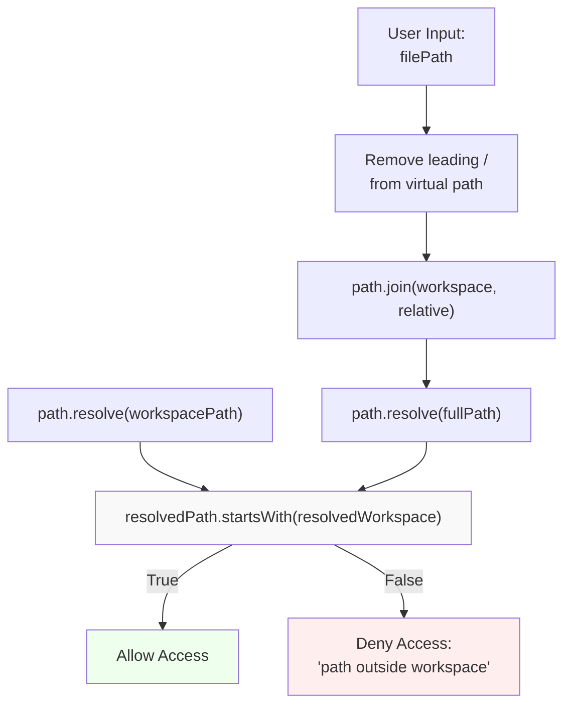

<!-- source: DeepWiki mcp.deepwiki.com · repo langchain-ai/openwork · page 5 Workspace and File System · fetched 2026-10-26 -->

# Workspace and File System

<details>
<summary>Relevant source files</summary>

The following files were used as context for generating this wiki page:

- [electron.vite.config.ts](electron.vite.config.ts)
- [src/main/ipc/models.ts](src/main/ipc/models.ts)
- [src/renderer/src/components/chat/ApiKeyDialog.tsx](src/renderer/src/components/chat/ApiKeyDialog.tsx)
- [src/renderer/src/components/panels/RightPanel.tsx](src/renderer/src/components/panels/RightPanel.tsx)
- [src/renderer/src/components/panels/TodoPanel.tsx](src/renderer/src/components/panels/TodoPanel.tsx)

</details>


## Purpose and Scope

This document describes openwork's workspace and file system architecture, which enables the agent to interact with user-selected directories on disk. Each thread maintains an independent workspace path, and the system provides secure file operations with real-time synchronization to the UI. For agent execution details including how file tools are used during runtime, see [Agent Runtime and Initialization](#3.1). For thread-specific state management including workspace path storage, see [Thread State and Context](#6.1).

---

## Overview

The workspace system manages the association between conversation threads and filesystem directories. Each thread can be linked to a workspace folder, which becomes the agent's working directory for file operations. The system implements security boundaries, file watching, and UI synchronization to provide a safe and responsive development environment.

**Key Capabilities:**
- Per-thread workspace path configuration
- Recursive directory tree loading with filtering
- Secure file read operations (text and binary)
- Real-time file change detection
- Virtual path resolution with security validation

**Sources:** [src/main/ipc/models.ts:255-516]()

---

## Workspace Path Management

### Per-Thread Workspace Association

Each thread stores its workspace path in the thread metadata JSON blob in the SQLite database. This enables different threads to work in different directories simultaneously without interference.



**Workspace Path Storage:**
- **Location:** Thread metadata column in SQLite threads table
- **Format:** JSON object with `workspacePath` property
- **Fallback:** Global `workspacePath` in electron-store for backward compatibility
- **Scope:** Thread-specific; each thread maintains independent workspace

**Sources:** [src/main/ipc/models.ts:255-269](), [src/main/ipc/models.ts:272-302]()

### IPC Handler: `workspace:get`

Retrieves the workspace path for a given thread. If no thread ID is provided, falls back to the global workspace setting.

| Parameter | Type | Description |
|-----------|------|-------------|
| `threadId` | `string?` | Optional thread identifier |
| **Returns** | `string \| null` | Absolute path to workspace folder, or null if not set |

**Implementation Flow:**
1. Import `getThread` from database module
2. Retrieve thread record by ID
3. Parse thread metadata JSON
4. Extract `workspacePath` property
5. Return path or null

**Sources:** [src/main/ipc/models.ts:255-269]()

### IPC Handler: `workspace:set`

Updates the workspace path for a thread, storing it in thread metadata and initializing the file watcher.

| Parameter | Type | Description |
|-----------|------|-------------|
| `params.threadId` | `string?` | Thread identifier |
| `params.path` | `string \| null` | New workspace path or null to clear |
| **Returns** | `string \| null` | The updated path value |

**Implementation Details:**
1. Retrieve existing thread record
2. Parse metadata JSON (or initialize empty object)
3. Update `workspacePath` property
4. Save updated metadata to database
5. Start/stop file watcher based on path presence

**File Watcher Integration:**
- `startWatching(threadId, path)` - begins monitoring directory for changes
- `stopWatching(threadId)` - stops monitoring when workspace is cleared

**Sources:** [src/main/ipc/models.ts:272-302]()

### IPC Handler: `workspace:select`

Opens a native directory picker dialog, allowing users to select a workspace folder via the OS file chooser.

| Parameter | Type | Description |
|-----------|------|-------------|
| `threadId` | `string?` | Thread to associate with selected folder |
| **Returns** | `string \| null` | Selected path, or null if dialog was cancelled |

**Dialog Configuration:**
- Properties: `openDirectory`, `createDirectory`
- Title: "Select Workspace Folder"
- Message: "Choose a folder for the agent to work in"

**Post-Selection Actions:**
1. Save selected path to thread metadata
2. Initialize file watcher for the directory
3. Return path to renderer for UI update

**Sources:** [src/main/ipc/models.ts:304-335]()

---

## File System Operations

### Loading Directory Trees

The `workspace:loadFromDisk` handler recursively reads the workspace directory structure and returns a flat list of file/directory entries with metadata.



**IPC Handler: `workspace:loadFromDisk`**

| Parameter | Type | Description |
|-----------|------|-------------|
| `params.threadId` | `string` | Thread identifier |
| **Returns** | `LoadResult` | Object with success flag, files array, and optional error |

**Return Structure:**
```typescript
{
  success: boolean
  files: Array<{
    path: string        // Virtual path starting with "/"
    is_dir: boolean     // True for directories
    size?: number       // File size in bytes
    modified_at?: string // ISO timestamp
  }>
  workspacePath?: string
  error?: string
}
```

**Filtering Rules:**
- Skip entries starting with `.` (hidden files)
- Skip `node_modules` directory
- Process all other files and directories recursively

**Path Convention:**
- Stored paths are relative to workspace root
- All paths begin with `/` (virtual filesystem root)
- Example: workspace `/Users/bob/project`, file at disk path `/Users/bob/project/src/app.ts` → virtual path `/src/app.ts`

**Sources:** [src/main/ipc/models.ts:337-406]()

### Reading File Contents

The system provides two handlers for reading files: one for text content and one for binary data.

#### IPC Handler: `workspace:readFile`

Reads a text file from the workspace and returns its content as UTF-8 string.

| Parameter | Type | Description |
|-----------|------|-------------|
| `params.threadId` | `string` | Thread identifier |
| `params.filePath` | `string` | Virtual path (starting with `/`) |
| **Returns** | `ReadResult` | Object with success flag, content, and metadata |

**Security Implementation:**


**Security Validation:**
1. Convert virtual path to relative path (strip leading `/`)
2. Join with workspace path: `path.join(workspacePath, relativePath)`
3. Resolve both paths to absolute canonical paths
4. Verify resolved file path starts with resolved workspace path
5. Reject access if path escapes workspace boundary

This prevents directory traversal attacks like `../../etc/passwd`.

**Error Conditions:**
- No workspace linked to thread
- Path outside workspace boundary
- Target is a directory (not a file)
- File does not exist or is not readable

**Sources:** [src/main/ipc/models.ts:408-460]()

#### IPC Handler: `workspace:readBinaryFile`

Reads a binary file (images, PDFs, etc.) and returns the content as base64-encoded string.

| Parameter | Type | Description |
|-----------|------|-------------|
| `params.threadId` | `string` | Thread identifier |
| `params.filePath` | `string` | Virtual path |
| **Returns** | `ReadResult` | Object with base64 content |

**Differences from `readFile`:**
- Uses `fs.readFile(fullPath)` without encoding argument (returns Buffer)
- Converts Buffer to base64: `buffer.toString("base64")`
- Same security validation as text file reading

**Use Cases:**
- Displaying images in UI
- Sending binary files to LLM vision models
- Processing compiled artifacts

**Sources:** [src/main/ipc/models.ts:462-515]()

---

## File Watching and Synchronization

### Workspace Watcher Service

The `workspace-watcher` service monitors workspace directories for file changes and emits IPC events to the renderer process, enabling real-time UI updates without polling.



**Watcher Lifecycle:**
- **Started:** When workspace path is set via `workspace:set` or `workspace:select`
- **Stopped:** When workspace path is cleared (set to null)
- **Scope:** Per-thread; each thread has independent watcher instance

**Event Format:**
```typescript
{
  threadId: string  // Thread that owns the workspace
  // Event triggered when files added, changed, or removed
}
```

**Sources:** [src/main/ipc/models.ts:13](), [src/main/ipc/models.ts:293-298](), [src/main/ipc/models.ts:327-328](), [src/main/ipc/models.ts:392]()

### UI Integration

The `FilesContent` component subscribes to file change events and reloads the directory tree when changes occur.

**Component Initialization:**
```typescript
// Load workspace path and initial files
useEffect(() => {
  const path = await window.api.workspace.get(currentThreadId)
  setWorkspacePath(path)
  
  if (path) {
    const result = await window.api.workspace.loadFromDisk(currentThreadId)
    if (result.success && result.files) {
      setWorkspaceFiles(result.files)
    }
  }
}, [currentThreadId])
```

**File Change Subscription:**
```typescript
// Listen for real-time file changes
useEffect(() => {
  const cleanup = window.api.workspace.onFilesChanged(async (data) => {
    if (data.threadId === currentThreadId) {
      const result = await window.api.workspace.loadFromDisk(currentThreadId)
      if (result.success && result.files) {
        setWorkspaceFiles(result.files)
      }
    }
  })
  return cleanup
}, [currentThreadId])
```

**Sources:** [src/renderer/src/components/panels/RightPanel.tsx:522-558]()

---

## UI Components

### File Tree Visualization

The `RightPanel` component displays workspace files in a collapsible tree structure with icons, size information, and folder expansion state.



**Component Hierarchy:**
1. **RightPanel** - Container with three collapsible sections (Tasks, Files, Agents)
2. **FilesContent** - Workspace management and file tree wrapper
3. **FileTree** - Builds tree structure from flat file list
4. **FileTreeNode** - Recursive component for tree rendering

**Sources:** [src/renderer/src/components/panels/RightPanel.tsx:118-370](), [src/renderer/src/components/panels/RightPanel.tsx:511-655]()

### File Tree Data Structure

The `buildFileTree` function transforms a flat list of files into a hierarchical tree structure suitable for UI rendering.

**Input Format:**
```typescript
FileInfo[] = [
  { path: "/src/app.ts", is_dir: false, size: 1234 },
  { path: "/src/lib/utils.ts", is_dir: false, size: 567 },
  { path: "/package.json", is_dir: false, size: 890 }
]
```

**Output Format:**
```typescript
TreeNode[] = [
  {
    name: "src",
    path: "/src",
    is_dir: true,
    children: [
      { name: "app.ts", path: "/src/app.ts", is_dir: false, size: 1234, children: [] },
      {
        name: "lib",
        path: "/src/lib",
        is_dir: true,
        children: [
          { name: "utils.ts", path: "/src/lib/utils.ts", is_dir: false, size: 567, children: [] }
        ]
      }
    ]
  },
  { name: "package.json", path: "/package.json", is_dir: false, size: 890, children: [] }
]
```

**Tree Building Algorithm:**
1. Sort files (directories first, then alphabetically)
2. For each file, split path into parts
3. Create or locate parent directory nodes
4. Attach file/directory to parent's children array
5. Use `nodeMap` to cache nodes by path for efficient lookup
6. Recursively sort children after tree is built

**Sources:** [src/renderer/src/components/panels/RightPanel.tsx:674-746]()

### FileTreeNode Component

Recursive component that renders individual tree nodes with expand/collapse functionality, icons, and interaction handlers.

**Visual Elements:**
- **Chevron:** `ChevronRight` (collapsed) / `ChevronDown` (expanded) for directories
- **Icon:** `FileIcon` component with type-specific icons and colors
- **Name:** Truncated filename
- **Size:** Formatted size badge for files (e.g., "1.2KB", "3.4MB")

**Icon Mapping:**

| File Extension | Icon | Visual Style |
|----------------|------|--------------|
| `.ts`, `.tsx` | `FileCode` | Blue |
| `.js`, `.jsx` | `FileCode` | Yellow |
| `.json` | `FileJson` | Yellow-orange |
| `.py` | `FileCode` | Green |
| `.css`, `.scss` | `FileCode` | Pink |
| `.html` | `FileCode` | Orange |
| `.svg`, `.png`, `.jpg` | `Image` | Purple |
| `.md`, `.mdx` | `FileText` | Muted |
| Directory (open) | `FolderOpen` | Amber |
| Directory (closed) | `Folder` | Amber |
| Default | `File` | Muted |

**Interaction Behavior:**
- **Directory Click:** Toggle expansion state
- **File Click:** Call `openFile(path, name)` to open file in editor tab
- **Hover:** Highlight background with `bg-background-interactive`

**Performance Optimization:**
- Component wrapped in `memo()` with custom comparison function
- Only re-renders when node data or expansion state changes
- Prevents unnecessary re-renders of entire subtree

**Sources:** [src/renderer/src/components/panels/RightPanel.tsx:783-878](), [src/renderer/src/components/panels/RightPanel.tsx:880-934]()

### Workspace Selection UI

The `FilesContent` component header provides workspace management controls.

**Header Layout:**

| Element | Purpose | Conditions |
|---------|---------|------------|
| Folder name | Display current workspace | Shows last path segment or "No folder linked" |
| Link button | Select new workspace | Shown when no files present |
| Change button | Replace workspace | Shown when files exist but user wants different folder |
| Sync button | Save files to disk | Shown when files exist (not yet implemented) |

**Button States:**
- **Syncing:** Shows `Loader2` spinner icon
- **Success:** Shows `Check` icon (green)
- **Link/Change:** Shows `FolderSync` or `Download` icon

**Empty State:**
When no files are loaded, displays centered message:
- Folder icon (8x8, 50% opacity)
- "No workspace files" text
- Hint about linked folder or prompting to click "Link"

**Sources:** [src/renderer/src/components/panels/RightPanel.tsx:596-654]()

---

## Security Model

### Path Validation Architecture

All file operations implement a two-stage security validation to prevent directory traversal attacks and unauthorized file access.



**Validation Steps:**

1. **Normalize Virtual Path:** Remove leading `/` from input
2. **Join Paths:** Combine workspace and relative path
3. **Resolve Canonical Paths:** Convert both paths to absolute, canonical form
4. **Prefix Check:** Verify file path starts with workspace path

**Attack Prevention:**

| Attack Vector | Example Input | Validation Result |
|---------------|---------------|-------------------|
| Basic traversal | `"/../../../etc/passwd"` | Rejected - resolves outside workspace |
| Symbolic link escape | `"/symlink-to-root/etc/passwd"` | Rejected - resolved path outside boundary |
| URL encoding | `"/%2e%2e/%2e%2e/etc/passwd"` | Rejected - URL decoding handled by Node.js |
| Null bytes | `"/file.txt\0.jpg"` | Rejected - Node.js path handling |
| Windows drive | `"C:/Windows/System32"` (on Unix) | Rejected - absolute path detection |

**Additional Checks:**
- Verify workspace is set before any file operation
- Ensure target is a file (not directory) for read operations
- Check file exists and is readable

**Sources:** [src/main/ipc/models.ts:427-436](), [src/main/ipc/models.ts:485-490]()

---

## Type Definitions

### Shared Types

Types used across main and renderer processes for workspace operations:

```typescript
// Workspace path operations
interface WorkspaceSetParams {
  threadId?: string
  path: string | null
}

interface WorkspaceLoadParams {
  threadId: string
}

interface WorkspaceFileParams {
  threadId: string
  filePath: string
}

// File information
interface FileInfo {
  path: string           // Virtual path starting with "/"
  is_dir?: boolean       // True for directories
  size?: number          // Size in bytes
  modified_at?: string   // ISO 8601 timestamp
}

// Load result
interface LoadResult {
  success: boolean
  files: FileInfo[]
  workspacePath?: string
  error?: string
}

// Read result
interface ReadResult {
  success: boolean
  content?: string      // UTF-8 for text, base64 for binary
  size?: number
  modified_at?: string
  error?: string
}
```

**Sources:** [src/main/types.ts](), [src/main/ipc/models.ts:5-12]()

---

## Summary

The workspace and file system architecture provides:

1. **Thread-Scoped Workspaces:** Each conversation thread maintains an independent workspace path stored in thread metadata
2. **Secure File Operations:** All file access validated against workspace boundary with canonical path resolution
3. **Real-Time Synchronization:** File watcher service detects changes and updates UI automatically
4. **Rich UI Visualization:** Tree structure with icons, sizes, and interactive navigation
5. **Flexible Management:** Native OS dialogs for folder selection, easy workspace switching

The system balances security, performance, and user experience to enable safe agent interaction with the filesystem while maintaining clear boundaries and real-time feedback.

---

