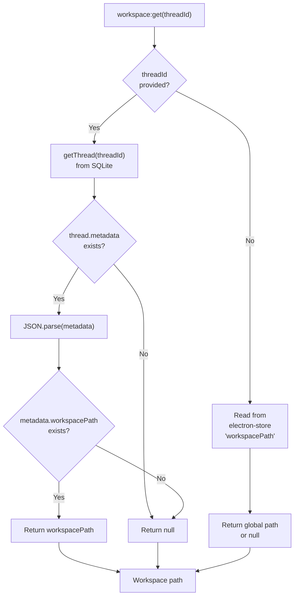
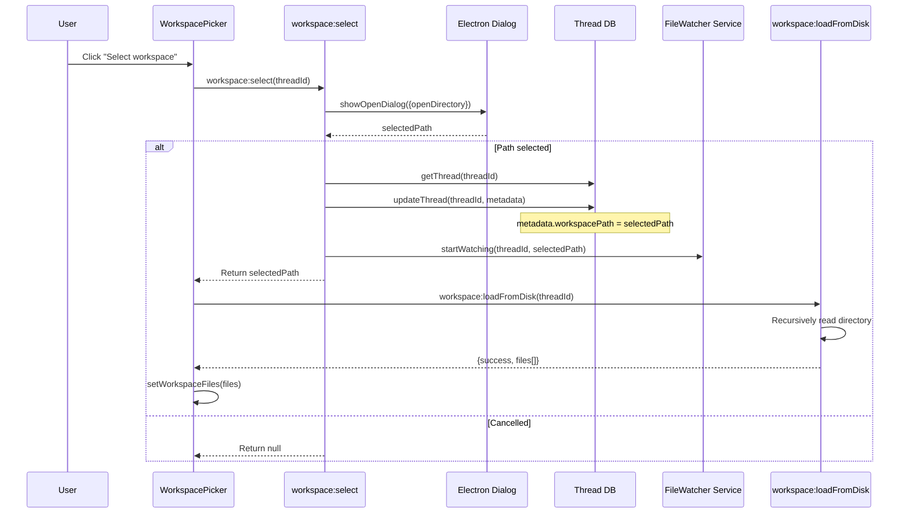
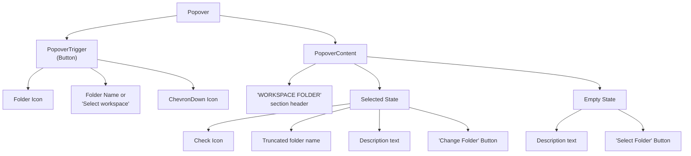
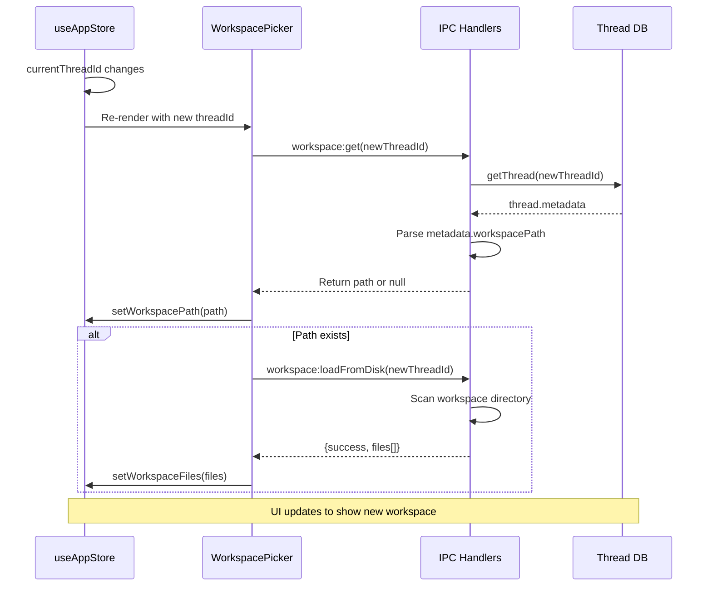

<!-- source: DeepWiki mcp.deepwiki.com · repo langchain-ai/openwork · page 5.1 Workspace Selection and Management · fetched 2026-10-26 -->

# Workspace Selection and Management

<details>
<summary>Relevant source files</summary>

The following files were used as context for generating this wiki page:

- [src/main/ipc/models.ts](src/main/ipc/models.ts)

</details>


## Purpose and Scope

This document describes how workspace folders are selected, stored, and managed in OpenWork. A workspace is a directory on the user's file system where the agent can read and write files. Each thread can have its own workspace path, or fall back to a global workspace setting. This page covers the storage architecture, selection workflow, IPC APIs, and UI components involved in workspace management.

For information about file system operations (reading, writing, watching files), see [File System Operations](#5.2). For how agents use the workspace path to create the `LocalSandbox`, see [Agent Runtime and Initialization](#3.1).

---

## Storage Architecture

OpenWork uses a dual-storage model for workspace paths:

| Storage Location | Scope | File Location | Data Structure |
|-----------------|-------|---------------|----------------|
| **Thread Metadata** | Per-thread | `~/.openwork/openwork.sqlite` | JSON field in `threads` table |
| **Global Setting** | Application-wide fallback | `~/.openwork/settings.json` | `workspacePath` key in electron-store |

When retrieving a workspace path for a thread, the system first checks the thread's metadata. If no thread-specific path exists, it falls back to the global setting. This allows users to set a default workspace while enabling individual threads to override it for different projects.

**Sources:** [src/main/ipc/models.ts:244-257](), [src/main/storage.ts:15-20]()

### Thread Metadata Structure

Thread metadata is stored as a JSON string in the `threads` table. The workspace path is stored in the `workspacePath` field:

```typescript
{
  "workspacePath": "/Users/username/projects/my-app"
}
```

When a thread is created, it has no metadata initially. The workspace path is added when the user selects a folder via the `WorkspacePicker` component or the `workspace:select` IPC handler.

**Sources:** [src/main/ipc/models.ts:273-279]()

### Workspace Path Retrieval Flow



**Sources:** [src/main/ipc/models.ts:244-257]()

---

## Workspace Selection Flow

The workspace selection process involves multiple components working together to open a folder dialog, persist the selection, start file watching, and load files into the UI.

### Selection Sequence



**Sources:** [src/main/ipc/models.ts:293-323](), [src/renderer/src/components/chat/WorkspacePicker.tsx:12-36]()

### selectWorkspaceFolder Function

The `selectWorkspaceFolder` helper function in `WorkspacePicker.tsx` encapsulates the selection logic:

```typescript
async function selectWorkspaceFolder(
  currentThreadId: string | null,
  setWorkspacePath: (path: string | null) => void,
  setWorkspaceFiles: (files: any[]) => void,
  setLoading: (loading: boolean) => void,
  setOpen?: (open: boolean) => void
): Promise<void>
```

This function:
1. Calls `window.api.workspace.select(currentThreadId)` to open the folder dialog
2. Updates the store with `setWorkspacePath(path)` if a path was selected
3. Loads files from disk using `window.api.workspace.loadFromDisk(currentThreadId)`
4. Populates the UI with `setWorkspaceFiles(result.files)`
5. Closes the popover if `setOpen` is provided

**Sources:** [src/renderer/src/components/chat/WorkspacePicker.tsx:12-36]()

---

## IPC Handlers

OpenWork provides four IPC handlers for workspace management, all registered in [src/main/ipc/models.ts]():

### workspace:get

Retrieves the workspace path for a given thread.

**Handler:** [src/main/ipc/models.ts:244-257]()

**Signature:**
```typescript
ipcMain.handle('workspace:get', async (_event, threadId?: string): Promise<string | null>
```

**Logic:**
- If no `threadId` is provided, returns the global workspace path from `electron-store`
- If `threadId` is provided, retrieves the thread from the database and extracts `workspacePath` from the thread's metadata JSON
- Returns `null` if no workspace is configured

### workspace:set

Sets the workspace path for a thread and starts/stops the file watcher.

**Handler:** [src/main/ipc/models.ts:260-290]()

**Signature:**
```typescript
ipcMain.handle('workspace:set', async (_event, { threadId, path }: { threadId?: string; path: string | null }): Promise<string | null>
```

**Logic:**
- If no `threadId` is provided, updates the global workspace path in `electron-store`
- If `threadId` is provided, updates the thread's metadata JSON with the new path
- If a path is set, calls `startWatching(threadId, path)` to begin monitoring file changes
- If path is `null`, calls `stopWatching(threadId)` to stop monitoring
- Returns the new path or `null`

### workspace:select

Opens a native folder selection dialog and persists the selected path.

**Handler:** [src/main/ipc/models.ts:293-323]()

**Signature:**
```typescript
ipcMain.handle('workspace:select', async (_event, threadId?: string): Promise<string | null>
```

**Dialog configuration:**
```typescript
{
  properties: ['openDirectory', 'createDirectory'],
  title: 'Select Workspace Folder',
  message: 'Choose a folder for the agent to work in'
}
```

**Logic:**
- Opens an Electron `dialog.showOpenDialog` with directory selection enabled
- If a folder is selected and `threadId` is provided:
  - Updates the thread's metadata with the selected path
  - Starts the file watcher via `startWatching(threadId, selectedPath)`
- If no `threadId` is provided, updates the global setting
- Returns the selected path or `null` if cancelled

### workspace:loadFromDisk

Recursively scans the workspace directory and returns the file tree.

**Handler:** [src/main/ipc/models.ts:326-394]()

**Signature:**
```typescript
ipcMain.handle('workspace:loadFromDisk', async (_event, { threadId }: { threadId: string }): Promise<{
  success: boolean;
  error?: string;
  files: Array<{ path: string; is_dir: boolean; size?: number; modified_at?: string }>;
  workspacePath?: string;
}>
```

**Logic:**
- Retrieves the workspace path from the thread's metadata
- Returns an error if no workspace is configured
- Recursively reads the directory structure, skipping:
  - Hidden files (starting with `.`)
  - `node_modules` directories
- Returns an array of file/directory objects with paths relative to the workspace root (prefixed with `/`)
- Starts the file watcher for the workspace
- Returns success status, file array, and the workspace path

**Sources:** [src/main/ipc/models.ts:326-394]()

---

## UI Components

### WorkspacePicker Component

The `WorkspacePicker` component displays the current workspace and provides a popover for selection.

**Location:** [src/renderer/src/components/chat/WorkspacePicker.tsx:38-135]()

**Component structure:**



**Key features:**
- Button text changes color to amber (`text-amber-500`) when no workspace is selected
- Displays the last segment of the path (folder name) for brevity
- Full path shown in tooltip via `title` attribute
- Button disabled when `currentThreadId` is null
- Loading state during folder selection

**Effect hook (lines 44-60):** On mount or when `currentThreadId` changes, the component:
1. Calls `window.api.workspace.get(currentThreadId)` to retrieve the current workspace path
2. Updates the store with `setWorkspacePath(path)`
3. If a path exists, calls `window.api.workspace.loadFromDisk(currentThreadId)` to load files
4. Updates the store with `setWorkspaceFiles(result.files)`

**Sources:** [src/renderer/src/components/chat/WorkspacePicker.tsx:38-135]()

### ChatContainer Integration

The `ChatContainer` component integrates workspace selection in two ways:

#### 1. Validation Before Message Submission

**Location:** [src/renderer/src/components/chat/ChatContainer.tsx:396-399]()

Before submitting a user message, `ChatContainer` checks if a workspace is selected:

```typescript
if (!workspacePath) {
  setThreadError(threadId, 'Please select a workspace folder before sending messages.')
  return
}
```

This prevents the agent from attempting to execute without a workspace, which would result in a `WORKSPACE_REQUIRED` error from the agent runtime.

#### 2. Empty State Prompt

**Location:** [src/renderer/src/components/chat/ChatContainer.tsx:478-501]()

When a thread has no messages and no workspace is selected, `ChatContainer` displays a prominent empty state:

```
NEW THREAD

Select a workspace folder
The agent needs a workspace to create and modify files

[Select workspace] (button)
```

The button calls `handleSelectWorkspaceFromEmptyState`, which invokes `selectWorkspaceFolder` to open the folder dialog.

#### 3. Input Area Integration

**Location:** [src/renderer/src/components/chat/ChatContainer.tsx:578-583]()

The `WorkspacePicker` component is displayed below the message input textarea, alongside the `ModelSwitcher`:

```tsx
<div className="flex items-center gap-2">
  <ModelSwitcher />
  <div className="w-px h-4 bg-border" />
  <WorkspacePicker />
</div>
```

**Sources:** [src/renderer/src/components/chat/ChatContainer.tsx:391-429](), [src/renderer/src/components/chat/ChatContainer.tsx:468-501]()

---

## State Management

Workspace state is managed in the Zustand store (`useAppStore`) with the following properties and actions:

| Property | Type | Description |
|----------|------|-------------|
| `workspacePath` | `string \| null` | Current workspace path for the active thread |
| `workspaceFiles` | `Array<{path, is_dir, size}>` | File tree loaded from workspace |

| Action | Signature | Description |
|--------|-----------|-------------|
| `setWorkspacePath` | `(path: string \| null) => void` | Updates workspace path in store |
| `setWorkspaceFiles` | `(files: Array) => void` | Updates file tree in store |

**Note:** The store holds only the current thread's workspace state. When switching threads, the `WorkspacePicker` component's effect hook loads the new thread's workspace path and files.

**Sources:** [src/renderer/src/lib/store.ts]() (referenced in components)

---

## Thread Switching Behavior

When the user switches threads (changes `currentThreadId`), the following sequence occurs:



This ensures that each thread's workspace is isolated and correctly restored when switching between threads.

**Sources:** [src/renderer/src/components/chat/WorkspacePicker.tsx:44-60]()

---

## Security Considerations

### Path Validation

When reading files via `workspace:readFile` or `workspace:readBinaryFile`, the handler performs security checks to prevent directory traversal attacks:

**Location:** [src/main/ipc/models.ts:419-424]()

```typescript
const resolvedPath = path.resolve(fullPath)
const resolvedWorkspace = path.resolve(workspacePath)
if (!resolvedPath.startsWith(resolvedWorkspace)) {
  return { success: false, error: 'Access denied: path outside workspace' }
}
```

This ensures that agents and UI components cannot read files outside the selected workspace directory.

### Agent Runtime Integration

The workspace path is passed to the agent runtime when creating a `LocalSandbox` instance. The sandbox uses `virtualMode: false`, meaning agents operate directly on absolute file paths within the workspace. This design requires careful validation to prevent unauthorized file access.

For details on how the agent runtime uses the workspace path, see [Agent Runtime and Initialization](#3.1).

**Sources:** [src/main/ipc/models.ts:419-424]()

---

## Common Patterns

### Loading Workspace on Component Mount

```typescript
useEffect(() => {
  async function loadWorkspace(): Promise<void> {
    if (currentThreadId) {
      const path = await window.api.workspace.get(currentThreadId)
      setWorkspacePath(path)
      
      if (path) {
        const result = await window.api.workspace.loadFromDisk(currentThreadId)
        if (result.success && result.files) {
          setWorkspaceFiles(result.files)
        }
      }
    }
  }
  loadWorkspace()
}, [currentThreadId, setWorkspacePath, setWorkspaceFiles])
```

This pattern is used in `WorkspacePicker` to ensure the workspace state is synchronized when the component mounts or the thread changes.

**Sources:** [src/renderer/src/components/chat/WorkspacePicker.tsx:44-60]()

### Validating Workspace Before Agent Invocation

```typescript
if (!workspacePath) {
  setThreadError(threadId, 'Please select a workspace folder before sending messages.')
  return
}
```

This pattern prevents the agent from being invoked without a workspace, which would result in an error from the agent runtime.

**Sources:** [src/renderer/src/components/chat/ChatContainer.tsx:396-399]()

---

## Summary

Workspace selection and management in OpenWork involves:

1. **Dual-storage architecture**: Thread-specific paths in thread metadata, with global fallback in electron-store
2. **Selection workflow**: Native folder dialog → persistence in database → file watcher startup → file tree loading
3. **IPC API**: Four handlers (`get`, `set`, `select`, `loadFromDisk`) for workspace operations
4. **UI components**: `WorkspacePicker` for selection, `ChatContainer` for validation and empty state handling
5. **Security**: Path validation to prevent directory traversal attacks

Each thread maintains its own workspace context, enabling users to work on multiple projects simultaneously while ensuring agents operate within authorized directories.

---

