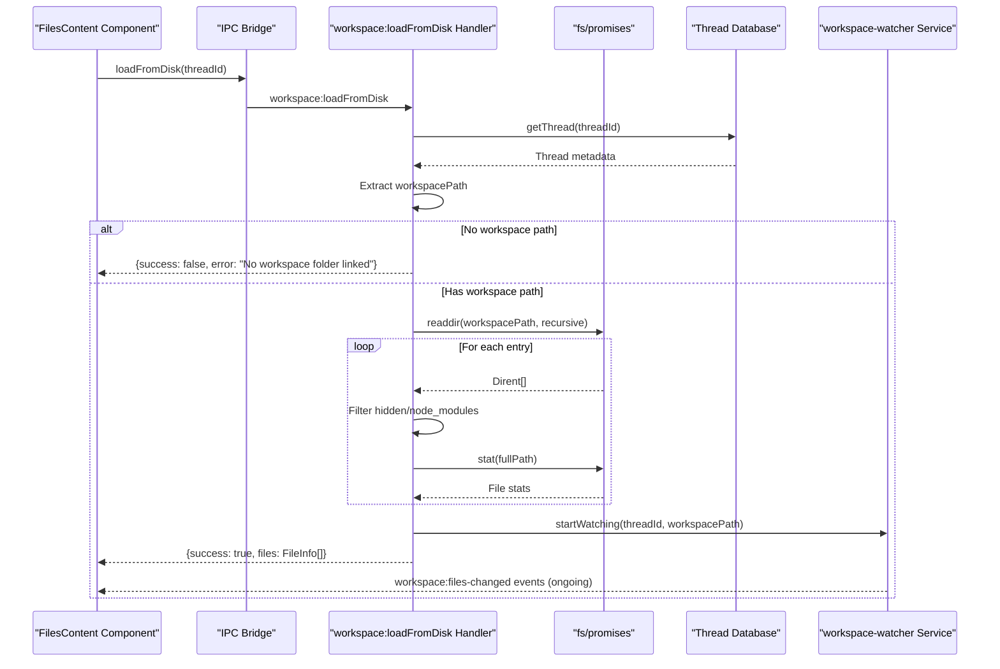
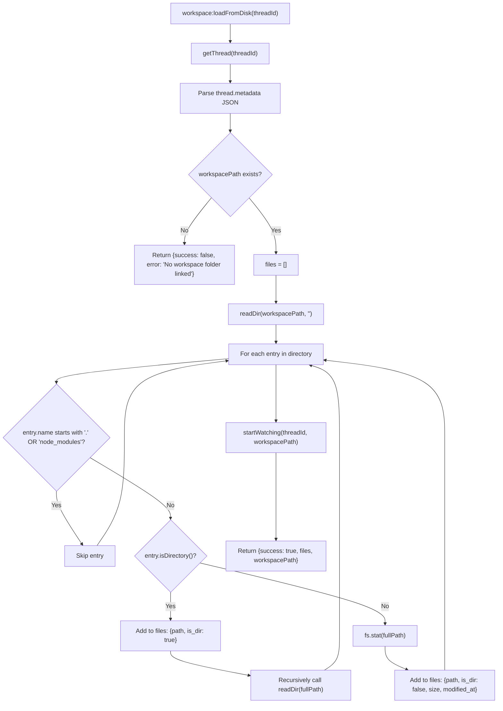
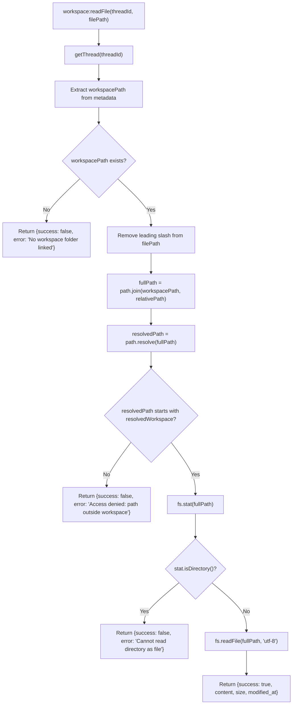
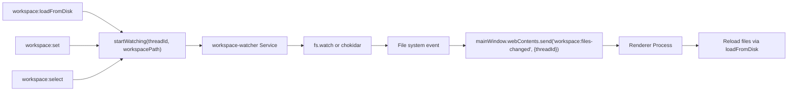
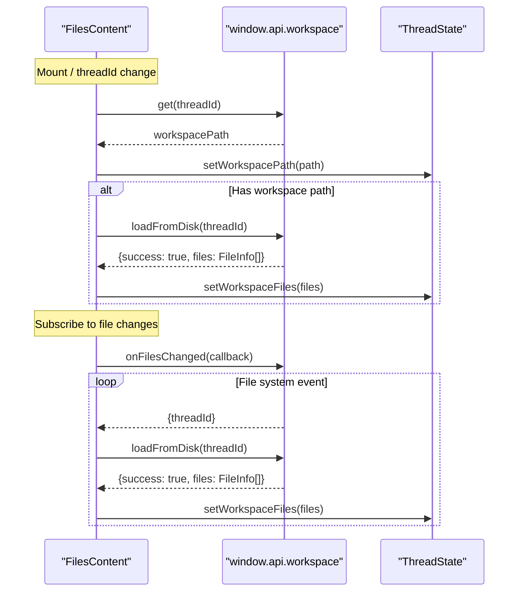

<!-- source: DeepWiki mcp.deepwiki.com · repo langchain-ai/openwork · page 5.2 File System Operations · fetched 2026-10-26 -->

# File System Operations

<details>
<summary>Relevant source files</summary>

The following files were used as context for generating this wiki page:

- [electron.vite.config.ts](electron.vite.config.ts)
- [src/main/ipc/models.ts](src/main/ipc/models.ts)
- [src/renderer/src/components/chat/ApiKeyDialog.tsx](src/renderer/src/components/chat/ApiKeyDialog.tsx)
- [src/renderer/src/components/panels/RightPanel.tsx](src/renderer/src/components/panels/RightPanel.tsx)
- [src/renderer/src/components/panels/TodoPanel.tsx](src/renderer/src/components/panels/TodoPanel.tsx)

</details>


## Purpose and Scope

This document describes the file system operations available in openwork for reading workspace files and monitoring file changes. These operations enable the agent runtime to access project files and allow the UI to display a synchronized file tree view of the workspace directory.

For information about workspace selection and thread-workspace association, see [Workspace Selection and Management](#5.1). For agent tool execution that modifies files, see [Agent Runtime and Initialization](#3.1).

**Sources:** [src/main/ipc/models.ts:1-524]()

---

## System Architecture

The file system operations layer provides three primary capabilities:
1. **Directory scanning** - Recursively loading file metadata from disk
2. **File reading** - Retrieving file contents (text or binary)
3. **Change monitoring** - Watching for file system modifications

**File System Operation Flow:**



**Sources:** [src/main/ipc/models.ts:337-406](), [src/renderer/src/components/panels/RightPanel.tsx:522-558]()

---

## IPC Handler Registration

The file system operation handlers are registered in the `registerModelHandlers` function. While this function is named for model handlers, it also registers workspace operations for organizational reasons.

| Handler | Purpose | Returns |
|---------|---------|---------|
| `workspace:loadFromDisk` | Recursively scan workspace directory and return file metadata | `{success: boolean, files: FileInfo[], workspacePath?: string, error?: string}` |
| `workspace:readFile` | Read text file contents from workspace | `{success: boolean, content?: string, size?: number, modified_at?: string, error?: string}` |
| `workspace:readBinaryFile` | Read binary file as base64-encoded string | `{success: boolean, content?: string, size?: number, modified_at?: string, error?: string}` |
| `workspace:get` | Get workspace path for thread | `string \| null` |
| `workspace:set` | Set workspace path for thread | `string \| null` |
| `workspace:select` | Open directory picker dialog | `string \| null` |

**Sources:** [src/main/ipc/models.ts:207-516]()

---

## Workspace Directory Loading

The `workspace:loadFromDisk` handler performs a complete scan of the workspace directory associated with a thread.

**Handler Implementation Flow:**



**Sources:** [src/main/ipc/models.ts:338-406]()

### Directory Traversal Logic

The handler uses a recursive `readDir` function to traverse the directory tree:

```typescript
async function readDir(dirPath: string, relativePath: string = ""): Promise<void>
```

**Filtering Rules:**
- Entries starting with `.` (hidden files) are skipped
- `node_modules` directories are skipped
- All other files and directories are included

**Path Structure:**
- Files are stored with a leading slash: `/filename.txt`
- Nested paths preserve directory structure: `/src/components/App.tsx`
- The `relativePath` parameter tracks the current position in the tree

**File Metadata:**
- Directories: `{path: string, is_dir: true}`
- Files: `{path: string, is_dir: false, size: number, modified_at: string (ISO 8601)}`

**Sources:** [src/main/ipc/models.ts:359-389]()

---

## File Reading Operations

### Text File Reading

The `workspace:readFile` handler reads UTF-8 encoded text files from the workspace.

**Implementation Structure:**



**Sources:** [src/main/ipc/models.ts:409-460]()

### Binary File Reading

The `workspace:readBinaryFile` handler reads binary files (images, PDFs, etc.) and returns them as base64-encoded strings.

**Key Differences from Text Reading:**
1. Does not specify encoding in `fs.readFile()` - returns Buffer
2. Converts Buffer to base64: `buffer.toString("base64")`
3. Returns base64 string in `content` field

The security checks and path resolution logic are identical to text file reading.

**Sources:** [src/main/ipc/models.ts:462-515]()

---

## Security Model

All file operations enforce strict security boundaries to prevent path traversal attacks.

**Security Check Implementation:**

```typescript
// Convert virtual path to full disk path
const relativePath = filePath.startsWith("/") ? filePath.slice(1) : filePath
const fullPath = path.join(workspacePath, relativePath)

// Security check: ensure the resolved path is within the workspace
const resolvedPath = path.resolve(fullPath)
const resolvedWorkspace = path.resolve(workspacePath)
if (!resolvedPath.startsWith(resolvedWorkspace)) {
  return { success: false, error: "Access denied: path outside workspace" }
}
```

**Protection Mechanisms:**

| Threat | Protection |
|--------|------------|
| Path traversal (`../../etc/passwd`) | `path.resolve()` canonicalizes path, then prefix check |
| Symbolic link escape | `path.resolve()` follows symlinks, then validates final path |
| Absolute path injection | Path is always joined with workspace root |
| Directory access | Explicit check for `stat.isDirectory()` before reading |

**Sources:** [src/main/ipc/models.ts:427-436](), [src/main/ipc/models.ts:481-490]()

---

## File Watching System

The file watching system monitors the workspace directory for changes and notifies the renderer process in real-time.

**File Watching Flow:**



**Sources:** [src/main/ipc/models.ts:13](), [src/main/ipc/models.ts:294-298](), [src/main/ipc/models.ts:392]()

### Watcher Lifecycle

The workspace watcher is started in three scenarios:
1. When `workspace:loadFromDisk` completes successfully
2. When `workspace:set` associates a path with a thread
3. When `workspace:select` dialog returns a path

The watcher is stopped when:
- `workspace:set` is called with `null` or `undefined` path
- `stopWatching(threadId)` is explicitly called

**Sources:** [src/main/ipc/models.ts:294-298]()

---

## UI Integration

The `FilesContent` component in the right panel consumes file system operations to display a live file tree.

**Component Lifecycle:**



**Sources:** [src/renderer/src/components/panels/RightPanel.tsx:522-558]()

### File Tree Construction

The `buildFileTree` function transforms the flat file list into a hierarchical tree structure for rendering.

**File Tree Building Algorithm:**

| Step | Operation | Example |
|------|-----------|---------|
| 1. Normalize paths | Remove leading slashes | `/src/App.tsx` → `src/App.tsx` |
| 2. Split into parts | Tokenize by `/` | `["src", "App.tsx"]` |
| 3. Build hierarchy | Traverse/create parent nodes | Create `src` dir node if needed |
| 4. Add leaf nodes | Insert file/dir at correct level | Add `App.tsx` to `src.children` |
| 5. Sort recursively | Directories first, then alphabetical | Ensures consistent ordering |

**TreeNode Interface:**
```typescript
interface TreeNode {
  name: string         // File/directory name
  path: string         // Full virtual path (with leading /)
  is_dir: boolean      // Directory flag
  size?: number        // File size in bytes
  children: TreeNode[] // Child nodes (empty for files)
}
```

**Sources:** [src/renderer/src/components/panels/RightPanel.tsx:674-746]()

### File Icon Mapping

The `FileIcon` component determines icon and color based on file extension:

| Extension | Icon | Color |
|-----------|------|-------|
| `.ts`, `.tsx` | `FileCode` | blue-400 |
| `.js`, `.jsx` | `FileCode` | yellow-400 |
| `.json` | `FileJson` | yellow-600 |
| `.md`, `.mdx` | `FileText` | muted-foreground |
| `.py` | `FileCode` | green-400 |
| `.css`, `.scss`, `.sass` | `FileCode` | pink-400 |
| `.html` | `FileCode` | orange-400 |
| `.svg`, `.png`, `.jpg`, `.jpeg`, `.gif`, `.webp` | `Image` | purple-400 |
| `.yml`, `.yaml` | `FileType` | red-400 |
| Other | `File` | muted-foreground |
| Directory (closed) | `Folder` | amber-500 |
| Directory (open) | `FolderOpen` | amber-500 |

**Sources:** [src/renderer/src/components/panels/RightPanel.tsx:880-934]()

---

## File Operations in Agent Runtime

While this page focuses on reading operations for the UI, the agent runtime uses these same workspace paths to execute file operations via the `LocalSandbox`. The sandbox performs:
- File creation/modification via `write_file` tool
- File reading via `read_file` tool
- Shell command execution in workspace context

These operations are not exposed through the IPC handlers documented here, as they occur entirely within the main process during agent execution.

**Sources:** [src/main/ipc/models.ts:256-269]()

---

