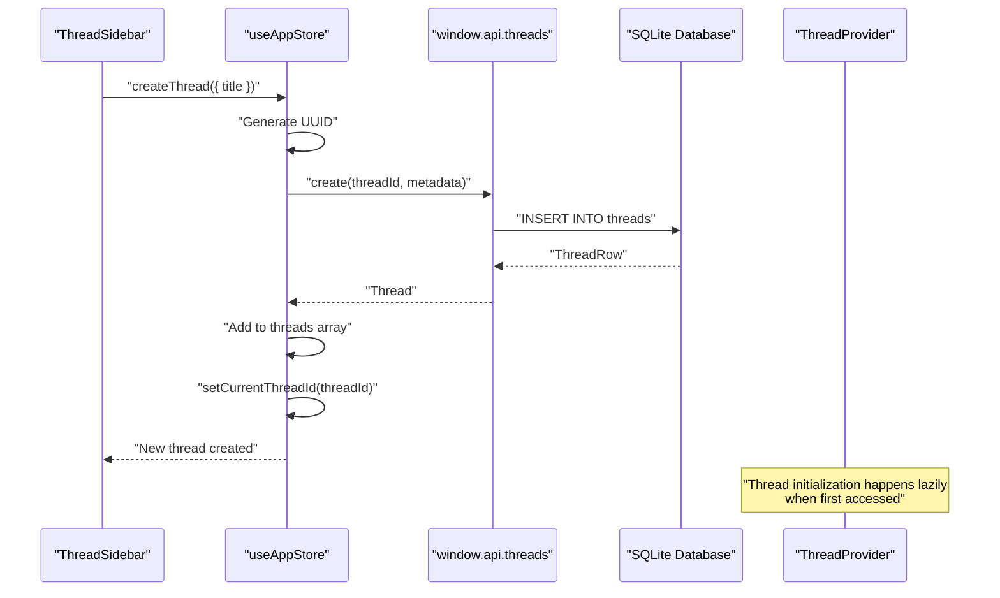
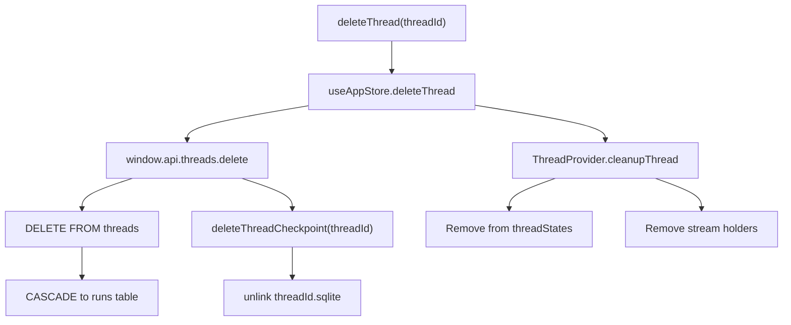
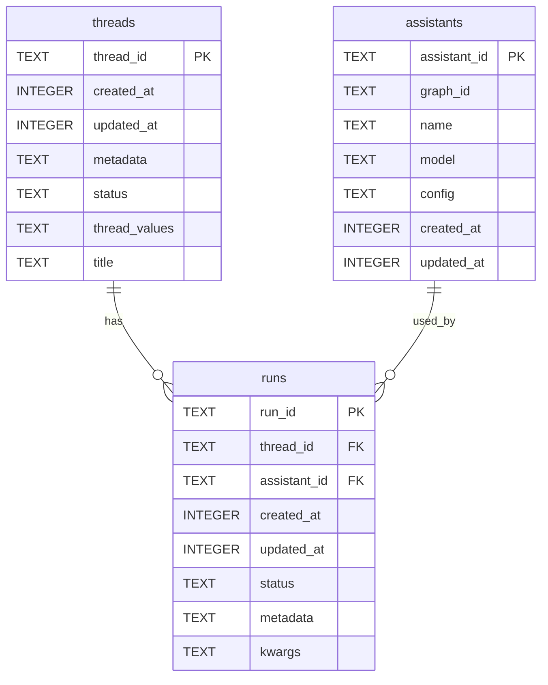
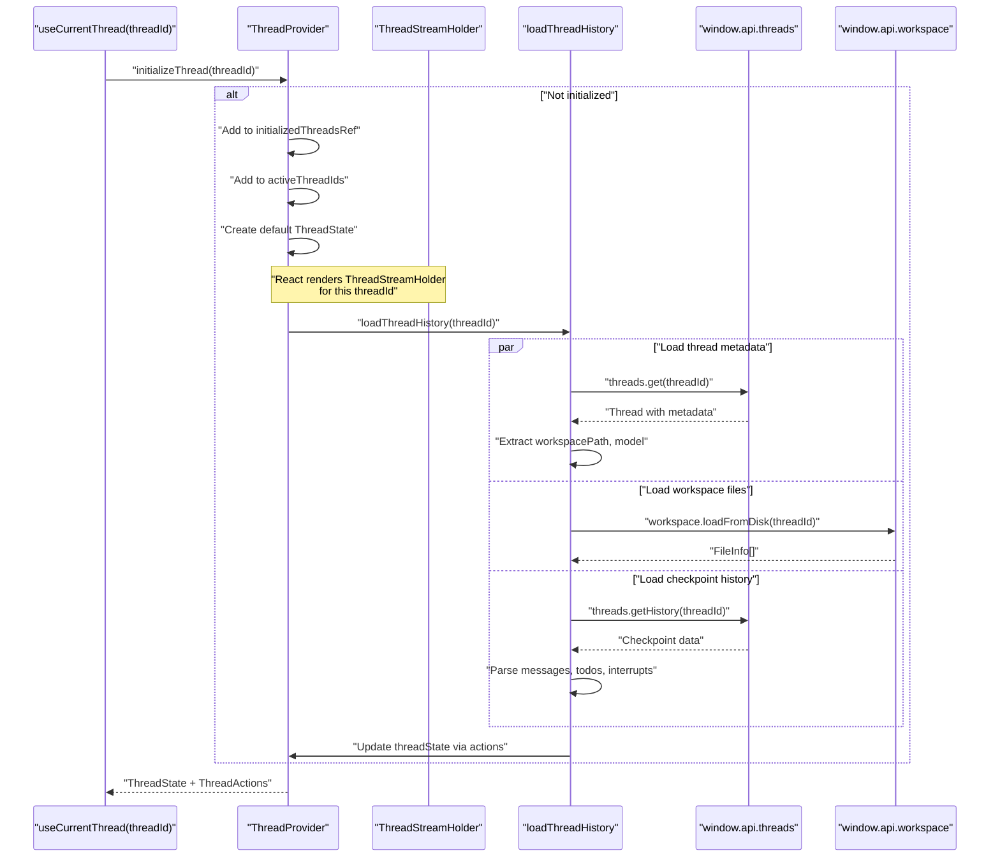
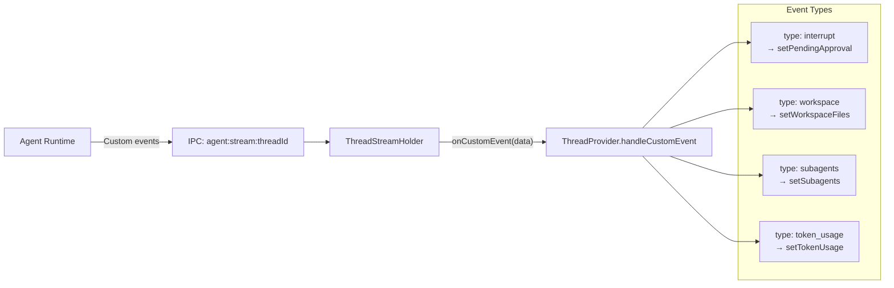
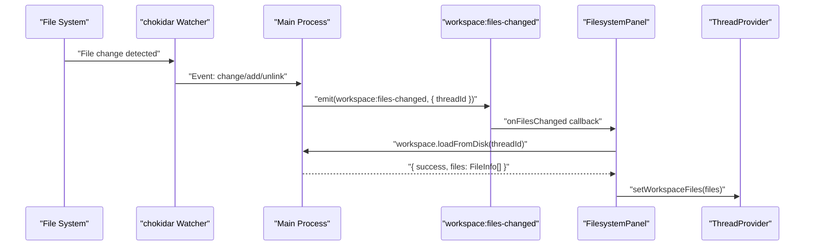
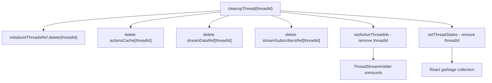

<!-- source: DeepWiki mcp.deepwiki.com · repo langchain-ai/openwork · page 6 Thread and Conversation Management · fetched 2026-10-26 -->

# Thread and Conversation Management

<details>
<summary>Relevant source files</summary>

The following files were used as context for generating this wiki page:

- [src/main/db/index.ts](src/main/db/index.ts)
- [src/main/storage.ts](src/main/storage.ts)
- [src/renderer/src/components/panels/FilesystemPanel.tsx](src/renderer/src/components/panels/FilesystemPanel.tsx)
- [src/renderer/src/components/sidebar/ThreadSidebar.tsx](src/renderer/src/components/sidebar/ThreadSidebar.tsx)
- [src/renderer/src/lib/thread-context.tsx](src/renderer/src/lib/thread-context.tsx)

</details>


This page documents the thread and conversation management system, which handles the lifecycle of conversation threads, their persistent storage, and state management. Threads are the primary organizational unit in openwork, each representing an independent conversation with its own workspace, message history, tasks, and agent state.

For information about the UI components that display threads, see [User Interface](#7). For details about state management patterns used across the application, see [State Management Architecture](#2.3). For workspace association with threads, see [Workspace and File System](#5).

---

## Thread Lifecycle

Threads follow a create-update-delete lifecycle managed through both the SQLite database (for metadata) and checkpoint files (for conversation state). Each thread has a unique `thread_id` that serves as the primary identifier across all systems.

### Thread Creation

New threads are created through the `createThread` function in `useAppStore`, which orchestrates both database insertion and state initialization:



**Sources**: [src/renderer/src/components/sidebar/ThreadSidebar.tsx:160-162](), [src/main/db/index.ts:177-198]()

### Thread Metadata Updates

Thread metadata (title, model, workspace path) is stored in the `threads.metadata` JSON column and can be updated independently of conversation state:

| Metadata Field | Type | Purpose |
|---------------|------|---------|
| `title` | `string` | Display name in sidebar |
| `model` | `string` | Model ID for this thread |
| `workspacePath` | `string` | Associated workspace directory |

**Sources**: [src/main/db/index.ts:200-239](), [src/renderer/src/lib/thread-context.tsx:484-491]()

### Thread Deletion

Thread deletion cascades across multiple storage layers:



**Sources**: [src/main/db/index.ts:241-245](), [src/main/storage.ts:44-49](), [src/renderer/src/lib/thread-context.tsx:703-718]()

---

## Thread State Architecture

The application uses a two-tier state management architecture to separate global thread metadata from per-thread conversation state.

### Global Thread Store (useAppStore)

The Zustand store `useAppStore` maintains the list of all threads and the currently selected thread:

```typescript
// Global state managed by useAppStore
interface AppStore {
  threads: Thread[]           // All threads ordered by updated_at
  currentThreadId: string | null
  createThread(metadata)
  selectThread(threadId)
  deleteThread(threadId)
  updateThread(threadId, updates)
}
```

**Sources**: [src/renderer/src/lib/store.ts]() (referenced in [src/renderer/src/components/sidebar/ThreadSidebar.tsx:129-137]())

### Per-Thread State (ThreadProvider)

The `ThreadProvider` context manages separate state for each active thread, including messages, tasks, workspace files, and streaming status:

```mermaid
graph TB
    subgraph "ThreadProvider Context"
        States["threadStates:<br/>Record&lt;string, ThreadState&gt;"]
        Actions["actionsCache:<br/>Record&lt;string, ThreadActions&gt;"]
        Streams["streamDataRef:<br/>Record&lt;string, StreamData&gt;"]
    end
    
    subgraph "ThreadState"
        Messages["messages: Message[]"]
        Todos["todos: Todo[]"]
        Files["workspaceFiles: FileInfo[]"]
        Workspace["workspacePath: string | null"]
        Subagents["subagents: Subagent[]"]
        Approval["pendingApproval: HITLRequest | null"]
        Error["error: string | null"]
        Model["currentModel: string"]
        Tokens["tokenUsage: TokenUsage | null"]
        Draft["draftInput: string"]
    end
    
    subgraph "StreamData"
        StreamMsgs["messages: Message[]"]
        Loading["isLoading: boolean"]
        StreamObj["stream: StreamInstance"]
    end
    
    States --> Messages
    States --> Todos
    States --> Files
    States --> Workspace
    States --> Subagents
    States --> Approval
    States --> Error
    States --> Model
    States --> Tokens
    States --> Draft
    
    Streams --> StreamMsgs
    Streams --> Loading
    Streams --> StreamObj
```



**Sources**: [src/renderer/src/lib/thread-context.tsx:35-79]()

### State Separation Rationale

Stream messages (`StreamData.messages`) are kept separate from persistent messages (`ThreadState.messages`) to optimize rendering performance. During agent execution, streaming messages update rapidly but are not persisted until the agent completes. This separation prevents unnecessary re-renders of the entire message list.

**Sources**: [src/renderer/src/lib/thread-context.tsx:55-60]()

---

## Thread Persistence Layer

Thread data is persisted across two storage mechanisms: SQLite for metadata and checkpoint files for conversation state.

### Database Schema

The SQLite database defines three core tables for thread management:



**Sources**: [src/main/db/index.ts:73-108]()

### Checkpoint Storage

Conversation state (messages, todos, agent graph state) is stored in per-thread SQLite checkpoint files managed by LangGraph's checkpointing system:

| Storage Location | Purpose | Format |
|-----------------|---------|--------|
| `~/.openwork/threads/{threadId}.sqlite` | LangGraph checkpoint database | SQLite |
| `~/.openwork/openwork.sqlite` | Thread metadata and runs | SQLite |

The checkpoint path is determined by `getThreadCheckpointPath(threadId)`:

**Sources**: [src/main/storage.ts:32-42]()

### Storage Directory Structure

```
~/.openwork/
├── openwork.sqlite          # Thread metadata database
├── langgraph.sqlite         # Legacy checkpoint location (unused)
├── threads/
│   ├── {thread-1}.sqlite   # Thread 1 checkpoints
│   ├── {thread-2}.sqlite   # Thread 2 checkpoints
│   └── ...
└── .env                     # API keys
```

**Sources**: [src/main/storage.ts:6-42]()

---

## ThreadProvider Implementation

The `ThreadProvider` component manages all per-thread state and coordinates between the streaming system, database, and UI components.

### Context Value Structure

```typescript
interface ThreadContextValue {
  getThreadState: (threadId: string) => ThreadState
  getThreadActions: (threadId: string) => ThreadActions
  initializeThread: (threadId: string) => void
  cleanupThread: (threadId: string) => void
  subscribeToStream: (threadId: string, callback: () => void) => () => void
  getStreamData: (threadId: string) => StreamData
  getAllThreadStates: () => Record<string, ThreadState>
  getAllStreamLoadingStates: () => Record<string, boolean>
}
```

**Sources**: [src/renderer/src/lib/thread-context.tsx:82-96]()

### Thread Initialization Flow

Threads are initialized lazily when first accessed through `useCurrentThread` or `useThreadState` hooks:



**Sources**: [src/renderer/src/lib/thread-context.tsx:685-701](), [src/renderer/src/lib/thread-context.tsx:539-683]()

### ThreadStreamHolder Component

Each active thread has a corresponding `ThreadStreamHolder` component that manages the LangGraph stream instance and forwards events to the `ThreadProvider`:

```typescript
// Key responsibilities of ThreadStreamHolder:
// 1. Creates useStream instance with ElectronIPCTransport
// 2. Forwards stream updates to parent via onStreamUpdate callback
// 3. Forwards custom events (interrupts, workspace changes) via onCustomEvent
// 4. Forwards errors via onError callback
```

**Sources**: [src/renderer/src/lib/thread-context.tsx:147-221]()

---

## Thread State Synchronization

Thread state synchronization occurs through multiple channels to keep the UI responsive and consistent.

### Stream Event Processing

Custom events from the agent runtime update thread state in real-time:



**Sources**: [src/renderer/src/lib/thread-context.tsx:358-437]()

### Checkpoint Restoration

When loading thread history, the system parses checkpoint data to restore conversation state:

| Checkpoint Field | Extracted Data | Target State |
|-----------------|---------------|--------------|
| `checkpoint.channel_values.messages` | LangChain message objects | `ThreadState.messages` |
| `checkpoint.channel_values.todos` | Todo items | `ThreadState.todos` |
| `checkpoint.channel_values.__interrupt__` | HITL request data | `ThreadState.pendingApproval` |

The restoration process handles both old and new interrupt formats from LangChain:

```typescript
// New format: actionRequests
if (actionRequests && actionRequests.length > 0) {
  const req = actionRequests[0]
  const hitlRequest: HITLRequest = {
    id: crypto.randomUUID(),
    tool_call: { id: crypto.randomUUID(), name: req.action, args: req.args },
    allowed_decisions: ["approve", "reject", "edit"]
  }
  actions.setPendingApproval(hitlRequest)
}
// Alternative format: reviewConfigs
else if (reviewConfigs && reviewConfigs.length > 0) {
  // Similar construction
}
```

**Sources**: [src/renderer/src/lib/thread-context.tsx:642-676]()

### File System Watching

The workspace file tree is automatically updated when file changes are detected:



**Sources**: [src/renderer/src/components/panels/FilesystemPanel.tsx:48-68]()

---

## Thread Access Hooks

The thread context system provides several React hooks for accessing thread state with different lifecycle semantics.

### useCurrentThread Hook

The primary hook for accessing a specific thread's state and actions. Automatically initializes the thread on first use:

```typescript
function useCurrentThread(threadId: string): ThreadState & ThreadActions {
  const context = useThreadContext()
  
  // Initialize thread if not already initialized
  useEffect(() => {
    context.initializeThread(threadId)
  }, [threadId, context])
  
  const state = context.getThreadState(threadId)
  const actions = context.getThreadActions(threadId)
  
  return { ...state, ...actions }
}
```

**Sources**: [src/renderer/src/lib/thread-context.tsx:783-794]()

### useThreadState Hook

Similar to `useCurrentThread` but accepts nullable thread IDs, useful when no thread is selected:

```typescript
function useThreadState(threadId: string | null): (ThreadState & ThreadActions) | null {
  // Returns null if threadId is null
  // Otherwise behaves like useCurrentThread
}
```

**Sources**: [src/renderer/src/lib/thread-context.tsx:797-810]()

### useThreadStream Hook

Subscribes to streaming updates for a specific thread using `useSyncExternalStore` for optimal reactivity:

```typescript
function useThreadStream(threadId: string): StreamData {
  const context = useThreadContext()
  
  const subscribe = useCallback(
    (callback: () => void) => context.subscribeToStream(threadId, callback),
    [context, threadId]
  )
  
  const getSnapshot = useCallback(
    () => context.getStreamData(threadId),
    [context, threadId]
  )
  
  return useSyncExternalStore(subscribe, getSnapshot, getSnapshot)
}
```

This hook is used by UI components like `ThreadStatusIcon` to show loading spinners and interrupt indicators without re-rendering the entire thread state.

**Sources**: [src/renderer/src/lib/thread-context.tsx:769-780](), [src/renderer/src/components/sidebar/ThreadSidebar.tsx:18-31]()

### useAllThreadStates Hook

Provides access to all initialized thread states, primarily used by the Kanban view to display multiple threads simultaneously:

**Sources**: [src/renderer/src/lib/thread-context.tsx:813-816]()

---

## Thread Actions

Thread actions are memoized per-thread to prevent unnecessary re-renders. Each action updates both the in-memory state and, where appropriate, persists changes to the backend.

### Message Management Actions

```typescript
interface MessageActions {
  appendMessage: (message: Message) => void          // Add or update message
  setMessages: (messages: Message[]) => void         // Replace all messages
}
```

The `appendMessage` action handles both new messages and updates to existing messages (by checking `message.id` for duplicates).

**Sources**: [src/renderer/src/lib/thread-context.tsx:446-454]()

### Workspace Management Actions

```typescript
interface WorkspaceActions {
  setWorkspaceFiles: (files: FileInfo[] | ((prev: FileInfo[]) => FileInfo[])) => void
  setWorkspacePath: (path: string | null) => void
}
```

The `setWorkspacePath` action also persists the path to the thread's metadata in the database.

**Sources**: [src/renderer/src/lib/thread-context.tsx:461-467](), [src/renderer/src/lib/thread-context.tsx:466-468]()

### Model Selection Action

```typescript
interface ModelAction {
  setCurrentModel: (modelId: string) => void
}
```

This action updates both the thread state and persists the model choice to the database metadata for continuity across sessions:

```typescript
setCurrentModel: (modelId: string) => {
  updateThreadState(threadId, () => ({ currentModel: modelId }))
  // Persist to backend
  window.api.threads.get(threadId).then((thread) => {
    if (thread) {
      const metadata = thread.metadata || {}
      window.api.threads.update(threadId, {
        metadata: { ...metadata, model: modelId }
      })
    }
  })
}
```

**Sources**: [src/renderer/src/lib/thread-context.tsx:481-492]()

### File Tab Management Actions

```typescript
interface FileTabActions {
  openFile: (path: string, name: string) => void
  closeFile: (path: string) => void
  setActiveTab: (tab: "agent" | string) => void
  setFileContents: (path: string, content: string) => void
}
```

These actions manage the tabbed interface in the center panel, allowing users to view files alongside the chat interface.

**Sources**: [src/renderer/src/lib/thread-context.tsx:493-530]()

---

## Error Handling and User Feedback

The thread context system includes sophisticated error parsing to provide user-friendly error messages for common failure scenarios.

### Error Message Parsing

The `parseErrorMessage` function detects and reformats common error types:

| Error Pattern | Detected By | User-Friendly Message |
|--------------|-------------|----------------------|
| Context window exceeded | `/prompt is too long: (\d+) tokens > (\d+) maximum/i` | "Context window exceeded (XK / YK tokens). The conversation history is too long. Please start a new thread to continue." |
| Rate limiting | `"rate_limit"` or `"429"` | "Rate limit exceeded. Please wait a moment before sending another message." |
| Authentication failure | `"401"` or `"invalid_api_key"` | "Authentication failed. Please check your API key in settings." |

**Sources**: [src/renderer/src/lib/thread-context.tsx:315-345]()

### Error State Management

Errors are stored per-thread in `ThreadState.error` and can be cleared via the `clearError()` action. The chat interface displays these errors prominently above the input area.

**Sources**: [src/renderer/src/lib/thread-context.tsx:347-355]()

---

## Thread Cleanup and Memory Management

To prevent memory leaks, the thread system implements cleanup mechanisms for threads that are no longer in use.

### Cleanup Process

When a thread is cleaned up (typically on deletion), the following operations occur:



**Sources**: [src/renderer/src/lib/thread-context.tsx:703-718]()

### Actions Cache

Thread actions are cached per-thread to prevent creating new action objects on every render. The cache is cleared when a thread is cleaned up:

```typescript
const actionsCache = useRef<Record<string, ThreadActions>>({})

const getThreadActions = useCallback((threadId: string): ThreadActions => {
  if (actionsCache.current[threadId]) {
    return actionsCache.current[threadId]
  }
  
  const actions: ThreadActions = { /* ... */ }
  actionsCache.current[threadId] = actions
  return actions
}, [updateThreadState])
```

**Sources**: [src/renderer/src/lib/thread-context.tsx:228-228](), [src/renderer/src/lib/thread-context.tsx:439-537]()

---

