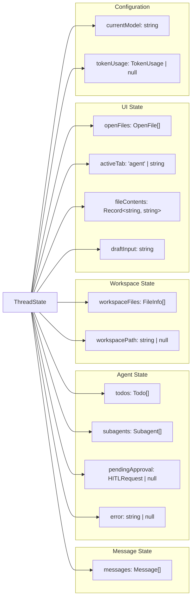
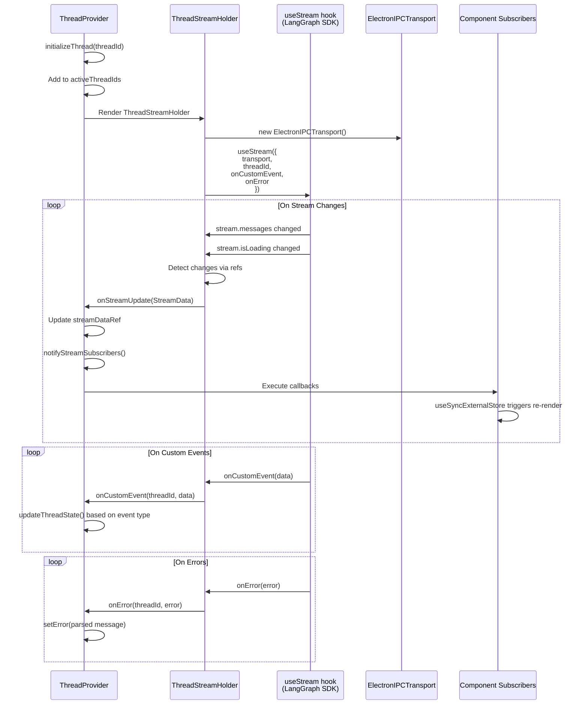
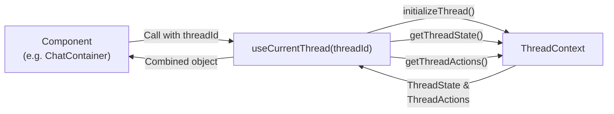
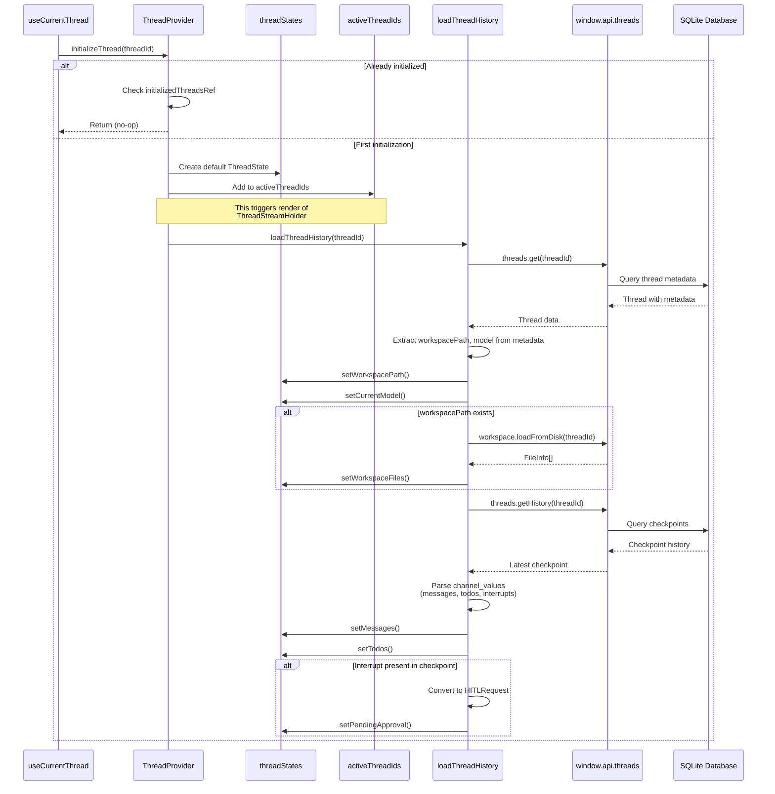
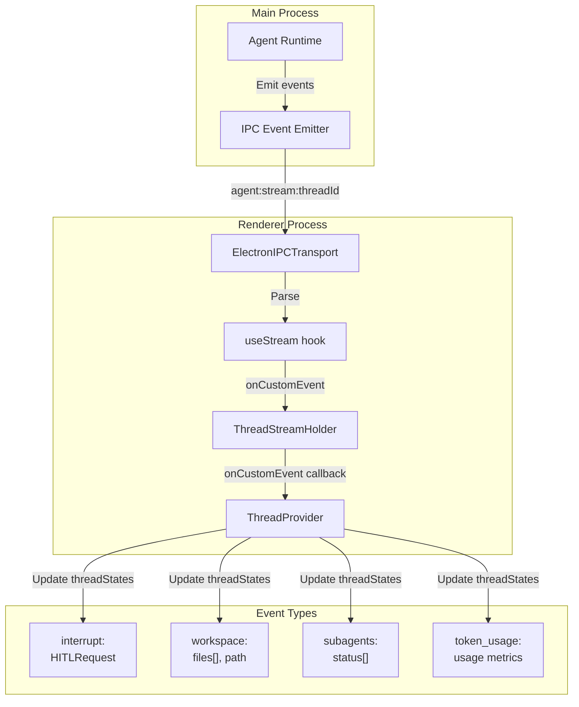
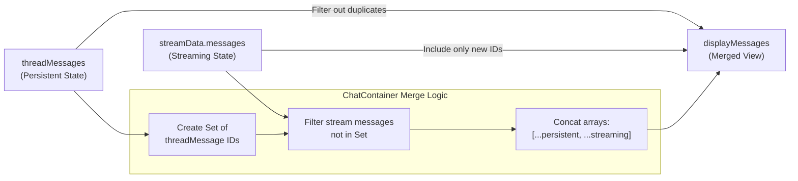

<!-- source: DeepWiki mcp.deepwiki.com · repo langchain-ai/openwork · page 6.1 Thread State and Context · fetched 2026-10-26 -->

# Thread State and Context

<details>
<summary>Relevant source files</summary>

The following files were used as context for generating this wiki page:

- [src/renderer/src/components/chat/ChatContainer.tsx](src/renderer/src/components/chat/ChatContainer.tsx)
- [src/renderer/src/components/panels/FilesystemPanel.tsx](src/renderer/src/components/panels/FilesystemPanel.tsx)
- [src/renderer/src/components/sidebar/ThreadSidebar.tsx](src/renderer/src/components/sidebar/ThreadSidebar.tsx)
- [src/renderer/src/lib/thread-context.tsx](src/renderer/src/lib/thread-context.tsx)

</details>


This document describes the per-thread state management system implemented by `ThreadProvider` and its associated hooks. It covers how thread-specific data (messages, todos, workspace files, etc.) is maintained separately for each conversation thread, how streaming agent execution integrates with persistent state, and the hook-based API for accessing and modifying thread state.

For information about thread persistence and checkpointing to SQLite, see [Thread Persistence and Checkpointing](#6.2). For the global application state (thread list, model configurations), see [State Management Architecture](#2.3).

## ThreadProvider Architecture

The `ThreadProvider` component manages state for all active conversation threads in the application. It uses React Context to provide thread-specific state and actions to any component that needs them, while keeping each thread's state isolated and independently manageable.

```mermaid
graph TB
    subgraph "React Component Tree"
        App["App Component"]
        ThreadProvider["ThreadProvider<br/>(Context Provider)"]
        ChatContainer["ChatContainer"]
        ThreadSidebar["ThreadSidebar"]
        FilesystemPanel["FilesystemPanel"]
        RightPanel["RightPanel"]
    end
    
    subgraph "ThreadProvider Internal State"
        threadStates["threadStates:<br/>Record&lt;string, ThreadState&gt;"]
        activeThreadIds["activeThreadIds:<br/>Set&lt;string&gt;"]
        streamDataRef["streamDataRef:<br/>Record&lt;string, StreamData&gt;"]
        streamSubscribers["streamSubscribersRef:<br/>Record&lt;string, Set&lt;callback&gt;&gt;"]
        actionsCache["actionsCache:<br/>Record&lt;string, ThreadActions&gt;"]
    end
    
    subgraph "Stream Holders"
        StreamHolder1["ThreadStreamHolder<br/>thread-1"]
        StreamHolder2["ThreadStreamHolder<br/>thread-2"]
        StreamHolder3["ThreadStreamHolder<br/>thread-N"]
    end
    
    App --> ThreadProvider
    ThreadProvider --> ChatContainer
    ThreadProvider --> ThreadSidebar
    ThreadProvider --> FilesystemPanel
    ThreadProvider --> RightPanel
    
    ThreadProvider --> threadStates
    ThreadProvider --> activeThreadIds
    ThreadProvider --> streamDataRef
    ThreadProvider --> streamSubscribers
    ThreadProvider --> actionsCache
    
    ThreadProvider -->|Renders for each<br/>active thread| StreamHolder1
    ThreadProvider -->|Renders for each<br/>active thread| StreamHolder2
    ThreadProvider -->|Renders for each<br/>active thread| StreamHolder3
    
    StreamHolder1 -.->|onStreamUpdate| streamDataRef
    StreamHolder2 -.->|onStreamUpdate| streamDataRef
    StreamHolder3 -.->|onStreamUpdate| streamDataRef
    
    StreamHolder1 -.->|onCustomEvent| threadStates
    StreamHolder2 -.->|onCustomEvent| threadStates
    StreamHolder3 -.->|onCustomEvent| threadStates
    
    ChatContainer -.->|useCurrentThread| threadStates
    ThreadSidebar -.->|useThreadStream| streamDataRef
    FilesystemPanel -.->|useThreadState| threadStates
```



**Sources:** [src/renderer/src/lib/thread-context.tsx:223-260](), [src/renderer/src/lib/thread-context.tsx:746-759]()

The provider maintains several key data structures:

| Data Structure | Type | Purpose |
|---|---|---|
| `threadStates` | `Record<string, ThreadState>` | Persistent state for each thread (messages, todos, workspace) |
| `activeThreadIds` | `Set<string>` | Thread IDs that currently have rendered `ThreadStreamHolder` components |
| `streamDataRef` | `Record<string, StreamData>` | Non-reactive stream data (messages, loading state, stream instance) |
| `streamSubscribersRef` | `Record<string, Set<callback>>` | Subscription callbacks for stream updates per thread |
| `actionsCache` | `Record<string, ThreadActions>` | Cached action objects to prevent recreation on each render |

**Sources:** [src/renderer/src/lib/thread-context.tsx:224-228](), [src/renderer/src/lib/thread-context.tsx:231-232]()

## ThreadState and ThreadActions

Each thread maintains its own independent state captured in the `ThreadState` interface:



**Sources:** [src/renderer/src/lib/thread-context.tsx:36-50]()

The `ThreadActions` interface provides methods to modify thread state:

| Action Method | Parameters | Purpose |
|---|---|---|
| `appendMessage` | `message: Message` | Add a message to the thread history (or update existing) |
| `setMessages` | `messages: Message[]` | Replace entire message history |
| `setTodos` | `todos: Todo[]` | Update the current task list |
| `setWorkspaceFiles` | `files: FileInfo[] \| (prev) => FileInfo[]` | Update workspace file tree |
| `setWorkspacePath` | `path: string \| null` | Set the workspace directory path |
| `setSubagents` | `subagents: Subagent[]` | Update subagent status list |
| `setPendingApproval` | `request: HITLRequest \| null` | Set/clear HITL approval request |
| `setError` | `error: string \| null` | Set an error message |
| `clearError` | - | Clear the current error |
| `setCurrentModel` | `modelId: string` | Change the LLM model for this thread |
| `openFile` | `path: string, name: string` | Open a file in the file editor tabs |
| `closeFile` | `path: string` | Close a file tab |
| `setActiveTab` | `tab: 'agent' \| string` | Switch to a different tab |
| `setFileContents` | `path: string, content: string` | Cache file contents for editor |
| `setDraftInput` | `input: string` | Save draft message input |

**Sources:** [src/renderer/src/lib/thread-context.tsx:63-79](), [src/renderer/src/lib/thread-context.tsx:445-531]()

Actions are cached per thread to prevent object recreation on every render, improving performance when components consume thread context.

## Stream Management with ThreadStreamHolder

The `ThreadStreamHolder` component is a key architectural element that separates streaming state from persistent state to optimize re-renders. For each active thread, the provider renders a `ThreadStreamHolder` component that manages the LangGraph SDK streaming connection.



**Sources:** [src/renderer/src/lib/thread-context.tsx:147-221](), [src/renderer/src/lib/thread-context.tsx:242-254]()

The holder component:
1. Creates an `ElectronIPCTransport` instance to communicate with the main process
2. Calls the LangGraph SDK's `useStream` hook with the transport and thread ID
3. Tracks stream state changes using refs to detect actual changes
4. Notifies the provider when stream data changes (messages, loading state)
5. Forwards custom events (interrupts, workspace updates, token usage) to the provider
6. Forwards errors to the provider for user-friendly display

This architecture ensures that:
- Stream updates don't cause the entire provider to re-render
- Components can subscribe to specific stream updates using `useSyncExternalStore`
- Multiple components can efficiently observe the same stream
- Stream state is kept separate from persistent thread state

**Sources:** [src/renderer/src/lib/thread-context.tsx:157-182](), [src/renderer/src/lib/thread-context.tsx:191-218]()

## Hook API

The context provides several hooks for accessing thread state and streaming data:

### useCurrentThread

The primary hook for accessing both state and actions for a specific thread. It automatically initializes the thread on mount and provides the full `ThreadState & ThreadActions` interface.



**Sources:** [src/renderer/src/lib/thread-context.tsx:782-794]()

Usage example from `ChatContainer`:

```typescript
const {
  messages: threadMessages,
  pendingApproval,
  todos,
  error: threadError,
  workspacePath,
  tokenUsage,
  currentModel,
  draftInput: input,
  setTodos,
  setWorkspaceFiles,
  setWorkspacePath,
  setPendingApproval,
  appendMessage,
  setError,
  clearError,
  setDraftInput: setInput
} = useCurrentThread(threadId)
```

**Sources:** [src/renderer/src/components/chat/ChatContainer.tsx:41-58]()

### useThreadStream

Subscribes to streaming updates for a thread using `useSyncExternalStore` for optimal reactivity. Returns a `StreamData` object containing:

| Property | Type | Description |
|---|---|---|
| `messages` | `StreamInstance['messages']` | Streaming messages from LangGraph SDK |
| `isLoading` | `boolean` | Whether the agent is currently processing |
| `stream` | `StreamInstance \| null` | The stream instance with `submit()`, `stop()`, `values` |

**Sources:** [src/renderer/src/lib/thread-context.tsx:56-60](), [src/renderer/src/lib/thread-context.tsx:769-780]()

Usage example from `ChatContainer`:

```typescript
const streamData = useThreadStream(threadId)
const stream = streamData.stream
const isLoading = streamData.isLoading

// Submit a message
await stream.submit(
  { messages: [{ type: "human", content: message }] },
  { config: { configurable: { thread_id: threadId, model_id: currentModel } } }
)

// Stop streaming
await stream.stop()
```

**Sources:** [src/renderer/src/components/chat/ChatContainer.tsx:61-63](), [src/renderer/src/components/chat/ChatContainer.tsx:259-268](), [src/renderer/src/components/chat/ChatContainer.tsx:291-293]()

The hook uses `useSyncExternalStore` which only triggers re-renders when subscribed data actually changes, preventing unnecessary updates when the provider's internal state changes.

**Sources:** [src/renderer/src/lib/thread-context.tsx:256-266](), [src/renderer/src/lib/thread-context.tsx:772-779]()

### useThreadState

A nullable variant of `useCurrentThread` that returns `null` if no thread ID is provided. Useful for optional thread contexts.

**Sources:** [src/renderer/src/lib/thread-context.tsx:797-810]()

Usage example from `FilesystemPanel`:

```typescript
const threadState = useThreadState(currentThreadId)
const workspaceFiles = threadState?.workspaceFiles ?? []
const workspacePath = threadState?.workspacePath ?? null
const setWorkspacePath = threadState?.setWorkspacePath
```

**Sources:** [src/renderer/src/components/panels/FilesystemPanel.tsx:20-24]()

### useAllThreadStates and useAllStreamLoadingStates

These hooks provide access to all initialized thread states and loading states, primarily used by the Kanban overview to display status for all threads simultaneously.

**Sources:** [src/renderer/src/lib/thread-context.tsx:813-822]()

## State Initialization and History Loading

When a thread is first accessed via `useCurrentThread` or `useThreadState`, the provider calls `initializeThread()` to set up the thread's state management:



**Sources:** [src/renderer/src/lib/thread-context.tsx:685-701](), [src/renderer/src/lib/thread-context.tsx:539-683]()

The initialization process:

1. **Default State Creation**: Creates a `ThreadState` with empty arrays and default values
2. **Thread Activation**: Adds thread to `activeThreadIds`, triggering render of `ThreadStreamHolder`
3. **Metadata Loading**: Fetches thread metadata from SQLite to restore workspace path and model selection
4. **Workspace Restoration**: If a workspace path exists, loads the file tree from disk
5. **History Restoration**: Loads the latest checkpoint from the database
6. **Message Parsing**: Converts LangChain message objects to the application's `Message` format
7. **State Parsing**: Extracts todos and other state from `channel_values`
8. **Interrupt Restoration**: If the agent was interrupted (HITL), recreates the `HITLRequest` for UI display

**Sources:** [src/renderer/src/lib/thread-context.tsx:544-562](), [src/renderer/src/lib/thread-context.tsx:565-680]()

### Checkpoint Data Structure

The checkpoint data loaded from the database has the following structure:

```typescript
checkpoint: {
  channel_values: {
    messages: Array<LangChainMessage>  // Conversation history
    todos: Array<{id, content, status}>  // Task list
    __interrupt__: Array<{  // HITL approval state
      value: {
        actionRequests: Array<{action, args}>
        reviewConfigs: Array<{toolName, toolArgs}>
      }
    }>
  }
}
```

**Sources:** [src/renderer/src/lib/thread-context.tsx:568-596]()

## Real-Time Updates and Custom Events

The `ThreadStreamHolder` receives custom events from the LangGraph SDK and forwards them to the provider's `handleCustomEvent` callback. This enables real-time synchronization of agent state with the UI.



**Sources:** [src/renderer/src/lib/thread-context.tsx:358-437]()

### Event Type: interrupt

When the agent requires human approval (HITL), it sends an interrupt event containing the action request details:

```typescript
{
  type: "interrupt",
  request: {
    id: string,
    tool_call: { id: string, name: string, args: Record<string, unknown> },
    allowed_decisions: ["approve", "reject", "edit"]
  }
}
```

The provider updates `pendingApproval` in the thread state, triggering UI components to display the approval dialog.

**Sources:** [src/renderer/src/lib/thread-context.tsx:362-370]()

### Event Type: workspace

Updates workspace file information when the agent creates or modifies files:

```typescript
{
  type: "workspace",
  files: Array<{ path: string, is_dir?: boolean, size?: number }>,
  path?: string  // New workspace path
}
```

The provider merges new files with existing `workspaceFiles`, preventing duplicates while preserving metadata.

**Sources:** [src/renderer/src/lib/thread-context.tsx:372-385]()

### Event Type: subagents

Tracks delegated subagent tasks and their execution status:

```typescript
{
  type: "subagents",
  subagents: Array<{
    id?: string,
    name?: string,
    description?: string,
    status?: "pending" | "running" | "completed" | "failed",
    startedAt?: Date,
    completedAt?: Date
  }>
}
```

**Sources:** [src/renderer/src/lib/thread-context.tsx:386-398]()

### Event Type: token_usage

Provides real-time context window monitoring by tracking token consumption:

```typescript
{
  type: "token_usage",
  usage: {
    inputTokens: number,
    outputTokens: number,
    totalTokens: number,
    cacheReadTokens?: number,
    cacheCreationTokens?: number
  }
}
```

The provider only updates token usage if the new input tokens are greater than or equal to previous values, ensuring the displayed count represents the accumulated context across the conversation.

**Sources:** [src/renderer/src/lib/thread-context.tsx:400-433]()

## Message Merging Strategy

The provider maintains separate state for persistent messages (from database) and streaming messages (from active execution). Components use `useMemo` to merge these efficiently:



**Sources:** [src/renderer/src/components/chat/ChatContainer.tsx:128-152]()

When streaming completes (`isLoading` transitions to `false`), the `ChatContainer` persists streaming messages by calling `appendMessage()` for each message. The `appendMessage` action checks for existing IDs to prevent duplicates.

**Sources:** [src/renderer/src/components/chat/ChatContainer.tsx:97-126](), [src/renderer/src/lib/thread-context.tsx:446-453]()

This strategy ensures:
- Real-time UI updates during agent execution without database writes
- Automatic persistence of messages when streaming completes
- No duplicate messages in the UI or database
- Efficient re-rendering only when display messages actually change

---

