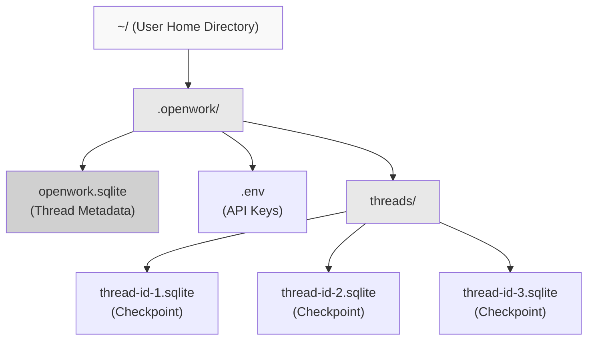
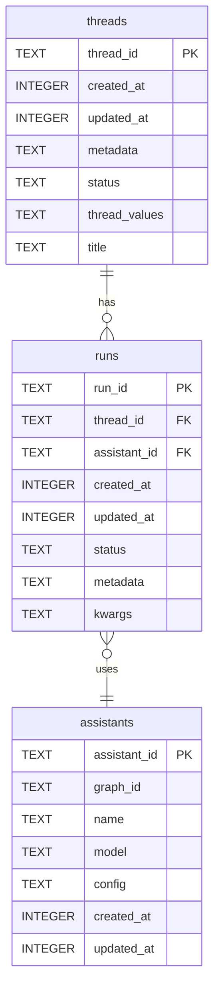
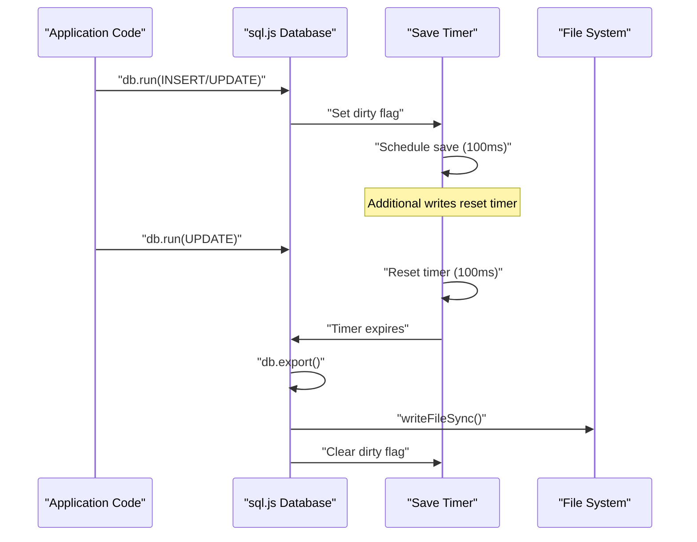
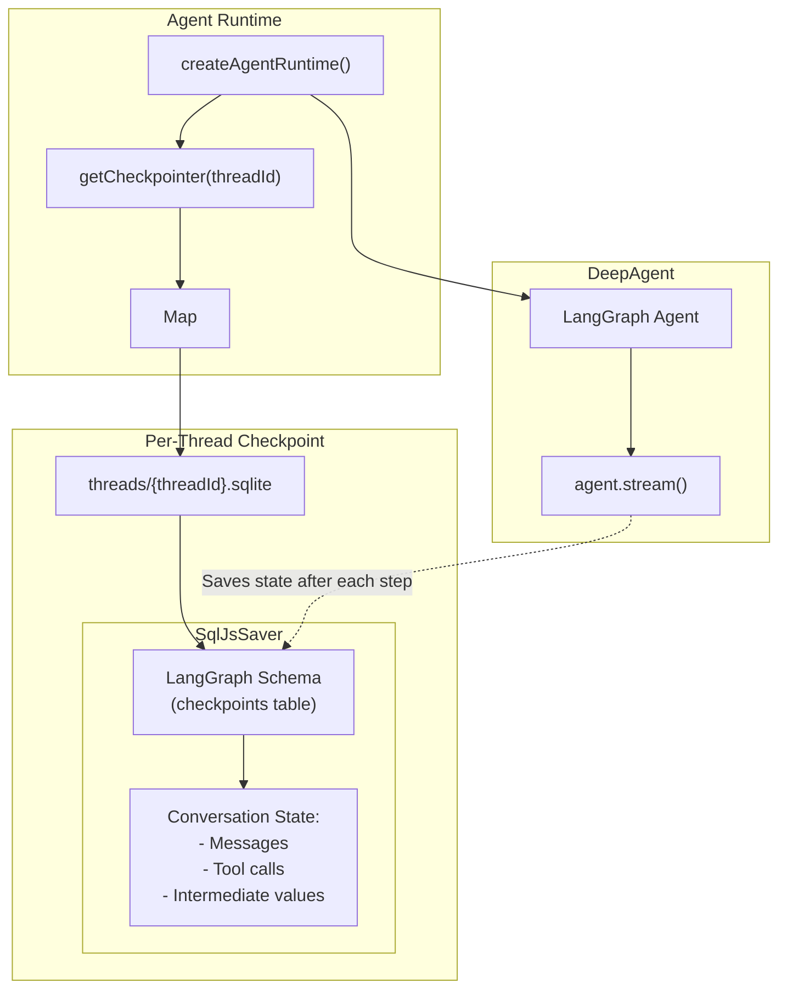
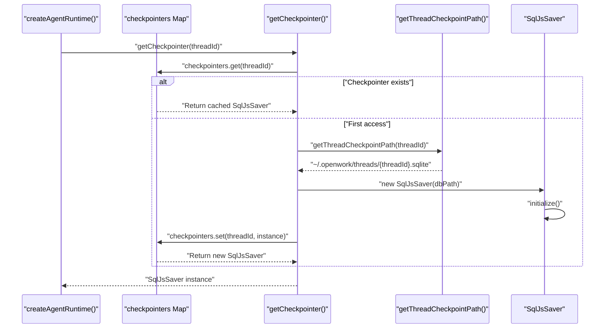
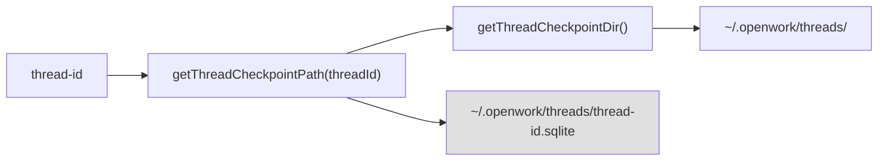
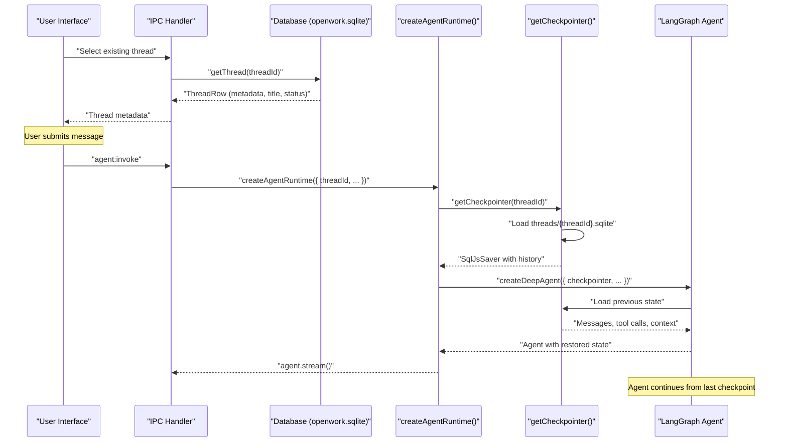

<!-- source: DeepWiki mcp.deepwiki.com · repo langchain-ai/openwork · page 6.2 Thread Persistence and Checkpointing · fetched 2026-10-26 -->

# Thread Persistence and Checkpointing

<details>
<summary>Relevant source files</summary>

The following files were used as context for generating this wiki page:

- [src/main/agent/runtime.ts](src/main/agent/runtime.ts)
- [src/main/agent/system-prompt.ts](src/main/agent/system-prompt.ts)
- [src/main/db/index.ts](src/main/db/index.ts)
- [src/main/storage.ts](src/main/storage.ts)

</details>


This document describes the persistence layer for thread conversations in openwork, including the SQLite database schema for thread metadata and the LangGraph checkpoint system for conversation state. Thread persistence enables conversation continuity across application sessions and provides a foundation for resuming interrupted agent executions.

For thread state management in the UI layer, see [Thread State and Context](#6.1). For the overall agent runtime initialization that uses these persistence mechanisms, see [Agent Runtime and Initialization](#3.1).

---

## Overview of Persistence Architecture

openwork uses a two-tier persistence strategy:

1. **SQLite Database** (`openwork.sqlite`) - Stores thread metadata, run history, and assistant configurations
2. **LangGraph Checkpoints** (per-thread SQLite files) - Stores complete conversation state including messages, tool calls, and intermediate agent state

The database tracks which threads exist and when they were last modified, while checkpoint files contain the full conversational history required to resume agent execution at any point.

**Storage Location**: All persistent data resides in `~/.openwork/` directory [src/main/storage.ts:6]()

Sources: [src/main/storage.ts:1-125](), [src/main/db/index.ts:1-246](), [src/main/agent/runtime.ts:39-59]()

---

## File System Layout



**Directory Structure**

| Path | Purpose | Created By |
|------|---------|------------|
| `~/.openwork/` | Root storage directory | `getOpenworkDir()` [src/main/storage.ts:17-22]() |
| `~/.openwork/openwork.sqlite` | Thread metadata database | `initializeDatabase()` [src/main/db/index.ts:53-118]() |
| `~/.openwork/.env` | API key storage | `setApiKey()` [src/main/storage.ts:98-108]() |
| `~/.openwork/threads/` | Checkpoint directory | `getThreadCheckpointDir()` [src/main/storage.ts:32-38]() |
| `~/.openwork/threads/{threadId}.sqlite` | Per-thread checkpoint | `getCheckpointer()` [src/main/agent/runtime.ts:42-51]() |

Sources: [src/main/storage.ts:6-49]()

---

## SQLite Database Schema

### Database Initialization

The main database is initialized using `sql.js`, an in-memory SQLite implementation that periodically flushes to disk [src/main/db/index.ts:53-118](). The database file is loaded into memory on startup and saved with debounced writes.



Sources: [src/main/db/index.ts:73-108]()

### Threads Table

The `threads` table stores thread-level metadata and status.

**Schema Definition** [src/main/db/index.ts:73-83]()

| Column | Type | Purpose |
|--------|------|---------|
| `thread_id` | TEXT PRIMARY KEY | UUID identifier for the thread |
| `created_at` | INTEGER | Unix timestamp (milliseconds) of creation |
| `updated_at` | INTEGER | Unix timestamp (milliseconds) of last modification |
| `metadata` | TEXT | JSON-encoded metadata object |
| `status` | TEXT | Thread status: `'idle'`, `'running'`, etc. |
| `thread_values` | TEXT | JSON-encoded thread state values |
| `title` | TEXT | User-visible thread title |

**Indexes**: 
- `idx_threads_updated_at` on `updated_at` for efficient sorting [src/main/db/index.ts:110]()

Sources: [src/main/db/index.ts:73-83](), [src/main/db/index.ts:138-147]()

### Runs Table

The `runs` table tracks individual agent execution runs within a thread.

**Schema Definition** [src/main/db/index.ts:85-96]()

| Column | Type | Purpose |
|--------|------|---------|
| `run_id` | TEXT PRIMARY KEY | Unique identifier for the run |
| `thread_id` | TEXT REFERENCES threads | Parent thread (with CASCADE delete) |
| `assistant_id` | TEXT | Associated assistant configuration |
| `created_at` | INTEGER | Run start timestamp |
| `updated_at` | INTEGER | Run last update timestamp |
| `status` | TEXT | Run status |
| `metadata` | TEXT | JSON-encoded run metadata |
| `kwargs` | TEXT | JSON-encoded run arguments |

**Indexes**:
- `idx_runs_thread_id` on `thread_id` for filtering by thread [src/main/db/index.ts:111]()
- `idx_runs_status` on `status` for filtering by status [src/main/db/index.ts:112]()

Sources: [src/main/db/index.ts:85-96]()

### Assistants Table

The `assistants` table stores assistant configurations (model, system prompt settings, etc.).

**Schema Definition** [src/main/db/index.ts:98-108]()

| Column | Type | Purpose |
|--------|------|---------|
| `assistant_id` | TEXT PRIMARY KEY | Unique identifier |
| `graph_id` | TEXT | Associated LangGraph graph ID |
| `name` | TEXT | Assistant display name |
| `model` | TEXT | Default model (e.g., `'claude-sonnet-4-5-20250929'`) |
| `config` | TEXT | JSON-encoded configuration |
| `created_at` | INTEGER | Creation timestamp |
| `updated_at` | INTEGER | Last update timestamp |

Sources: [src/main/db/index.ts:98-108]()

---

## Database Operations

### Save Mechanism

The database uses a debounced save strategy to optimize disk writes while maintaining durability [src/main/db/index.ts:13-29]().



**Debounced Save Implementation** [src/main/db/index.ts:13-29]()

1. Database modifications set `dirty = true`
2. Timer is set/reset to 100ms in the future
3. When timer expires, database exports to buffer and writes to disk
4. `flush()` forces immediate save [src/main/db/index.ts:34-44]()

Sources: [src/main/db/index.ts:6-44]()

### Thread CRUD Operations

#### getAllThreads()

Returns all threads ordered by `updated_at` descending [src/main/db/index.ts:149-160]().

```typescript
const threads = getAllThreads()
// Returns: ThreadRow[] sorted by most recently updated
```

#### getThread(threadId)

Retrieves a single thread by ID [src/main/db/index.ts:162-175]().

```typescript
const thread = getThread("thread-abc-123")
// Returns: ThreadRow | null
```

#### createThread(threadId, metadata)

Creates a new thread with initial metadata [src/main/db/index.ts:177-198]().

```typescript
const thread = createThread("thread-abc-123", { 
  workspace: "/path/to/project" 
})
// Returns: ThreadRow with created_at = updated_at = now
```

#### updateThread(threadId, updates)

Updates thread fields and refreshes `updated_at` [src/main/db/index.ts:200-239]().

```typescript
updateThread("thread-abc-123", {
  status: "running",
  title: "Implement feature X"
})
// Sets updated_at to current timestamp
```

#### deleteThread(threadId)

Deletes thread and cascades to runs [src/main/db/index.ts:241-245]().

```typescript
deleteThread("thread-abc-123")
// Triggers CASCADE DELETE on runs table
```

Sources: [src/main/db/index.ts:136-246]()

---

## LangGraph Checkpoint System

### Checkpoint Architecture

Each thread has a dedicated SQLite checkpoint file managed by `SqlJsSaver` from `@langchain/langgraph-checkpoint`. This file stores the complete conversation state required by LangGraph to resume agent execution.



Sources: [src/main/agent/runtime.ts:39-59](), [src/main/agent/runtime.ts:122-178]()

### Checkpointer Lifecycle

#### Initialization and Caching

Checkpointers are lazily initialized and cached per-thread [src/main/agent/runtime.ts:39-51]():



**Implementation** [src/main/agent/runtime.ts:39-51]():

```typescript
const checkpointers = new Map<string, SqlJsSaver>()

export async function getCheckpointer(threadId: string): Promise<SqlJsSaver> {
  let checkpointer = checkpointers.get(threadId)
  if (!checkpointer) {
    const dbPath = getThreadCheckpointPath(threadId)
    checkpointer = new SqlJsSaver(dbPath)
    await checkpointer.initialize()
    checkpointers.set(threadId, checkpointer)
  }
  return checkpointer
}
```

Sources: [src/main/agent/runtime.ts:39-51](), [src/main/storage.ts:40-42]()

#### Integration with Agent Runtime

When creating an agent runtime, the checkpointer is passed to `createDeepAgent()` [src/main/agent/runtime.ts:122-178]():

```typescript
export async function createAgentRuntime(options: CreateAgentRuntimeOptions) {
  const { threadId, modelId, workspacePath } = options
  
  // Get or create checkpointer for this thread
  const checkpointer = await getCheckpointer(threadId)
  
  // Create agent with checkpointing enabled
  const agent = createDeepAgent({
    model,
    checkpointer,  // LangGraph uses this to save/restore state
    backend,
    systemPrompt,
    filesystemSystemPrompt,
    interruptOn: { execute: true }
  })
  
  return agent
}
```

The checkpointer is then used by LangGraph internally to:
1. Load previous conversation state when resuming a thread
2. Save agent state after each execution step
3. Enable conversation continuity across sessions

Sources: [src/main/agent/runtime.ts:122-178]()

#### Cleanup

Checkpointers can be explicitly closed to release resources [src/main/agent/runtime.ts:53-59]():

```typescript
export async function closeCheckpointer(threadId: string): Promise<void> {
  const checkpointer = checkpointers.get(threadId)
  if (checkpointer) {
    await checkpointer.close()
    checkpointers.delete(threadId)
  }
}
```

All checkpointers are closed during application shutdown [src/main/agent/runtime.ts:184-188]():

```typescript
export async function closeRuntime(): Promise<void> {
  const closePromises = Array.from(checkpointers.values()).map((cp) => cp.close())
  await Promise.all(closePromises)
  checkpointers.clear()
}
```

Sources: [src/main/agent/runtime.ts:53-59](), [src/main/agent/runtime.ts:184-188]()

---

## Checkpoint File Management

### File Path Resolution



**Path Construction** [src/main/storage.ts:32-42]():

```typescript
export function getThreadCheckpointDir(): string {
  const dir = join(getOpenworkDir(), "threads")
  if (!existsSync(dir)) {
    mkdirSync(dir, { recursive: true })
  }
  return dir
}

export function getThreadCheckpointPath(threadId: string): string {
  return join(getThreadCheckpointDir(), `${threadId}.sqlite`)
}
```

Sources: [src/main/storage.ts:32-42]()

### Checkpoint Deletion

When a thread is deleted, both the metadata and checkpoint file are removed [src/main/storage.ts:44-49]():

```typescript
export function deleteThreadCheckpoint(threadId: string): void {
  const path = getThreadCheckpointPath(threadId)
  if (existsSync(path)) {
    unlinkSync(path)
  }
}
```

**Deletion Flow**:

1. Thread metadata deleted from `openwork.sqlite` via `deleteThread(threadId)` [src/main/db/index.ts:241-245]()
2. Checkpoint file deleted from `threads/{threadId}.sqlite` via `deleteThreadCheckpoint(threadId)` [src/main/storage.ts:44-49]()
3. Checkpointer removed from cache via `closeCheckpointer(threadId)` [src/main/agent/runtime.ts:53-59]()

Sources: [src/main/storage.ts:44-49](), [src/main/db/index.ts:241-245]()

---

## State Restoration Flow

When a user opens an existing thread, the system restores both metadata and conversational state:



**Key Points**:

1. **Metadata First**: Thread metadata (title, status, workspace) is loaded from `openwork.sqlite`
2. **Lazy Checkpoint Loading**: Checkpoint file is only accessed when agent runtime is created
3. **Automatic State Restoration**: LangGraph automatically loads previous state from checkpointer
4. **Seamless Continuation**: Agent resumes as if the previous session never ended

Sources: [src/main/db/index.ts:162-175](), [src/main/agent/runtime.ts:122-178](), [src/main/agent/runtime.ts:42-51]()

---

## Persistence Guarantees

### Database Durability

**Debounced Writes**: Database changes are batched and written every 100ms [src/main/db/index.ts:13-29]()

**Forced Flush**: Critical operations can force immediate save via `flush()` [src/main/db/index.ts:34-44]()

**Shutdown Safety**: On application exit, pending changes are synchronously written [src/main/db/index.ts:120-134]()

### Checkpoint Durability

**Per-Step Persistence**: LangGraph's `SqlJsSaver` persists after each agent execution step

**Transaction Safety**: SQLite provides ACID guarantees for checkpoint writes

**Corruption Recovery**: Invalid checkpoint files result in fresh conversation start (no data loss in main database)

Sources: [src/main/db/index.ts:13-44](), [src/main/db/index.ts:120-134]()

---

## Summary

The persistence layer provides robust, two-tier storage for thread conversations:

| Layer | Storage | Purpose | Implementation |
|-------|---------|---------|----------------|
| **Metadata** | `openwork.sqlite` | Thread list, titles, workspace paths | `sql.js` with debounced saves |
| **Conversation State** | `threads/{threadId}.sqlite` | Full conversation history for agent | `SqlJsSaver` (LangGraph checkpointing) |

This architecture ensures:
- **Fast UI Loading**: Metadata loads instantly without full conversation state
- **Conversation Continuity**: Agents resume exactly where they left off
- **Durability**: Debounced writes balance performance with data safety
- **Isolation**: Each thread's checkpoint is independent, preventing cross-thread corruption

Sources: [src/main/db/index.ts:1-246](), [src/main/storage.ts:1-125](), [src/main/agent/runtime.ts:39-188]()

---

