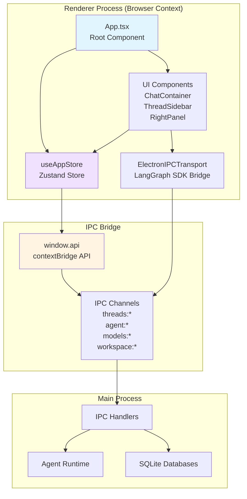
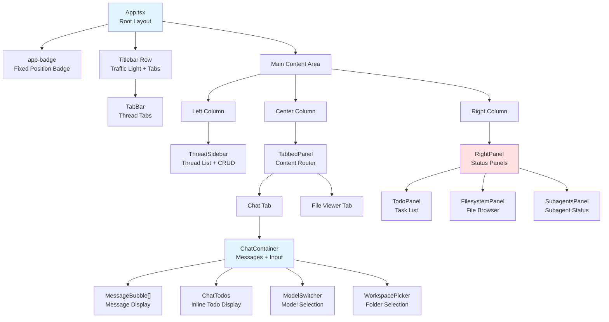
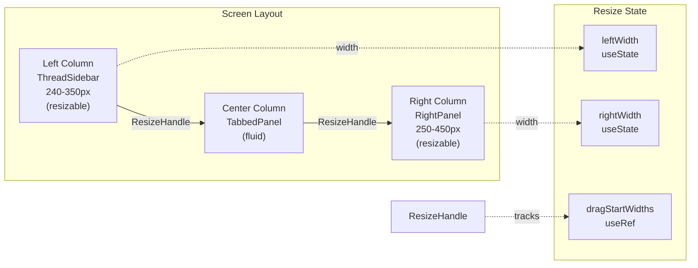
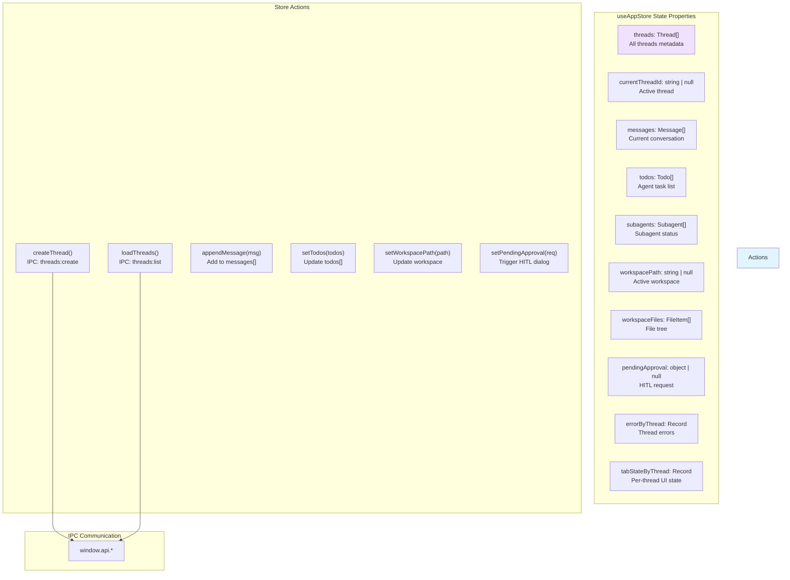
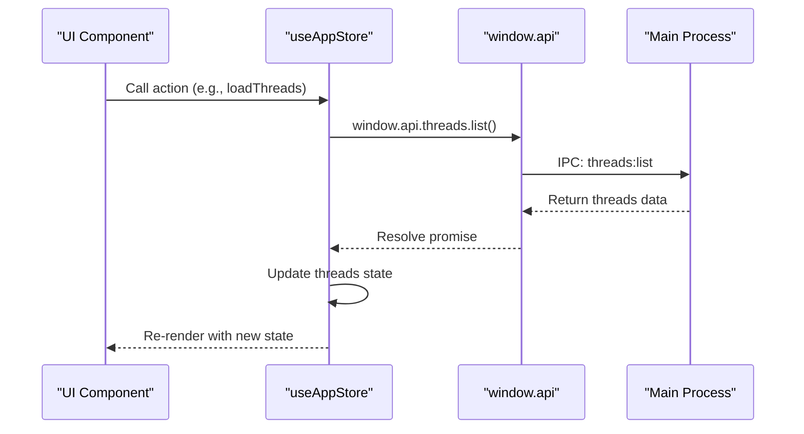
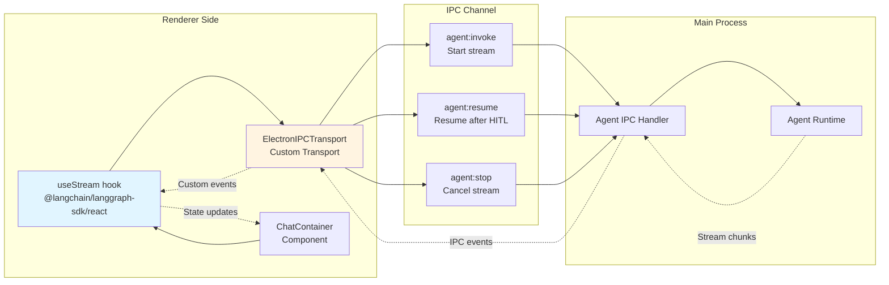
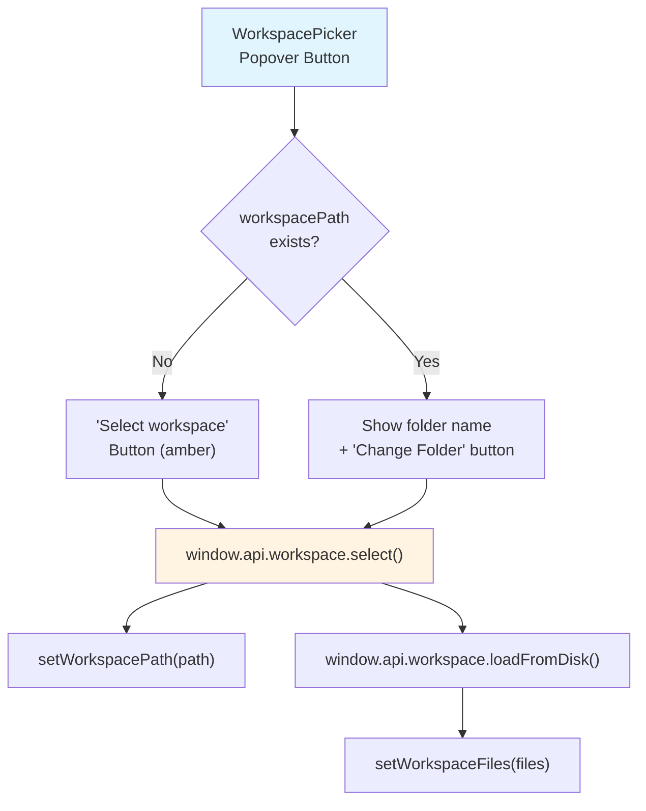
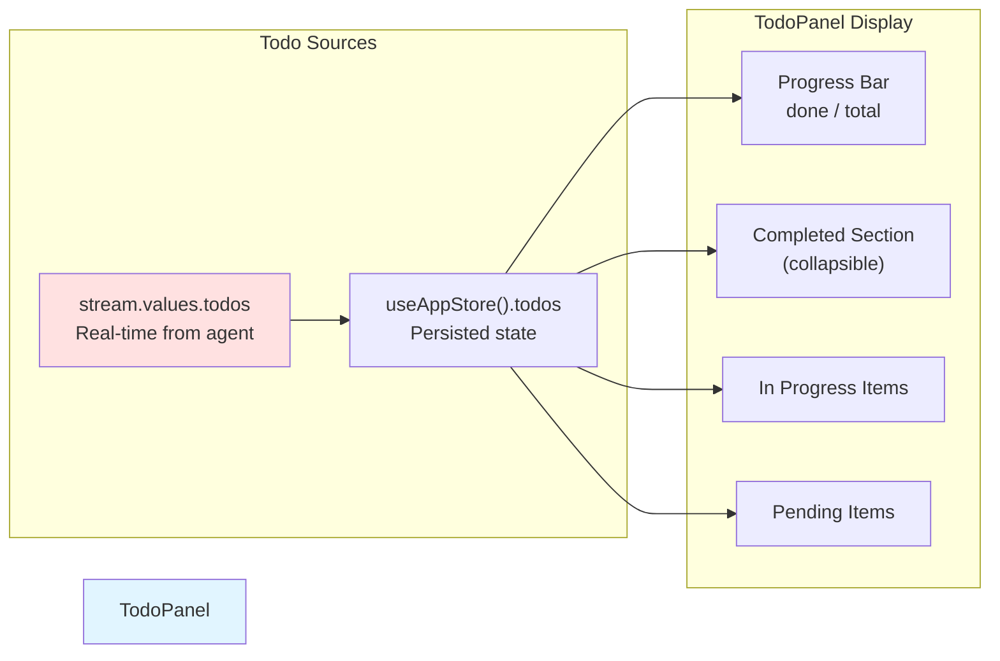
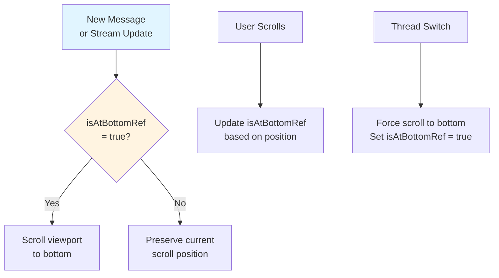
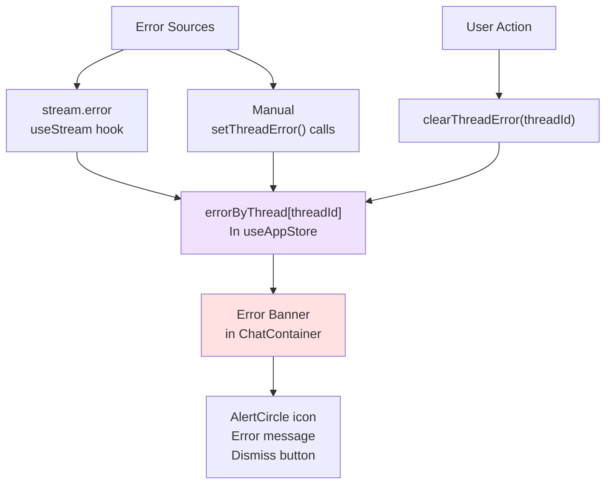

<!-- source: DeepWiki mcp.deepwiki.com · repo langchain-ai/openwork · page 7 User Interface · fetched 2026-10-26 -->

# User Interface

<details>
<summary>Relevant source files</summary>

The following files were used as context for generating this wiki page:

- [src/renderer/src/App.tsx](src/renderer/src/App.tsx)
- [src/renderer/src/components/chat/ChatContainer.tsx](src/renderer/src/components/chat/ChatContainer.tsx)

</details>


## Purpose and Scope

This page provides an overview of OpenWork's user interface architecture, including the React renderer process structure, component hierarchy, layout system, and state management patterns. The UI is built as an Electron renderer process using React, styled with Tailwind CSS, and manages state through Zustand.

For detailed information about specific UI subsystems, see:
- Application layout and resizable panels: [Application Layout and Structure](#7.1)
- Chat and message display: [Chat Interface](#7.2)
- Thread sidebar and right panel: [Side Panels and Navigation](#7.3)
- Model selection and settings dialogs: [Model Switcher and Settings](#7.4)
- TypeScript type definitions: [Type Definitions and Shared Interfaces](#7.5)

For information about how the UI communicates with the main process, see [IPC Communication System](#2.2). For state management details, see [Global State Management](#2.3).

## Renderer Process Architecture

OpenWork's UI runs in an Electron renderer process, isolated from Node.js APIs for security. The renderer communicates with the main process exclusively through IPC channels exposed via the preload script.



**Key Architectural Properties:**

- **Process Isolation**: Renderer has no direct Node.js access; all privileged operations go through IPC
- **Single Source of Truth**: `useAppStore` manages all UI state using Zustand
- **Streaming Integration**: `ElectronIPCTransport` adapts LangGraph's streaming SDK to Electron IPC
- **Type Safety**: TypeScript types are shared between renderer and main processes via `src/types.ts`

**Sources:** [src/renderer/src/App.tsx:1-186](), [src/renderer/src/components/chat/ChatContainer.tsx:1-91]()

## Component Hierarchy

The UI is organized as a hierarchy of specialized components, each responsible for a specific domain.

### Component Tree Structure



**Sources:** [src/renderer/src/App.tsx:17-186](), [src/renderer/src/components/chat/ChatContainer.tsx:61-590]()

### Component Responsibilities

| Component | File | Primary Responsibility |
|-----------|------|------------------------|
| `App.tsx` | [src/renderer/src/App.tsx]() | Root layout, zoom compensation, resizable column management |
| `ThreadSidebar` | [src/renderer/src/components/sidebar/ThreadSidebar.tsx]() | Thread list display, create/delete/select operations |
| `TabbedPanel` | [src/renderer/src/components/tabs/TabbedPanel.tsx]() | Content routing between chat and file viewer |
| `ChatContainer` | [src/renderer/src/components/chat/ChatContainer.tsx]() | Message display, input handling, agent streaming integration |
| `MessageBubble` | [src/renderer/src/components/chat/MessageBubble.tsx]() | Individual message rendering, tool call display, approval UI |
| `RightPanel` | [src/renderer/src/components/panels/RightPanel.tsx]() | Status panel container with tabs for tasks/files/agents |
| `WorkspacePicker` | [src/renderer/src/components/chat/WorkspacePicker.tsx]() | Workspace folder selection and display |
| `ModelSwitcher` | [src/renderer/src/components/chat/ModelSwitcher.tsx]() | Model/provider selection UI |

**Sources:** [src/renderer/src/App.tsx:1-186](), [src/renderer/src/components/chat/ChatContainer.tsx:1-590](), [src/renderer/src/components/chat/WorkspacePicker.tsx:1-136]()

## Three-Column Layout System

The application uses a fixed three-column layout with resizable panels:



**Layout Constants:**

[src/renderer/src/App.tsx:8-15]() defines the panel size constraints:

```typescript
const BADGE_MIN_SCREEN_WIDTH = 235
const LEFT_MAX = 350
const LEFT_DEFAULT = 240
const RIGHT_MIN = 250
const RIGHT_MAX = 450
const RIGHT_DEFAULT = 320
```

**Zoom Compensation:**

The layout implements zoom-aware rendering for macOS traffic light buttons. As users zoom the UI, the titlebar height (36px CSS) shrinks in screen pixels, potentially overlapping the fixed-position traffic lights. The app calculates extra padding dynamically:

[src/renderer/src/App.tsx:28-46]() implements the compensation logic:

1. Detect zoom level by comparing `window.outerWidth / window.innerWidth`
2. Calculate titlebar height in screen pixels: `36px * zoomLevel`
3. Add extra padding if titlebar is shorter than 40 screen pixels (traffic light clearance)
4. Store padding in CSS custom property `--sidebar-safe-padding`

**Sources:** [src/renderer/src/App.tsx:8-92]()

## State Management and Data Flow

### Zustand Store Structure

The UI uses a single Zustand store (`useAppStore`) as the source of truth for all application state. The store is defined in [src/renderer/src/lib/store.ts]() and consumed by components via the `useAppStore` hook.



**Store Update Sources:**

1. **Direct IPC Calls**: Actions like `createThread` call `window.api.threads.create()` and update state
2. **Stream Events**: `ChatContainer` receives events from `ElectronIPCTransport` and calls store actions
3. **User Interactions**: UI components call store actions in response to clicks, form submissions

**Sources:** [src/renderer/src/components/chat/ChatContainer.tsx:67-84]()

### IPC Communication Pattern

Components never directly invoke IPC; they go through the store for consistency:



**Example: Thread Creation Flow**

[src/renderer/src/components/chat/ChatContainer.tsx:391-442]() shows the submit flow:

1. User submits message via form
2. `handleSubmit` checks workspace path (required)
3. Calls `appendMessage` to add user message to store
4. Calls `generateTitleForFirstMessage` if first message
5. Invokes `stream.submit()` to start agent execution
6. Stream events trigger store updates via `handleCustomEvent`

**Sources:** [src/renderer/src/components/chat/ChatContainer.tsx:391-442]()

## Agent Streaming Integration

The chat interface integrates with LangGraph's streaming agent execution through `ElectronIPCTransport`.

### ElectronIPCTransport Bridge



**Stream Event Processing:**

[src/renderer/src/components/chat/ChatContainer.tsx:165-178]() configures the stream hook:

```typescript
const stream = useStream<DeepAgent>({
  transport,
  threadId,
  messagesKey: 'messages',
  onCustomEvent: (data) => { handleCustomEvent(data) },
  onError: (error) => { setThreadError(threadId, errorMessage) }
})
```

[src/renderer/src/components/chat/ChatContainer.tsx:95-163]() processes custom events:

- `type: 'message'`: Append message to store
- `type: 'workspace'`: Update workspace files list
- `type: 'subagents'`: Update subagent status
- `type: 'interrupt'`: Trigger HITL approval dialog

**Sources:** [src/renderer/src/components/chat/ChatContainer.tsx:92-196]()

### Real-Time UI Updates

As the agent streams responses, the UI updates incrementally:

| Stream Event | UI Update | Store Action |
|--------------|-----------|--------------|
| Message chunk | Append to `stream.messages` | None (streaming state) |
| Tool call | Display in `MessageBubble` | None until stream completes |
| Values update (todos) | Update `ChatTodos` inline | `setTodos()` |
| Interrupt | Show approval dialog | `setPendingApproval()` |
| Stream complete | Persist to store | `appendMessage()` for each message |

[src/renderer/src/components/chat/ChatContainer.tsx:199-211]() syncs todos from stream values:

```typescript
const agentValues = stream.values as AgentStreamValues | undefined
const streamTodos = agentValues?.todos
useEffect(() => {
  if (Array.isArray(streamTodos)) {
    setTodos(streamTodos.map(t => ({ ... })))
  }
}, [streamTodos, setTodos])
```

**Display Messages Merging:**

[src/renderer/src/components/chat/ChatContainer.tsx:286-322]() combines store messages with streaming messages to provide a unified display:

1. Get IDs of messages already in store
2. Filter streaming messages to exclude duplicates
3. Map streaming message types to store message format
4. Return concatenated array: `[...storeMessages, ...streamingMsgs]`

**Sources:** [src/renderer/src/components/chat/ChatContainer.tsx:199-322]()

## Workspace Integration

The workspace system provides both UI display and agent file access. The UI components for workspace management are in `WorkspacePicker` and `FilesystemPanel`.

### WorkspacePicker Component



**Key Functions:**

[src/renderer/src/components/chat/WorkspacePicker.tsx:12-36]() exports `selectWorkspaceFolder`, a shared utility for workspace selection:

1. Call `window.api.workspace.select(threadId)` to open native folder dialog
2. Update store with `setWorkspacePath(path)`
3. Call `window.api.workspace.loadFromDisk(threadId)` to scan directory
4. Update store with `setWorkspaceFiles(result.files)`

[src/renderer/src/components/chat/WorkspacePicker.tsx:44-60]() loads workspace on thread switch:

```typescript
useEffect(() => {
  async function loadWorkspace() {
    if (currentThreadId) {
      const path = await window.api.workspace.get(currentThreadId)
      setWorkspacePath(path)
      if (path) {
        const result = await window.api.workspace.loadFromDisk(currentThreadId)
        if (result.success && result.files) {
          setWorkspaceFiles(result.files)
        }
      }
    }
  }
  loadWorkspace()
}, [currentThreadId, setWorkspacePath, setWorkspaceFiles])
```

**Workspace Requirement:**

[src/renderer/src/components/chat/ChatContainer.tsx:395-399]() blocks message submission without a workspace:

```typescript
if (!workspacePath) {
  setThreadError(threadId, 'Please select a workspace folder before sending messages.')
  return
}
```

**Sources:** [src/renderer/src/components/chat/WorkspacePicker.tsx:1-136](), [src/renderer/src/components/chat/ChatContainer.tsx:395-399]()

## Task Display and Progress Tracking

The `TodoPanel` displays agent-generated tasks with status indicators and progress tracking.

### Todo Status Visualization



**Status Configuration:**

[src/renderer/src/components/panels/TodoPanel.tsx:9-34]() defines status metadata:

| Status | Icon | Badge Color | Label |
|--------|------|-------------|-------|
| `pending` | Circle | outline | PENDING |
| `in_progress` | Clock | info | IN PROGRESS |
| `completed` | CheckCircle2 | nominal | DONE |
| `cancelled` | XCircle | critical | CANCELLED |

**Grouping Logic:**

[src/renderer/src/components/panels/TodoPanel.tsx:40-47]() groups todos by status:

```typescript
const inProgress = todos.filter((t) => t.status === 'in_progress')
const pending = todos.filter((t) => t.status === 'pending')
const completed = todos.filter((t) => t.status === 'completed')
const cancelled = todos.filter((t) => t.status === 'cancelled')
const doneItems = [...completed, ...cancelled]
```

Display order: Completed (collapsible) → In Progress → Pending

**Progress Calculation:**

[src/renderer/src/components/panels/TodoPanel.tsx:49-52]() computes progress percentage:

```typescript
const total = todos.length
const done = completed.length
const progress = total > 0 ? Math.round((done / total) * 100) : 0
```

**Sources:** [src/renderer/src/components/panels/TodoPanel.tsx:1-161]()

## Auto-Scrolling and Viewport Management

The chat container implements intelligent auto-scrolling that preserves user scroll position while still scrolling for new messages when appropriate.

### Scroll Behavior Logic



**Implementation Details:**

[src/renderer/src/components/chat/ChatContainer.tsx:339-354]() tracks scroll position:

```typescript
const handleScroll = useCallback(() => {
  const viewport = getViewport()
  if (!viewport) return
  
  const { scrollTop, scrollHeight, clientHeight } = viewport
  const threshold = 50  // Consider "at bottom" if within 50px
  isAtBottomRef.current = scrollHeight - scrollTop - clientHeight < threshold
}, [getViewport])
```

[src/renderer/src/components/chat/ChatContainer.tsx:366-371]() implements conditional auto-scroll:

```typescript
useEffect(() => {
  const viewport = getViewport()
  if (viewport && isAtBottomRef.current) {
    viewport.scrollTop = viewport.scrollHeight
  }
}, [displayMessages, stream.isLoading, getViewport])
```

[src/renderer/src/components/chat/ChatContainer.tsx:374-380]() forces scroll on thread switch:

```typescript
useEffect(() => {
  const viewport = getViewport()
  if (viewport) {
    viewport.scrollTop = viewport.scrollHeight
    isAtBottomRef.current = true
  }
}, [threadId, getViewport])
```

**Radix ScrollArea Integration:**

The component uses Radix UI's `ScrollArea` which wraps the content in a viewport. [src/renderer/src/components/chat/ChatContainer.tsx:339-343]() queries the actual viewport element:

```typescript
const getViewport = useCallback(() => {
  return scrollRef.current?.querySelector(
    '[data-radix-scroll-area-viewport]'
  ) as HTMLDivElement | null
}, [])
```

**Sources:** [src/renderer/src/components/chat/ChatContainer.tsx:339-380]()

## Error Handling and Display

The UI displays errors at two levels: thread-specific errors and global errors.

### Thread-Specific Error Display



**Error Tracking:**

[src/renderer/src/components/chat/ChatContainer.tsx:222-243]() syncs stream errors to the store:

```typescript
const lastErrorRef = useRef<unknown>(null)

useEffect(() => {
  const isNewError = stream.error && stream.error !== lastErrorRef.current
  
  if (isNewError) {
    lastErrorRef.current = stream.error
    const errorMessage = stream.error instanceof Error 
      ? stream.error.message 
      : String(stream.error)
    setThreadError(threadId, errorMessage)
  } else if (!stream.error) {
    lastErrorRef.current = null
  }
}, [stream.error, threadId, setThreadError])
```

The `lastErrorRef` prevents stale errors from being synced when switching threads.

**Error Display:**

[src/renderer/src/components/chat/ChatContainer.tsx:526-546]() renders error banner:

- Only displays when `threadError` exists and `!stream.isLoading`
- Shows AlertCircle icon, error message, and dismiss button
- Positioned below messages, above input
- Red/destructive color scheme

**Sources:** [src/renderer/src/components/chat/ChatContainer.tsx:86-88](), [src/renderer/src/components/chat/ChatContainer.tsx:222-243](), [src/renderer/src/components/chat/ChatContainer.tsx:526-546]()

## Styling and Theming

OpenWork uses Tailwind CSS with a custom design system defined in theme configuration.

### Theme Architecture

The application uses CSS custom properties for theming, defined in `src/renderer/src/index.css`. Key color tokens include:

- **Backgrounds**: `--background`, `--background-secondary`, `--sidebar`
- **Borders**: `--border`, `--border-strong`
- **Text**: `--foreground`, `--muted-foreground`
- **Status**: `--status-nominal`, `--status-info`, `--status-critical`
- **Interactive**: `--accent`, `--ring`

### Spacing and Typography

The design system uses consistent spacing and typography conventions:

| Class | Usage | Example |
|-------|-------|---------|
| `.text-section-header` | Section labels | "PROGRESS", "TASKS" |
| `.text-data` | Data values | Counters, timestamps |
| `.app-drag-region` | Draggable titlebar | Enables window dragging |
| `.app-badge` | Fixed app badge | "OPENWORK v0.1.0" |

### Component-Specific Styling

**Message Bubbles**: Use role-based styling (user messages align right with blue background, assistant messages align left with gray background)

**Status Indicators**: Use semantic color coding (nominal/green for success, critical/red for errors, info/blue for in-progress)

**Panels**: Consistent border-t/border-b separators, ScrollArea for overflow, padding-4 for content

**Sources:** [src/renderer/src/App.tsx:122-136]()

---

