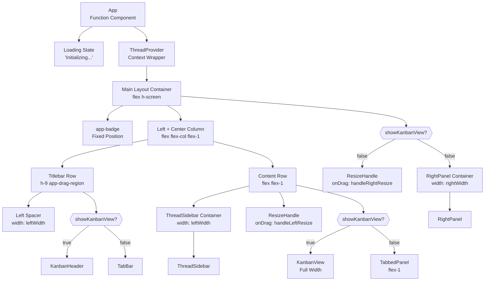
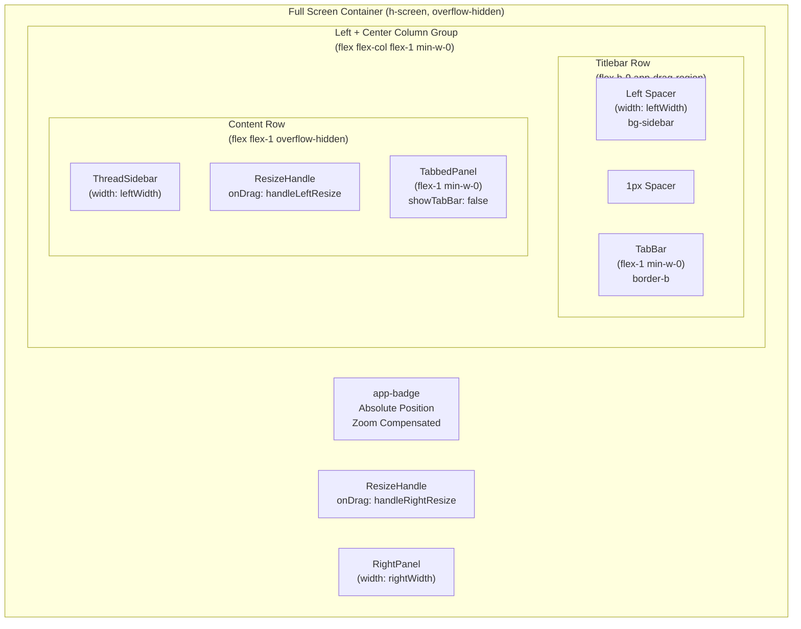
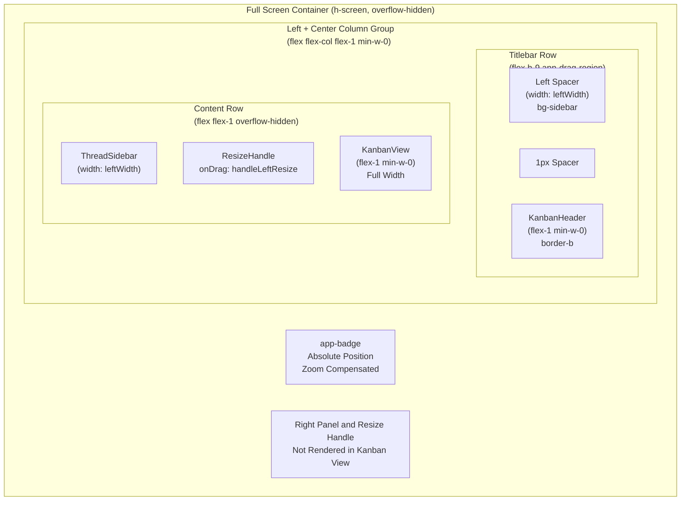
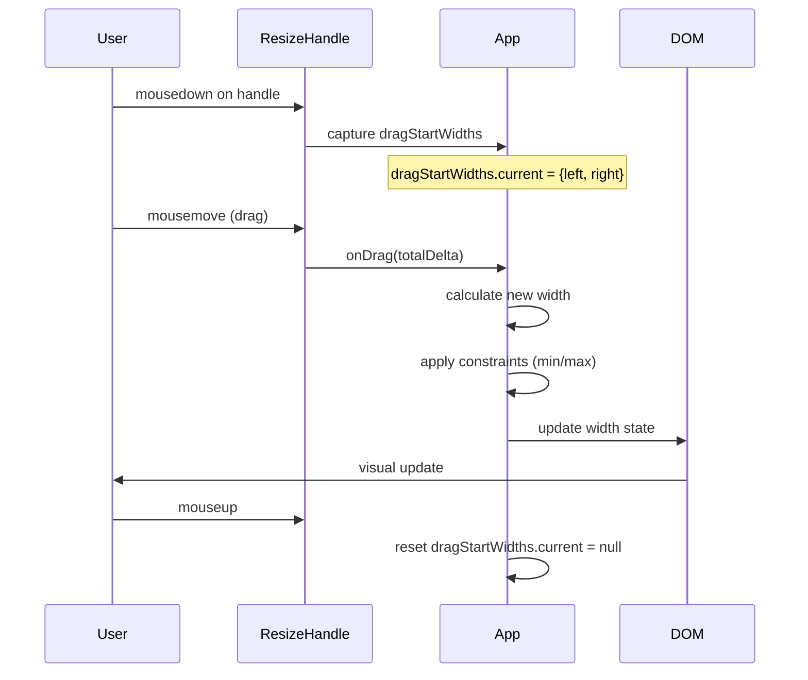
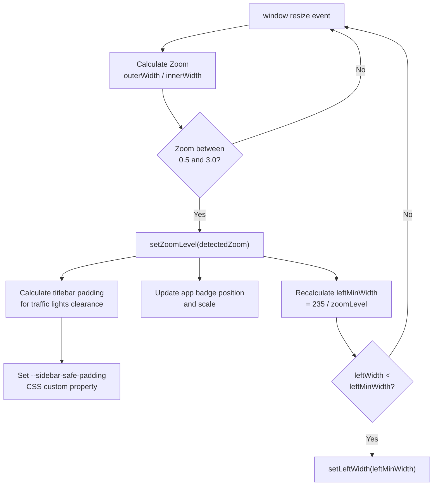

<!-- source: DeepWiki mcp.deepwiki.com · repo langchain-ai/openwork · page 7.1 Application Layout and Structure · fetched 2026-10-26 -->

# Application Layout and Structure

<details>
<summary>Relevant source files</summary>

The following files were used as context for generating this wiki page:

- [src/renderer/src/App.tsx](src/renderer/src/App.tsx)

</details>


## Purpose and Scope

This document describes the root application layout and visual structure of OpenWork. It covers the `App` component in [src/renderer/src/App.tsx](), which implements:
- Two distinct layout modes (Thread view and Kanban view)
- Three-column resizable panel system for Thread view
- Zoom compensation logic for macOS traffic lights
- Titlebar integration with drag regions

For details on specific UI components within the panels, see [Chat Interface](#7.2) and [Side Panels and Navigation](#7.3). For global state management that coordinates UI updates, see [State Management Architecture](#2.3).

---

## Root Component Architecture

The application is rendered through the `App` function component defined in [src/renderer/src/App.tsx:17](). This component serves as the layout container and coordinates:

- **Initialization**: Loading threads from storage on startup
- **Layout Management**: Three resizable columns with fixed constraints
- **Zoom Handling**: Compensating for browser zoom levels
- **State Coordination**: Connecting UI panels to the Zustand store

### Component Hierarchy



**Sources**: [src/renderer/src/App.tsx:19-205]()

---

## Layout Modes: Thread View vs Kanban View

The application supports two distinct layout modes, controlled by the `showKanbanView` boolean from `useAppStore` [src/renderer/src/App.tsx:20]():

### Thread View Mode (`showKanbanView = false`)

Three-column layout for focused conversation with a single thread:

| Column | Component | Purpose | Default Width | Constraints |
|--------|-----------|---------|---------------|-------------|
| Left | `ThreadSidebar` | Thread list and management | 240px | 235px (zoom-dependent) - 350px |
| Center | `TabbedPanel` | Chat interface and file viewer | Flexible (fills remaining space) | No explicit constraints |
| Right | `RightPanel` | Tasks, files, and agents status | 320px | 250px - 450px |

### Kanban View Mode (`showKanbanView = true`)

Two-column layout for overview of all threads:

| Column | Component | Purpose | Width |
|--------|-----------|---------|-------|
| Left | `ThreadSidebar` | Thread list (same as Thread view) | 240px (with same constraints) |
| Center | `KanbanView` | Full-width Kanban board showing all threads | Flexible (fills remaining space) |

The right panel and its resize handle are completely hidden in Kanban view [src/renderer/src/App.tsx:192-201]().

The left and center columns are grouped together in a flex container [src/renderer/src/App.tsx:142-190](), which spans the full height. The titlebar sits above the content area and spans both columns.

### Thread View Layout Diagram



**Sources**: [src/renderer/src/App.tsx:124-201]()

### Kanban View Layout Diagram



**Sources**: [src/renderer/src/App.tsx:124-190](), [src/renderer/src/App.tsx:192-201]()

---

## Panel Sizing and Constraints

Panel widths are controlled by React state variables and enforced through constraint constants:

### Left Panel (ThreadSidebar)

- **State Variable**: `leftWidth` [src/renderer/src/App.tsx:20]()
- **Default**: `LEFT_DEFAULT = 240` [src/renderer/src/App.tsx:11]()
- **Maximum**: `LEFT_MAX = 350` [src/renderer/src/App.tsx:10]()
- **Minimum**: Dynamically calculated based on zoom level [src/renderer/src/App.tsx:54]()
  - Formula: `Math.ceil(BADGE_MIN_SCREEN_WIDTH / zoomLevel)`
  - `BADGE_MIN_SCREEN_WIDTH = 235` ensures the app badge always displays [src/renderer/src/App.tsx:9]()

### Right Panel

- **State Variable**: `rightWidth` [src/renderer/src/App.tsx:21]()
- **Default**: `RIGHT_DEFAULT = 320` [src/renderer/src/App.tsx:15]()
- **Minimum**: `RIGHT_MIN = 250` [src/renderer/src/App.tsx:13]()
- **Maximum**: `RIGHT_MAX = 450` [src/renderer/src/App.tsx:14]()

The center panel (`TabbedPanel`) receives no explicit width—it uses `flex-1` to fill remaining space [src/renderer/src/App.tsx:164]().

**Sources**: [src/renderer/src/App.tsx:8-15](), [src/renderer/src/App.tsx:20-21](), [src/renderer/src/App.tsx:54]()

---

## Resizable Panel System

Panels are resizable through `ResizeHandle` components that implement drag-based width adjustments.

### Resize Handle Mechanism



### Left Panel Resize Logic

The `handleLeftResize` callback [src/renderer/src/App.tsx:63-72]() implements:

1. **Capture Initial State**: On first drag event, stores current widths in `dragStartWidths.current`
2. **Calculate New Width**: `newWidth = dragStartWidths.current.left + totalDelta`
3. **Apply Constraints**: `Math.min(LEFT_MAX, Math.max(leftMinWidth, newWidth))`
4. **Update State**: `setLeftWidth(newWidth)`

The `leftMinWidth` is zoom-compensated to ensure the badge always fits.

### Right Panel Resize Logic

The `handleRightResize` callback [src/renderer/src/App.tsx:74-83]() follows similar logic but inverts the delta:

- **Calculate New Width**: `newWidth = dragStartWidths.current.right - totalDelta` (negative because dragging right decreases the panel width)
- **Constraints**: `Math.min(RIGHT_MAX, Math.max(RIGHT_MIN, newWidth))`

### Drag State Reset

A global `mouseup` listener [src/renderer/src/App.tsx:86-92]() resets `dragStartWidths.current` to ensure the next drag starts from the current width rather than accumulating deltas.

**Sources**: [src/renderer/src/App.tsx:24-25](), [src/renderer/src/App.tsx:63-92]()

---

## Zoom Compensation System

OpenWork implements comprehensive zoom compensation to ensure the app badge and titlebar remain properly positioned when the browser zoom level changes. This is critical because macOS positions traffic light controls at a fixed screen location.

### Zoom Detection Mechanism

The `updateZoom` function [src/renderer/src/App.tsx:29-46]() detects zoom level by comparing outer and inner window dimensions:

```javascript
const detectedZoom = Math.round((window.outerWidth / window.innerWidth) * 100) / 100
```

This value is stored in the `zoomLevel` state [src/renderer/src/App.tsx:22]() and triggers recalculations.

### Zoom Compensation Flow



### Titlebar Padding Calculation

At high zoom levels, the CSS titlebar height (36px) becomes smaller in screen pixels than the traffic light controls. The system calculates extra padding [src/renderer/src/App.tsx:38-44]():

```
TRAFFIC_LIGHT_BOTTOM_SCREEN = 40  // Fixed screen pixels
TITLEBAR_HEIGHT_CSS = 36
titlebarScreenHeight = 36 * detectedZoom
extraPaddingScreen = max(0, 40 - titlebarScreenHeight)
extraPaddingCss = extraPaddingScreen / detectedZoom
```

This extra padding is applied via the CSS custom property `--sidebar-safe-padding` [src/renderer/src/App.tsx:44]().

### App Badge Compensation

The app badge uses inverse scaling to maintain constant screen size [src/renderer/src/App.tsx:125-132]():

- **Position**: Top and left values are divided by zoom (`14 / zoomLevel`, `82 / zoomLevel`)
- **Scale**: `transform: scale(1 / zoomLevel)` with `transformOrigin: 'top left'`

This ensures the badge appears at a fixed screen position (14px from top, 82px from left) regardless of zoom.

### Minimum Width Enforcement

The `leftMinWidth` calculation [src/renderer/src/App.tsx:54]() ensures the left panel always contains the badge:

```javascript
const leftMinWidth = Math.ceil(BADGE_MIN_SCREEN_WIDTH / zoomLevel)
```

A `useEffect` [src/renderer/src/App.tsx:57-61]() enforces this minimum whenever the zoom changes.

**Sources**: [src/renderer/src/App.tsx:22](), [src/renderer/src/App.tsx:28-61](), [src/renderer/src/App.tsx:123-136]()

---

## Titlebar Integration

The titlebar occupies 36px height (`h-9` class) [src/renderer/src/App.tsx:144]() and integrates three elements:

### Titlebar Structure

| Section | Width | Purpose |
|---------|-------|---------|
| Left Spacer | `leftWidth` | Aligns with ThreadSidebar, provides space for traffic lights and badge |
| Resize Handle Spacer | 1px | Maintains visual alignment with resize handle below |
| Center Content | `flex-1` | Displays `TabBar` or `KanbanHeader` based on view mode |

The left spacer matches the ThreadSidebar width [src/renderer/src/App.tsx:146]() to maintain vertical alignment. The `app-drag-region` class [src/renderer/src/App.tsx:144]() enables window dragging on macOS by allowing the titlebar to respond to drag events.

### Conditional Titlebar Content

The center section conditionally renders based on `showKanbanView` [src/renderer/src/App.tsx:152-158]():

```javascript
{showKanbanView ? (
  <KanbanHeader className="h-full" />
) : (
  currentThreadId && <TabBar className="h-full border-b-0" />
)}
```

- **Kanban View**: Displays `KanbanHeader` component
- **Thread View**: Displays `TabBar` component (only when `currentThreadId` is set)

**Sources**: [src/renderer/src/App.tsx:144-159]()

---

## Initialization Flow

The `App` component initializes the application state through a `useEffect` hook [src/renderer/src/App.tsx:94-110]():

```mermaid
sequenceDiagram
    participant App
    participant useAppStore
    participant IPC["IPC (threads:list)"]
    participant UI
    
    App->>App: useEffect (mount)
    App->>useAppStore: loadThreads()
    useAppStore->>IPC: Request thread list
    IPC-->>useAppStore: Return threads array
    
    useAppStore->>App: Check threads.length
    
    alt threads.length === 0
        App->>useAppStore: createThread()
        useAppStore->>IPC: threads:create
        IPC-->>useAppStore: New thread created
    end
    
    App->>App: setIsLoading(false)
    App->>UI: Render main layout
```

### Initialization Steps

1. **Loading State**: Display "Initializing..." message [src/renderer/src/App.tsx:112-118]()
2. **Load Threads**: Call `loadThreads()` action from store [src/renderer/src/App.tsx:97]()
3. **Create Default Thread**: If no threads exist, create one [src/renderer/src/App.tsx:99-102]()
4. **Render Layout**: Transition from loading state to main layout [src/renderer/src/App.tsx:106]()

### Error Handling

Initialization errors are caught and logged but do not prevent the app from rendering [src/renderer/src/App.tsx:103-104](). The loading flag is cleared in the `finally` block to ensure the UI always becomes interactive.

**Sources**: [src/renderer/src/App.tsx:94-118]()

---

## CSS Classes and Styling

The layout uses several notable CSS classes:

| Class | Purpose | Location |
|-------|---------|----------|
| `app-drag-region` | Enables titlebar dragging on macOS | [src/renderer/src/App.tsx:141]() |
| `app-badge` | Styles the fixed app badge with zoom compensation | [src/renderer/src/App.tsx:124]() |
| `h-screen` | Full viewport height container | [src/renderer/src/App.tsx:121]() |
| `flex-1` | Flexible sizing for center panel | [src/renderer/src/App.tsx:139]() |

The `--sidebar-safe-padding` CSS custom property [src/renderer/src/App.tsx:44]() is dynamically set to adjust for traffic light clearance at different zoom levels.

**Sources**: [src/renderer/src/App.tsx:121-183]()

---

