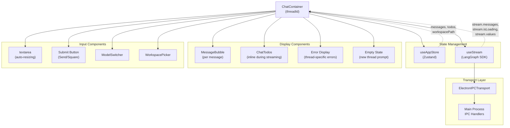
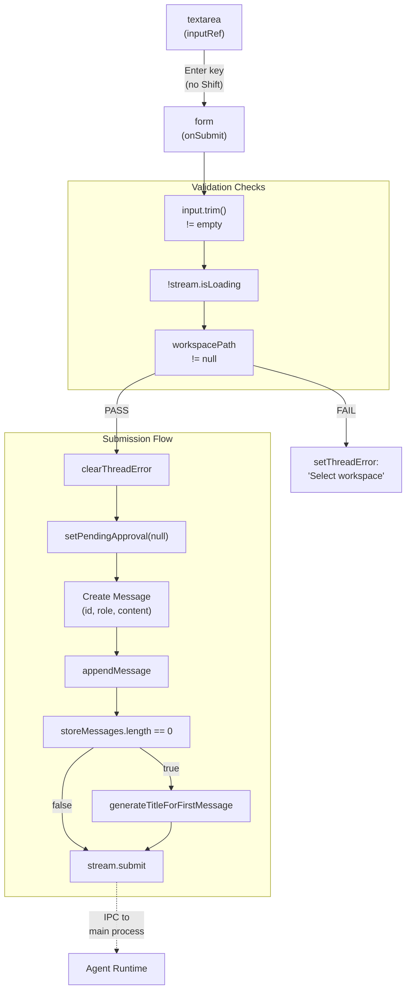
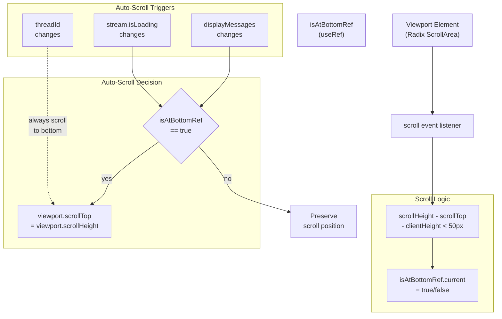
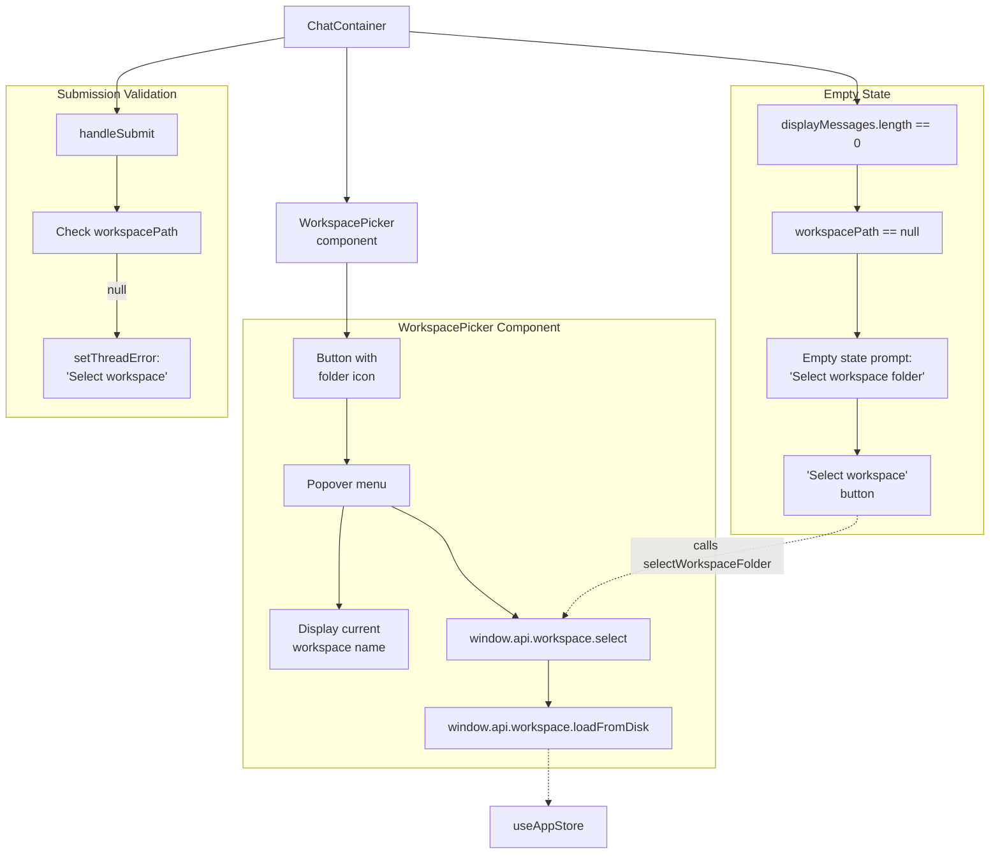

<!-- source: DeepWiki mcp.deepwiki.com · repo langchain-ai/openwork · page 7.2 Chat Interface · fetched 2026-10-26 -->

# Chat Interface

Relevant source files

The following files were used as context for generating this wiki page:

- [src/renderer/src/components/chat/ChatContainer.tsx](src/renderer/src/components/chat/ChatContainer.tsx)

This document describes the chat interface components and mechanisms that enable users to interact with AI agents through a conversational UI. The `ChatContainer` component serves as the primary interface for displaying messages, handling user input, and managing real-time streaming updates from agent execution.

For information about side panel components (RightPanel, ThreadSidebar, FilesystemPanel), see [Side Panels and Navigation](#7.3). For the overall application layout structure, see [Application Layout and Structure](#7.1). For agent execution details, see [Agent Streaming Execution Pipeline](#3.2).

## Component Architecture

The chat interface is built around the `ChatContainer` component, which orchestrates message display, user input, streaming updates, and workspace management. The component integrates several specialized sub-components to provide a complete conversational experience.

**Sources:** [src/renderer/src/components/chat/ChatContainer.tsx:1-590]()

## Message Display System

The chat interface displays messages through a computed list that merges persisted store messages with in-flight streaming messages. This ensures users see real-time updates during agent execution while maintaining consistency with the stored conversation history.

### Display Messages Composition

The `displayMessages` array is computed from two sources:

1. **Store Messages** (`storeMessages`): Persisted messages loaded from the thread's checkpoint database
2. **Streaming Messages** (`stream.messages`): Temporary messages being received during active agent execution

The composition logic filters out streaming messages that are already in the store to prevent duplicates:

[src/renderer/src/components/chat/ChatContainer.tsx:286-322]()

### Message Role Mapping

Messages are normalized into a consistent format with roles (`user`, `assistant`, `tool`, `system`). The streaming messages use LangGraph's type conventions (`human`, `ai`, `tool`), which are mapped to the internal role system:

| LangGraph Type | Internal Role | Display Context |
|----------------|---------------|-----------------|
| `human` | `user` | User-submitted messages |
| `ai` | `assistant` | Agent responses |
| `tool` | `tool` | Tool execution results |
| (default) | `system` | System notifications |

### Tool Results Display

Tool execution results are tracked in a map structure (`toolResults`) that associates tool call IDs with their outputs. This enables `MessageBubble` components to display tool calls alongside their results:

[src/renderer/src/components/chat/ChatContainer.tsx:324-336]()

**Sources:** [src/renderer/src/components/chat/ChatContainer.tsx:286-336]()

## Streaming Integration

The chat interface uses the `useStream` hook from `@langchain/langgraph-sdk/react` with a custom `ElectronIPCTransport` to enable real-time streaming over Electron IPC channels.

```mermaid
graph LR
    subgraph "Renderer Process"
        ChatContainer["ChatContainer"]
        useStream["useStream hook"]
        Transport["ElectronIPCTransport"]
    end
    
    subgraph "IPC Bridge"
        PreloadAPI["window.api"]
        IPCChannel["IPC Channels<br/>(agent:invoke,<br/>agent:resume,<br/>agent:stop)"]
    end
    
    subgraph "Main Process"
        IPCHandlers["IPC Handlers"]
        AgentRuntime["Agent Runtime"]
    end
    
    ChatContainer -->|"stream = useStream"| useStream
    useStream -->|"transport: ElectronIPCTransport"| Transport
    Transport -->|"window.api.agent.*"| PreloadAPI
    PreloadAPI --> IPCChannel
    IPCChannel --> IPCHandlers
    IPCHandlers --> AgentRuntime
    
    AgentRuntime -.->|"stream chunks"| IPCHandlers
    IPCHandlers -.-> IPCChannel
    IPCChannel -.-> PreloadAPI
    PreloadAPI -.->|"event callbacks"| Transport
    Transport -.->|"onCustomEvent,<br/>onError"| useStream
    useStream -.->|"messages,<br/>values,<br/>isLoading"| ChatContainer
```

### Stream Hook Configuration

The `useStream` hook is configured with custom event handlers:

[src/renderer/src/components/chat/ChatContainer.tsx:166-178]()

Key configuration properties:
- `transport`: `ElectronIPCTransport` instance (memoized)
- `threadId`: Current thread identifier
- `messagesKey`: `'messages'` - key to extract messages from stream values
- `onCustomEvent`: Handler for custom event types (workspace, subagents, interrupt)
- `onError`: Handler for stream errors

### Custom Event Handling

The chat interface processes five types of custom events emitted during agent execution:

| Event Type | Data Structure | State Updates |
|------------|----------------|---------------|
| `message` | `MessageEventData` | Appends message to store |
| `workspace` | `files[]`, `path` | Updates workspace files and path |
| `subagents` | `subagents[]` | Updates subagent list |
| `interrupt` | `request` | Sets pending approval state |
| (stream messages) | (LangGraph messages) | Handled by `useStream` directly |

The custom event handler implementation:

[src/renderer/src/components/chat/ChatContainer.tsx:95-163]()

**Sources:** [src/renderer/src/components/chat/ChatContainer.tsx:92-178]()

## Input and Submission

The chat interface provides a textarea-based input system with auto-resizing, keyboard shortcuts, and workspace validation before submission.

### Workspace Validation

Before submitting a message, the interface validates that a workspace path is configured. Without a workspace, agents cannot perform file operations:

[src/renderer/src/components/chat/ChatContainer.tsx:391-410]()

### Textarea Auto-Resize

The textarea automatically adjusts its height based on content, capped at 200px maximum:

[src/renderer/src/components/chat/ChatContainer.tsx:451-462]()

### Keyboard Shortcuts

- **Enter**: Submit message (if not holding Shift)
- **Shift+Enter**: Insert newline without submitting

[src/renderer/src/components/chat/ChatContainer.tsx:444-449]()

### First Message Title Generation

When a user sends the first message in a thread, the interface triggers asynchronous title generation:

[src/renderer/src/components/chat/ChatContainer.tsx:415-429]()

**Sources:** [src/renderer/src/components/chat/ChatContainer.tsx:391-462]()

## Scroll Management

The chat interface implements intelligent scroll behavior that auto-scrolls to new messages when the user is already at the bottom, but preserves the scroll position when the user has scrolled up to review history.

### Scroll Position Tracking

The interface tracks whether the user is "at bottom" using a 50-pixel threshold. This ref is updated on every scroll event:

[src/renderer/src/components/chat/ChatContainer.tsx:346-363]()

### Conditional Auto-Scroll

New messages and loading state changes only trigger auto-scroll if `isAtBottomRef.current` is true:

[src/renderer/src/components/chat/ChatContainer.tsx:366-371]()

### Thread Switch Behavior

When switching threads, the interface always scrolls to the bottom and resets the tracking ref:

[src/renderer/src/components/chat/ChatContainer.tsx:374-380]()

**Sources:** [src/renderer/src/components/chat/ChatContainer.tsx:339-380]()

## Error Handling

The chat interface displays thread-specific errors in a dismissible banner above the input area. Errors are tracked per-thread in the store's `errorByThread` map, allowing each conversation to maintain its own error state.

### Error Display Component

When an error exists for the current thread and streaming is not active, the interface renders an error banner:

[src/renderer/src/components/chat/ChatContainer.tsx:526-546]()

### Error State Management

Errors are set from two sources:
1. **Workspace validation failures** during message submission
2. **Stream errors** from the `useStream` hook

Stream errors are synchronized to the store with deduplication logic to prevent stale errors from affecting new threads:

[src/renderer/src/components/chat/ChatContainer.tsx:222-243]()

### Error Clearing

Errors are cleared automatically when:
- User submits a new message [src/renderer/src/components/chat/ChatContainer.tsx:402-404]()
- User clicks the dismiss button [src/renderer/src/components/chat/ChatContainer.tsx:387-389]()

**Sources:** [src/renderer/src/components/chat/ChatContainer.tsx:86-88, 222-243, 387-389, 402-404, 526-546]()

## Loading States and Indicators

The chat interface displays multiple loading indicators during agent execution, providing real-time feedback on agent activity.

### Loading State Synchronization

The `stream.isLoading` state is synchronized to the store's `loadingThreadId` property, enabling the ThreadSidebar to show loading indicators:

[src/renderer/src/components/chat/ChatContainer.tsx:214-220]()

### Streaming Indicator

During active streaming, the interface displays a loading indicator with animated spinner and inline todos:

[src/renderer/src/components/chat/ChatContainer.tsx:515-523]()

### Input Disabling

The textarea and submit button are disabled during streaming to prevent concurrent submissions:

[src/renderer/src/components/chat/ChatContainer.tsx:562, 568-576]()

**Sources:** [src/renderer/src/components/chat/ChatContainer.tsx:214-220, 515-523, 562, 568-576]()

## Workspace Integration

The chat interface integrates workspace selection directly into the input area through the `WorkspacePicker` component, and enforces workspace selection before allowing message submission.

### WorkspacePicker Component

The `WorkspacePicker` component renders a button below the input textarea, displaying either the current workspace folder name or prompting to select one:

[src/renderer/src/components/chat/WorkspacePicker.tsx:38-135]()

### Empty State Workspace Prompt

When a thread has no messages and no workspace, the chat interface displays a centered empty state with a workspace selection prompt:

[src/renderer/src/components/chat/ChatContainer.tsx:478-501]()

### Workspace Selection Flow

The `selectWorkspaceFolder` function orchestrates the workspace selection process:

1. Opens native folder selection dialog via `window.api.workspace.select(threadId)`
2. If a path is selected, updates the store with `setWorkspacePath(path)`
3. Loads directory contents via `window.api.workspace.loadFromDisk(threadId)`
4. Updates the store with `setWorkspaceFiles(files)`

[src/renderer/src/components/chat/WorkspacePicker.tsx:12-36]()

### Thread-Specific Workspace Persistence

The workspace path is loaded when the thread changes, pulling from either thread-specific metadata or global settings:

[src/renderer/src/components/chat/WorkspacePicker.tsx:44-60]()

**Sources:** [src/renderer/src/components/chat/ChatContainer.tsx:478-501](), [src/renderer/src/components/chat/WorkspacePicker.tsx:12-135]()

## Human-in-the-Loop Approval UI

The chat interface handles agent interrupts by displaying approval dialogs within message bubbles. When an agent requests human approval (e.g., for file operations), the `pendingApproval` state triggers UI elements in the relevant `MessageBubble`.

### Approval State Management

The pending approval state is set when a custom event with type `'interrupt'` is received:

[src/renderer/src/components/chat/ChatContainer.tsx:155-159]()

### Approval Decision Handler

When the user approves or rejects an operation, the handler submits a resume command to the stream:

[src/renderer/src/components/chat/ChatContainer.tsx:181-196]()

The resume command is sent to the `agent:resume` IPC channel via the `ElectronIPCTransport`, which communicates the decision back to the agent runtime.

### MessageBubble Integration

The `pendingApproval` state and `handleApprovalDecision` callback are passed to each `MessageBubble`:

[src/renderer/src/components/chat/ChatContainer.tsx:505-511]()

For detailed information about the approval UI and workflow, see [Human-in-the-Loop (HITL) System](#3.3).

**Sources:** [src/renderer/src/components/chat/ChatContainer.tsx:155-159, 181-196, 505-511]()

## Message Persistence and Stream Completion

When an agent execution completes, the chat interface persists streaming messages to the store and refreshes the thread list to update metadata (last message timestamp, etc.).

### Stream Completion Detection

The interface detects stream completion by tracking changes to `stream.isLoading`:

[src/renderer/src/components/chat/ChatContainer.tsx:246-283]()

### Persistence Logic

When streaming completes (`prevLoadingRef.current && !stream.isLoading`):

1. Iterate through `stream.messages`
2. Map LangGraph message types to internal roles
3. Call `appendMessage(storeMsg)` for each message
4. Call `loadThreads()` to refresh thread metadata

This ensures all streamed content is persisted to the checkpoint database and reflected in the thread list.

**Sources:** [src/renderer/src/components/chat/ChatContainer.tsx:246-283]()

## Inline Todos Display

During active streaming, the chat interface displays todos inline within the message area, providing real-time visibility into the agent's task breakdown. This differs from the persistent todos shown in the RightPanel.

### Streaming Todos Synchronization

The `stream.values` object contains the agent's current state, including todos. The interface syncs these to the store:

[src/renderer/src/components/chat/ChatContainer.tsx:199-211]()

### Inline Display During Streaming

When `stream.isLoading` is true and todos exist, they are displayed below the "Agent is thinking..." indicator:

[src/renderer/src/components/chat/ChatContainer.tsx:515-523]()

The `ChatTodos` component renders a compact, inline view of the todos. For the persistent todos panel in the right sidebar, see [Side Panels and Navigation](#7.3).

**Sources:** [src/renderer/src/components/chat/ChatContainer.tsx:199-211, 515-523]()

---

