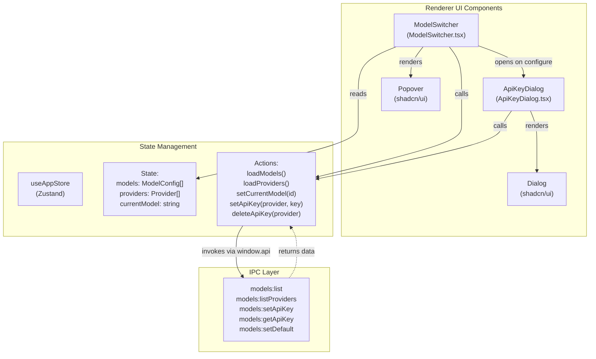
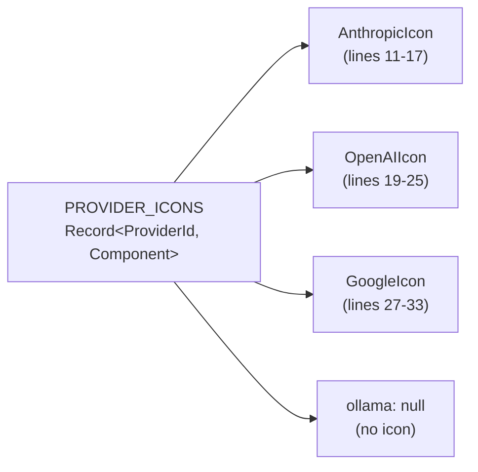
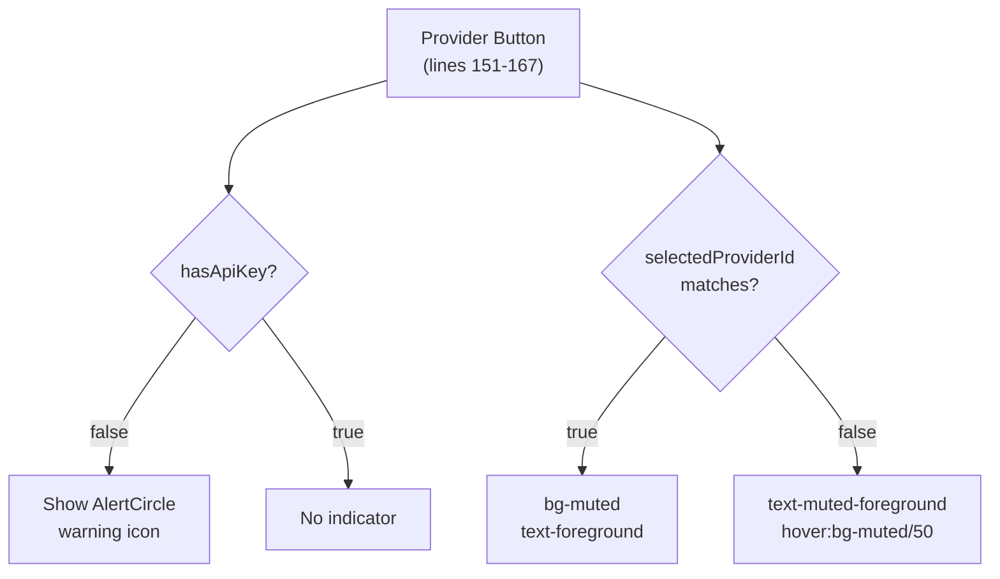
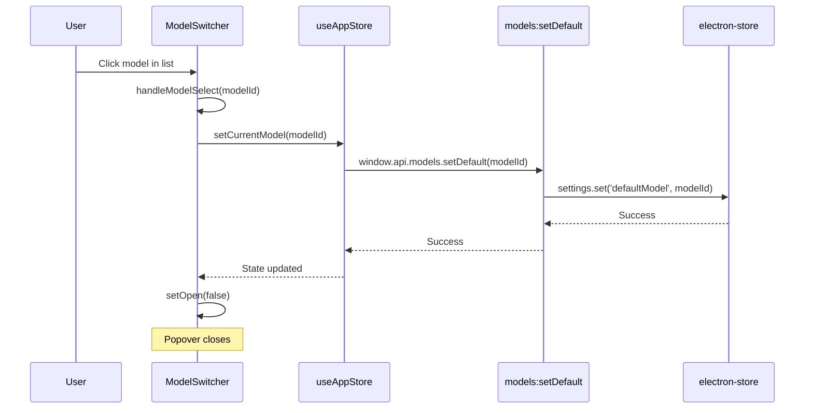
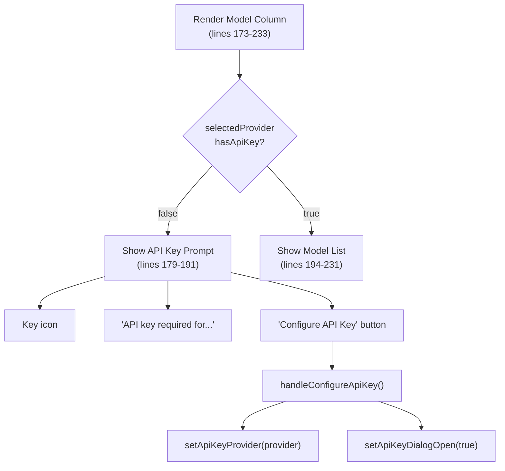
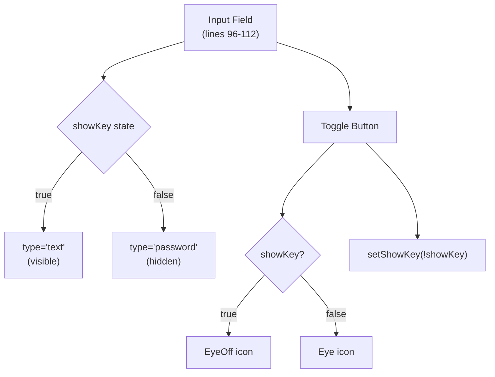
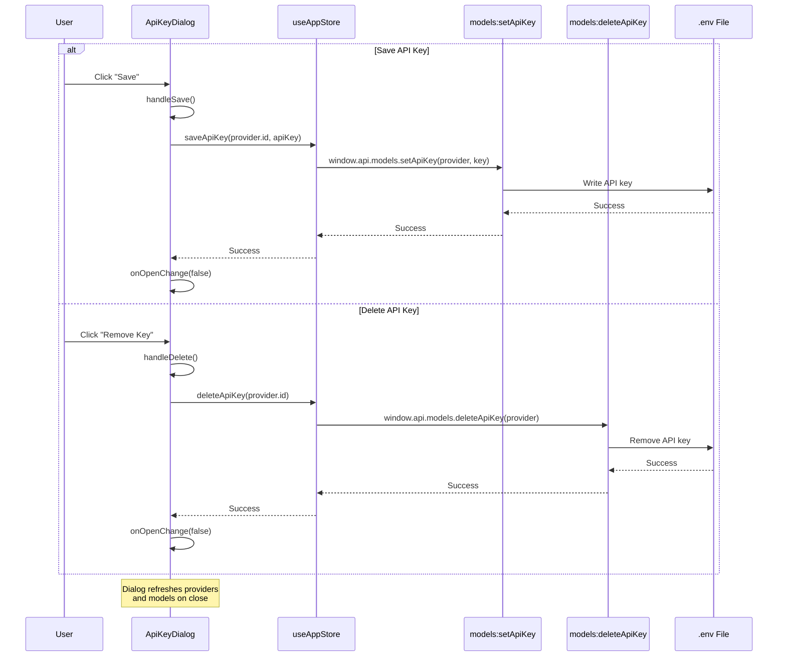
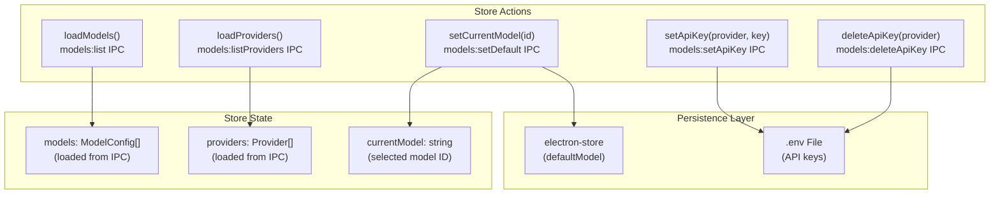
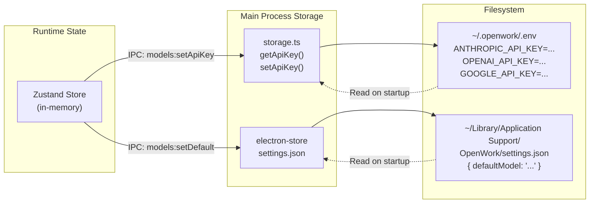
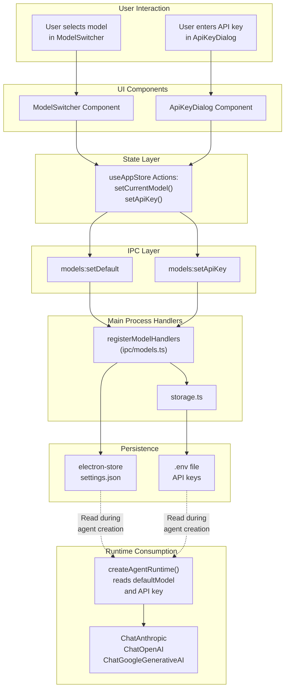

<!-- source: DeepWiki mcp.deepwiki.com · repo langchain-ai/openwork · page 7.4 Model Switcher and Configuration UI · fetched 2026-10-26 -->

# Model Switcher and Settings

<details>
<summary>Relevant source files</summary>

The following files were used as context for generating this wiki page:

- [electron.vite.config.ts](electron.vite.config.ts)
- [src/main/types.ts](src/main/types.ts)
- [src/renderer/src/components/chat/ApiKeyDialog.tsx](src/renderer/src/components/chat/ApiKeyDialog.tsx)
- [src/renderer/src/components/chat/ModelSwitcher.tsx](src/renderer/src/components/chat/ModelSwitcher.tsx)
- [src/renderer/src/components/panels/RightPanel.tsx](src/renderer/src/components/panels/RightPanel.tsx)
- [src/renderer/src/components/panels/TodoPanel.tsx](src/renderer/src/components/panels/TodoPanel.tsx)
- [src/renderer/src/types.ts](src/renderer/src/types.ts)

</details>


## Purpose and Scope

This page documents the UI components and workflows for selecting AI models and configuring provider API keys in OpenWork. The system provides a dropdown interface (`ModelSwitcher`) for choosing models from different providers (Anthropic, OpenAI, Google), and a dialog (`ApiKeyDialog`) for managing API credentials.

For information about how models are consumed by the agent runtime, see [Agent Runtime and Initialization](#3.1). For details on how model configurations are defined and stored in the main process, see [Model Configuration System](#4.1) and [API Key Management](#4.2).

## Component Architecture

The model switching interface consists of two primary React components that work together to provide model selection and credential management:



**Sources:** [src/renderer/src/components/chat/ModelSwitcher.tsx:1-246](), [src/renderer/src/components/chat/ApiKeyDialog.tsx:1-159](), [src/renderer/src/lib/store.ts]()

### ModelSwitcher Component

The `ModelSwitcher` component provides a button that opens a popover for selecting models. The component structure follows a two-column layout:

| Column | Purpose | Width | Contents |
|--------|---------|-------|----------|
| **Provider Column** | Select AI provider | 140px | List of providers with API key status indicators |
| **Model Column** | Select specific model | ~280px | Filtered list of models for selected provider, or API key prompt |

The component maintains internal state for the popover open/close state, selected provider, and API key dialog visibility:

```typescript
// Component state (lines 50-53)
const [open, setOpen] = useState(false)
const [selectedProviderId, setSelectedProviderId] = useState<ProviderId | null>(null)
const [apiKeyDialogOpen, setApiKeyDialogOpen] = useState(false)
const [apiKeyProvider, setApiKeyProvider] = useState<Provider | null>(null)
```

**Sources:** [src/renderer/src/components/chat/ModelSwitcher.tsx:49-62](), [src/renderer/src/components/chat/ModelSwitcher.tsx:116-244]()

### Provider Icons

Provider branding is displayed using inline SVG components defined within the file. The system supports four providers with corresponding icon components:



**Sources:** [src/renderer/src/components/chat/ModelSwitcher.tsx:10-40]()

## Provider Management

### Provider Data Structure

Providers are represented by the `Provider` interface, which tracks both identity and credential status:

```typescript
interface Provider {
  id: ProviderId                    // 'anthropic' | 'openai' | 'google' | 'ollama'
  name: string                      // Display name (e.g., "Anthropic")
  hasApiKey: boolean                // Whether API key is configured
}
```

**Sources:** [src/renderer/src/types.ts:26-33](), [src/main/types.ts:27-34]()

### Provider Loading and Fallback

The component loads providers on mount via the `loadProviders()` action. If providers haven't loaded yet (e.g., during initial render), a fallback array is used to prevent UI flicker:

```typescript
// Fallback providers (lines 43-47)
const FALLBACK_PROVIDERS: Provider[] = [
  { id: 'anthropic', name: 'Anthropic', hasApiKey: false },
  { id: 'openai', name: 'OpenAI', hasApiKey: false },
  { id: 'google', name: 'Google', hasApiKey: false }
]

// Use fallback if none loaded (line 71)
const displayProviders = providers.length > 0 ? providers : FALLBACK_PROVIDERS
```

**Sources:** [src/renderer/src/components/chat/ModelSwitcher.tsx:42-71]()

### Provider Selection and API Key Indicators

Providers are displayed in the left column with visual indicators for missing API keys. The `AlertCircle` icon appears when `hasApiKey` is false:



**Sources:** [src/renderer/src/components/chat/ModelSwitcher.tsx:148-169]()

## Model Selection

### Model Data Structure

Models are represented by the `ModelConfig` interface, which includes provider association and availability:

```typescript
interface ModelConfig {
  id: string                        // Model identifier (e.g., "claude-3-5-sonnet-20241022")
  name: string                      // Display name
  provider: ProviderId              // Associated provider
  model: string                     // API-specific model string
  description?: string              // Optional description
  available: boolean                // Whether model is available for use
}
```

**Sources:** [src/renderer/src/types.ts:35-42](), [src/main/types.ts:36-44]()

### Model Filtering and Display

The right column displays models filtered by the selected provider. The filtering logic is straightforward:

```typescript
// Filter models by selected provider (lines 88-90)
const filteredModels = selectedProviderId 
  ? models.filter(m => m.provider === selectedProviderId)
  : []
```

Models are displayed in a scrollable list with checkmarks indicating the current selection:

**Sources:** [src/renderer/src/components/chat/ModelSwitcher.tsx:87-91](), [src/renderer/src/components/chat/ModelSwitcher.tsx:194-219]()

### Model Selection Flow



**Sources:** [src/renderer/src/components/chat/ModelSwitcher.tsx:97-100]()

### No API Key State

When a provider is selected but lacks an API key, the model list is replaced with a prompt to configure credentials:



**Sources:** [src/renderer/src/components/chat/ModelSwitcher.tsx:178-191](), [src/renderer/src/components/chat/ModelSwitcher.tsx:102-105]()

## API Key Management

### ApiKeyDialog Component

The `ApiKeyDialog` provides a modal interface for entering, updating, or removing API keys. The component accepts three props:

| Prop | Type | Purpose |
|------|------|---------|
| `open` | `boolean` | Controls dialog visibility |
| `onOpenChange` | `(open: boolean) => void` | Callback when dialog closes |
| `provider` | `Provider \| null` | Provider being configured |

**Sources:** [src/renderer/src/components/chat/ApiKeyDialog.tsx:15-19]()

### Provider-Specific Configuration

The dialog adapts its UI based on the provider, using the `PROVIDER_INFO` constant:

```typescript
const PROVIDER_INFO: Record<string, { placeholder: string; envVar: string }> = {
  anthropic: { placeholder: 'sk-ant-...', envVar: 'ANTHROPIC_API_KEY' },
  openai: { placeholder: 'sk-...', envVar: 'OPENAI_API_KEY' },
  google: { placeholder: 'AIza...', envVar: 'GOOGLE_API_KEY' }
}
```

This information is displayed to guide users on:
- Expected key format (via placeholder)
- Environment variable name (shown below input field)

**Sources:** [src/renderer/src/components/chat/ApiKeyDialog.tsx:21-25](), [src/renderer/src/components/chat/ApiKeyDialog.tsx:94-116]()

### API Key Input and Visibility Toggle

The API key is entered in a password-style input with a visibility toggle button:



**Sources:** [src/renderer/src/components/chat/ApiKeyDialog.tsx:96-112]()

### Save and Delete Operations



**Sources:** [src/renderer/src/components/chat/ApiKeyDialog.tsx:49-77]()

### Post-Save Provider Refresh

After saving or deleting an API key, the dialog triggers a refresh of both providers and models to update the `hasApiKey` flags:

```typescript
// Refresh after dialog closes (lines 107-114)
function handleApiKeyDialogClose(isOpen: boolean) {
  setApiKeyDialogOpen(isOpen)
  if (!isOpen) {
    // Refresh providers after dialog closes
    loadProviders()
    loadModels()
  }
}
```

**Sources:** [src/renderer/src/components/chat/ModelSwitcher.tsx:107-114]()

## State Management and Persistence

### Zustand Store Integration

The model switcher components interact with the global Zustand store through several state properties and actions:



**Sources:** [src/renderer/src/components/chat/ModelSwitcher.tsx:55-62]()

### IPC Channel Summary

The model switcher system uses five IPC channels for communication with the main process:

| IPC Channel | Direction | Purpose | Storage Target |
|-------------|-----------|---------|----------------|
| `models:list` | Main → Renderer | Fetch available models with API key status | N/A (read-only) |
| `models:listProviders` | Main → Renderer | Fetch providers with API key status | N/A (read-only) |
| `models:setApiKey` | Renderer → Main | Store API key for provider | `.env` file |
| `models:getApiKey` | Main → Renderer | Retrieve API key for provider | `.env` file |
| `models:setDefault` | Renderer → Main | Set default model selection | `electron-store` |

**Sources:** Diagram 4 in system architecture

### Storage Architecture



API keys are stored in a `.env` file to enable `.gitignore` exclusion and manual editing. The default model preference is stored in `electron-store` as structured JSON configuration.

**Sources:** Referenced in Diagram 4 of system architecture

## Complete Data Flow

The following diagram illustrates the end-to-end data flow from user interaction to persistence and agent runtime consumption:



**Sources:** [src/renderer/src/components/chat/ModelSwitcher.tsx:97-114](), [src/renderer/src/components/chat/ApiKeyDialog.tsx:49-77]()

## Component Lifecycle and Initialization

### ModelSwitcher Mount Behavior

On mount, the `ModelSwitcher` loads both models and providers:

```typescript
// Load models and providers on mount (lines 65-68)
useEffect(() => {
  loadModels()
  loadProviders()
}, [loadModels, loadProviders])
```

The component also initializes the selected provider based on the current model, or defaults to the first provider if no model is selected:

```typescript
// Set initial selected provider (lines 74-85)
useEffect(() => {
  if (!selectedProviderId && currentModel) {
    const model = models.find(m => m.id === currentModel)
    if (model) {
      setSelectedProviderId(model.provider)
    }
  }
  // Default to first provider if none selected
  if (!selectedProviderId && displayProviders.length > 0) {
    setSelectedProviderId(displayProviders[0].id)
  }
}, [currentModel, models, selectedProviderId, displayProviders])
```

**Sources:** [src/renderer/src/components/chat/ModelSwitcher.tsx:64-85]()

### ApiKeyDialog Mount Behavior

When the dialog opens, it checks whether the provider already has an API key configured and resets the input field:

```typescript
// Check for existing key on open (lines 37-43)
useEffect(() => {
  if (open && provider) {
    setHasExistingKey(provider.hasApiKey)
    setApiKey('')
    setShowKey(false)
  }
}, [open, provider])
```

This allows the UI to adapt its messaging and button labels based on whether the user is adding a new key or updating an existing one.

**Sources:** [src/renderer/src/components/chat/ApiKeyDialog.tsx:36-43]()

## Integration with Chat Interface

The `ModelSwitcher` is rendered in the chat interface header, providing contextual access to model selection while composing messages. The current model is displayed in the button trigger with the provider icon and model ID:

```typescript
// Button trigger display (lines 125-133)
{selectedModel ? (
  <>
    {PROVIDER_ICONS[selectedModel.provider]?.({ className: 'size-3.5' })}
    <span className="font-mono">{selectedModel.id}</span>
  </>
) : (
  <span>Select model</span>
)}
```

**Sources:** [src/renderer/src/components/chat/ModelSwitcher.tsx:119-134]()

---

