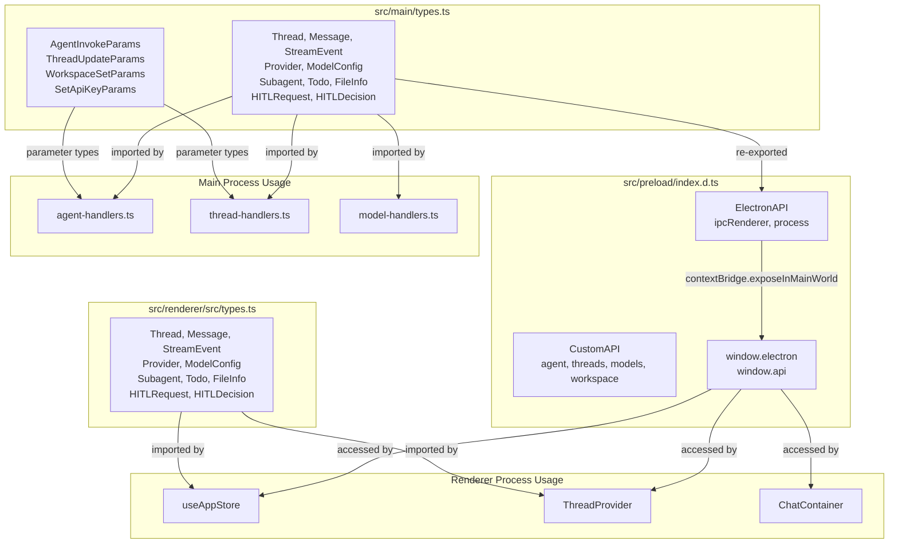
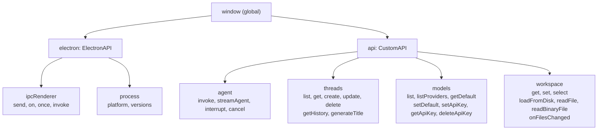
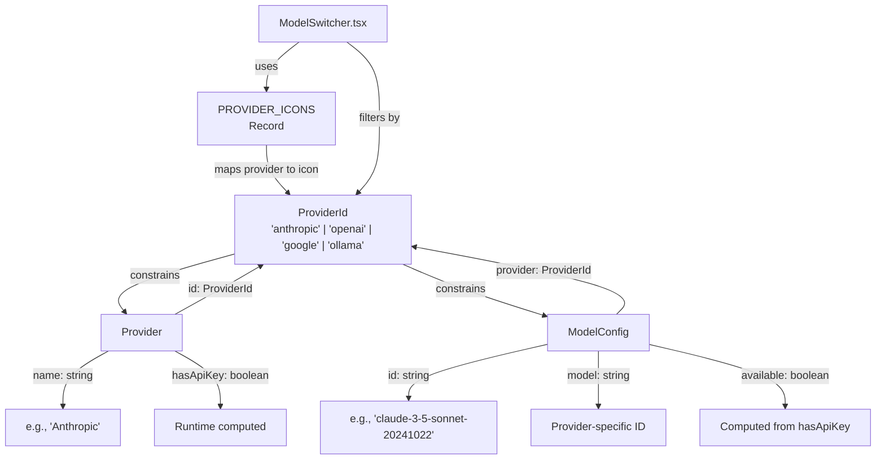
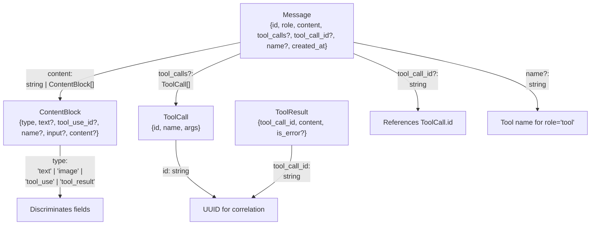
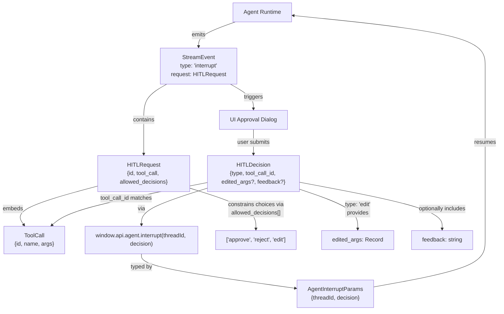
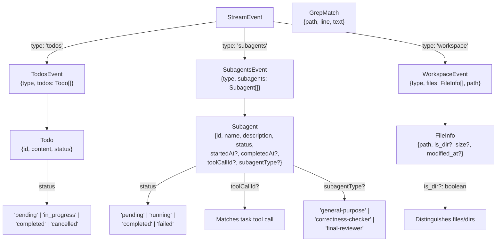
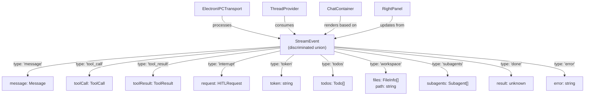

<!-- source: DeepWiki mcp.deepwiki.com · repo langchain-ai/openwork · page 7.5 Type Definitions and Shared Interfaces · fetched 2026-10-26 -->

# Type Definitions and Shared Interfaces

<details>
<summary>Relevant source files</summary>

The following files were used as context for generating this wiki page:

- [src/main/types.ts](src/main/types.ts)
- [src/preload/index.d.ts](src/preload/index.d.ts)
- [src/renderer/src/components/chat/ModelSwitcher.tsx](src/renderer/src/components/chat/ModelSwitcher.tsx)
- [src/renderer/src/types.ts](src/renderer/src/types.ts)

</details>


This document catalogs the TypeScript type definitions and interfaces that form the data contracts throughout OpenWork. These types define the shape of data exchanged between the renderer and main processes via IPC, stored in databases, and passed to/from the agent system. The types are intentionally duplicated between [src/renderer/src/types.ts]() and [src/main/types.ts]() to maintain strict process boundaries in the Electron architecture.

For information about how these types are used in IPC communication, see [IPC Communication System](#2.2). For details on state management patterns using these types, see [Global State Management](#2.3).

## Type Organization and Duplication Strategy

OpenWork maintains parallel type definitions in both the renderer and main processes rather than sharing a single source. This architectural decision enforces the separation of concerns inherent in Electron's multi-process model and prevents accidental coupling between processes.

**Three-Layer Type Architecture:**



**Sources:** [src/preload/index.d.ts:1-103](), [src/renderer/src/types.ts:1-134](), [src/main/types.ts:1-187]()

The preload script at [src/preload/index.d.ts]() acts as the type bridge, defining the `window.electron` and `window.api` interfaces available in the renderer. It imports types from `src/main/types.ts` to ensure consistency in method signatures ([src/preload/index.d.ts:1]()).

The duplication between `src/renderer/src/types.ts` and `src/main/types.ts` is intentional (both ~130-180 lines) and provides clear isolation. Any changes requiring coordination between processes become explicit through type changes on both sides of the IPC boundary.

## Preload API Type Definitions

The preload layer defines the complete IPC API surface exposed to the renderer via `window.api` and `window.electron`.

**Interface Structure:**



**Sources:** [src/preload/index.d.ts:3-102]()

### ElectronAPI Interface

The `ElectronAPI` interface ([src/preload/index.d.ts:3-14]()) provides low-level Electron primitives:

| Member | Type | Purpose |
|--------|------|---------|
| `ipcRenderer.send` | `(channel: string, ...args: unknown[]) => void` | One-way message to main |
| `ipcRenderer.on` | `(channel: string, listener: (...args: unknown[]) => void) => () => void` | Subscribe to events, returns cleanup |
| `ipcRenderer.once` | `(channel: string, listener: (...args: unknown[]) => void) => void` | One-time event listener |
| `ipcRenderer.invoke` | `(channel: string, ...args: unknown[]) => Promise<unknown>` | Request-response IPC |
| `process.platform` | `NodeJS.Platform` | OS platform identifier |
| `process.versions` | `NodeJS.ProcessVersions` | Node/Chrome version info |

### CustomAPI Interface

The `CustomAPI` interface ([src/preload/index.d.ts:16-95]()) groups domain-specific operations:

**Agent Operations** ([src/preload/index.d.ts:17-37]()):
- `invoke(threadId, message, onEvent, modelId?)`: Start agent execution with callback
- `streamAgent(threadId, message, command, onEvent, modelId?)`: Resume with command
- `interrupt(threadId, decision, onEvent?)`: Send HITL decision
- `cancel(threadId)`: Abort running agent

**Thread Operations** ([src/preload/index.d.ts:38-46]()):
- `list()`: Returns `Thread[]`
- `get(threadId)`: Returns `Thread | null`
- `create(metadata?)`: Returns new `Thread`
- `update(threadId, updates)`: Returns updated `Thread`
- `delete(threadId)`: Removes thread
- `getHistory(threadId)`: Returns message history
- `generateTitle(message)`: Auto-generates thread title

**Model Operations** ([src/preload/index.d.ts:47-55]()):
- `list()`: Returns `ModelConfig[]`
- `listProviders()`: Returns `Provider[]`
- `getDefault()`: Returns default model ID
- `setDefault(modelId)`: Sets default model
- `setApiKey(provider, apiKey)`: Stores API key
- `getApiKey(provider)`: Retrieves API key
- `deleteApiKey(provider)`: Removes API key

**Workspace Operations** ([src/preload/index.d.ts:56-94]()):
- `get(threadId?)`: Returns workspace path
- `set(threadId, path)`: Associates workspace with thread
- `select(threadId?)`: Opens file picker dialog
- `loadFromDisk(threadId)`: Returns file tree structure
- `readFile(threadId, filePath)`: Returns text file content
- `readBinaryFile(threadId, filePath)`: Returns base64-encoded binary
- `onFilesChanged(callback)`: File watcher subscription

**Sources:** [src/preload/index.d.ts:1-103]()

## IPC Handler Parameter Types

The main process defines structured parameter types for IPC handlers, ensuring type safety for incoming requests ([src/main/types.ts:5-56]()).

**Parameter Type Mapping:**

| IPC Handler | Parameter Type | Fields |
|-------------|----------------|--------|
| `agent:invoke` | `AgentInvokeParams` | `threadId`, `message`, `modelId?` |
| `agent:resume` | `AgentResumeParams` | `threadId`, `command`, `modelId?` |
| `agent:interrupt` | `AgentInterruptParams` | `threadId`, `decision` |
| `agent:cancel` | `AgentCancelParams` | `threadId` |
| `thread:update` | `ThreadUpdateParams` | `threadId`, `updates` |
| `workspace:set` | `WorkspaceSetParams` | `threadId?`, `path` |
| `workspace:loadFromDisk` | `WorkspaceLoadParams` | `threadId` |
| `workspace:readFile` | `WorkspaceFileParams` | `threadId`, `filePath` |
| `models:setApiKey` | `SetApiKeyParams` | `provider`, `apiKey` |

**Example Type Definition:**

```typescript
// From src/main/types.ts:9-13
export interface AgentInvokeParams {
  threadId: string
  message: string
  modelId?: string
}
```

These parameter interfaces are used by IPC handlers to destructure and validate incoming requests. The `modelId?` optional field allows per-invocation model override, falling back to thread or global defaults.

**Sources:** [src/main/types.ts:5-56]()

## Core Type Categories

### Thread and Run Types

These types represent conversation threads and execution runs, forming the organizational spine of the application.

| Type | Purpose | Key Fields |
|------|---------|------------|
| `Thread` | Persistent conversation context | `thread_id`, `status`, `metadata`, `title` |
| `ThreadStatus` | Thread execution state | `'idle' \| 'busy' \| 'interrupted' \| 'error'` |
| `Run` | Single agent execution | `run_id`, `thread_id`, `status` |
| `RunStatus` | Run execution state | `'pending' \| 'running' \| 'error' \| 'success' \| 'interrupted'` |

```typescript
// From src/renderer/src/types.ts and src/main/types.ts
export type ThreadStatus = 'idle' | 'busy' | 'interrupted' | 'error'

export interface Thread {
  thread_id: string
  created_at: Date
  updated_at: Date
  metadata?: Record<string, unknown>
  status: ThreadStatus
  thread_values?: Record<string, unknown>
  title?: string
}
```

The `metadata` field stores thread-specific configuration like workspace paths ([src/renderer/src/types.ts:8]()). The `thread_values` field holds LangGraph checkpoint data. Thread titles are auto-generated by the `threads:generateTitle` IPC handler.

**Sources:** [src/renderer/src/types.ts:2-12](), [src/main/types.ts:2-12]()

### Model and Provider Types

These types define the AI model configuration system, supporting multiple LLM providers with distinct API authentication requirements.

**Type Hierarchy and Usage:**



**Sources:** [src/renderer/src/types.ts:27-42](), [src/main/types.ts:82-99](), [src/renderer/src/components/chat/ModelSwitcher.tsx:36-41]()

**Type Definitions:**

| Type | Purpose | Definition |
|------|---------|------------|
| `ProviderId` | Union of supported providers | `'anthropic' \| 'openai' \| 'google' \| 'ollama'` |
| `Provider` | Provider metadata with API key status | `{id: ProviderId, name: string, hasApiKey: boolean}` |
| `ModelConfig` | Model specification | `{id: string, name: string, provider: ProviderId, model: string, description?: string, available: boolean}` |

The `ModelConfig.available` field is computed at runtime by checking whether the provider has a configured API key ([src/renderer/src/types.ts:41]()). The `model` field contains the provider-specific model identifier (e.g., `"claude-3-5-sonnet-20241022"`) used in LLM API calls.

The `ModelSwitcher` component ([src/renderer/src/components/chat/ModelSwitcher.tsx:36-41]()) defines a `PROVIDER_ICONS` mapping that associates each `ProviderId` with its respective SVG icon component (`AnthropicIcon`, `OpenAIIcon`, `GoogleIcon`).

**Sources:** [src/renderer/src/types.ts:27-42](), [src/main/types.ts:82-99](), [src/renderer/src/components/chat/ModelSwitcher.tsx:36-41]()

### Message and Communication Types

Messages form the conversational history and support multiple content formats including text, tool uses, and structured content blocks.

**Message Structure and Relationships:**



**Sources:** [src/renderer/src/types.ts:70-101](), [src/main/types.ts:124-151]()

**Message Interface:**

The `Message` interface ([src/renderer/src/types.ts:70-80]()) represents a single conversational turn:

```typescript
export interface Message {
  id: string                         // Unique message identifier
  role: 'user' | 'assistant' | 'system' | 'tool'
  content: string | ContentBlock[]   // Text or structured content
  tool_calls?: ToolCall[]            // Tools invoked by assistant
  tool_call_id?: string              // For tool messages: links to originating call
  name?: string                      // For tool messages: tool name
  created_at: Date
}
```

Messages with `role: 'tool'` represent tool execution results and use `tool_call_id` to correlate with their originating `ToolCall` ([src/renderer/src/types.ts:76-78]()). This linking is critical for the agent to match tool outputs with their invocations.

**ContentBlock Interface:**

The `ContentBlock` type ([src/renderer/src/types.ts:82-89]()) supports Anthropic's message format where a single message may contain multiple blocks of different types:

```typescript
export interface ContentBlock {
  type: 'text' | 'image' | 'tool_use' | 'tool_result'
  text?: string           // For type='text'
  tool_use_id?: string    // For type='tool_use'
  name?: string           // For type='tool_use'
  input?: unknown         // For type='tool_use'
  content?: string        // For type='tool_result'
}
```

**ToolCall and ToolResult:**

```typescript
// From src/renderer/src/types.ts:91-101
export interface ToolCall {
  id: string                        // UUID for correlation
  name: string                      // Tool function name
  args: Record<string, unknown>     // Tool arguments
}

export interface ToolResult {
  tool_call_id: string              // Correlates with ToolCall.id
  content: string | unknown         // Tool output
  is_error?: boolean                // Indicates execution failure
}
```

The `ToolCall.id` field links to `ToolResult.tool_call_id` and `Message.tool_call_id`, establishing a three-way correlation for tool execution tracking.

**Sources:** [src/renderer/src/types.ts:70-101](), [src/main/types.ts:124-151]()

### Human-in-the-Loop (HITL) Types

HITL types enable the agent interruption and approval workflow, allowing users to review and modify potentially dangerous operations before execution.

**HITL Request-Response Flow:**



**Sources:** [src/renderer/src/types.ts:103-114](), [src/main/types.ts:153-165](), [src/main/types.ts:21-24]()

**Type Definitions:**

```typescript
// From src/renderer/src/types.ts:103-114
export interface HITLRequest {
  id: string                                  // Unique request identifier
  tool_call: ToolCall                         // The tool call requiring approval
  allowed_decisions: HITLDecision['type'][]   // Permitted response types
}

export interface HITLDecision {
  type: 'approve' | 'reject' | 'edit'
  tool_call_id: string                        // Correlates with HITLRequest.tool_call.id
  edited_args?: Record<string, unknown>       // Modified arguments when type='edit'
  feedback?: string                           // User explanation for agent context
}
```

The `allowed_decisions` array constrains which approval actions are permitted for a specific tool call ([src/renderer/src/types.ts:106]()). For example, file deletion operations might only allow `['approve', 'reject']` while file writes permit `['approve', 'reject', 'edit']`.

When `type: 'edit'`, the `edited_args` field contains the modified tool arguments ([src/renderer/src/types.ts:112]()). The optional `feedback` field allows users to provide explanatory text that the agent can use to refine subsequent operations.

The `AgentInterruptParams` interface ([src/main/types.ts:21-24]()) wraps the decision for IPC transmission:

```typescript
export interface AgentInterruptParams {
  threadId: string
  decision: HITLDecision
}
```

**Sources:** [src/renderer/src/types.ts:103-114](), [src/main/types.ts:153-165](), [src/main/types.ts:21-24]()

### Agent State Types

These types represent the runtime state of agent execution, including tasks, spawned subagents, and file system information.

**Agent State Type Relationships:**



**Sources:** [src/renderer/src/types.ts:44-128](), [src/main/types.ts:101-181]()

#### Todo Type

Tracks agent-generated tasks and their completion status:

```typescript
// From src/renderer/src/types.ts:116-120
export interface Todo {
  id: string
  content: string
  status: 'pending' | 'in_progress' | 'completed' | 'cancelled'
}
```

Todos are maintained in the agent's state graph and persisted to the LangGraph checkpoint database. The UI displays them in the `RightPanel`'s TASKS section, updated via `StreamEvent` with `type: 'todos'`.

**Sources:** [src/renderer/src/types.ts:116-120](), [src/main/types.ts:167-171]()

#### Subagent Type

Represents spawned subagent tasks with lifecycle tracking:

```typescript
// From src/renderer/src/types.ts:44-56
export interface Subagent {
  id: string
  name: string
  description: string
  status: 'pending' | 'running' | 'completed' | 'failed'
  startedAt?: Date
  completedAt?: Date
  toolCallId?: string     // Correlates with task tool call response
  subagentType?: string   // e.g., 'general-purpose', 'correctness-checker'
}
```

The `toolCallId` field links the subagent to the `task` tool call that spawned it ([src/renderer/src/types.ts:53]()). This enables the UI to match subagent completion events with their originating tool calls.

The `subagentType` discriminator determines the UI presentation, with specific icons and badges for types like `'correctness-checker'` and `'final-reviewer'`.

**Sources:** [src/renderer/src/types.ts:44-56](), [src/main/types.ts:101-109]()

#### File System Types

Support workspace file operations and display:

```typescript
// From src/renderer/src/types.ts:122-133
export interface FileInfo {
  path: string
  is_dir?: boolean
  size?: number
  modified_at?: string
}

export interface GrepMatch {
  path: string
  line: number
  text: string
}
```

`FileInfo` represents files and directories in the workspace file tree. The `is_dir` flag distinguishes directories from files ([src/renderer/src/types.ts:124]()). Returned by `workspace:loadFromDisk` IPC handler.

`GrepMatch` structures the results from the agent's `grep` tool, providing line-level search results with file path, line number, and matching text.

**Sources:** [src/renderer/src/types.ts:122-133](), [src/main/types.ts:174-185]()

### Stream Event Types

The `StreamEvent` discriminated union defines all possible events emitted during agent execution streaming. This is the primary data structure for real-time agent-to-UI communication.

**StreamEvent Type Hierarchy:**



**Sources:** [src/renderer/src/types.ts:58-68](), [src/main/types.ts:112-122]()

**Full Type Definition:**

```typescript
// From src/renderer/src/types.ts:58-68
export type StreamEvent =
  | { type: 'message'; message: Message }
  | { type: 'tool_call'; toolCall: ToolCall }
  | { type: 'tool_result'; toolResult: ToolResult }
  | { type: 'interrupt'; request: HITLRequest }
  | { type: 'token'; token: string }
  | { type: 'todos'; todos: Todo[] }
  | { type: 'workspace'; files: FileInfo[]; path: string }
  | { type: 'subagents'; subagents: Subagent[] }
  | { type: 'done'; result: unknown }
  | { type: 'error'; error: string }
```

**Event Type Semantics:**

| Event Type | Purpose | UI Handler | Key Fields |
|------------|---------|------------|------------|
| `message` | Complete message added to conversation | Appends to message list | `message: Message` |
| `tool_call` | Agent invoked a tool | Displays tool execution indicator | `toolCall: ToolCall` |
| `tool_result` | Tool execution completed | Shows tool result | `toolResult: ToolResult` |
| `interrupt` | Agent requesting HITL approval | Opens approval dialog | `request: HITLRequest` |
| `token` | Single token from streaming response | Accumulates for typewriter effect | `token: string` |
| `todos` | Agent state update with new task list | Updates RightPanel TASKS | `todos: Todo[]` |
| `workspace` | Workspace files changed | Refreshes RightPanel FILES | `files: FileInfo[], path: string` |
| `subagents` | Subagent spawned/updated | Updates RightPanel SUBAGENTS | `subagents: Subagent[]` |
| `done` | Stream completed successfully | Finalizes UI state | `result: unknown` |
| `error` | Stream failed with error | Displays error banner | `error: string` |

The `token` event type enables character-by-character streaming display of assistant responses ([src/renderer/src/types.ts:63]()). The `ThreadProvider` accumulates tokens in `streamData` state and merges them with persistent messages for display.

The `workspace` event signals that the agent modified files, prompting the UI to reload the file tree ([src/renderer/src/types.ts:65]()). The included `path` field identifies the workspace directory for verification.

**Sources:** [src/renderer/src/types.ts:58-68](), [src/main/types.ts:112-122]()

## Type Usage Patterns

### IPC Boundary Type Safety

The type definitions establish a contract for IPC communication. Handlers in the main process return types that match the expectations of renderer callers:

```typescript
// Pattern: Renderer calls with typed response
const threads = await window.api.threads.list()  // Returns: Thread[]
const model = await window.api.models.getDefault()  // Returns: string | null
```

The `window.api` object exposed via preload is fully typed using the shared type definitions, providing end-to-end type safety across the IPC boundary.

### Discriminated Union Pattern

`StreamEvent` exemplifies TypeScript's discriminated union pattern. The `type` field acts as a discriminator, allowing type narrowing:

```typescript
// Pattern: Type-safe event handling
for await (const event of stream) {
  if (event.type === 'token') {
    // TypeScript knows event.token exists
    accumulateToken(event.token)
  } else if (event.type === 'interrupt') {
    // TypeScript knows event.request exists
    await handleHITL(event.request)
  }
}
```

This pattern ensures compile-time verification that all event types are handled correctly and prevents accessing fields that don't exist on a particular event variant.

### Optional Field Convention

Many types use optional fields (`?`) to represent data that may not always be present:

```typescript
interface Thread {
  thread_id: string       // Always present
  metadata?: Record<...>  // Optional - may not be set
  title?: string          // Optional - auto-generated asynchronously
}
```

This convention distinguishes between required identifying information (like `thread_id`) and supplementary data that's populated conditionally or asynchronously (like `title`).

**Sources:** [src/renderer/src/types.ts:1-134](), [src/main/types.ts:1-132]()

---

