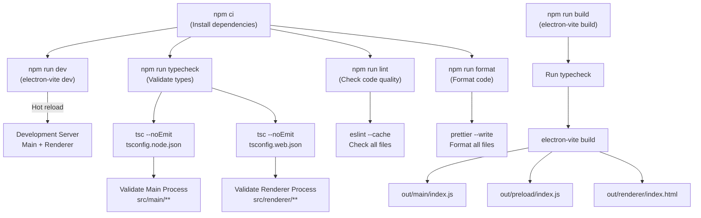
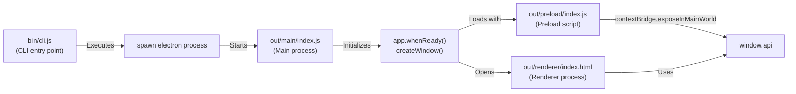
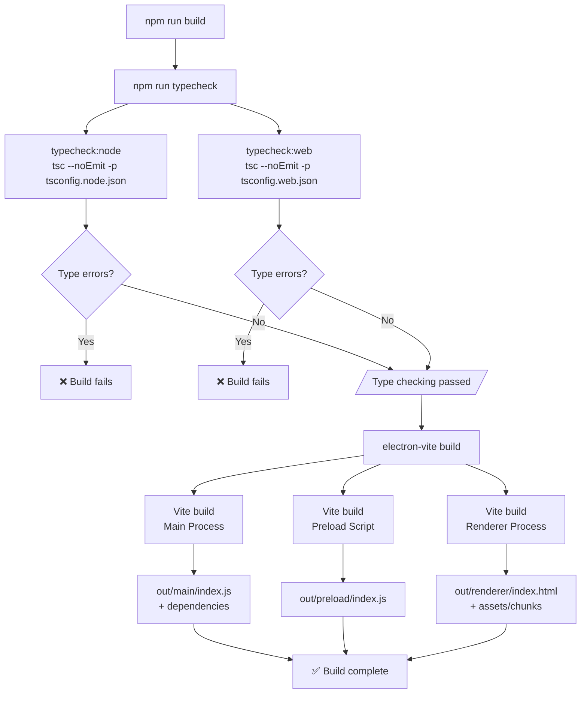
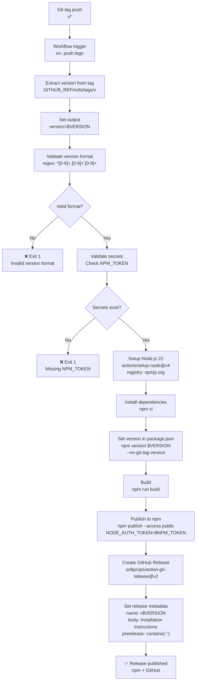
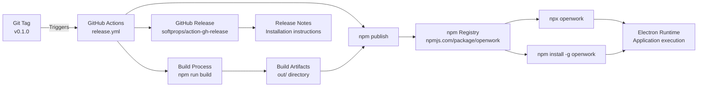

<!-- source: DeepWiki mcp.deepwiki.com · repo langchain-ai/openwork · page 8 Development and Deployment · fetched 2026-10-26 -->

# Development and Deployment

<details>
<summary>Relevant source files</summary>

The following files were used as context for generating this wiki page:

- [.github/workflows/release.yml](.github/workflows/release.yml)
- [package-lock.json](package-lock.json)
- [package.json](package.json)
- [src/renderer/index.html](src/renderer/index.html)

</details>


This document covers the development environment setup, build processes, and deployment workflows for OpenWork. It explains how to configure the project, use development scripts, build distributable artifacts, and publish releases through automated CI/CD pipelines.

For information about the application's runtime architecture, see [Architecture](#2). For details on setting up the UI development environment, see [User Interface](#7).

---

## Development Environment Setup

OpenWork is an Electron-based desktop application that requires Node.js 18 or higher. The project uses `electron-vite` as its build tool and `pnpm` as its package manager.

### Package Manager and Node Version

The project specifies a package manager constraint in [package.json:107]():

```
"packageManager": "pnpm@10.28.0+sha512..."
```

And requires Node.js 18 or higher per [package.json:35-37]():

```json
"engines": {
  "node": ">=18"
}
```

### Core Dependencies

OpenWork's dependency structure consists of three main categories:

| Category | Key Packages | Purpose |
|----------|-------------|---------|
| **Electron Runtime** | `electron@^39.2.6` | Desktop application framework |
| **AI/Agent Framework** | `deepagents@^1.4.1`, `@langchain/langgraph@^1.0.15`, `@langchain/langgraph-sdk@^1.5.3` | Agent execution and orchestration |
| **LLM Providers** | `@langchain/anthropic@^1.3.10`, `@langchain/openai@^1.2.2`, `@langchain/google-genai@^2.1.10` | Model provider integrations |
| **UI Framework** | `react@^19.2.1`, `react-dom@^19.2.1` | Renderer process UI |
| **UI Components** | `@radix-ui/*`, `lucide-react@^0.469.0`, `tailwindcss@^4.0.0` | Component library and styling |
| **State Management** | `zustand@^5.0.3` | Application state store |
| **Storage** | `electron-store@^8.2.0`, `sql.js@^1.12.0` | Settings and database persistence |

Sources: [package.json:48-83]()

### Development Dependencies

The development toolchain uses:

| Tool | Package | Purpose |
|------|---------|---------|
| **Build System** | `electron-vite@^5.0.0`, `vite@^7.2.6` | Electron-specific Vite configuration |
| **TypeScript** | `typescript@^5.9.3`, `@electron-toolkit/tsconfig@^2.0.0` | Type checking and compilation |
| **Linting** | `eslint@^9.39.1`, `@electron-toolkit/eslint-config-ts@^3.1.0` | Code quality enforcement |
| **Formatting** | `prettier@^3.7.4`, `@electron-toolkit/eslint-config-prettier@^3.0.0` | Code formatting |
| **React Tooling** | `@vitejs/plugin-react@^5.1.1`, `eslint-plugin-react@^7.37.5` | React development support |

Sources: [package.json:84-106]()

---

## Development Scripts

OpenWork defines six primary npm scripts in [package.json:38-46]():

### Script Reference Table

| Script | Command | Description |
|--------|---------|-------------|
| `format` | `prettier --write .` | Format all files using Prettier |
| `lint` | `eslint --cache .` | Lint codebase with ESLint caching |
| `typecheck:node` | `tsc --noEmit -p tsconfig.node.json --composite false` | Type-check main process code |
| `typecheck:web` | `tsc --noEmit -p tsconfig.web.json --composite false` | Type-check renderer process code |
| `typecheck` | `npm run typecheck:node && npm run typecheck:web` | Type-check both processes |
| `start` | `electron-vite preview` | Run production preview build |
| `dev` | `electron-vite dev` | Start development server with hot reload |
| `build` | `npm run typecheck && electron-vite build` | Type-check and build production artifacts |

### Development Workflow



Sources: [package.json:38-46]()

---

## CLI Entry Point and Execution Model

### Binary Configuration

OpenWork is distributed as an npm package with a command-line executable. The [package.json:13-15]() defines:

```json
"bin": {
  "openwork": "./bin/cli.js"
}
```

This makes the `openwork` command available globally when installed via `npm install -g openwork` or via `npx openwork`.

### Application Entry Flow



### Package Distribution Structure

The [package.json:6-12]() specifies which files are included in the npm package:

```json
"files": [
  "out/",
  "bin/",
  "resources/",
  "LICENSE",
  "README.md"
]
```

| Directory/File | Contents | Purpose |
|----------------|----------|---------|
| `out/` | Built JavaScript and assets | Compiled application code |
| `bin/` | `cli.js` executable | Command-line entry point |
| `resources/` | Application resources | Icons, assets, etc. |
| `LICENSE` | MIT license | Legal terms |
| `README.md` | Documentation | User-facing documentation |

The [package.json:5]() sets the main entry point:

```json
"main": "./out/main/index.js"
```

This points to the compiled Electron main process entry file after build.

Sources: [package.json:5-15]()

---

## Build Process

### Build Pipeline Overview

The build process orchestrated by `npm run build` follows this pipeline:



### Build Configuration Structure

OpenWork uses separate TypeScript configurations for different Electron processes:

| Config File | Target | Scope |
|-------------|--------|-------|
| `tsconfig.node.json` | Main process and preload | Node.js environment, Electron main APIs |
| `tsconfig.web.json` | Renderer process | Browser environment, React, DOM APIs |

The composite build ensures type safety across process boundaries while allowing appropriate environment-specific APIs in each context.

Sources: [package.json:38-46]()

---

## Automated Release Pipeline

### Release Workflow Architecture

The GitHub Actions release pipeline in [.github/workflows/release.yml]() automates version management, building, and publishing to npm and GitHub Releases.



### Release Trigger and Version Extraction

The workflow is triggered on git tag pushes matching the pattern `v*` as defined in [.github/workflows/release.yml:3-6]():

```yaml
on:
  push:
    tags:
      - "v*"
```

Version extraction occurs in [.github/workflows/release.yml:23-28]():

```bash
VERSION=${GITHUB_REF#refs/tags/v}
echo "version=$VERSION" >> $GITHUB_OUTPUT
```

This strips the `v` prefix from tags like `v0.1.0` to produce `0.1.0`.

### Version Validation

The pipeline validates version format using regex in [.github/workflows/release.yml:30-38]():

```bash
if [[ ! "$VERSION" =~ ^[0-9]+\.[0-9]+\.[0-9]+(-[a-zA-Z0-9.]+)?$ ]]; then
  echo "❌ Invalid version format: $VERSION"
  exit 1
fi
```

Valid formats:
- `X.Y.Z` (e.g., `1.0.0`)
- `X.Y.Z-prerelease` (e.g., `1.0.0-beta.1`)

Sources: [.github/workflows/release.yml:23-38]()

### Secret Validation

The pipeline requires an `NPM_TOKEN` secret for publishing, validated in [.github/workflows/release.yml:40-48]():

```bash
if [ -z "$NPM_TOKEN" ]; then
  echo "::error::Missing required secret: NPM_TOKEN"
  exit 1
fi
```

This token must have publish permissions for the `openwork` package on npm.

Sources: [.github/workflows/release.yml:40-48]()

### Build and Publish Steps

The release job executes these steps sequentially:

| Step | Command | Purpose |
|------|---------|---------|
| **Setup Node** | `actions/setup-node@v4` with Node 22 | Configure npm registry authentication |
| **Install** | `npm ci` | Install exact dependency versions from package-lock.json |
| **Set Version** | `npm version $VERSION --no-git-tag-version --allow-same-version` | Update package.json version without creating git tag |
| **Build** | `npm run build` | Type-check and compile application |
| **Publish** | `npm publish --access public` | Upload to npm registry |

The publish step uses the `NODE_AUTH_TOKEN` environment variable set to `${{ secrets.NPM_TOKEN }}` per [.github/workflows/release.yml:67-70]():

```yaml
- name: Publish to npm
  run: npm publish --access public
  env:
    NODE_AUTH_TOKEN: ${{ secrets.NPM_TOKEN }}
```

Sources: [.github/workflows/release.yml:50-70]()

### GitHub Release Creation

After npm publishing, the workflow creates a GitHub Release using `softprops/action-gh-release@v2` in [.github/workflows/release.yml:72-99]():

```yaml
- name: Create GitHub Release
  uses: softprops/action-gh-release@v2
  with:
    name: v${{ steps.version.outputs.version }}
    body: |
      ## openwork v${{ steps.version.outputs.version }}
      
      ### Installation
      
      ```bash
      # Run directly
      npx openwork
      
      # Or install globally
      npm install -g openwork
      openwork
      ```
      
      Requires Node.js 18+. Electron is installed automatically as a dependency.
    draft: false
    prerelease: ${{ contains(steps.version.outputs.version, '-') }}
```

The `prerelease` flag is automatically set based on whether the version contains a hyphen (e.g., `1.0.0-beta` would be marked as prerelease).

Sources: [.github/workflows/release.yml:72-99]()

### Concurrency Control

The workflow uses concurrency control to prevent simultaneous releases in [.github/workflows/release.yml:8-11]():

```yaml
concurrency:
  group: release
  cancel-in-progress: false
```

This ensures only one release runs at a time, but does not cancel in-progress releases when a new tag is pushed.

Sources: [.github/workflows/release.yml:8-11]()

---

## Release Process Overview

### Manual Release Steps

To create a new release:

1. **Update version** (if not already done):
   ```bash
   npm version patch  # or minor, or major
   ```

2. **Create and push git tag**:
   ```bash
   git tag v0.1.0
   git push origin v0.1.0
   ```

3. **Automated pipeline executes**:
   - Validates version format
   - Validates secrets
   - Installs dependencies
   - Builds application
   - Publishes to npm
   - Creates GitHub Release

4. **Verify release**:
   - Check npm: `https://www.npmjs.com/package/openwork`
   - Check GitHub: `https://github.com/langchain-ai/openwork/releases`

### Release Artifact Distribution



Sources: [.github/workflows/release.yml](), [package.json:13-15]()

---

## Contributing and Development Best Practices

### Code Quality Enforcement

Before committing changes, run:

```bash
npm run format      # Auto-format code
npm run lint        # Check for linting issues
npm run typecheck   # Validate TypeScript types
```

All three checks must pass before the `build` script succeeds.

### Local Testing

To test the application locally before release:

```bash
npm run dev         # Development mode with hot reload
npm run build       # Production build
npm start           # Preview production build
```

### Issue Reporting

For bug reports and feature requests, use the GitHub Issues page defined in [package.json:23-25]():

```json
"bugs": {
  "url": "https://github.com/langchain-ai/openwork/issues"
}
```

Sources: [package.json:23-25](), [package.json:38-46]()

---

## Package Metadata and Registry Information

### Package Identification

| Field | Value |
|-------|-------|
| **Name** | `openwork` |
| **Description** | "A tactical agent interface for deepagentsjs" |
| **License** | MIT |
| **Author** | LangChain |
| **Homepage** | https://github.com/langchain-ai/openwork |
| **Repository** | git+https://github.com/langchain-ai/openwork.git |

### Keywords for Discoverability

The package is tagged with keywords for npm search in [package.json:26-34]():

```json
"keywords": [
  "ai",
  "agent",
  "electron",
  "deepagents",
  "langchain",
  "langgraph",
  "desktop"
]
```

These keywords make the package discoverable when users search for AI agent tools, Electron applications, or LangChain-related projects.

Sources: [package.json:1-34]()

---

