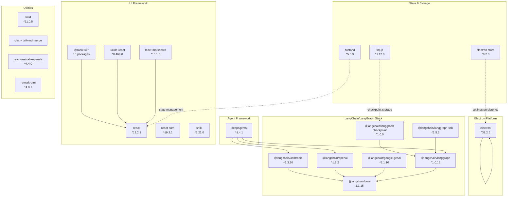
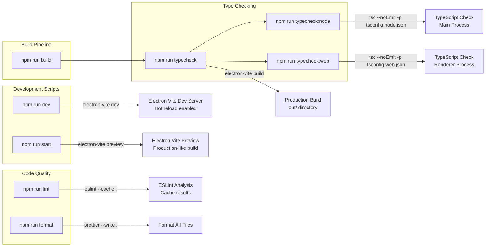
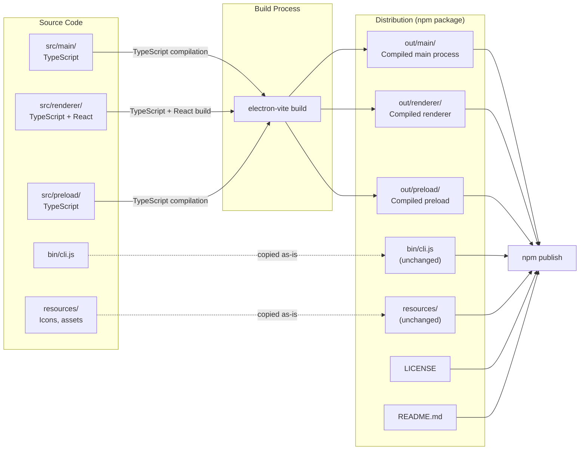
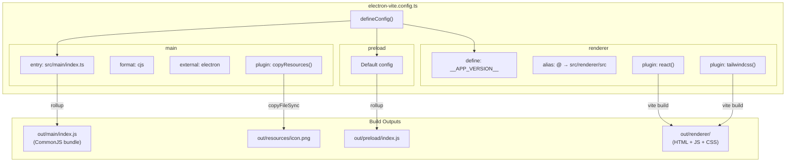
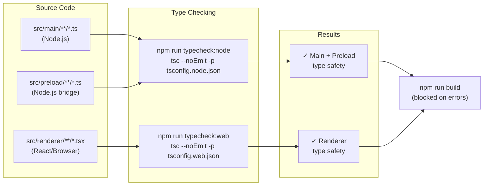

<!-- source: DeepWiki mcp.deepwiki.com · repo langchain-ai/openwork · page 8.1 Project Setup and Configuration · fetched 2026-10-26 -->

# Project Setup and Configuration

<details>
<summary>Relevant source files</summary>

The following files were used as context for generating this wiki page:

- [electron.vite.config.ts](electron.vite.config.ts)
- [package-lock.json](package-lock.json)
- [package.json](package.json)
- [src/renderer/src/components/chat/ApiKeyDialog.tsx](src/renderer/src/components/chat/ApiKeyDialog.tsx)
- [src/renderer/src/components/panels/RightPanel.tsx](src/renderer/src/components/panels/RightPanel.tsx)
- [src/renderer/src/components/panels/TodoPanel.tsx](src/renderer/src/components/panels/TodoPanel.tsx)

</details>


## Purpose and Scope

This document covers the `package.json` configuration, project dependencies, npm scripts, and development environment requirements for OpenWork. It explains how the project is structured for development and distribution, including runtime dependencies, build tooling, and script workflows.

For information about running the application and command-line entry points, see [CLI and Application Entry Points](#8.2). For build automation and CI/CD, see [Build and Release Pipeline](#8.3).

---

## Package Metadata

OpenWork is published as an npm package with the identifier `openwork`. The package configuration defines core metadata used by npm, GitHub, and the Electron application itself.

| Property | Value | Purpose |
|----------|-------|---------|
| `name` | `"openwork"` | Package identifier for npm registry |
| `version` | `"0.1.0"` | Semantic version number |
| `description` | `"A tactical agent interface for deepagentsjs"` | One-line description of the application |
| `author` | `"LangChain"` | Package author/maintainer |
| `license` | `"MIT"` | Open source license type |
| `homepage` | `https://github.com/langchain-ai/openwork` | Project website/documentation |
| `repository.url` | `git+https://github.com/langchain-ai/openwork.git` | Git repository location |
| `bugs.url` | `https://github.com/langchain-ai/openwork/issues` | Issue tracking URL |

The `keywords` array [package.json:26-34]() enables discovery on npm:
```json
["ai", "agent", "electron", "deepagents", "langchain", "langgraph", "desktop"]
```

**Sources:** [package.json:1-34]()

---

## Node.js Version Requirements

OpenWork requires Node.js version 18 or higher, specified in the `engines` field [package.json:35-37]():

```json
"engines": {
  "node": ">=18"
}
```

This requirement ensures compatibility with:
- Modern JavaScript features (ES2022+)
- Electron 39.x internal Node.js version
- LangChain SDK async/await patterns
- Native module compatibility

**Sources:** [package.json:35-37]()

---

## Package Manager Configuration

OpenWork uses **pnpm** (version 10.28.0) as its package manager, with the configuration locked via the `packageManager` field [package.json:107]():

```json
"packageManager": "pnpm@10.28.0+sha512.05df71d1421f21399e053fde567cea34d446fa02c76571441bfc1c7956e98e363088982d940465fd34480d4d90a0668bc12362f8aa88000a64e83d0b0e47be48"
```

This ensures:
- Consistent dependency resolution across development environments
- Faster installation via pnpm's content-addressable store
- Strict lockfile enforcement with SHA-512 integrity hash

Developers must have pnpm installed or use Corepack to automatically use the correct version.

**Sources:** [package.json:107]()

---

## Runtime Dependencies

### Dependency Architecture

The following diagram shows how runtime dependencies are organized by functional category:



**Sources:** [package.json:48-83]()

### Key Dependencies by Category

#### Electron Platform
- **`electron`** (^39.2.6): Desktop application runtime, provides Node.js and Chromium integration

#### LangChain/LangGraph Stack
- **`@langchain/core`** (1.1.16): Core abstractions for LLM interactions
- **`@langchain/langgraph`** (^1.0.15): State graph orchestration framework for agents
- **`@langchain/langgraph-checkpoint`** (^1.0.0): State persistence and checkpointing
- **`@langchain/langgraph-sdk`** (^1.5.3): Client SDK for LangGraph streaming
- **`@langchain/anthropic`** (^1.3.11): Claude model integration
- **`@langchain/openai`** (^1.2.3): GPT model integration
- **`@langchain/google-genai`** (^2.1.12): Gemini model integration

#### Agent Framework
- **`deepagents`** (^1.5.1): Core agent framework providing `DeepAgent` class, `LocalSandbox`, and file tools

#### UI Framework (React Ecosystem)
- **`react`** (^19.2.1) / **`react-dom`** (^19.2.1): UI rendering library
- **`@radix-ui/*`** (15 packages): Unstyled, accessible UI primitives including:
  - `react-context-menu`, `react-dialog`, `react-dropdown-menu`
  - `react-label`, `react-popover`, `react-progress`
  - `react-scroll-area`, `react-select`, `react-separator`
  - `react-slot`, `react-switch`, `react-tabs`, `react-tooltip`
- **`lucide-react`** (^0.469.0): Icon library
- **`react-markdown`** (^10.1.0): Markdown rendering in chat messages
- **`remark-gfm`** (^4.0.1): GitHub Flavored Markdown support
- **`shiki`** (^3.21.0): Syntax highlighting for code blocks
- **`react-resizable-panels`** (^4.4.0): Resizable panel layout system

#### State & Storage
- **`zustand`** (^5.0.3): Global state management store (`useAppStore`)
- **`electron-store`** (^8.2.0): Persistent settings storage (default model, workspace path)
- **`sql.js`** (^1.12.0): In-memory SQLite for LangGraph checkpoints

#### Utilities
- **`uuid`** (^11.0.5): Thread ID generation
- **`clsx`** (^2.1.1) / **`tailwind-merge`** (^2.6.0): Conditional className composition
- **`class-variance-authority`** (^0.7.1): Component variant styling

**Sources:** [package.json:48-83]()

---

## Development Dependencies

Development dependencies provide tooling for TypeScript compilation, linting, formatting, and Electron build processes:

### TypeScript Toolchain
| Package | Version | Purpose |
|---------|---------|---------|
| `typescript` | ^5.9.3 | TypeScript compiler |
| `@electron-toolkit/tsconfig` | ^2.0.0 | Base TypeScript configurations for Electron projects |
| `@types/node` | ^22.19.1 | Node.js type definitions |
| `@types/react` | ^19.2.7 | React type definitions |
| `@types/react-dom` | ^19.2.3 | React DOM type definitions |
| `@types/uuid` | ^10.0.0 | UUID library type definitions |

### Build Tooling
| Package | Version | Purpose |
|---------|---------|---------|
| `electron-vite` | ^5.0.0 | Vite-based build system optimized for Electron |
| `vite` | ^7.2.6 | Build tool and dev server |
| `@vitejs/plugin-react` | ^5.1.1 | React Fast Refresh and JSX transformation |
| `@tailwindcss/vite` | ^4.0.0 | Tailwind CSS integration via Vite |
| `tailwindcss` | ^4.0.0 | Utility-first CSS framework |

### Code Quality Tools
| Package | Version | Purpose |
|---------|---------|---------|
| `eslint` | ^9.39.1 | JavaScript/TypeScript linter |
| `@electron-toolkit/eslint-config-ts` | ^3.1.0 | Electron-specific ESLint rules for TypeScript |
| `@electron-toolkit/eslint-config-prettier` | ^3.0.0 | Prettier integration for ESLint |
| `eslint-plugin-react` | ^7.37.5 | React-specific linting rules |
| `eslint-plugin-react-hooks` | ^7.0.1 | Enforce React Hooks rules |
| `eslint-plugin-react-refresh` | ^0.4.24 | React Fast Refresh compatibility checks |
| `prettier` | ^3.7.4 | Code formatter |

**Sources:** [package.json:84-106]()

---

## npm Scripts

### Script Workflow Diagram



**Sources:** [package.json:38-46]()

### Script Definitions

#### Development Scripts
- **`npm run dev`** [package.json:45]()
  - Command: `electron-vite dev`
  - Starts development server with hot module replacement (HMR)
  - Launches Electron app in development mode
  - Watches for file changes and automatically recompiles

- **`npm run start`** [package.json:44]()
  - Command: `electron-vite preview`
  - Builds and previews production-like build without full optimization
  - Useful for testing production behavior without creating distributable

#### Type Checking Scripts
- **`npm run typecheck`** [package.json:43]()
  - Command: `npm run typecheck:node && npm run typecheck:web`
  - Runs both Node.js and web type checks sequentially
  - **Required** before production builds

- **`npm run typecheck:node`** [package.json:41]()
  - Command: `tsc --noEmit -p tsconfig.node.json --composite false`
  - Type checks main process code (Node.js environment)
  - Uses [tsconfig.node.json]() configuration
  - `--noEmit` prevents file generation (check only)
  - `--composite false` disables project references for standalone checking

- **`npm run typecheck:web`** [package.json:42]()
  - Command: `tsc --noEmit -p tsconfig.web.json --composite false`
  - Type checks renderer process code (browser environment)
  - Uses [tsconfig.web.json]() configuration

#### Code Quality Scripts
- **`npm run lint`** [package.json:40]()
  - Command: `eslint --cache .`
  - Lints all JavaScript/TypeScript files
  - Uses ESLint cache (`.eslintcache`) to speed up subsequent runs
  - Catches common code issues and enforces style rules

- **`npm run format`** [package.json:39]()
  - Command: `prettier --write .`
  - Formats all files according to Prettier configuration
  - Modifies files in-place to match style rules

#### Build Script
- **`npm run build`** [package.json:46]()
  - Command: `npm run typecheck && electron-vite build`
  - **Production build pipeline:**
    1. Runs `typecheck` (fails if type errors exist)
    2. Runs `electron-vite build` to compile production-optimized code
  - Output directory: `out/` [package.json:7]()
  - Creates minified, optimized bundles for distribution

**Sources:** [package.json:38-46]()

---

## Entry Points and File Distribution

### Application Entry Points

OpenWork defines two primary entry points:

#### Main Process Entry Point
- **Field:** `main` [package.json:5]()
- **Value:** `"./out/main/index.js"`
- **Purpose:** Electron's main process entry point (Node.js environment)
- **Runtime:** Runs when Electron application launches
- **Responsibilities:** IPC handlers, agent runtime, database access, file system operations

#### CLI Entry Point
- **Field:** `bin` [package.json:13-15]()
- **Value:** `{ "openwork": "./bin/cli.js" }`
- **Purpose:** Command-line executable installed via npm
- **Usage:** Users run `npx openwork` or globally installed `openwork` command
- **Functionality:** Spawns Electron process with proper environment setup
- For detailed information about CLI implementation, see [CLI and Application Entry Points](#8.2)

### Distributed Files

The `files` array [package.json:6-12]() specifies which files/directories are included when the package is published to npm:

```json
"files": [
  "out/",
  "bin/",
  "resources/",
  "LICENSE",
  "README.md"
]
```

#### File Distribution Mapping



**Directory Purposes:**

| Directory | Purpose | Build Status |
|-----------|---------|--------------|
| `out/` | Compiled JavaScript output from TypeScript source | Generated by `electron-vite build` |
| `bin/` | CLI entry point script | Included as-is (already JavaScript) |
| `resources/` | Application icons, images, and static assets | Included as-is |
| `LICENSE` | MIT license text | Included as-is |
| `README.md` | Project documentation | Included as-is |

**Important:** The `src/` directory is **not** included in npm distributions. Only the compiled `out/` directory is distributed, ensuring package size efficiency and preventing source code exposure.

**Sources:** [package.json:5-15]()

---

## Build Configuration (electron-vite.config.ts)

### Overview

The `electron-vite.config.ts` file configures how the application is built for different Electron processes. It uses `electron-vite` (a Vite-based build tool optimized for Electron) to bundle the main process, preload script, and renderer process separately.

**Build Configuration Architecture:**



**Sources:** [electron.vite.config.ts:1-56]()

### Main Process Configuration

The main process configuration [electron.vite.config.ts:29-40]() specifies how the Node.js backend is built:

```typescript
main: {
  build: {
    lib: {
      entry: "src/main/index.ts",
      formats: ["cjs"]
    },
    rollupOptions: {
      external: ["electron"],
      plugins: [copyResources()]
    }
  }
}
```

**Key Settings:**

| Setting | Value | Purpose |
|---------|-------|---------|
| `entry` | `"src/main/index.ts"` | Main process entry point |
| `formats` | `["cjs"]` | Output as CommonJS (required by Electron) |
| `external` | `["electron"]` | Don't bundle `electron` module (provided by runtime) |
| `plugins` | `[copyResources()]` | Custom plugin to copy icon assets |

**Custom `copyResources()` Plugin:**

The `copyResources()` function [electron.vite.config.ts:10-26]() is a custom Vite plugin that copies application icons to the output directory:

```typescript
function copyResources() {
  return {
    name: "copy-resources",
    closeBundle() {
      const srcIcon = resolve("resources/icon.png")
      const destDir = resolve("out/resources")
      const destIcon = resolve("out/resources/icon.png")
      
      if (existsSync(srcIcon)) {
        if (!existsSync(destDir)) {
          mkdirSync(destDir, { recursive: true })
        }
        copyFileSync(srcIcon, destIcon)
      }
    }
  }
}
```

This ensures `resources/icon.png` is available in the built application for the system tray icon and window icons.

**Sources:** [electron.vite.config.ts:10-40]()

### Preload Script Configuration

The preload script uses default configuration [electron.vite.config.ts:42]():

```typescript
preload: {}
```

Electron Vite automatically configures the preload script with:
- Entry point: `src/preload/index.ts`
- Output: `out/preload/index.js`
- Context isolation-compatible bundling
- No Node.js polyfills (native Node.js APIs available)

**Sources:** [electron.vite.config.ts:42]()

### Renderer Process Configuration

The renderer process configuration [electron.vite.config.ts:43-54]() sets up the React-based UI build:

```typescript
renderer: {
  define: {
    __APP_VERSION__: JSON.stringify(pkg.version)
  },
  resolve: {
    alias: {
      "@": resolve("src/renderer/src"),
      "@renderer": resolve("src/renderer/src")
    }
  },
  plugins: [react(), tailwindcss()]
}
```

**Key Settings:**

| Setting | Purpose |
|---------|---------|
| `define.__APP_VERSION__` | Injects package version as compile-time constant |
| `alias."@"` | Enables `@/` imports to resolve to `src/renderer/src` |
| `alias."@renderer"` | Alternative alias for renderer source |
| `plugins.react()` | Enables React Fast Refresh and JSX transformation |
| `plugins.tailwindcss()` | Integrates Tailwind CSS processing via Vite |

**Import Alias Example:**

With the `@` alias configured, renderer code can import with short paths:

```typescript
// Instead of:
import { useAppStore } from "../../../lib/store"

// Use:
import { useAppStore } from "@/lib/store"
```

**Version Injection:**

The `__APP_VERSION__` constant [electron.vite.config.ts:7,45]() is derived from `package.json` and can be accessed in renderer code:

```typescript
declare const __APP_VERSION__: string
console.log(`OpenWork version: ${__APP_VERSION__}`)
```

**Sources:** [electron.vite.config.ts:1-56]()

---

## TypeScript Configuration

OpenWork uses separate TypeScript configurations for different Electron processes, specified via the `typecheck:node` and `typecheck:web` scripts [package.json:41-42]().

### Configuration Files

| File | Purpose | Environment |
|------|---------|-------------|
| `tsconfig.node.json` | Main process and Node.js utilities | Node.js 18+ |
| `tsconfig.web.json` | Renderer process and React components | Browser (Chromium) |

### Type Checking Workflow



**Sources:** [package.json:41-43]()

### Base Configuration

Both configurations extend `@electron-toolkit/tsconfig`, which provides baseline settings optimized for Electron projects [package.json:88]():

- ES2022 target for modern JavaScript features
- Module resolution: `node16` or `bundler`
- Strict type checking enabled
- Declaration generation disabled (runtime code only)

### Node.js Configuration (tsconfig.node.json)

Expected settings for main process and preload scripts:

```json
{
  "extends": "@electron-toolkit/tsconfig/node.json",
  "compilerOptions": {
    "composite": false,
    "types": ["node"]
  },
  "include": [
    "src/main/**/*",
    "src/preload/**/*",
    "electron.vite.config.ts"
  ]
}
```

**Key aspects:**
- `types: ["node"]`: Node.js built-in module types (fs, path, etc.)
- Includes main process, preload script, and build configuration
- No DOM types (server-side only)

### Web Configuration (tsconfig.web.json)

Expected settings for renderer process:

```json
{
  "extends": "@electron-toolkit/tsconfig/web.json",
  "compilerOptions": {
    "composite": false,
    "baseUrl": ".",
    "paths": {
      "@/*": ["src/renderer/src/*"],
      "@renderer/*": ["src/renderer/src/*"]
    },
    "types": ["vite/client"],
    "jsx": "react-jsx"
  },
  "include": ["src/renderer/**/*"]
}
```

**Key aspects:**
- `jsx: "react-jsx"`: Modern JSX transform (no `import React` needed)
- `types: ["vite/client"]`: Vite-specific types for HMR and imports
- Path aliases match `electron.vite.config.ts` resolver
- Includes DOM types (browser environment)

**Sources:** [package.json:41-42](), [electron.vite.config.ts:48-51]()

### Type Checking Commands

**Check All Code:**
```bash
npm run typecheck
```
Runs both `typecheck:node` and `typecheck:web` sequentially. This is executed automatically before production builds.

**Check Main Process Only:**
```bash
npm run typecheck:node
```
Validates TypeScript in `src/main/` and `src/preload/` against Node.js types.

**Check Renderer Only:**
```bash
npm run typecheck:web
```
Validates TypeScript in `src/renderer/` against browser/React types.

**Sources:** [package.json:41-43]()

---

## Development Environment Setup

### Quick Start

1. **Install pnpm** (if not already installed):
   ```bash
   npm install -g pnpm
   # or use corepack
   corepack enable
   ```

2. **Clone repository and install dependencies:**
   ```bash
   git clone https://github.com/langchain-ai/openwork.git
   cd openwork
   pnpm install
   ```

3. **Run development server:**
   ```bash
   pnpm dev
   ```

### Configuration Files

The project uses several configuration files (referenced but not shown in provided files):
- `tsconfig.node.json`: TypeScript configuration for main process (Node.js environment)
- `tsconfig.web.json`: TypeScript configuration for renderer process (web environment)
- `.prettierrc` or `prettier.config.js`: Prettier formatting rules
- `.eslintrc` or `eslint.config.js`: ESLint linting rules
- `electron-vite.config.ts`: Electron Vite build configuration

**Sources:** [package.json:1-108]()

---

