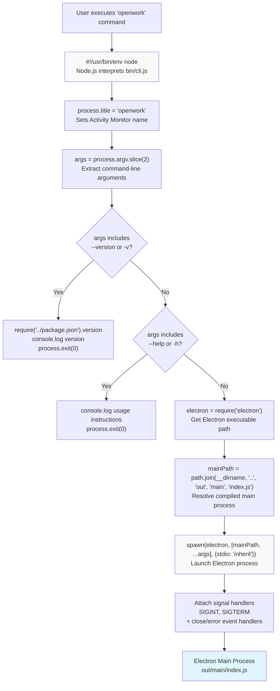
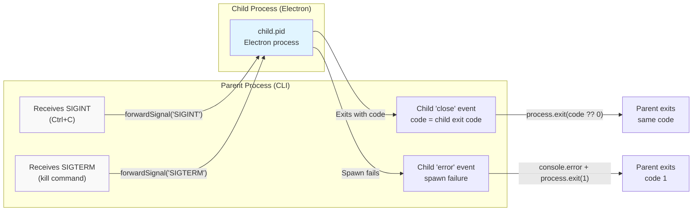
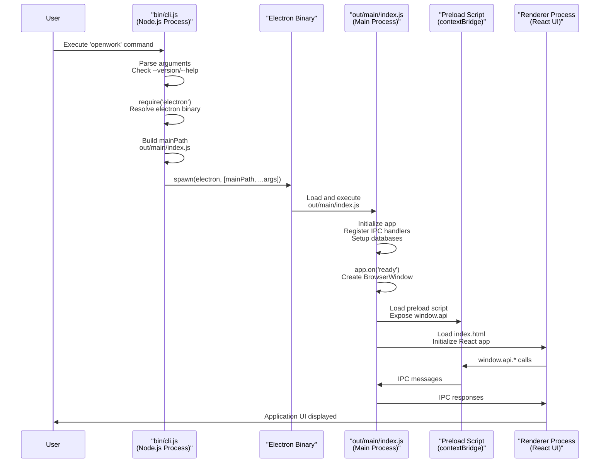

<!-- source: DeepWiki mcp.deepwiki.com · repo langchain-ai/openwork · page 8.2 CLI and Application Entry Points · fetched 2026-10-26 -->

# CLI and Application Entry Points

<details>
<summary>Relevant source files</summary>

The following files were used as context for generating this wiki page:

- [.github/workflows/release.yml](.github/workflows/release.yml)
- [bin/cli.js](bin/cli.js)
- [src/main/index.ts](src/main/index.ts)
- [src/renderer/index.html](src/renderer/index.html)

</details>


## Purpose and Scope

This document explains how OpenWork is launched from the command line and how the application entry points are structured. It covers the `bin/cli.js` script, command-line argument handling, Electron process spawning, and the initialization sequence from CLI invocation to application startup.

For information about the Electron process model after initialization, see [Electron Process Model](#2.1). For build and release processes that package these entry points, see [Build and Release Pipeline](#8.3).

## Overview

OpenWork uses a CLI wrapper script at `bin/cli.js` that serves as the primary entry point for the application. This script is configured as a Node.js executable via the shebang line and is registered in `package.json` as the `bin` entry point. When users run the `openwork` command, this script spawns an Electron process with the compiled main process code.

The entry point architecture follows a two-stage initialization pattern:

1. **CLI Layer** (`bin/cli.js`): Handles command-line arguments, version/help display, and Electron process spawning
2. **Main Process Layer** (`out/main/index.js`): Electron's main process that initializes windows, IPC handlers, and the application runtime

Sources: [bin/cli.js:1-64]()

## CLI Script Architecture



**CLI Script Execution Flow**

The CLI script executes through a series of validation and initialization steps before spawning the Electron process.

Sources: [bin/cli.js:1-64]()

## Process Configuration and Identity

The CLI script sets the process title to `'openwork'` immediately upon execution [bin/cli.js:11](). This title appears in system process managers like Activity Monitor on macOS or Task Manager on Windows, making it easy to identify the running application.

The script is marked as executable through the shebang line `#!/usr/bin/env node` [bin/cli.js:1](), which instructs the operating system to use the Node.js interpreter. The `package.json` configuration maps the `openwork` command to this script via the `bin` field.

Sources: [bin/cli.js:1-11]()

## Command-Line Argument Handling

The script supports three invocation modes, determined by inspecting command-line arguments:

| Argument | Aliases | Behavior | Exit Code |
|----------|---------|----------|-----------|
| `--version` | `-v` | Prints application version from `package.json` | 0 |
| `--help` | `-h` | Displays usage instructions | 0 |
| (none) | | Spawns Electron application | Inherited from child |

### Version Display

When the user passes `--version` or `-v`, the script reads the version string from `package.json` and prints it in the format `openwork v{version}` [bin/cli.js:16-20]():

```javascript
if (args.includes('--version') || args.includes('-v')) {
  const { version } = require('../package.json')
  console.log(`openwork v${version}`)
  process.exit(0)
}
```

### Help Display

The `--help` or `-h` flag triggers display of a usage message that describes the available commands [bin/cli.js:23-33]():

```
openwork - A tactical agent interface for deepagentsjs

Usage:
  openwork              Launch the application
  openwork --version    Show version
  openwork --help       Show this help
```

Sources: [bin/cli.js:13-33]()

## Electron Process Spawning

If no help or version flags are present, the script proceeds to spawn the Electron application. This involves three key operations:

### 1. Electron Executable Resolution

The script uses `require('electron')` to obtain the path to the Electron binary [bin/cli.js:36](). The `electron` package provides the executable as its main export when required in Node.js.

### 2. Main Process Path Construction

The script constructs the path to the compiled main process using `path.join(__dirname, '..', 'out', 'main', 'index.js')` [bin/cli.js:39](). This resolves to the TypeScript-compiled JavaScript output from the build process.

**Path Resolution:**
- `__dirname` points to `bin/`
- `..` navigates to repository root
- `out/main/index.js` is the compiled Electron main process entry point

### 3. Child Process Creation

The script spawns Electron using Node.js's `child_process.spawn()` [bin/cli.js:41-43]():

```javascript
const child = spawn(electron, [mainPath, ...args], {
  stdio: 'inherit'
})
```

Key configuration:
- **First argument** (`electron`): Path to Electron executable
- **Second argument** (`[mainPath, ...args]`): Array with main process path followed by any user-provided CLI arguments
- **`stdio: 'inherit'`**: Connects child process stdin/stdout/stderr to parent process, enabling console output visibility

Sources: [bin/cli.js:36-43]()

## Signal Handling and Process Management

The CLI script establishes robust process lifecycle management to ensure clean shutdown and proper exit code propagation.



**Signal Forwarding and Exit Code Propagation**

### Signal Forwarding

The script forwards `SIGINT` (Ctrl+C) and `SIGTERM` signals from the parent process to the Electron child process [bin/cli.js:46-53]():

```javascript
function forwardSignal(signal) {
  if (child.pid) {
    process.kill(child.pid, signal)
  }
}

process.on('SIGINT', () => forwardSignal('SIGINT'))
process.on('SIGTERM', () => forwardSignal('SIGTERM'))
```

This ensures that when a user presses Ctrl+C or sends a termination signal, the Electron application receives it and can perform graceful shutdown.

### Exit Code Propagation

The script listens to the child process's `close` event and exits with the same code [bin/cli.js:56-58]():

```javascript
child.on('close', (code) => {
  process.exit(code ?? 0)
})
```

If `code` is `null` (rare edge case), the script defaults to exit code `0`.

### Spawn Error Handling

If Electron fails to spawn (e.g., corrupt installation, missing dependencies), the script catches the error and exits with code `1` [bin/cli.js:60-63]():

```javascript
child.on('error', (err) => {
  console.error('Failed to start openwork:', err.message)
  process.exit(1)
})
```

Sources: [bin/cli.js:46-63]()

## Application Initialization Sequence

Once the Electron process spawns successfully, execution transitions from the CLI layer to the Electron application layers.



**End-to-End Initialization Sequence**

### Stage 1: CLI Execution
1. User runs `openwork` command
2. Node.js executes `bin/cli.js` via shebang
3. Script validates arguments and resolves Electron binary path
4. Script spawns Electron process with `out/main/index.js` as entry point

### Stage 2: Main Process Initialization
Once Electron starts:
1. Loads and executes `out/main/index.js` (compiled from TypeScript source)
2. Initializes IPC handlers for threads, models, workspace, and agent operations
3. Connects to SQLite databases for threads and LangGraph checkpoints
4. Waits for Electron's `ready` event

### Stage 3: Window and Renderer Creation
After Electron is ready:
1. Main process creates `BrowserWindow` with preload script configuration
2. Preload script executes in isolated context, exposing `window.api` via `contextBridge`
3. Main process loads `index.html` which bootstraps the React application
4. Renderer process initializes Zustand store and React component tree

### Stage 4: Application Ready
1. React UI renders (ThreadSidebar, ChatContainer, RightPanel components)
2. UI makes initial IPC calls to populate threads, models, and workspace state
3. Application is fully operational and responsive to user input

For detailed information about the IPC communication established during initialization, see [IPC Communication System](#2.2). For details on the state management initialized in the renderer, see [Global State Management](#2.3).

Sources: [bin/cli.js:1-64]()

## Summary Table: CLI Script Components

| Component | Location | Purpose |
|-----------|----------|---------|
| Shebang line | [bin/cli.js:1]() | Makes script executable via Node.js |
| Process title | [bin/cli.js:11]() | Sets process name to `'openwork'` for system monitors |
| Argument parser | [bin/cli.js:13]() | Extracts command-line arguments using `process.argv.slice(2)` |
| Version handler | [bin/cli.js:16-20]() | Prints version from `package.json` on `--version` flag |
| Help handler | [bin/cli.js:23-33]() | Displays usage instructions on `--help` flag |
| Electron resolver | [bin/cli.js:36]() | Resolves Electron binary path via `require('electron')` |
| Main path builder | [bin/cli.js:39]() | Constructs path to `out/main/index.js` |
| Process spawner | [bin/cli.js:41-43]() | Spawns Electron child process with `stdio: 'inherit'` |
| Signal forwarder | [bin/cli.js:46-53]() | Forwards SIGINT/SIGTERM to child process |
| Exit handler | [bin/cli.js:56-58]() | Exits parent with same code as child |
| Error handler | [bin/cli.js:60-63]() | Catches spawn failures and exits with code 1 |

Sources: [bin/cli.js:1-64]()

---

