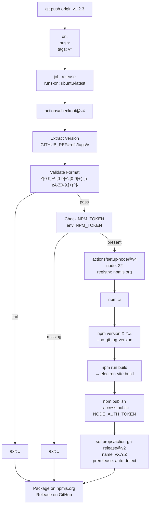
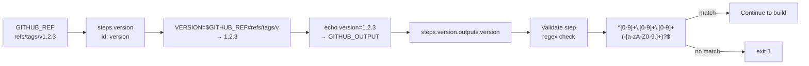
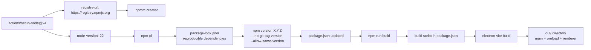
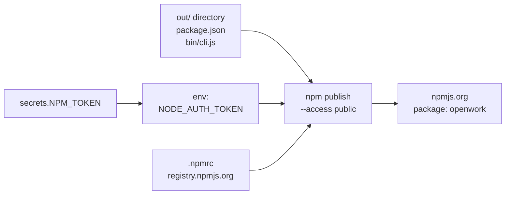
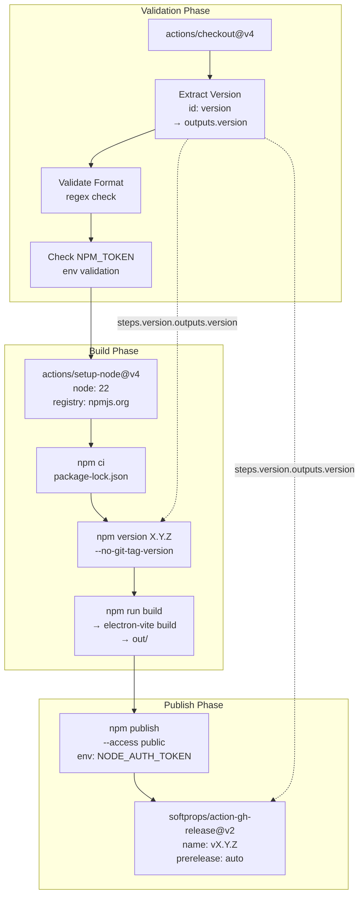
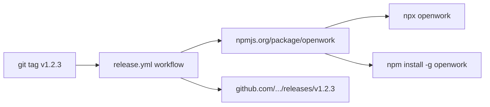

<!-- source: DeepWiki mcp.deepwiki.com · repo langchain-ai/openwork · page 8.3 Build and Release Pipeline · fetched 2026-10-26 -->

# Build and Release Pipeline

<details>
<summary>Relevant source files</summary>

The following files were used as context for generating this wiki page:

- [.github/workflows/release.yml](.github/workflows/release.yml)
- [README.md](README.md)
- [src/renderer/index.html](src/renderer/index.html)

</details>


The release pipeline automates version management, building, npm publishing, and GitHub release creation via GitHub Actions. Triggered by version tags matching `v*.*.*` pattern.

References [Project Setup and Configuration](#8.1) for `package.json` scripts and [CLI and Application Entry Points](#8.2) for the published CLI wrapper.

**Sources:** [.github/workflows/release.yml:1-100]()

---

## Pipeline Architecture

The pipeline is triggered by git tags matching `v*` and executes in `.github/workflows/release.yml`. The workflow validates version format, builds using `electron-vite build`, publishes to npm registry, and creates GitHub releases.

### Complete Pipeline Flow



**Sources:** [.github/workflows/release.yml:1-100]()

---

## GitHub Actions Workflow Configuration

The release workflow is defined in `.github/workflows/release.yml` and uses several GitHub Actions features to ensure reliable releases.

### Workflow Configuration

| Property | Value | Purpose |
|----------|-------|---------|
| `name` | `Release` | Workflow identifier |
| `on.push.tags` | `v*` | Trigger pattern |
| `concurrency.group` | `release` | Mutex for releases |
| `concurrency.cancel-in-progress` | `false` | Queue instead of cancel |
| `permissions.contents` | `write` | GitHub release creation |
| `runs-on` | `ubuntu-latest` | Runner OS |

The `concurrency.group: release` with `cancel-in-progress: false` creates a mutex. Simultaneous tag pushes queue rather than cancel the active job.

**Sources:** [.github/workflows/release.yml:9-11]()

---

## Version Extraction and Validation

The workflow performs strict validation to ensure version tags are properly formatted before proceeding with the release.

### Version Extraction and Validation



Bash parameter expansion strips `refs/tags/v`: `VERSION=${GITHUB_REF#refs/tags/v}`. Output written to `$GITHUB_OUTPUT` makes the version available as `steps.version.outputs.version` in subsequent steps.

The regex `^[0-9]+\.[0-9]+\.[0-9]+(-[a-zA-Z0-9.]+)?$` validates semver format:

| Valid | Invalid |
|-------|---------|
| `1.2.3` | `v1.2.3` (prefix) |
| `1.0.0-beta.1` | `1.2` (missing patch) |
| `2.3.4-alpha` | `1.2.3.4` (extra component) |

The workflow checks for `NPM_TOKEN` in environment before build. Missing token causes immediate `exit 1`.

**Sources:** [.github/workflows/release.yml:23-48]()

---

## Build Execution

### Build Environment Configuration



The `npm ci` command installs exact versions from `package-lock.json`. The `npm version` command updates `package.json` version field without creating git commits (`--no-git-tag-version`) and allows rerunning on same version (`--allow-same-version`).

The `npm run build` executes the `build` script from `package.json`, which invokes `electron-vite build` to compile:
- Main process (Node.js/TypeScript)
- Preload script (context bridge)
- Renderer process (React/TypeScript)

Output artifacts are written to `out/` directory. See [Project Setup and Configuration](#8.1) for build script details.

**Sources:** [.github/workflows/release.yml:50-65]()

---

## npm Publishing

After a successful build, the workflow publishes the package to the npm registry.

### npm Publishing



The `npm publish --access public` command publishes the package. Authentication uses `NODE_AUTH_TOKEN` environment variable set to `secrets.NPM_TOKEN`. The `.npmrc` file (created by `actions/setup-node@v4`) configures registry URL.

Published artifacts include:
- `out/` directory (compiled Electron bundles)
- `package.json` (with updated version)
- `bin/cli.js` (CLI entry point)

**Sources:** [.github/workflows/release.yml:50-70]()

---

## GitHub Release Creation

After npm publishing succeeds, the workflow creates a corresponding GitHub release with installation instructions and metadata.

### GitHub Release Creation

The `softprops/action-gh-release@v2` action creates GitHub releases:

| Input | Value | Logic |
|-------|-------|-------|
| `name` | `v${{ steps.version.outputs.version }}` | Release title |
| `body` | Markdown template | Installation instructions |
| `draft` | `false` | Publish immediately |
| `prerelease` | `${{ contains(steps.version.outputs.version, '-') }}` | Detects `-beta`, `-alpha`, etc. |

The `prerelease` field uses `contains()` to detect hyphens: `1.2.3-beta.1` → `true`, `1.2.3` → `false`.

Release body template:

```markdown
## openwork v{version}

### Installation

npx openwork
# or
npm install -g openwork
openwork

Requires Node.js 18+. Electron is installed automatically.

### Links
- Documentation: github.com/langchain-ai/openwork
- npm package: npmjs.com/package/openwork
```

The release references the CLI wrapper at `bin/cli.js` (see [CLI and Application Entry Points](#8.2)).

**Sources:** [.github/workflows/release.yml:72-99]()

---

## Step Dependency Graph



**Sources:** [.github/workflows/release.yml:20-99]()

---

## Release Trigger Mechanism

### Tag Creation Methods

```bash
# Method 1: npm version (updates package.json + creates tag)
npm version patch  # or minor, major
git push --follow-tags

# Method 2: Manual tag creation
git tag v1.2.3
git push origin v1.2.3
```

### Tag Pattern Matching

The workflow trigger uses `on.push.tags: v*`:

| Pattern | Matches |
|---------|---------|
| `v*` | `v1.0.0`, `v2.3.4-beta`, `v1.0.0-alpha.1` |
| Does not match | `1.0.0` (no `v`), `release-1.0` (wrong prefix) |

### Release Output Artifacts



Successful releases create:
- npm package at `npmjs.org/package/openwork`
- GitHub release at repository `/releases` page
- Git tag in repository history

Monitor via GitHub Actions tab → Release workflow.

**Sources:** [.github/workflows/release.yml:3-6]()

---

## Error Handling and Failure Scenarios

The workflow includes several validation gates that cause early failure if conditions are not met.

### Error Conditions and Exit Codes

| Failure Step | Condition | Exit Code | Output |
|--------------|-----------|-----------|--------|
| Validate Format | `$VERSION` doesn't match regex | 1 | `Invalid version format: $VERSION` |
| Validate Secrets | `$NPM_TOKEN` is empty | 1 | `::error::Missing required secret: NPM_TOKEN` |
| Build | `electron-vite build` fails | Non-zero | TypeScript/build errors |
| Publish | Package exists or auth fails | Non-zero | npm error output |
| Release | No `contents: write` permission | Non-zero | GitHub API error |

Validation scripts:

```bash
# Version format check
if [[ ! "$VERSION" =~ ^[0-9]+\.[0-9]+\.[0-9]+(-[a-zA-Z0-9.]+)?$ ]]; then
  exit 1
fi

# Secret check
if [ -z "$NPM_TOKEN" ]; then
  exit 1
fi
```

**Sources:** [.github/workflows/release.yml:30-48]()

---

## Security Considerations

The release pipeline handles sensitive credentials and requires proper security configuration.

### Secret Management

- **NPM_TOKEN:** Stored as a GitHub repository secret [.github/workflows/release.yml:48]()
  - Required for publishing to npm registry
  - Should have publish permissions for the `openwork` package
  - Exposed as `NODE_AUTH_TOKEN` environment variable only in the publish step [.github/workflows/release.yml:70]()

- **GITHUB_TOKEN:** Automatically provided by GitHub Actions [.github/workflows/release.yml:99]()
  - Used for creating GitHub releases
  - Scoped to the workflow's `contents: write` permission [.github/workflows/release.yml:14]()

### Permission Boundaries

The workflow operates with minimal required permissions:

- **Write access:** Only `contents` (for creating releases)
- **Read access:** Implicit read access to repository code
- **No access:** Issues, pull requests, packages, or other resources

### Concurrency Protection

The concurrency configuration prevents race conditions during simultaneous tag pushes [.github/workflows/release.yml:9-11]():

```yaml
concurrency:
  group: release
  cancel-in-progress: false
```

This ensures:
- Only one release runs at a time
- Queued releases wait rather than canceling the active release
- No version conflicts in npm or GitHub releases

**Sources:** [.github/workflows/release.yml:9-14,48,70,99]()