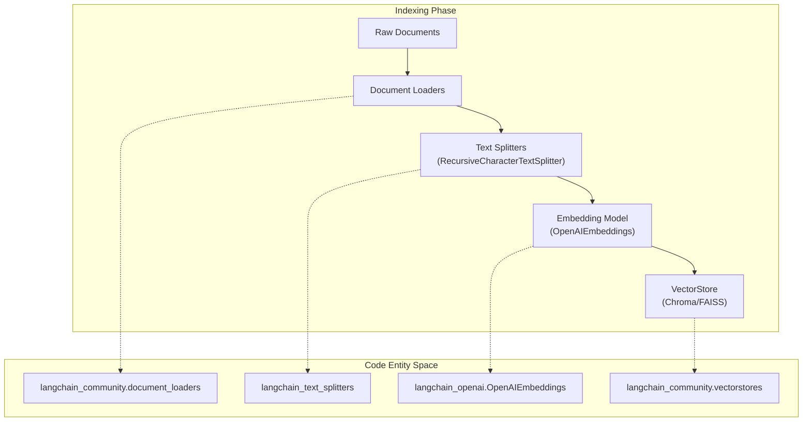
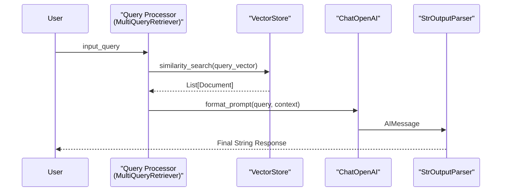

<!-- source: DeepWiki mcp.deepwiki.com · repo langchain-ai/rag-from-scratch · page 1 Overview · fetched 2026-10-26 -->

# Overview

Relevant source files

The following files were used as context for generating this wiki page:

- [README.md](README.md)

This page provides a comprehensive introduction to the RAG from Scratch repository, explaining what Retrieval-Augmented Generation (RAG) is, the purpose of the implementation, and how the notebooks are organized.

## What is RAG?

Retrieval-Augmented Generation (RAG) is a technique designed to address the limitations of Large Language Models (LLMs), which are trained on fixed datasets and often lack access to private or recent information [README.md:3-3](). While fine-tuning is an option, it is frequently ill-suited for factual recall and can be prohibitively expensive [README.md:3-3]().

RAG functions as a mechanism to expand an LLM's knowledge base by using documents retrieved from external data sources to ground the LLM's generation via in-context learning [README.md:4-4](). This approach ensures that the model can reason about information not present in its original training set.

## Repository Purpose

The `rag-from-scratch` repository is a pedagogical resource designed to build an understanding of RAG from the ground up [README.md:5-5](). It accompanies a video playlist and provides a step-by-step implementation of indexing, retrieval, and generation [README.md:5-8]().

The primary goals of this implementation are:
1. **First-Principles Understanding**: Moving beyond high-level abstractions to see how data flows through each component.
2. **Modular Learning**: Breaking down the RAG pipeline into digestible notebooks that cover specific techniques.
3. **Practical Implementation**: Providing a direct path from natural language concepts to executable Python code using the LangChain ecosystem.

### Repository Structure and Notebook Organization

The notebooks are organized to guide a developer from basic concepts to production-level refinements:

| Notebook Range | Focus Area | Key Concepts |
| :--- | :--- | :--- |
| **1 - 4** | Basic RAG | Indexing, Retrieval, and Generation basics. |
| **5 - 9** | Advanced Retrieval | Multi-query, RAG-Fusion, Decomposition, and Step-back prompting. |
| **10 - 11** | Context Management | Long-context handling and document compression. |
| **12 - 14** | Sophisticated Routing | Logical and semantic routing, Query construction. |
| **15 - 18** | Refinement & Evaluation | Corrective RAG (CRAG), Self-RAG, and Adaptive RAG. |

Sources: [README.md:1-8]()

## Core RAG Pipeline

The implementation follows a structured data flow that bridges raw documents to final LLM responses. This flow is categorized into the Indexing (Offline) and Retrieval/Generation (Online) phases.

### Natural Language to Code Mapping: Indexing

This diagram illustrates how raw information is transformed into a searchable `VectorStore`.

**Indexing Pipeline Architecture**

Sources: [README.md:5-6]()

### Natural Language to Code Mapping: Query and Generation

This diagram shows the "Online" flow where a user's question is used to retrieve context and generate a grounded answer.

**Retrieval and Generation Flow**

Sources: [README.md:5-6]()

## Key Implementation Concepts

The repository covers several critical technical areas:

*   **Indexing**: Loading data from sources like the web or local files and splitting them into manageable chunks to fit within LLM context windows.
*   **Retrieval**: Using vector similarity (e.g., cosine similarity) to fetch the most relevant chunks based on a user's query.
*   **Generation**: Constructing prompts that include the retrieved context, instructing the LLM to answer only based on the provided information to minimize hallucinations.
*   **Advanced Orchestration**: Implementing complex logic like "Self-RAG" where the model evaluates its own retrieved documents for relevance before generating an answer.

Sources: [README.md:5-6]()

---

