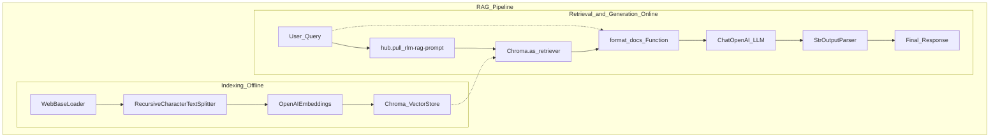
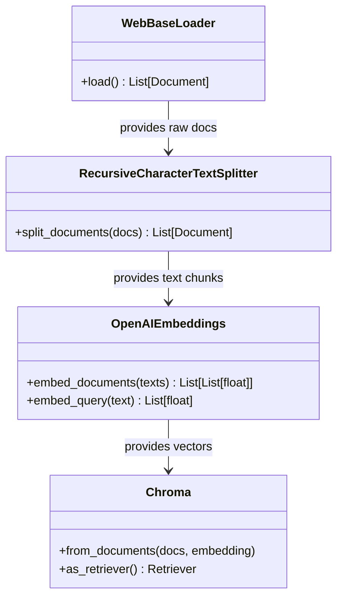
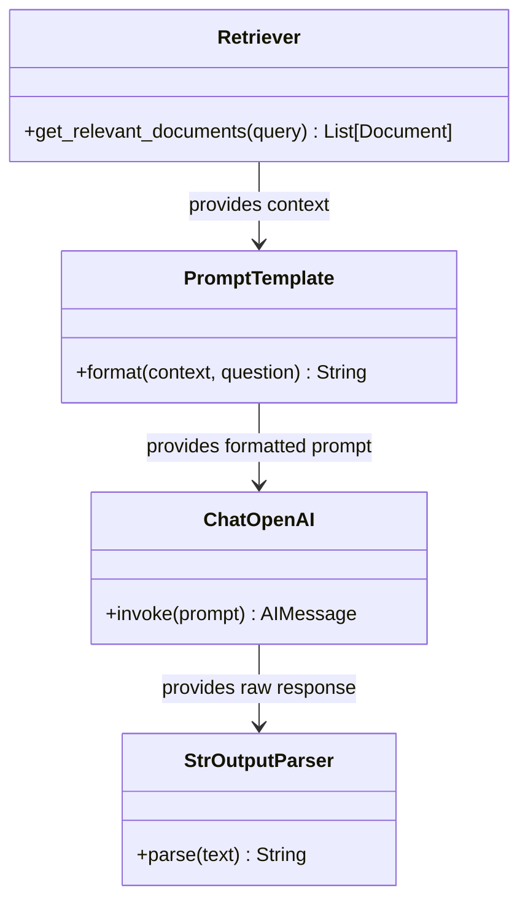
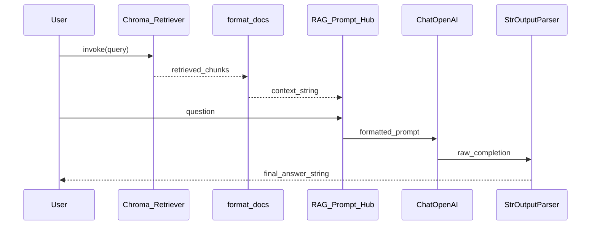

<!-- source: DeepWiki mcp.deepwiki.com · repo langchain-ai/rag-from-scratch · page 2 RAG Architecture · fetched 2026-10-26 -->

# RAG Architecture

Relevant source files

The following files were used as context for generating this wiki page:

- [README.md](README.md)
- [rag_from_scratch_1_to_4.ipynb](rag_from_scratch_1_to_4.ipynb)

## Purpose and Scope

This document provides a comprehensive technical overview of the Retrieval-Augmented Generation (RAG) architecture implemented in the `rag-from-scratch` repository. It details the core components, their interactions, and the data flow through the system as LLMs are grounded with external data sources [README.md:1-6](). For detailed implementation of specific components, see the dedicated pages on [Document Processing and Indexing](#2.1), [Retrieval Mechanisms](#2.2), and [Query Augmentation and Generation](#2.3).

## High-Level RAG Architecture

The architecture follows a modular design pattern consisting of two primary phases: offline processing (indexing) and online processing (retrieval and generation).

### Core RAG Pipeline Architecture

Sources: [rag_from_scratch_1_to_4.ipynb:42-55](), [rag_from_scratch_1_to_4.ipynb:114-125](), [rag_from_scratch_1_to_4.ipynb:206-225]()

The architecture separates concerns between document preparation and query handling:

1. **Offline Processing (Indexing)**: Documents are loaded via `WebBaseLoader`, split into chunks using `RecursiveCharacterTextSplitter`, embedded, and stored in a `Chroma` vector database [rag_from_scratch_1_to_4.ipynb:42-55]().
2. **Online Processing (Retrieval & Generation)**: Relevant chunks are fetched by a `retriever`, formatted, and passed to an LLM like `ChatOpenAI` using a specific prompt template (e.g., `rlm-rag-prompt`) [rag_from_scratch_1_to_4.ipynb:206-225]().

## Core RAG Components

### Document Processing and Indexing Components

Sources: [rag_from_scratch_1_to_4.ipynb:42-55](), [rag_from_scratch_1_to_4.ipynb:114-125]()

### Retrieval and Generation Components

Sources: [rag_from_scratch_1_to_4.ipynb:206-225]()

## RAG Data Flow

The following sequence diagram illustrates the data flow using the LCEL (LangChain Expression Language) chain implemented in the repository [rag_from_scratch_1_to_4.ipynb:218-220]():

Sources: [rag_from_scratch_1_to_4.ipynb:206-225]()

## Implementation Evolution

The RAG architecture is implemented across multiple notebooks, evolving from basic retrieval to complex multi-step reasoning:

1.  **Basic RAG (Notebooks 1-4)**: Foundation of indexing, retrieval, and generation using `Chroma` and `OpenAI` [rag_from_scratch_1_to_4.ipynb:1-5](). For details, see [Document Processing and Indexing](#2.1).
2.  **Advanced RAG (Notebooks 5-9)**: Introduction of Query Translation techniques like Multi-query, RAG-Fusion, and Decomposition. For details, see [Retrieval Mechanisms](#2.2).
3.  **Extensions (Notebooks 10-11)**: Implementation of Routing (Logical and Semantic) and Query Construction for structured data.
4.  **Refinements (Notebooks 12-14)**: Indexing optimizations like Multi-vector retrievers and ColBERT, and Re-ranking strategies. For details, see [Query Augmentation and Generation](#2.3).
5.  **Production Implementation (Notebooks 15-18)**: Advanced "Corrective RAG" (CRAG) and Self-RAG using `LangGraph` for stateful orchestration.

## Key Implementation Considerations

The RAG architecture in this repository addresses several critical implementation concerns:

1.  **Context Management**: Using `format_docs` to join document contents into a single string for the prompt [rag_from_scratch_1_to_4.ipynb:211-213]().
2.  **Modularity**: Leveraging LangChain's LCEL to pipe components like `retriever | prompt | llm | parser` [rag_from_scratch_1_to_4.ipynb:218-220]().
3.  **External Knowledge**: Mitigating LLM limitations regarding private or recent information [README.md:3-4]().

The subsequent pages will explore specific components in greater detail, including document processing ([Document Processing and Indexing](#2.1)), retrieval mechanisms ([Retrieval Mechanisms](#2.2)), and query augmentation and generation ([Query Augmentation and Generation](#2.3)).

---

