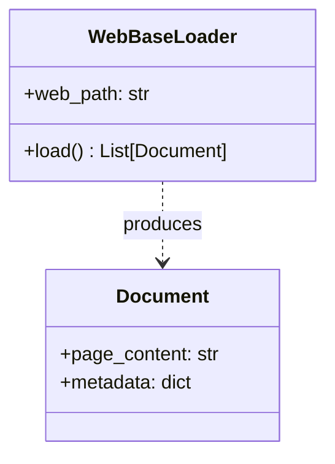
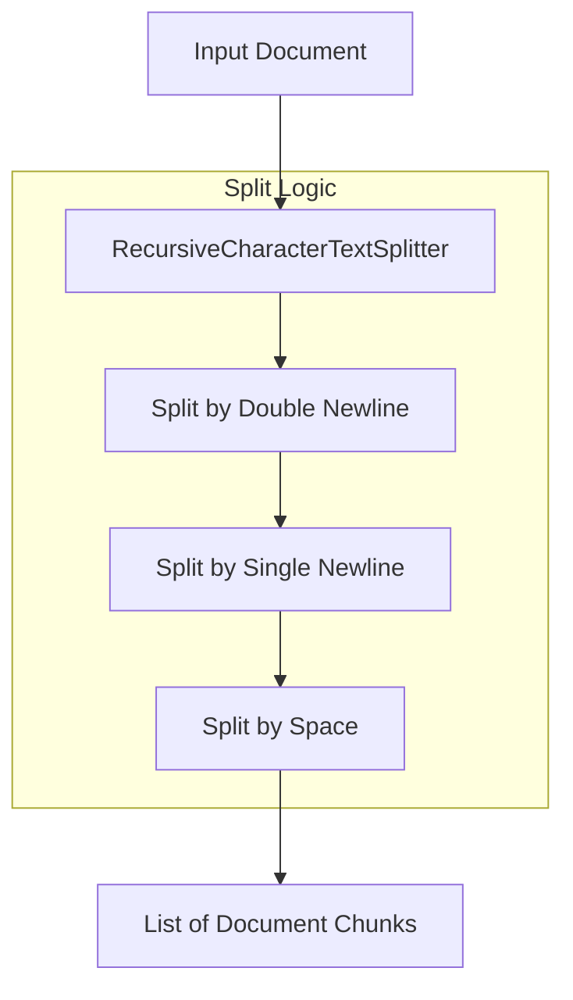
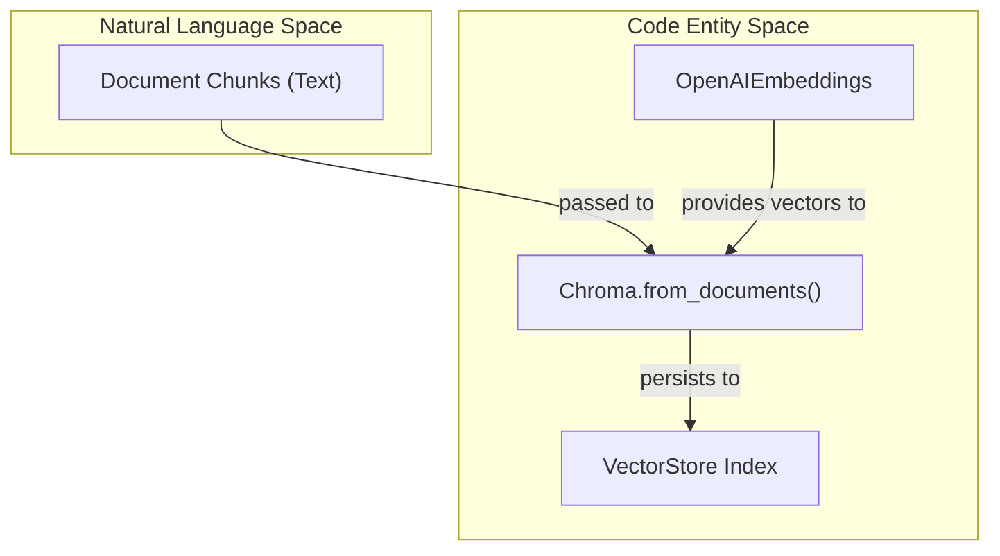
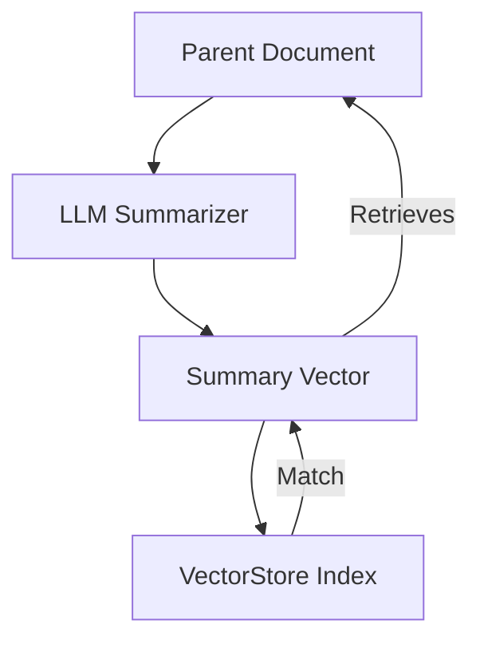

<!-- source: DeepWiki mcp.deepwiki.com · repo langchain-ai/rag-from-scratch · page 2.1 Document Processing and Indexing · fetched 2026-10-26 -->

# Document Processing and Indexing

<details>
<summary>Relevant source files</summary>

The following files were used as context for generating this wiki page:

- [rag_from_scratch_12_to_14.ipynb](rag_from_scratch_12_to_14.ipynb)
- [rag_from_scratch_1_to_4.ipynb](rag_from_scratch_1_to_4.ipynb)

</details>


Document processing and indexing form the critical foundation of any Retrieval-Augmented Generation (RAG) system. This section explains how raw documents are transformed into a format suitable for efficient retrieval. The process encompasses loading data from various sources, processing documents into manageable chunks, generating vector embeddings, and creating indices that enable fast similarity search.

This page focuses on the offline processing components of the RAG pipeline as implemented in the "RAG from Scratch" series.

## Document Processing Pipeline

The pipeline transforms raw content (e.g., web pages) into searchable vector representations. In the initial implementation, this is achieved using LangChain's orchestration components.


Sources: [rag_from_scratch_1_to_4.ipynb:55-75]()

## Data Loading

The repository primarily utilizes `WebBaseLoader` to pull content from external sources, such as blog posts. This loader handles the HTTP request and initial HTML parsing to extract text content.



In the foundational notebooks, a BeautifulSoup `WebBaseLoader` is configured to target specific CSS classes (e.g., post-content, post-title) to ensure only relevant text is ingested [rag_from_scratch_1_to_4.ipynb:55-65]().

Sources: [rag_from_scratch_1_to_4.ipynb:55-65]()

## Document Chunking

Chunking is the process of breaking down large documents into smaller pieces to fit within the context window of embedding models and LLMs. The repository uses `RecursiveCharacterTextSplitter`.

### Implementation Details
- **Chunk Size**: Defined by `chunk_size` (e.g., 300 characters) [rag_from_scratch_1_to_4.ipynb:69-70]().
- **Chunk Overlap**: Defined by `chunk_overlap` (e.g., 50 characters) to maintain semantic continuity between adjacent chunks [rag_from_scratch_1_to_4.ipynb:70-71]().
- **Recursive Strategy**: The splitter attempts to split by a list of characters (typically `["\n\n", "\n", " ", ""]`) recursively until chunks are small enough.



Sources: [rag_from_scratch_1_to_4.ipynb:67-73]()

## Embedding Generation

Once documents are split, each chunk is converted into a high-dimensional vector. This "Natural Language Space" to "Vector Space" transition is handled by the `OpenAIEmbeddings` class.

| Property | Value (Default) |
| :--- | :--- |
| **Model** | `text-embedding-3-small` |
| **Dimensions** | 1536 (typical for OpenAI) |
| **Function** | `embed_documents()` |

The embedding model maps semantic meaning to coordinates; chunks with similar meanings are positioned close to each other in the vector space [rag_from_scratch_1_to_4.ipynb:101-115]().

Sources: [rag_from_scratch_1_to_4.ipynb:75-76](), [rag_from_scratch_1_to_4.ipynb:101-115]()

## Vector Indexing and Storage

The final stage is the creation of a `VectorStore`. The repository uses `Chroma`, an embedding database, to index the generated vectors.

### Data Flow to Code Entities
This diagram bridges the conceptual process to the specific LangChain and Chroma entities used in the code.



### Retrieval Integration
The `VectorStore` is converted into a `Retriever` object using the `.as_retriever()` method. This abstraction allows the RAG chain to query the index without needing to manage the underlying vector similarity math directly [rag_from_scratch_1_to_4.ipynb:77-78]().

```python
# Code Reference for Indexing
vectorstore = Chroma.from_documents(documents=all_splits, embedding=OpenAIEmbeddings())
retriever = vectorstore.as_retriever()
```

Sources: [rag_from_scratch_1_to_4.ipynb:75-78]()

## Multi-Representation Indexing (Advanced)

In later sections (Notebooks 12-14), more complex indexing strategies are introduced, such as the **Multi-Vector Retriever**. Instead of indexing the raw chunks directly, the system might index:
1. **Summaries**: Index a summary of the chunk but retrieve the full text.
2. **Sub-documents**: Split chunks into even smaller "child" chunks for better embedding granularity, but return the "parent" chunk to provide more context to the LLM.



Sources: [rag_from_scratch_12_to_14.ipynb:1-20]()

---

