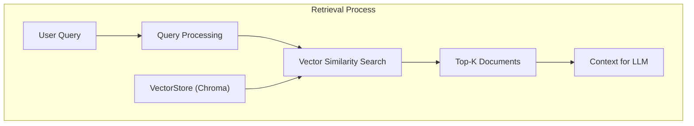
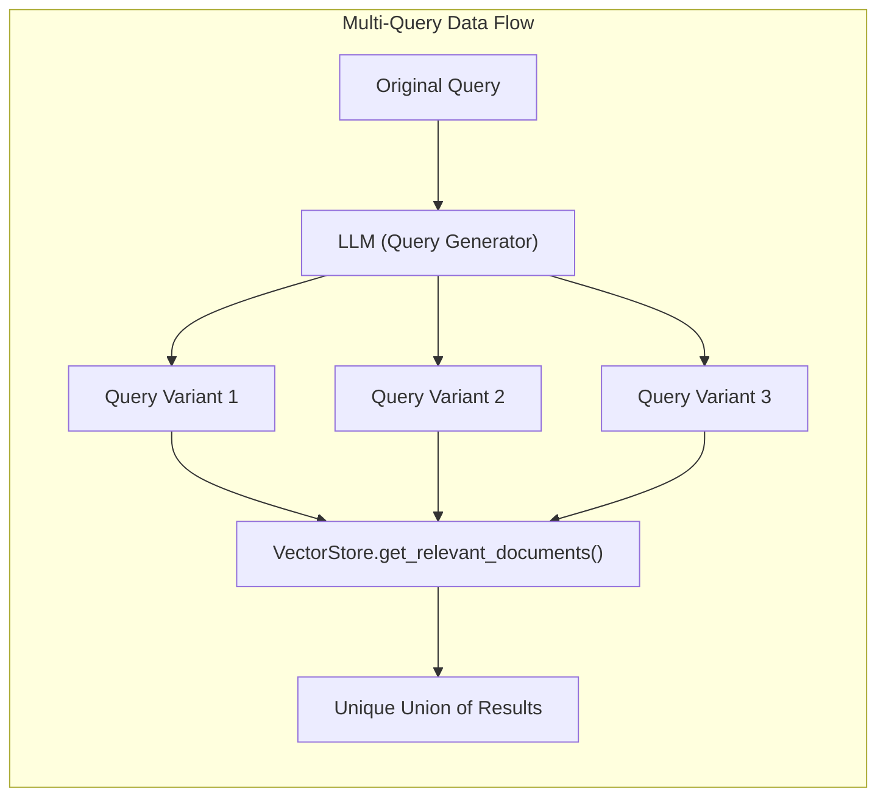
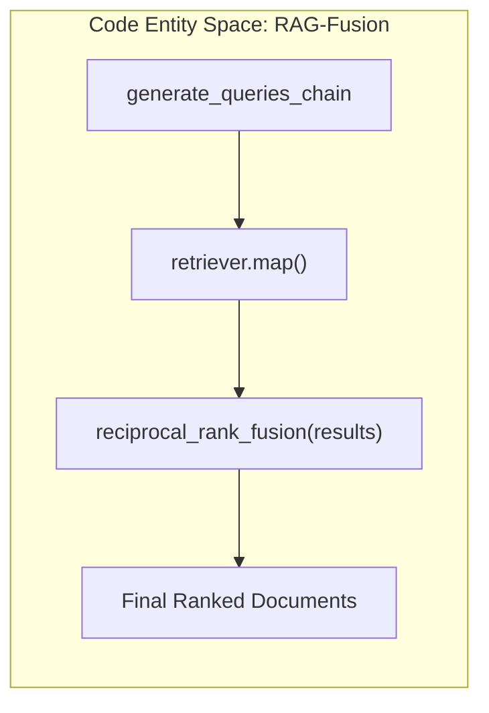
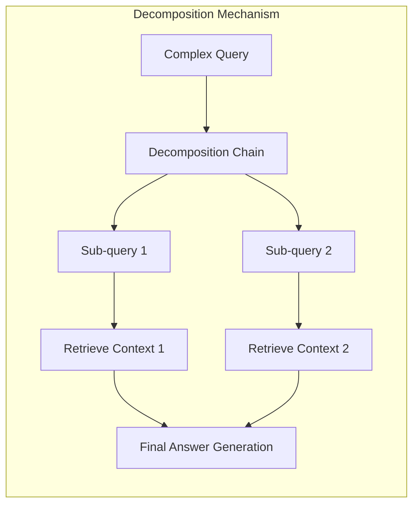
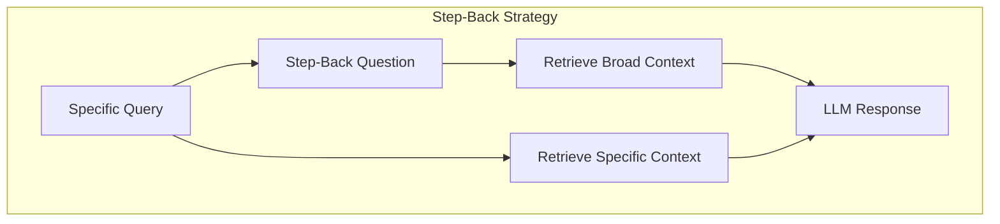

<!-- source: DeepWiki mcp.deepwiki.com · repo langchain-ai/rag-from-scratch · page 2.2 Retrieval Mechanisms · fetched 2026-10-26 -->

# Retrieval Mechanisms

Relevant source files

The following files were used as context for generating this wiki page:

- [rag_from_scratch_12_to_14.ipynb](rag_from_scratch_12_to_14.ipynb)
- [rag_from_scratch_15_to_18.ipynb](rag_from_scratch_15_to_18.ipynb)
- [rag_from_scratch_5_to_9.ipynb](rag_from_scratch_5_to_9.ipynb)

This page explains the retrieval component of Retrieval-Augmented Generation (RAG) systems as implemented in the "RAG from scratch" repository. Retrieval mechanisms are responsible for finding and fetching the most relevant document chunks from a vector database or index in response to a user query.

## Overview of Retrieval in RAG

Retrieval is the process of identifying which document chunks in the vector store are most likely to contain the information needed to answer a specific query. The system converts the natural language query into a vector and performs a similarity search against the indexed document vectors.

Sources:
- The general flow described in [rag_from_scratch_1_to_4.ipynb:1-100]()

## Multi-Query Retrieval

To improve retrieval robustness, the codebase implements "Multi-Query" retrieval. This technique uses an LLM to generate multiple versions of a user's query from different perspectives. This overcomes limitations of single-vector distance-based searches by capturing different semantic nuances.

### Implementation Details
The implementation uses a `PromptTemplate` to instruct the LLM to generate five different versions of the input question [rag_from_scratch_5_to_9.ipynb:42-60](). The `MultiQueryRetriever` (from `langchain.retrievers.multi_query`) automates this process by wrapping a base retriever.

Sources:
- Multi-query implementation in [rag_from_scratch_5_to_9.ipynb:35-110]()

## RAG-Fusion and Reciprocal Rank Fusion (RRF)

RAG-Fusion extends the multi-query concept by re-ranking the results retrieved from multiple queries. It uses **Reciprocal Rank Fusion (RRF)**, an algorithm that provides a final score based on the rank of documents across different search results rather than their raw similarity scores.

### Reciprocal Rank Fusion Logic
For each document $d$ in the set of retrieved documents $D$:
$$score(d) = \sum_{q \in Queries} \frac{1}{k + rank(q, d)}$$
Where $k$ is a constant (typically 60) to prevent small ranks from dominating.

Sources:
- RAG-Fusion implementation and RRF function in [rag_from_scratch_5_to_9.ipynb:120-200]()

## Decomposition and Sub-Query Retrieval

For complex questions, the system implements **Query Decomposition**. This involves breaking down a single query into sub-questions that can be answered independently.

| Technique | Description | Code Reference |
| :--- | :--- | :--- |
| **Least-to-Most** | Breaking a query into sub-problems solved sequentially. | [rag_from_scratch_5_to_9.ipynb:350-400]() |
| **Sub-Query Decomposition** | Generating N sub-questions and retrieving context for each. | [rag_from_scratch_5_to_9.ipynb:450-500]() |

Sources:
- Decomposition logic in [rag_from_scratch_5_to_9.ipynb:325-550]()

## Step-Back Prompting and Long-Context Retrieval

The repository explores techniques to handle retrieval when specific queries are too narrow or context is too large.

1.  **Step-Back Prompting**: Generates a more generic "step-back" question to retrieve higher-level principles or broader context [rag_from_scratch_5_to_9.ipynb:570-650]().
2.  **Long-Context Re-ranking**: When many documents are retrieved, the system uses a `LongContextReorder` to prevent the "lost in the middle" phenomenon where LLMs ignore context in the center of a long prompt.

Sources:
- Step-back implementation in [rag_from_scratch_5_to_9.ipynb:560-700]()

## Technical Summary of Retrieval Entities

| Component | Code Entity / Class | Purpose |
| :--- | :--- | :--- |
| **Retriever** | `vectorstore.as_retriever()` | Basic similarity search interface [rag_from_scratch_1_to_4.ipynb:120-130]() |
| **Multi-Query** | `MultiQueryRetriever` | Generating query variations [rag_from_scratch_5_to_9.ipynb:100-110]() |
| **Fusion** | `reciprocal_rank_fusion` | Re-ranking multiple search results [rag_from_scratch_5_to_9.ipynb:140-160]() |
| **Context Reorder** | `LongContextReorder` | Optimizing document order for LLM attention [rag_from_scratch_12_to_14.ipynb:200-250]() |

Sources:
- Class definitions and usage across [rag_from_scratch_1_to_4.ipynb](), [rag_from_scratch_5_to_9.ipynb](), and [rag_from_scratch_12_to_14.ipynb]()

---

