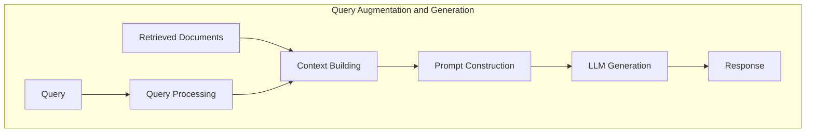
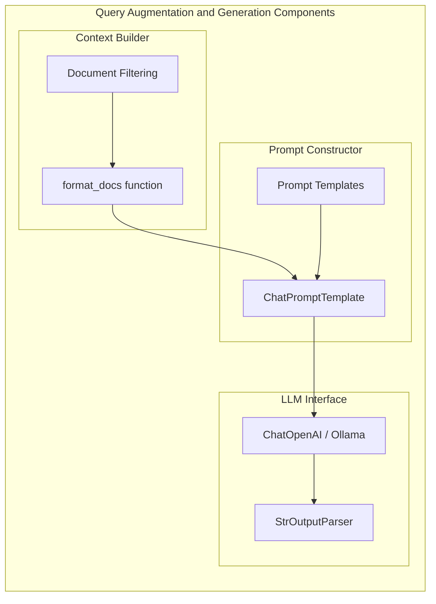
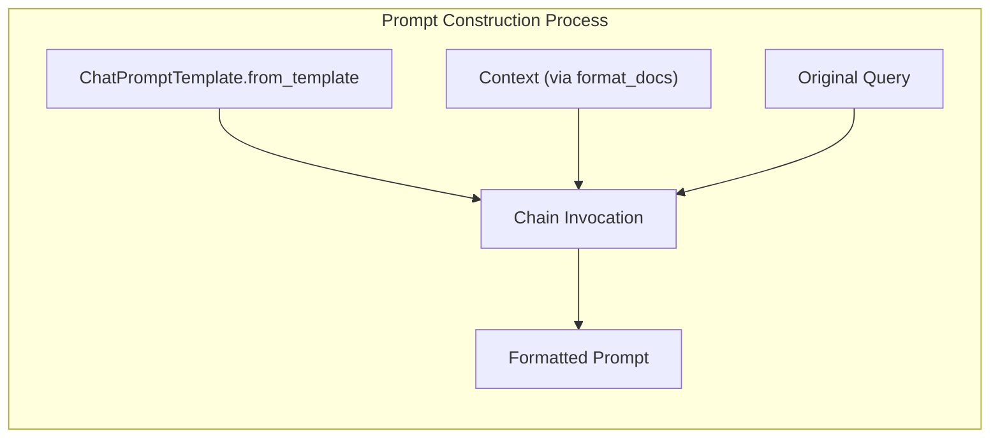
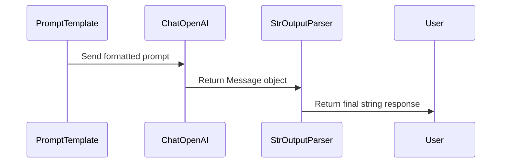
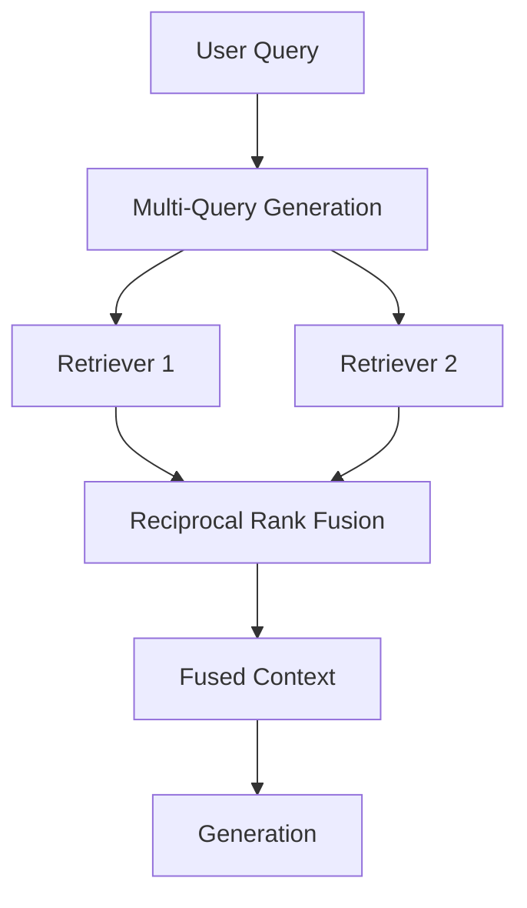
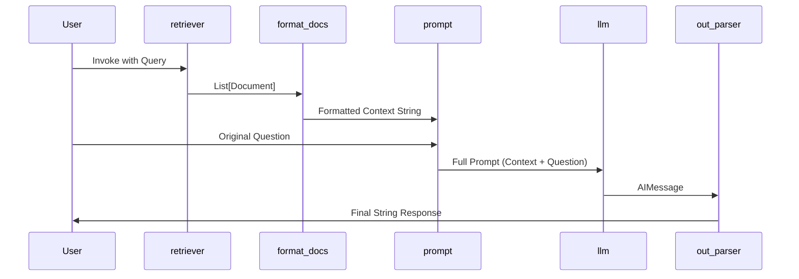

<!-- source: DeepWiki mcp.deepwiki.com · repo langchain-ai/rag-from-scratch · page 2.3 Query Augmentation and Generation · fetched 2026-10-26 -->

# Query Augmentation and Generation

<details>
<summary>Relevant source files</summary>

The following files were used as context for generating this wiki page:

- [rag_from_scratch_1_to_4.ipynb](rag_from_scratch_1_to_4.ipynb)
- [rag_from_scratch_5_to_9.ipynb](rag_from_scratch_5_to_9.ipynb)

</details>


## Purpose and Scope

This document explains the final stage of the RAG pipeline: Query Augmentation and Generation. This component is responsible for leveraging retrieved documents to enhance the original query and generate high-quality responses using a language model. It covers the process from receiving retrieved documents to returning the final generated response to the user. This section builds upon the retrieval mechanisms explained in [Retrieval Mechanisms]() and completes the RAG workflow.

## Overview of Query Augmentation and Generation

Query Augmentation and Generation represents the critical final stage in the RAG pipeline where retrieved information is integrated with the original query to produce contextually informed responses. This process bridges the gap between retrieved documents and the language model's response generation capabilities.



Sources: [rag_from_scratch_1_to_4.ipynb:5-30]()

## Components of Query Augmentation and Generation

The Query Augmentation and Generation process consists of several key components that work together to transform retrieved documents and the original query into a final response. In the provided notebooks, this is primarily handled using `LangChain` Expression Language (LCEL) chains.



Sources: [rag_from_scratch_1_to_4.ipynb:420-440](), [rag_from_scratch_5_to_9.ipynb:10-30]()

### Context Building

The Context Builder component takes retrieved documents and processes them to create a coherent context for the language model. In the implementation, this is often a helper function called `format_docs`.

1. **Document prioritization**: Arranging retrieved documents by relevance (usually handled by the retriever's score).
2. **Context assembly**: Combining selected document fragments into a unified string.

```python
def format_docs(docs):
    return "\n\n".join(doc.page_content for doc in docs)
```

Sources: [rag_from_scratch_1_to_4.ipynb:421-423]()

### Prompt Construction

The Prompt Constructor creates the final prompt that will be sent to the language model. The repository uses `ChatPromptTemplate` to define the structure.

1. **Template selection**: Defining a system message that instructs the LLM to use the provided context.
2. **Context integration**: Using placeholders like `{context}` and `{question}` to inject data.



Sources: [rag_from_scratch_1_to_4.ipynb:413-418]()

### Response Generation

The final component handles the interaction with the language model and processes its output:

1. **LLM interface**: Using `ChatOpenAI` or local models via `Ollama`.
2. **Response parsing**: Utilizing `StrOutputParser` to convert the LLM's `BaseMessage` output into a simple string.



Sources: [rag_from_scratch_1_to_4.ipynb:426-433]()

## Advanced Query Augmentation (RAG Fusion & Multi-Query)

The repository introduces advanced techniques in notebooks 5-9 to improve generation by augmenting the query before retrieval or by synthesizing multiple retrieval results.

### Multi-Query Retrieval
Instead of a single query, the system generates multiple versions of the user's question to capture different perspectives, increasing the chance of retrieving relevant documents [rag_from_scratch_5_to_9.ipynb:120-140]().

### RAG Fusion
This technique generates multiple queries, retrieves documents for each, and then applies **Reciprocal Rank Fusion (RRF)** to re-rank the results before passing them to the generation stage [rag_from_scratch_5_to_9.ipynb:450-480]().



Sources: [rag_from_scratch_5_to_9.ipynb:482-510]()

## Implementation Considerations

### Context Window Management
The implementation must ensure that the combined `context` and `question` do not exceed the model's token limit. In the basic implementation, this is implicitly managed by the `k` parameter in the retriever (e.g., `retriever = vectorstore.as_retriever(search_kwargs={"k": 3})`) [rag_from_scratch_1_to_4.ipynb:400-405]().

### Response Quality Control
The prompts used in the repository often include "Hallucination prevention" instructions, such as: *"If you don't know the answer, just say that you don't know, don't try to make up an answer."* [rag_from_scratch_1_to_4.ipynb:413-418]().

## Practical Example Flow

This sequence diagram illustrates the complete flow using the LCEL (LangChain Expression Language) syntax found in the codebase:



Sources: [rag_from_scratch_1_to_4.ipynb:426-433]()

## Conclusion

The Query Augmentation and Generation component represents the culminating stage of the RAG pipeline. By using LCEL chains to link retrievers, formatting functions, and prompt templates, the system transforms raw retrieved data into accurate, contextually relevant natural language responses. Advanced techniques like RAG Fusion further enhance this by ensuring the most relevant context is prioritized during the generation phase.

---

