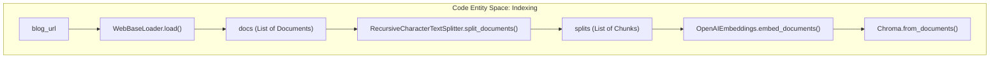
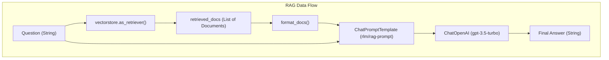

<!-- source: DeepWiki mcp.deepwiki.com · repo langchain-ai/rag-from-scratch · page 3 Basic RAG Implementation (Notebooks 1-4) · fetched 2026-10-26 -->

# Basic RAG Implementation (Notebooks 1-4)

<details>
<summary>Relevant source files</summary>

The following files were used as context for generating this wiki page:

- [rag_from_scratch_1_to_4.ipynb](rag_from_scratch_1_to_4.ipynb)

</details>


## Purpose and Scope

This document provides a detailed technical explanation of the foundational Retrieval-Augmented Generation (RAG) implementation as presented in notebooks 1 through 4. It focuses on the core mechanics of indexing, retrieval, and generation using the LangChain framework. The scope covers the transition from raw web content to a functional RAG chain.

## Overview of Notebooks 1-4

The initial phase of the "RAG from scratch" series establishes the "Three Pillars of RAG":
1.  **Indexing**: Loading, splitting, and storing data.
2.  **Retrieval**: Fetching relevant data based on user queries.
3.  **Generation**: Producing an answer using an LLM and the retrieved context.

Sources: [rag_from_scratch_1_to_4.ipynb:1-20]()

## Indexing Pipeline

The indexing process converts unstructured data into a structured vector format. In these notebooks, the `WebBaseLoader` is used to fetch content from a blog post, which is then processed into chunks.

### Document Loading and Splitting
The implementation utilizes the `RecursiveCharacterTextSplitter` to break documents into manageable pieces. This specific splitter is preferred because it attempts to keep related text (like paragraphs and sentences) together by splitting on a hierarchy of characters.

| Component | Code Entity | Purpose |
| :--- | :--- | :--- |
| **Loader** | `WebBaseLoader` | Fetches HTML content from URLs [rag_from_scratch_1_to_4.ipynb:58-62]() |
| **Splitter** | `RecursiveCharacterTextSplitter` | Chunks text into segments of `chunk_size` [rag_from_scratch_1_to_4.ipynb:74-78]() |
| **Parameters** | `chunk_size`, `chunk_overlap` | Controls the granularity and context continuity [rag_from_scratch_1_to_4.ipynb:76-77]() |

### Vector Storage
Once split, the text chunks are converted into embeddings using `OpenAIEmbeddings` and stored in a `Chroma` vector database.


Sources: [rag_from_scratch_1_to_4.ipynb:58-94]()

## Retrieval and Generation

The "Online" portion of the RAG system connects the stored data to the user query and the LLM.

### Retrieval Mechanism
The `vectorstore` is exposed as a `Retriever` interface. When a query is received, the system performs a similarity search to identify the `k` most relevant splits.

### Prompting and Generation
A specific prompt template is pulled from the LangChain Hub (`rlm/rag-prompt`). This template instructs the LLM to use the retrieved context to answer the question.


Sources: [rag_from_scratch_1_to_4.ipynb:100-138]()

## Key Implementation Details

### The `format_docs` Function
A utility function `format_docs` is implemented to join the page content of retrieved documents with double newlines. This ensures the LLM receives a clean, continuous block of text as context.
[rag_from_scratch_1_to_4.ipynb:128-130]()

### The RAG Chain (LCEL)
The implementation uses **LangChain Expression Language (LCEL)** to pipe components together. This declarative style defines the flow from input to output.

```python
# Conceptual LCEL Flow
rag_chain = (
    {"context": retriever | format_docs, "question": RunnablePassthrough()}
    | prompt
    | llm
    | StrOutputParser()
)
```
[rag_from_scratch_1_to_4.ipynb:132-138]()

## Summary of Configuration (Notebooks 1-4)

The foundational implementation uses the following default technical stack:

| Layer | Implementation Entity |
| :--- | :--- |
| **LLM** | `ChatOpenAI` (Model: `gpt-3.5-turbo`) [rag_from_scratch_1_to_4.ipynb:104-104]() |
| **Embeddings** | `OpenAIEmbeddings` [rag_from_scratch_1_to_4.ipynb:89-89]() |
| **Vector DB** | `Chroma` [rag_from_scratch_1_to_4.ipynb:92-94]() |
| **Chunking** | `chunk_size=1000`, `chunk_overlap=200` [rag_from_scratch_1_to_4.ipynb:76-77]() |

Sources: [rag_from_scratch_1_to_4.ipynb:74-138]()

## Limitations of the Basic Approach
As noted in the transition to subsequent notebooks, this basic implementation:
1.  **Retrieval**: Relies solely on semantic similarity, which may fail if the query and document use different terminology.
2.  **Generation**: Does not include logic for query rewriting or multi-step reasoning.
3.  **Context**: Does not handle cases where the retrieved context is irrelevant or "noisy."

These limitations are addressed in [Advanced RAG Techniques (Notebooks 5-9)]().

---

