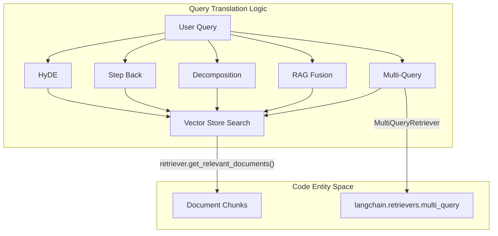
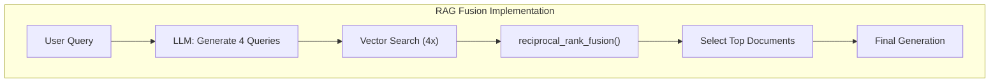
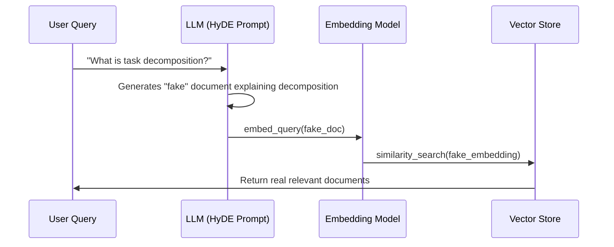

<!-- source: DeepWiki mcp.deepwiki.com · repo langchain-ai/rag-from-scratch · page 4 Advanced RAG Techniques (Notebooks 5-9) · fetched 2026-10-26 -->

# Advanced RAG Techniques (Notebooks 5-9)

Relevant source files

The following files were used as context for generating this wiki page:

- [rag_from_scratch_5_to_9.ipynb](rag_from_scratch_5_to_9.ipynb)

## Purpose and Scope

This document covers the advanced Retrieval-Augmented Generation (RAG) techniques implemented in notebooks 5-9 of the RAG from scratch repository. These notebooks transition from basic retrieval to sophisticated query transformation and translation strategies. The primary goal is to address common failure modes in RAG, such as poor query phrasing, lack of domain-specific terminology, and the limitations of single-vector similarity search.

## Query Translation Overview

Notebooks 5-9 focus heavily on **Query Translation**, the process of modifying or decomposing a user query before it reaches the vector store to improve retrieval accuracy [rag_from_scratch_5_to_9.ipynb:1-15]().

Sources: [rag_from_scratch_5_to_9.ipynb:1-50]()

## Multi-Query Retrieval (Notebook 5)

The `Multi-Query` approach addresses the sensitivity of distance-based vector search to specific wording. It uses an LLM to generate multiple perspectives of the same query [rag_from_scratch_5_to_9.ipynb:18-25]().

*   **Implementation**: An LLM prompt is defined to generate five different versions of the user question [rag_from_scratch_5_to_9.ipynb:34-45]().
*   **Data Flow**: Each generated query is sent to the retriever. The results are then combined (union) to create a larger set of potentially relevant documents [rag_from_scratch_5_to_9.ipynb:101-115]().

Sources: [rag_from_scratch_5_to_9.ipynb:34-45](), [rag_from_scratch_5_to_9.ipynb:101-115]()

## RAG Fusion (Notebook 6)

RAG Fusion builds on Multi-Query by adding a re-ranking step using **Reciprocal Rank Fusion (RRF)**. This algorithm scores documents based on their rank across multiple search results rather than their absolute similarity score [rag_from_scratch_5_to_9.ipynb:154-165]().

### Reciprocal Rank Fusion Logic
The function `reciprocal_rank_fusion` takes a list of search results and applies the formula:
`score = 1 / (rank + k)`
where `k` is a constant (defaulting to 60) [rag_from_scratch_5_to_9.ipynb:237-258]().

Sources: [rag_from_scratch_5_to_9.ipynb:237-258](), [rag_from_scratch_5_to_9.ipynb:268-285]()

## Decomposition (Notebook 7)

Decomposition breaks a complex query into simpler sub-questions. This is particularly effective for multi-hop reasoning where the answer to the main question depends on several distinct pieces of information [rag_from_scratch_5_to_9.ipynb:363-375]().

*   **Sub-query Generation**: The LLM is prompted to "generate sub-questions" related to the input [rag_from_scratch_5_to_9.ipynb:384-395]().
*   **Iterative Search**: The system can solve these sub-questions sequentially, using the answer of the first to inform the retrieval of the second (Recursive RAG) [rag_from_scratch_5_to_9.ipynb:491-510]().

Sources: [rag_from_scratch_5_to_9.ipynb:384-395](), [rag_from_scratch_5_to_9.ipynb:491-510]()

## Step-Back Prompting (Notebook 8)

Step-back prompting encourages the LLM to generate a high-level, "step-back" question about concepts or principles related to the specific query [rag_from_scratch_5_to_9.ipynb:615-625]().

*   **Mechanism**: If a user asks a specific technical question, the "step-back" question might ask about the underlying architecture.
*   **Retrieval**: Both the original and the step-back questions are used for retrieval, providing the LLM with both specific facts and broad context [rag_from_scratch_5_to_9.ipynb:671-685]().

Sources: [rag_from_scratch_5_to_9.ipynb:634-645](), [rag_from_scratch_5_to_9.ipynb:671-685]()

## Hypothetical Document Embeddings - HyDE (Notebook 9)

HyDE flips the standard RAG approach. Instead of using the query to find documents, it uses an LLM to generate a *hypothetical* answer (a "fake" document) and uses that answer to perform the vector search [rag_from_scratch_5_to_9.ipynb:754-765]().

*   **Logic**: The hypothetical document captures the semantic pattern of a relevant result better than a short, keyword-sparse query [rag_from_scratch_5_to_9.ipynb:767-775]().
*   **Code Flow**:
    1.  `hyde_prompt` generates a synthetic response [rag_from_scratch_5_to_9.ipynb:784-795]().
    2.  This response is embedded via `embeddings.embed_query()`.
    3.  `vectorstore.similarity_search()` uses the synthetic embedding to find real documents [rag_from_scratch_5_to_9.ipynb:801-815]().

Sources: [rag_from_scratch_5_to_9.ipynb:784-795](), [rag_from_scratch_5_to_9.ipynb:801-815]()

## Summary of Techniques

| Technique | Core Logic | Key Function/Prompt |
| :--- | :--- | :--- |
| **Multi-Query** | Generates multiple query variations | `MultiQueryRetriever` [rag_from_scratch_5_to_9.ipynb:101-105]() |
| **RAG Fusion** | Re-ranks results using RRF | `reciprocal_rank_fusion` [rag_from_scratch_5_to_9.ipynb:237-240]() |
| **Decomposition** | Breaks query into sub-questions | `template` (sub-questions) [rag_from_scratch_5_to_9.ipynb:384-390]() |
| **Step-Back** | Generates an abstract question | `step_back_prompt` [rag_from_scratch_5_to_9.ipynb:634-640]() |
| **HyDE** | Maps query to hypothetical answer | `hyde_prompt` [rag_from_scratch_5_to_9.ipynb:784-790]() |

Sources: [rag_from_scratch_5_to_9.ipynb:1-850]()

---

