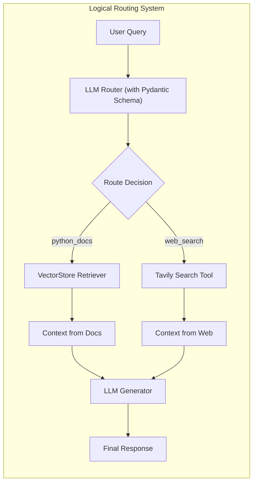
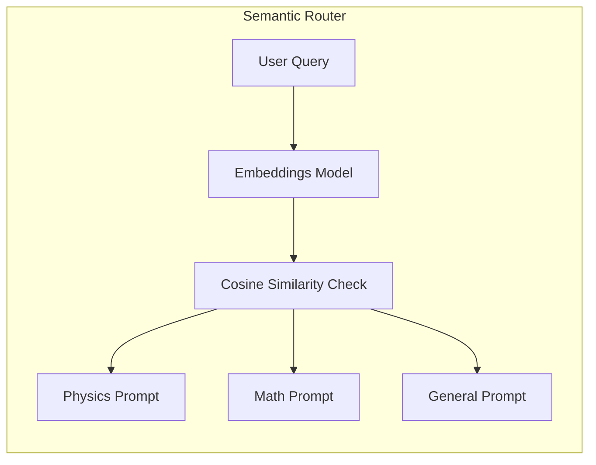
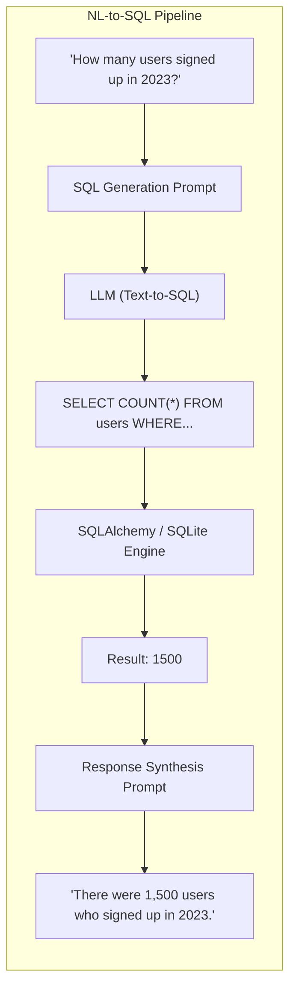

<!-- source: DeepWiki mcp.deepwiki.com · repo langchain-ai/rag-from-scratch · page 5 Extensions and Optimizations (Notebooks 10-11) · fetched 2026-10-26 -->

# Extensions and Optimizations (Notebooks 10-11)

Relevant source files

The following files were used as context for generating this wiki page:

- [rag_from_scratch_10_and_11.ipynb](rag_from_scratch_10_and_11.ipynb)

## Purpose and Scope

This document details the extensions and optimization techniques implemented in notebooks 10 and 11 of the RAG from scratch repository. These notebooks focus on **Routing** and **Query Construction**, moving beyond simple retrieval to systems that can dynamically choose data paths or translate natural language into structured queries for specific database schemas.

For information about the core RAG implementation, see [Basic RAG Implementation (Notebooks 1-4)](). For the advanced techniques that these optimizations build upon, see [Advanced RAG Techniques (Notebooks 5-9)]().

## Routing (Notebook 10)

Notebook 10 introduces "Routing," a logic layer that directs an incoming query to the most appropriate retrieval pipeline or data source. This prevents "noise" by ensuring queries are only sent to relevant indices.

### Logical Routing

Logical routing uses an LLM to classify a query and select a destination. The implementation uses `ChatOpenAI` and function calling (structured outputs) to produce a routing decision [rag_from_scratch_10_and_11.ipynb:101-140]().

**Key Components:**
*   **RouteQuery Class**: A Pydantic model used to constrain the LLM's output to a specific set of strings (e.g., `web_search` or `vectorstore`) [rag_from_scratch_10_and_11.ipynb:101-118]().
*   **Structured Output**: The LLM is prompted to act as an expert router [rag_from_scratch_10_and_11.ipynb:120-137]().
*   **Routing Function**: A logic gate (often implemented via a `choose_route` function) that inspects the LLM output and calls the corresponding branch [rag_from_scratch_10_and_11.ipynb:165-185]().

### Semantic Routing

Semantic routing directs queries based on their embedding similarity to predefined "prompt templates" or "topic clusters" rather than explicit classification [rag_from_scratch_10_and_11.ipynb:218-285]().

**Implementation Details:**
*   **Prompt Templates**: Multiple templates are defined for different domains (e.g., physics, math) [rag_from_scratch_10_and_11.ipynb:218-245]().
*   **Embeddings**: Templates are embedded and stored. The query is compared against these embeddings to find the closest match [rag_from_scratch_10_and_11.ipynb:247-265]().

**Sources:** [rag_from_scratch_10_and_11.ipynb:101-285]()

---

## Query Construction (Notebook 11)

Notebook 11 explores "Query Construction," where the system translates natural language into a domain-specific language (DSL) like SQL or Cypher, or structured filters for metadata.

### Structured Queries for Metadata Filters

Many vector databases (like Pinecone or Chroma) support metadata filtering. Notebook 11 demonstrates how to use an LLM to extract these filters from a natural language query [rag_from_scratch_10_and_11.ipynb:346-455]().

| Component | Code Entity / Role |
| :--- | :--- |
| **Schema Definition** | Pydantic model defining valid filter attributes (e.g., `year`, `author`) [rag_from_scratch_10_and_11.ipynb:368-385]() |
| **Query Translator** | LLM prompt that maps "recent papers" to `{"year": {"$gt": 2022}}` [rag_from_scratch_10_and_11.ipynb:390-420]() |
| **Self-Query Retriever** | A retriever that combines the semantic vector search with the generated metadata filter [rag_from_scratch_10_and_11.ipynb:430-455]() |

### Natural Language to SQL

This optimization allows RAG systems to access structured relational data. The data flow bridges the "Natural Language Space" to the "SQL Execution Space."

**Key Implementation Steps:**
1.  **Schema Context**: The LLM is provided with the table DDL (Data Definition Language) to understand column names and types [rag_from_scratch_10_and_11.ipynb:510-530]().
2.  **Query Generation**: The LLM generates the SQL string [rag_from_scratch_10_and_11.ipynb:540-560]().
3.  **Execution**: The system executes the query against a database (e.g., `langchain_community.utilities.SQLDatabase`) [rag_from_scratch_10_and_11.ipynb:570-585]().

**Sources:** [rag_from_scratch_10_and_11.ipynb:346-585]()

---

## Performance and Evaluation Summary

The optimizations in these notebooks address the "Retrieval Gap" where semantic search alone is insufficient.

| Optimization | Problem Solved | Key Function/Class |
| :--- | :--- | :--- |
| **Logical Routing** | Irrelevant data sources | `RouteQuery` (Pydantic), `with_structured_output` [rag_from_scratch_10_and_11.ipynb:101-118]() |
| **Semantic Routing** | Inefficient prompt selection | `cosine_similarity`, `Embeddings` [rag_from_scratch_10_and_11.ipynb:247-265]() |
| **Query Construction** | Structured data access | `SelfQueryRetriever`, `create_sql_query_chain` [rag_from_scratch_10_and_11.ipynb:430-585]() |

**Sources:** [rag_from_scratch_10_and_11.ipynb:1-600]()

---

