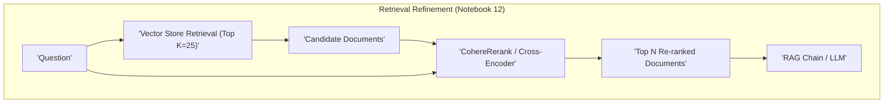
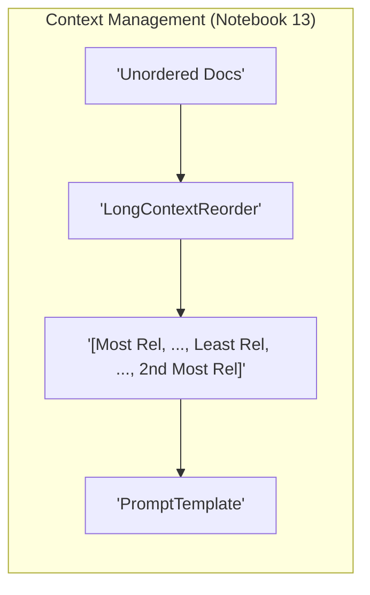
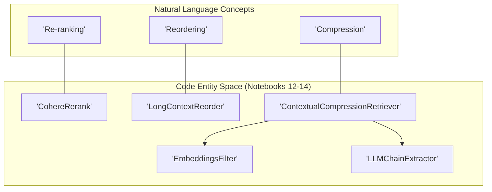

<!-- source: DeepWiki mcp.deepwiki.com · repo langchain-ai/rag-from-scratch · page 6 Further Refinements (Notebooks 12-14) · fetched 2026-10-26 -->

# Further Refinements (Notebooks 12-14)

Relevant source files

The following files were used as context for generating this wiki page:

- [rag_from_scratch_12_to_14.ipynb](rag_from_scratch_12_to_14.ipynb)

This section covers the refinements and advanced techniques implemented in notebooks 12-14 of the RAG from scratch repository. These notebooks focus on "Long Context" challenges and "Re-ranking" strategies to optimize the balance between retrieval recall and generation precision.

## Purpose and Scope

The primary purpose of notebooks 12-14 is to address specific limitations in standard RAG pipelines, specifically the "Lost in the Middle" phenomenon and the noise introduced by large document sets. 

1.  **Re-ranking (Notebook 12)**: Implementing scoring layers to prioritize the most relevant documents.
2.  **Context Selection/Compression (Notebook 13)**: Reducing the token load while maintaining information density.
3.  **Long Context Management (Notebook 14)**: Handling large context windows and mitigating the performance degradation when relevant information is buried in the middle of a prompt.

## Re-ranking and Scoring (Notebook 12)

While initial retrieval (Vector Search) is fast, it often lacks precision. Notebook 12 introduces a two-stage retrieval process: initial retrieval followed by a re-ranking step using a more computationally expensive but accurate model.

### Implementation Logic
The system retrieves a larger set of documents (e.g., top 25) and uses a `CohereRerank` or similar cross-encoder to re-score them based on the query [rag_from_scratch_12_to_14.ipynb:154-180]().

**Diagram: Two-Stage Retrieval with Re-ranking**

**Sources:** [rag_from_scratch_12_to_14.ipynb:140-180]()

## Context Selection and "Lost in the Middle" (Notebook 13)

LLMs often struggle to utilize information located in the middle of a long context window. Notebook 13 explores the "Long Context Reorder" technique to ensure the most relevant documents are placed at the beginning and end of the prompt.

### Key Implementation Entities
- **LongContextReorder**: A transformation step that sorts retrieved documents so that the highest-scoring items are at the extremities of the context window [rag_from_scratch_12_to_14.ipynb:342-375]().

**Diagram: Context Reordering Data Flow**

**Sources:** [rag_from_scratch_12_to_14.ipynb:342-415]()

## Context Compression (Notebook 14)

To improve efficiency and reduce costs, Notebook 14 introduces the `ContextualCompressionRetriever`. This component filters or summarizes documents before passing them to the LLM.

### Components
- **LLMChainExtractor**: Uses an LLM to extract only the parts of the documents that are relevant to the query [rag_from_scratch_12_to_14.ipynb:488-510]().
- **EmbeddingsFilter**: Uses embedding similarity to prune documents that do not meet a specific relevance threshold [rag_from_scratch_12_to_14.ipynb:530-550]().

**Diagram: Natural Language Space to Code Entity Space**

**Sources:** [rag_from_scratch_12_to_14.ipynb:488-550]()

## Summary of Refinement Techniques

| Notebook | Technique | Code Entity / Function | Purpose |
| :--- | :--- | :--- | :--- |
| 12 | Re-ranking | `CohereRerank` | Improves precision by re-scoring candidates [rag_from_scratch_12_to_14.ipynb:154-180]() |
| 13 | Re-ordering | `LongContextReorder` | Prevents 'Lost in the Middle' performance drops [rag_from_scratch_12_to_14.ipynb:342-375]() |
| 14 | Compression | `ContextualCompressionRetriever` | Reduces token count and noise in the prompt [rag_from_scratch_12_to_14.ipynb:488-510]() |
| 14 | Filtering | `EmbeddingsFilter` | Prunes irrelevant context using vector similarity [rag_from_scratch_12_to_14.ipynb:530-550]() |

**Sources:** [rag_from_scratch_12_to_14.ipynb:1-550]()

---

