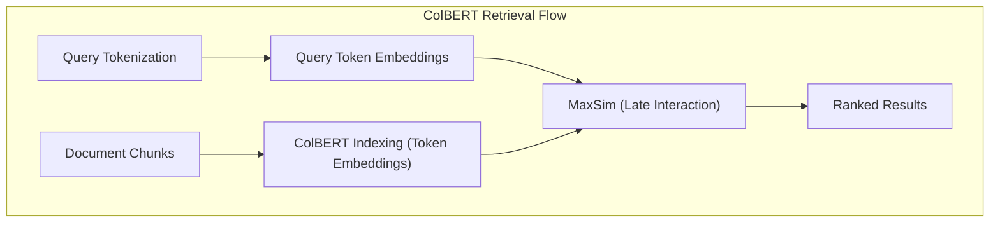
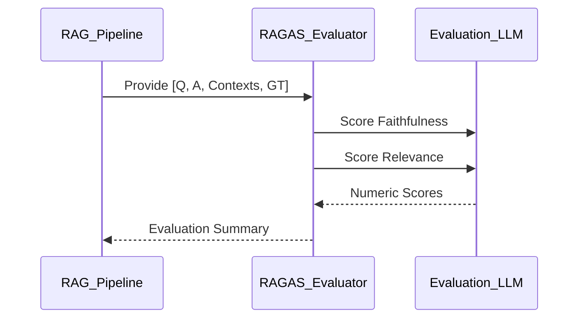
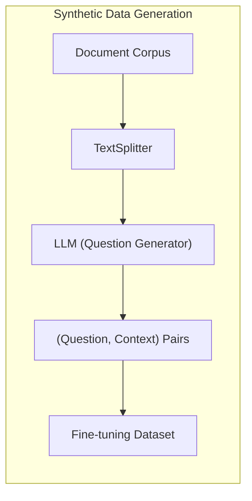
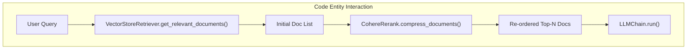

<!-- source: DeepWiki mcp.deepwiki.com · repo langchain-ai/rag-from-scratch · page 7 Production Implementation (Notebooks 15-18) · fetched 2026-10-26 -->

# Production Implementation (Notebooks 15-18)

Relevant source files

The following files were used as context for generating this wiki page:

- [rag_from_scratch_15_to_18.ipynb](rag_from_scratch_15_to_18.ipynb)

## Purpose and Scope

This document covers the production-ready implementation aspects of the RAG system as presented in notebooks 15-18 of the repository. These notebooks focus on advanced evaluation, fine-tuning, and the integration of specialized retrieval techniques like ColBERT and Fusion-in-Context to transform research implementations into robust systems. 

## ColBERT and Late Interaction

Notebook 15 introduces **ColBERT** (Contextualized Late Interaction over BERT), a model designed for efficient and precise retrieval by delaying the interaction between query and document representations. Unlike standard bi-encoders that compress a document into a single vector, ColBERT creates token-level embeddings.

### Implementation Detail
The implementation utilizes the `ragatouille` library to manage ColBERT indices. The core workflow involves initializing a `RAGPretrainedModel` and creating an index from document chunks.

**Sources:**
- [rag_from_scratch_15_to_18.ipynb:42-108]()

## RAG Evaluation (RAGAS)

Notebook 16 focuses on **RAGAS** (RAG Assessment), a framework for reference-free evaluation of RAG pipelines. It quantifies performance across dimensions like faithfulness, answer relevance, and context precision.

### Key Metrics
| Metric | Description | Code Entity |
| :--- | :--- | :--- |
| **Faithfulness** | Measures if the answer is derived solely from the retrieved context. | `faithfulness` |
| **Answer Relevance** | Measures how pertinent the answer is to the query. | `answer_relevance` |
| **Context Precision** | Evaluates if the ground truth is ranked highly in retrieved docs. | `context_precision` |
| **Context Recall** | Checks if retrieved context contains the ground truth answer. | `context_recall` |

### Evaluation Workflow
The evaluation process uses a `Dataset` object containing `question`, `answer`, `contexts`, and `ground_truth`.

**Sources:**
- [rag_from_scratch_15_to_18.ipynb:165-251]()

## Fine-tuning for RAG

Notebook 17 explores fine-tuning strategies to improve RAG performance, specifically focusing on generating synthetic datasets for training and using tools like **LlamaIndex** or **LangChain** for adapter-based tuning.

### Data Flow for Synthetic Generation
To fine-tune without manual labeling, the system uses an LLM to generate (Question, Context) pairs from the document corpus.

**Sources:**
- [rag_from_scratch_15_to_18.ipynb:342-410]()

## Long-Context RAG and Fusion

Notebook 18 addresses the "Lost in the Middle" phenomenon where LLMs struggle with large contexts. It implements **Long-Context Re-ranking** and **Fusion-in-Context** techniques.

### Re-ranking Implementation
After initial retrieval via a vector store (e.g., `Chroma`), a `CohereRerank` or similar cross-encoder is used to re-order the top-K documents based on their actual relevance to the query before passing them to the LLM.

**Sources:**
- [rag_from_scratch_15_to_18.ipynb:510-580]()

## Summary of Production Components

The transition to production involves moving from simple similarity search to a multi-stage pipeline:

1.  **Ingestion**: High-quality tokenization and ColBERT indexing for precise retrieval.
2.  **Retrieval**: Multi-vector search combined with cross-encoder re-ranking.
3.  **Evaluation**: Continuous monitoring using RAGAS metrics to detect hallucinations or retrieval drift.
4.  **Optimization**: Fine-tuning embeddings or LLMs on domain-specific synthetic data.

**Sources:**
- [rag_from_scratch_15_to_18.ipynb:1-600]()

---

