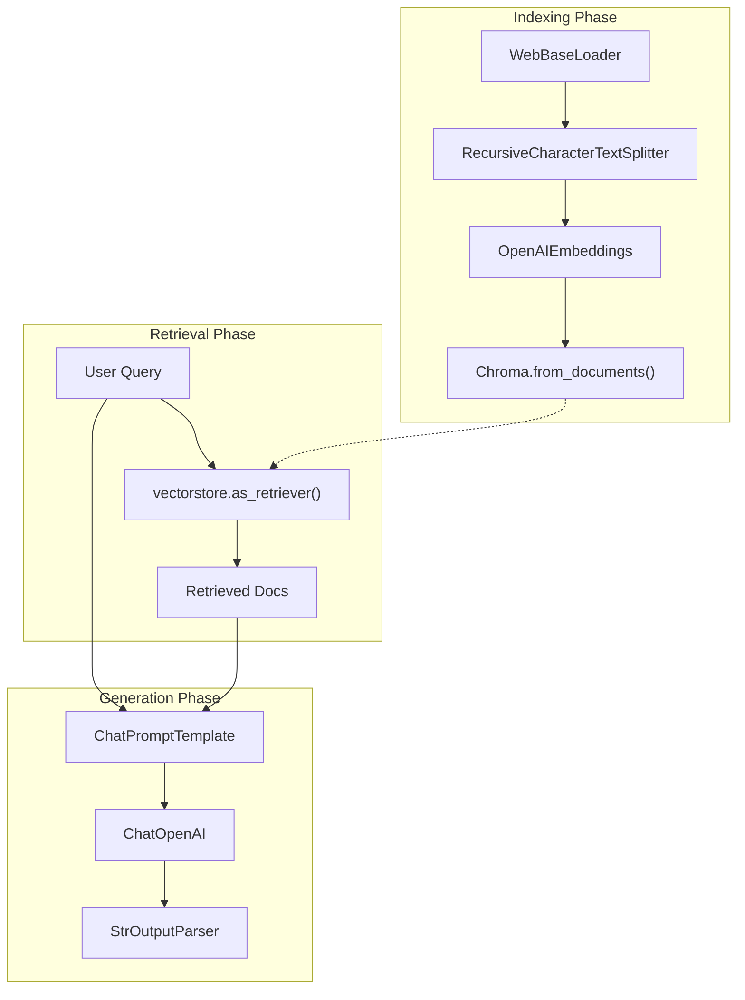
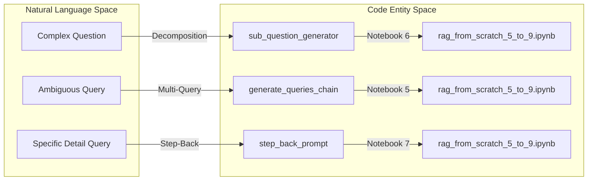

<!-- source: DeepWiki mcp.deepwiki.com · repo langchain-ai/rag-from-scratch · page 9 Glossary · fetched 2026-10-26 -->

# Glossary

Relevant source files

The following files were used as context for generating this wiki page:

- [README.md](README.md)
- [rag_from_scratch_10_and_11.ipynb](rag_from_scratch_10_and_11.ipynb)
- [rag_from_scratch_12_to_14.ipynb](rag_from_scratch_12_to_14.ipynb)
- [rag_from_scratch_15_to_18.ipynb](rag_from_scratch_15_to_18.ipynb)
- [rag_from_scratch_1_to_4.ipynb](rag_from_scratch_1_to_4.ipynb)
- [rag_from_scratch_5_to_9.ipynb](rag_from_scratch_5_to_9.ipynb)

This glossary defines technical terms, domain concepts, and implementation-specific jargon used across the **RAG from scratch** codebase. It provides direct pointers to the notebooks and functions where these concepts are implemented, serving as a technical reference for engineers onboarding to the system.

## Core RAG Concepts

### Retrieval Augmented Generation (RAG)
A technique used to ground Large Language Model (LLM) generation in external, verifiable data. By retrieving relevant document snippets from a data source and providing them as context, RAG mitigates hallucinations and allows models to reason over private or recent information not present in their training data [README.md:3-6]().

### Indexing
The process of preparing and storing document data for efficient retrieval. In this codebase, it typically involves loading data (e.g., from URLs), splitting text into manageable chunks, and storing their vector representations [rag_from_scratch_1_to_4.ipynb:10-25]().

### Vector Store
A database used to store and search high-dimensional vector embeddings. This repository frequently utilizes `Chroma` for local vector storage [rag_from_scratch_1_to_4.ipynb:35-50]().

## Code Entity Space: Indexing and Retrieval
The following diagram maps the logical retrieval process to specific code entities and LangChain components used in the repository.

**Diagram: Indexing and Retrieval Data Flow**

Sources: [rag_from_scratch_1_to_4.ipynb:12-80]()

## Advanced Retrieval & Query Transformation

### Multi-Query Retrieval
A strategy to overcome the limitations of distance-based similarity search by generating multiple variations of a user's input query. This captures different perspectives and improves the likelihood of hitting relevant documents [rag_from_scratch_5_to_9.ipynb:15-40]().

### RAG-Fusion
An extension of Multi-Query retrieval that applies **Reciprocal Rank Fusion (RRF)** to re-rank documents retrieved from multiple query variations, ensuring the most consistently relevant documents are prioritized [rag_from_scratch_5_to_9.ipynb:85-110]().

### Decomposition
The process of breaking down a complex, multi-part question into simpler sub-questions. These are solved sequentially or in parallel, with the answers aggregated to provide a final response [rag_from_scratch_5_to_9.ipynb:150-180]().

### Step-Back Prompting
A technique where the LLM generates a broader, more "high-level" version of the user query to retrieve fundamental concepts that might be missing from the specific query [rag_from_scratch_5_to_9.ipynb:210-230]().

## Translation: Natural Language to Code Logic
This diagram bridges the gap between high-level query transformation concepts and the specific functional implementations found in the advanced notebooks.

**Diagram: Query Transformation Mapping**

Sources: [rag_from_scratch_5_to_9.ipynb:10-250]()

## Optimization and Refinement Terms

| Term | Definition | Code Reference |
| :--- | :--- | :--- |
| **HyDE** | Hypothetical Document Embeddings; generates a fake document to use for similarity search. | [rag_from_scratch_5_to_9.ipynb:260-280]() |
| **Routing** | Directing a query to a specific retriever or database based on its intent. | [rag_from_scratch_10_and_11.ipynb:40-70]() |
| **Self-RAG** | A framework where the model critiques its own retrieved documents and generated answers. | [rag_from_scratch_12_to_14.ipynb:100-150]() |
| **Corrective RAG (CRAG)** | A method to evaluate retrieval quality and trigger web search if internal documents are insufficient. | [rag_from_scratch_12_to_14.ipynb:200-240]() |
| **Adaptive RAG** | A strategy that routes queries between different RAG approaches (e.g., standard vs. CRAG) based on complexity. | [rag_from_scratch_15_to_18.ipynb:50-90]() |

Sources: [rag_from_scratch_10_and_11.ipynb:1-100](), [rag_from_scratch_12_to_14.ipynb:1-250](), [rag_from_scratch_15_to_18.ipynb:1-100]()

Would you like the summary of the next reasonably large segment of original text?