# Page: Overview

# Overview

<details>
<summary>Relevant source files</summary>

The following files were used as context for generating this wiki page:

- [README.md](README.md)

</details>


This page provides a comprehensive introduction to the RAG from Scratch repository, explaining what Retrieval-Augmented Generation (RAG) is, the purpose of the implementation, and how the notebooks are organized.

## What is RAG?

Retrieval-Augmented Generation (RAG) is a technique designed to address the limitations of Large Language Models (LLMs), which are trained on fixed datasets and often lack access to private or recent information [README.md:3-3](). While fine-tuning is an option, it is frequently ill-suited for factual recall and can be prohibitively expensive [README.md:3-3]().

RAG functions as a mechanism to expand an LLM's knowledge base by using documents retrieved from external data sources to ground the LLM's generation via in-context learning [README.md:4-4](). This approach ensures that the model can reason about information not present in its original training set.

## Repository Purpose

The `rag-from-scratch` repository is a pedagogical resource designed to build an understanding of RAG from the ground up [README.md:5-5](). It accompanies a video playlist and provides a step-by-step implementation of indexing, retrieval, and generation [README.md:5-8]().

The primary goals of this implementation are:
1. **First-Principles Understanding**: Moving beyond high-level abstractions to see how data flows through each component.
2. **Modular Learning**: Breaking down the RAG pipeline into digestible notebooks that cover specific techniques.
3. **Practical Implementation**: Providing a direct path from natural language concepts to executable Python code using the LangChain ecosystem.

### Repository Structure and Notebook Organization

The notebooks are organized to guide a developer from basic concepts to production-level refinements:

| Notebook Range | Focus Area | Key Concepts |
| :--- | :--- | :--- |
| **1 - 4** | Basic RAG | Indexing, Retrieval, and Generation basics. |
| **5 - 9** | Advanced Retrieval | Multi-query, RAG-Fusion, Decomposition, and Step-back prompting. |
| **10 - 11** | Context Management | Long-context handling and document compression. |
| **12 - 14** | Sophisticated Routing | Logical and semantic routing, Query construction. |
| **15 - 18** | Refinement & Evaluation | Corrective RAG (CRAG), Self-RAG, and Adaptive RAG. |

Sources: [README.md:1-8]()

## Core RAG Pipeline

The implementation follows a structured data flow that bridges raw documents to final LLM responses. This flow is categorized into the Indexing (Offline) and Retrieval/Generation (Online) phases.

### Natural Language to Code Mapping: Indexing

This diagram illustrates how raw information is transformed into a searchable `VectorStore`.

**Indexing Pipeline Architecture**
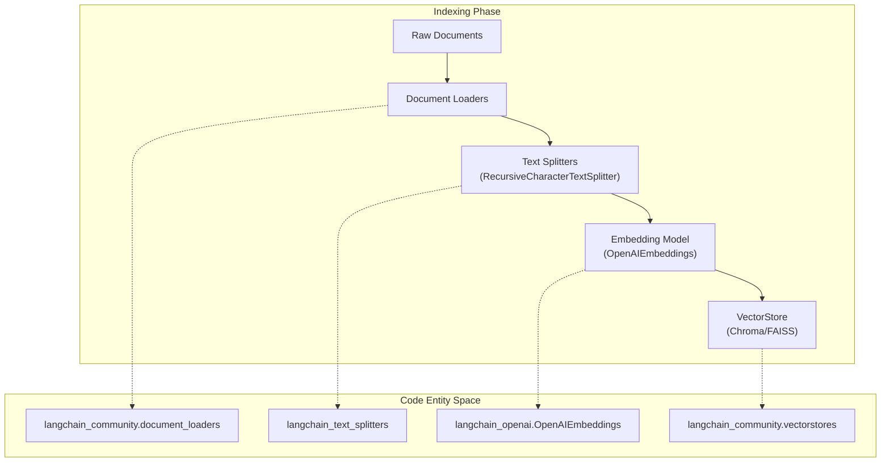
Sources: [README.md:5-6]()

### Natural Language to Code Mapping: Query and Generation

This diagram shows the "Online" flow where a user's question is used to retrieve context and generate a grounded answer.

**Retrieval and Generation Flow**
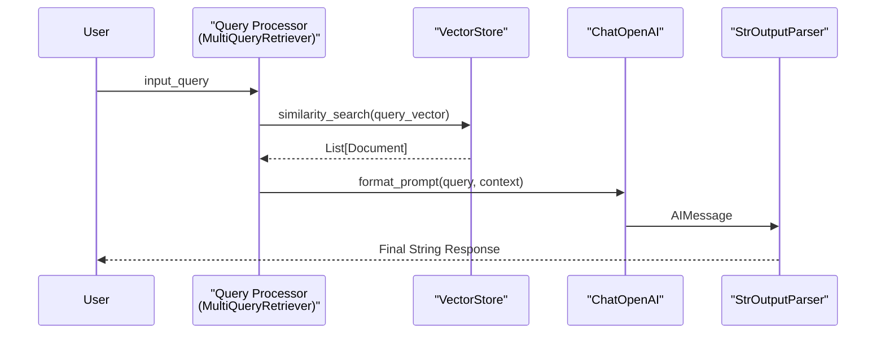
Sources: [README.md:5-6]()

## Key Implementation Concepts

The repository covers several critical technical areas:

*   **Indexing**: Loading data from sources like the web or local files and splitting them into manageable chunks to fit within LLM context windows.
*   **Retrieval**: Using vector similarity (e.g., cosine similarity) to fetch the most relevant chunks based on a user's query.
*   **Generation**: Constructing prompts that include the retrieved context, instructing the LLM to answer only based on the provided information to minimize hallucinations.
*   **Advanced Orchestration**: Implementing complex logic like "Self-RAG" where the model evaluates its own retrieved documents for relevance before generating an answer.

Sources: [README.md:5-6]()

---

# Page: RAG Architecture

# RAG Architecture

<details>
<summary>Relevant source files</summary>

The following files were used as context for generating this wiki page:

- [README.md](README.md)
- [rag_from_scratch_1_to_4.ipynb](rag_from_scratch_1_to_4.ipynb)

</details>


## Purpose and Scope

This document provides a comprehensive technical overview of the Retrieval-Augmented Generation (RAG) architecture implemented in the `rag-from-scratch` repository. It details the core components, their interactions, and the data flow through the system as LLMs are grounded with external data sources [README.md:1-6](). For detailed implementation of specific components, see the dedicated pages on [Document Processing and Indexing](#2.1), [Retrieval Mechanisms](#2.2), and [Query Augmentation and Generation](#2.3).

## High-Level RAG Architecture

The architecture follows a modular design pattern consisting of two primary phases: offline processing (indexing) and online processing (retrieval and generation).

### Core RAG Pipeline Architecture

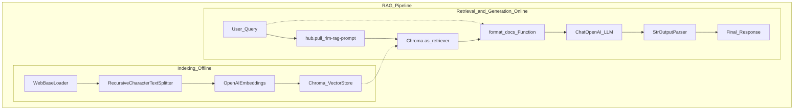
Sources: [rag_from_scratch_1_to_4.ipynb:42-55](), [rag_from_scratch_1_to_4.ipynb:114-125](), [rag_from_scratch_1_to_4.ipynb:206-225]()

The architecture separates concerns between document preparation and query handling:

1. **Offline Processing (Indexing)**: Documents are loaded via `WebBaseLoader`, split into chunks using `RecursiveCharacterTextSplitter`, embedded, and stored in a `Chroma` vector database [rag_from_scratch_1_to_4.ipynb:42-55]().
2. **Online Processing (Retrieval & Generation)**: Relevant chunks are fetched by a `retriever`, formatted, and passed to an LLM like `ChatOpenAI` using a specific prompt template (e.g., `rlm-rag-prompt`) [rag_from_scratch_1_to_4.ipynb:206-225]().

## Core RAG Components

### Document Processing and Indexing Components

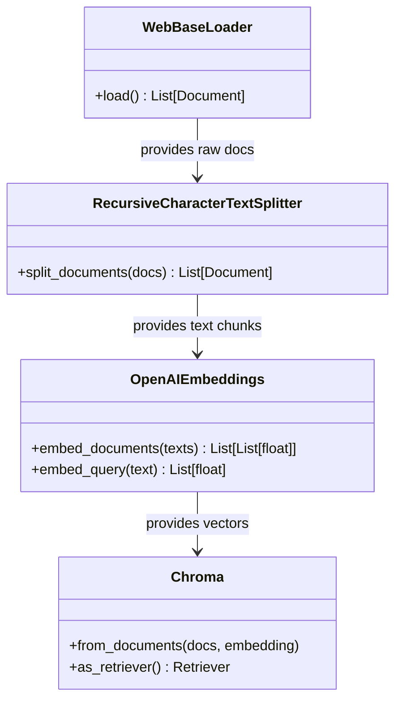
Sources: [rag_from_scratch_1_to_4.ipynb:42-55](), [rag_from_scratch_1_to_4.ipynb:114-125]()

### Retrieval and Generation Components

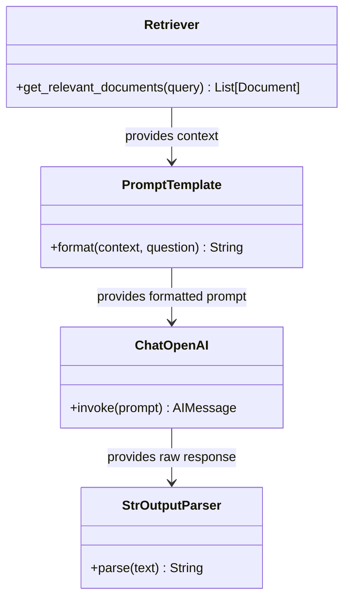
Sources: [rag_from_scratch_1_to_4.ipynb:206-225]()

## RAG Data Flow

The following sequence diagram illustrates the data flow using the LCEL (LangChain Expression Language) chain implemented in the repository [rag_from_scratch_1_to_4.ipynb:218-220]():

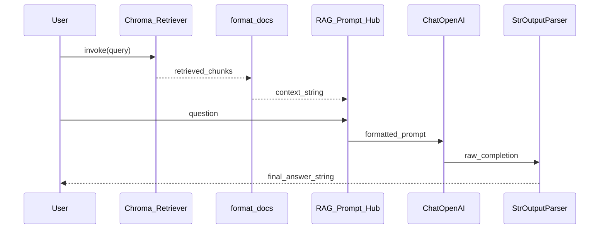
Sources: [rag_from_scratch_1_to_4.ipynb:206-225]()

## Implementation Evolution

The RAG architecture is implemented across multiple notebooks, evolving from basic retrieval to complex multi-step reasoning:

1.  **Basic RAG (Notebooks 1-4)**: Foundation of indexing, retrieval, and generation using `Chroma` and `OpenAI` [rag_from_scratch_1_to_4.ipynb:1-5](). For details, see [Document Processing and Indexing](#2.1).
2.  **Advanced RAG (Notebooks 5-9)**: Introduction of Query Translation techniques like Multi-query, RAG-Fusion, and Decomposition. For details, see [Retrieval Mechanisms](#2.2).
3.  **Extensions (Notebooks 10-11)**: Implementation of Routing (Logical and Semantic) and Query Construction for structured data.
4.  **Refinements (Notebooks 12-14)**: Indexing optimizations like Multi-vector retrievers and ColBERT, and Re-ranking strategies. For details, see [Query Augmentation and Generation](#2.3).
5.  **Production Implementation (Notebooks 15-18)**: Advanced "Corrective RAG" (CRAG) and Self-RAG using `LangGraph` for stateful orchestration.

## Key Implementation Considerations

The RAG architecture in this repository addresses several critical implementation concerns:

1.  **Context Management**: Using `format_docs` to join document contents into a single string for the prompt [rag_from_scratch_1_to_4.ipynb:211-213]().
2.  **Modularity**: Leveraging LangChain's LCEL to pipe components like `retriever | prompt | llm | parser` [rag_from_scratch_1_to_4.ipynb:218-220]().
3.  **External Knowledge**: Mitigating LLM limitations regarding private or recent information [README.md:3-4]().

The subsequent pages will explore specific components in greater detail, including document processing ([Document Processing and Indexing](#2.1)), retrieval mechanisms ([Retrieval Mechanisms](#2.2)), and query augmentation and generation ([Query Augmentation and Generation](#2.3)).

---

# Page: Document Processing and Indexing

# Document Processing and Indexing

<details>
<summary>Relevant source files</summary>

The following files were used as context for generating this wiki page:

- [rag_from_scratch_12_to_14.ipynb](rag_from_scratch_12_to_14.ipynb)
- [rag_from_scratch_1_to_4.ipynb](rag_from_scratch_1_to_4.ipynb)

</details>


Document processing and indexing form the critical foundation of any Retrieval-Augmented Generation (RAG) system. This section explains how raw documents are transformed into a format suitable for efficient retrieval. The process encompasses loading data from various sources, processing documents into manageable chunks, generating vector embeddings, and creating indices that enable fast similarity search.

This page focuses on the offline processing components of the RAG pipeline as implemented in the "RAG from Scratch" series.

## Document Processing Pipeline

The pipeline transforms raw content (e.g., web pages) into searchable vector representations. In the initial implementation, this is achieved using LangChain's orchestration components.


Sources: [rag_from_scratch_1_to_4.ipynb:55-75]()

## Data Loading

The repository primarily utilizes `WebBaseLoader` to pull content from external sources, such as blog posts. This loader handles the HTTP request and initial HTML parsing to extract text content.

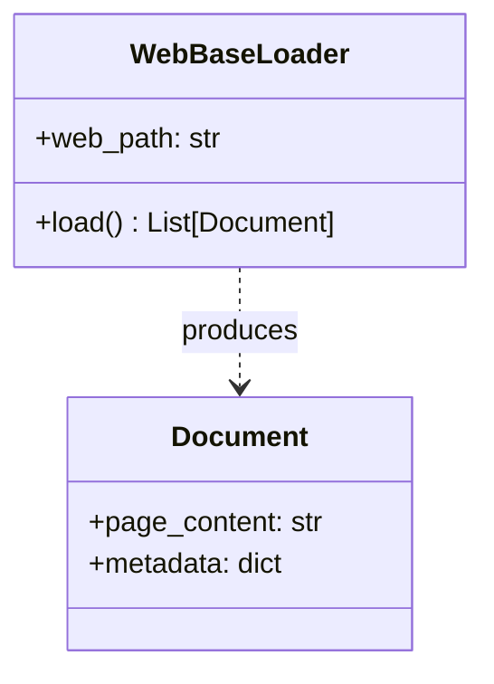

In the foundational notebooks, a BeautifulSoup `WebBaseLoader` is configured to target specific CSS classes (e.g., post-content, post-title) to ensure only relevant text is ingested [rag_from_scratch_1_to_4.ipynb:55-65]().

Sources: [rag_from_scratch_1_to_4.ipynb:55-65]()

## Document Chunking

Chunking is the process of breaking down large documents into smaller pieces to fit within the context window of embedding models and LLMs. The repository uses `RecursiveCharacterTextSplitter`.

### Implementation Details
- **Chunk Size**: Defined by `chunk_size` (e.g., 300 characters) [rag_from_scratch_1_to_4.ipynb:69-70]().
- **Chunk Overlap**: Defined by `chunk_overlap` (e.g., 50 characters) to maintain semantic continuity between adjacent chunks [rag_from_scratch_1_to_4.ipynb:70-71]().
- **Recursive Strategy**: The splitter attempts to split by a list of characters (typically `["\n\n", "\n", " ", ""]`) recursively until chunks are small enough.

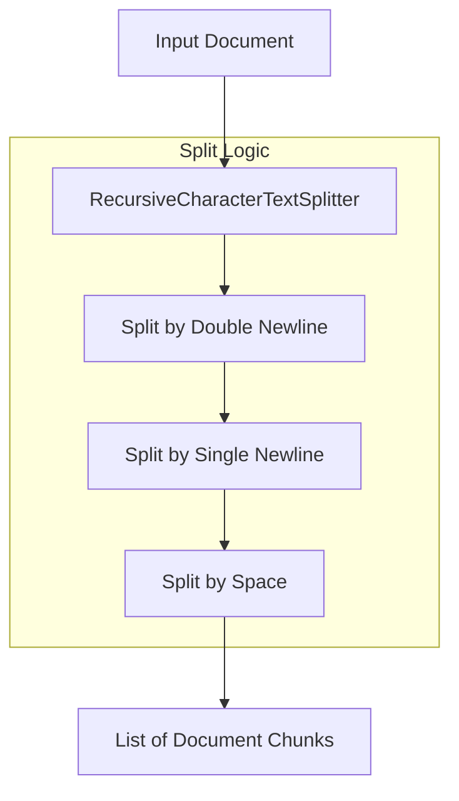

Sources: [rag_from_scratch_1_to_4.ipynb:67-73]()

## Embedding Generation

Once documents are split, each chunk is converted into a high-dimensional vector. This "Natural Language Space" to "Vector Space" transition is handled by the `OpenAIEmbeddings` class.

| Property | Value (Default) |
| :--- | :--- |
| **Model** | `text-embedding-3-small` |
| **Dimensions** | 1536 (typical for OpenAI) |
| **Function** | `embed_documents()` |

The embedding model maps semantic meaning to coordinates; chunks with similar meanings are positioned close to each other in the vector space [rag_from_scratch_1_to_4.ipynb:101-115]().

Sources: [rag_from_scratch_1_to_4.ipynb:75-76](), [rag_from_scratch_1_to_4.ipynb:101-115]()

## Vector Indexing and Storage

The final stage is the creation of a `VectorStore`. The repository uses `Chroma`, an embedding database, to index the generated vectors.

### Data Flow to Code Entities
This diagram bridges the conceptual process to the specific LangChain and Chroma entities used in the code.

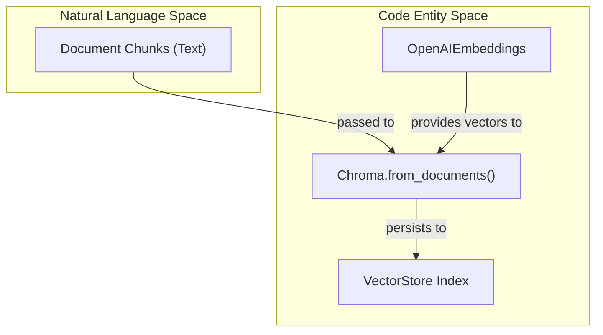

### Retrieval Integration
The `VectorStore` is converted into a `Retriever` object using the `.as_retriever()` method. This abstraction allows the RAG chain to query the index without needing to manage the underlying vector similarity math directly [rag_from_scratch_1_to_4.ipynb:77-78]().

```python
# Code Reference for Indexing
vectorstore = Chroma.from_documents(documents=all_splits, embedding=OpenAIEmbeddings())
retriever = vectorstore.as_retriever()
```

Sources: [rag_from_scratch_1_to_4.ipynb:75-78]()

## Multi-Representation Indexing (Advanced)

In later sections (Notebooks 12-14), more complex indexing strategies are introduced, such as the **Multi-Vector Retriever**. Instead of indexing the raw chunks directly, the system might index:
1. **Summaries**: Index a summary of the chunk but retrieve the full text.
2. **Sub-documents**: Split chunks into even smaller "child" chunks for better embedding granularity, but return the "parent" chunk to provide more context to the LLM.

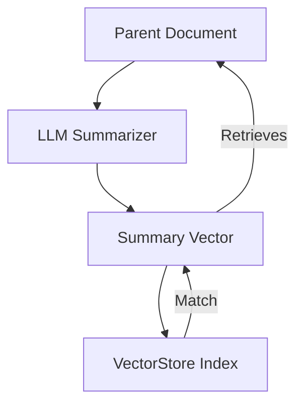

Sources: [rag_from_scratch_12_to_14.ipynb:1-20]()

---

# Page: Retrieval Mechanisms

# Retrieval Mechanisms

<details>
<summary>Relevant source files</summary>

The following files were used as context for generating this wiki page:

- [rag_from_scratch_12_to_14.ipynb](rag_from_scratch_12_to_14.ipynb)
- [rag_from_scratch_15_to_18.ipynb](rag_from_scratch_15_to_18.ipynb)
- [rag_from_scratch_5_to_9.ipynb](rag_from_scratch_5_to_9.ipynb)

</details>


This page explains the retrieval component of Retrieval-Augmented Generation (RAG) systems as implemented in the "RAG from scratch" repository. Retrieval mechanisms are responsible for finding and fetching the most relevant document chunks from a vector database or index in response to a user query.

## Overview of Retrieval in RAG

Retrieval is the process of identifying which document chunks in the vector store are most likely to contain the information needed to answer a specific query. The system converts the natural language query into a vector and performs a similarity search against the indexed document vectors.

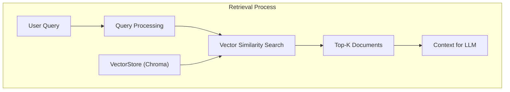

Sources:
- The general flow described in [rag_from_scratch_1_to_4.ipynb:1-100]()

## Multi-Query Retrieval

To improve retrieval robustness, the codebase implements "Multi-Query" retrieval. This technique uses an LLM to generate multiple versions of a user's query from different perspectives. This overcomes limitations of single-vector distance-based searches by capturing different semantic nuances.

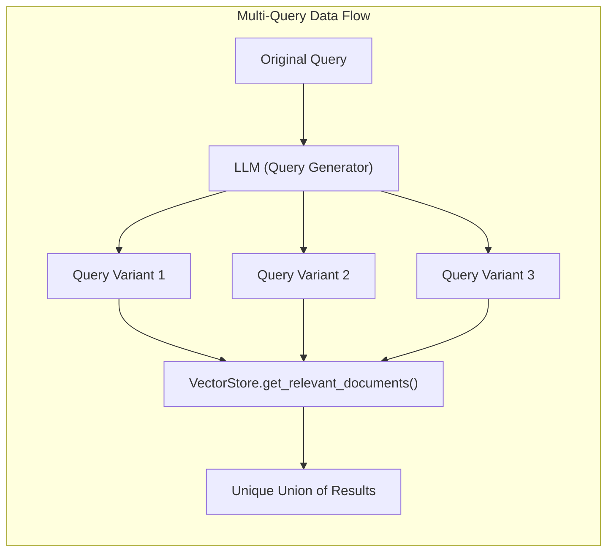

### Implementation Details
The implementation uses a `PromptTemplate` to instruct the LLM to generate five different versions of the input question [rag_from_scratch_5_to_9.ipynb:42-60](). The `MultiQueryRetriever` (from `langchain.retrievers.multi_query`) automates this process by wrapping a base retriever.

Sources:
- Multi-query implementation in [rag_from_scratch_5_to_9.ipynb:35-110]()

## RAG-Fusion and Reciprocal Rank Fusion (RRF)

RAG-Fusion extends the multi-query concept by re-ranking the results retrieved from multiple queries. It uses **Reciprocal Rank Fusion (RRF)**, an algorithm that provides a final score based on the rank of documents across different search results rather than their raw similarity scores.

### Reciprocal Rank Fusion Logic
For each document $d$ in the set of retrieved documents $D$:
$$score(d) = \sum_{q \in Queries} \frac{1}{k + rank(q, d)}$$
Where $k$ is a constant (typically 60) to prevent small ranks from dominating.

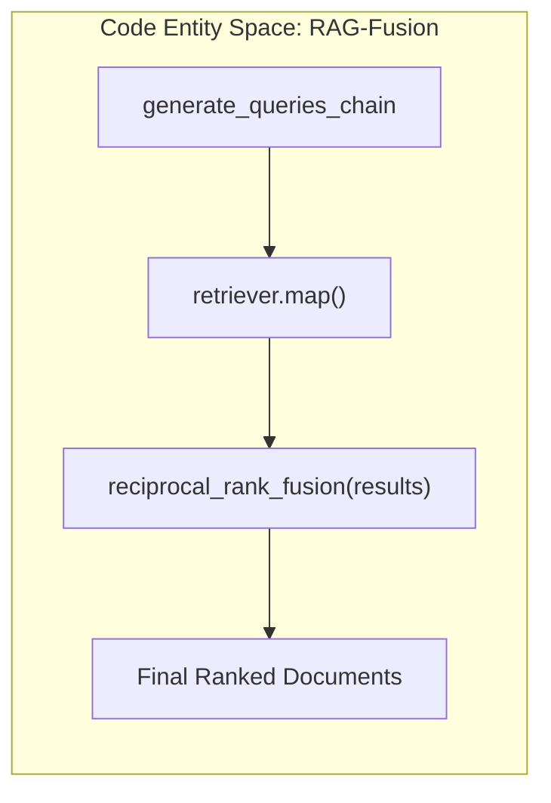

Sources:
- RAG-Fusion implementation and RRF function in [rag_from_scratch_5_to_9.ipynb:120-200]()

## Decomposition and Sub-Query Retrieval

For complex questions, the system implements **Query Decomposition**. This involves breaking down a single query into sub-questions that can be answered independently.

| Technique | Description | Code Reference |
| :--- | :--- | :--- |
| **Least-to-Most** | Breaking a query into sub-problems solved sequentially. | [rag_from_scratch_5_to_9.ipynb:350-400]() |
| **Sub-Query Decomposition** | Generating N sub-questions and retrieving context for each. | [rag_from_scratch_5_to_9.ipynb:450-500]() |

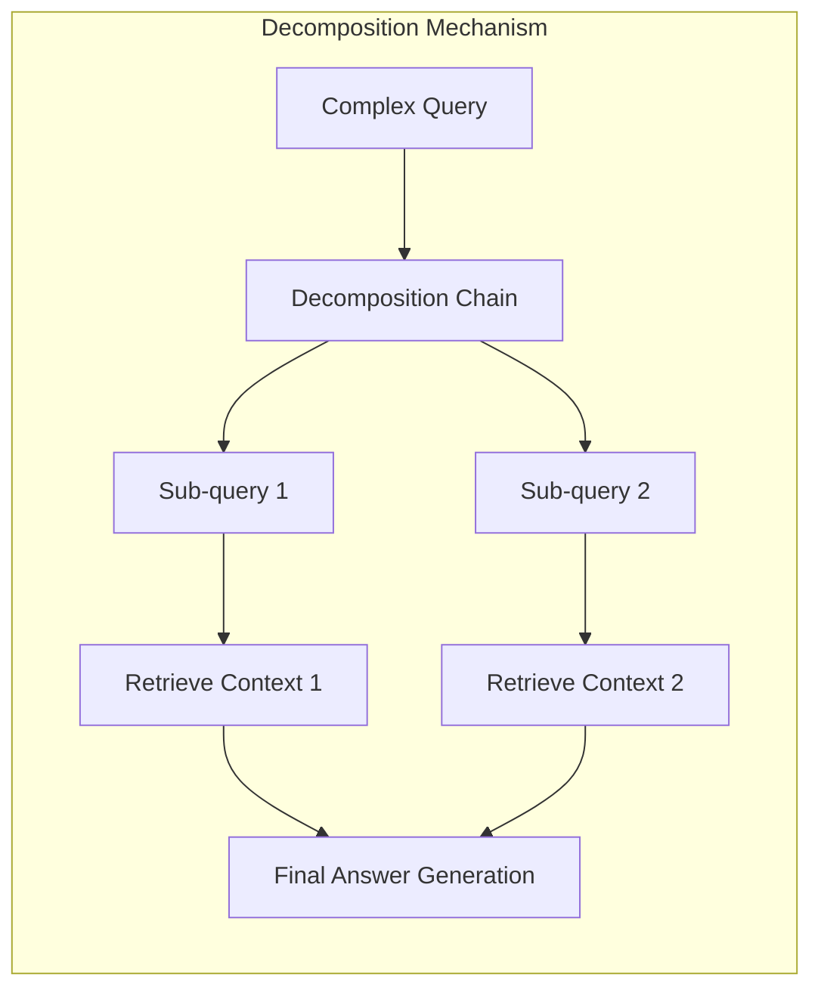

Sources:
- Decomposition logic in [rag_from_scratch_5_to_9.ipynb:325-550]()

## Step-Back Prompting and Long-Context Retrieval

The repository explores techniques to handle retrieval when specific queries are too narrow or context is too large.

1.  **Step-Back Prompting**: Generates a more generic "step-back" question to retrieve higher-level principles or broader context [rag_from_scratch_5_to_9.ipynb:570-650]().
2.  **Long-Context Re-ranking**: When many documents are retrieved, the system uses a `LongContextReorder` to prevent the "lost in the middle" phenomenon where LLMs ignore context in the center of a long prompt.

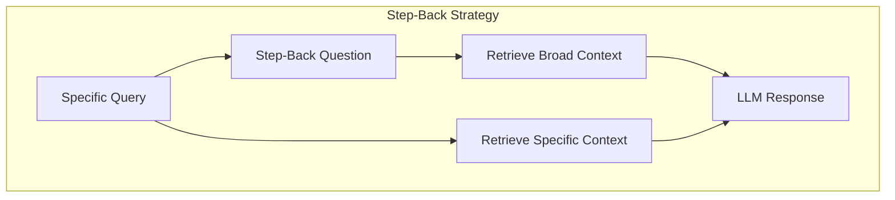

Sources:
- Step-back implementation in [rag_from_scratch_5_to_9.ipynb:560-700]()

## Technical Summary of Retrieval Entities

| Component | Code Entity / Class | Purpose |
| :--- | :--- | :--- |
| **Retriever** | `vectorstore.as_retriever()` | Basic similarity search interface [rag_from_scratch_1_to_4.ipynb:120-130]() |
| **Multi-Query** | `MultiQueryRetriever` | Generating query variations [rag_from_scratch_5_to_9.ipynb:100-110]() |
| **Fusion** | `reciprocal_rank_fusion` | Re-ranking multiple search results [rag_from_scratch_5_to_9.ipynb:140-160]() |
| **Context Reorder** | `LongContextReorder` | Optimizing document order for LLM attention [rag_from_scratch_12_to_14.ipynb:200-250]() |

Sources:
- Class definitions and usage across [rag_from_scratch_1_to_4.ipynb](), [rag_from_scratch_5_to_9.ipynb](), and [rag_from_scratch_12_to_14.ipynb]()

---

# Page: Query Augmentation and Generation

# Query Augmentation and Generation

<details>
<summary>Relevant source files</summary>

The following files were used as context for generating this wiki page:

- [rag_from_scratch_1_to_4.ipynb](rag_from_scratch_1_to_4.ipynb)
- [rag_from_scratch_5_to_9.ipynb](rag_from_scratch_5_to_9.ipynb)

</details>


## Purpose and Scope

This document explains the final stage of the RAG pipeline: Query Augmentation and Generation. This component is responsible for leveraging retrieved documents to enhance the original query and generate high-quality responses using a language model. It covers the process from receiving retrieved documents to returning the final generated response to the user. This section builds upon the retrieval mechanisms explained in [Retrieval Mechanisms]() and completes the RAG workflow.

## Overview of Query Augmentation and Generation

Query Augmentation and Generation represents the critical final stage in the RAG pipeline where retrieved information is integrated with the original query to produce contextually informed responses. This process bridges the gap between retrieved documents and the language model's response generation capabilities.

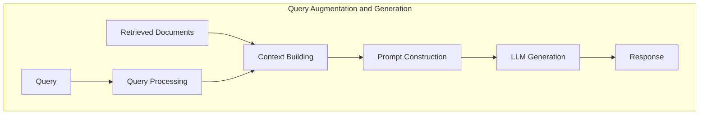

Sources: [rag_from_scratch_1_to_4.ipynb:5-30]()

## Components of Query Augmentation and Generation

The Query Augmentation and Generation process consists of several key components that work together to transform retrieved documents and the original query into a final response. In the provided notebooks, this is primarily handled using `LangChain` Expression Language (LCEL) chains.

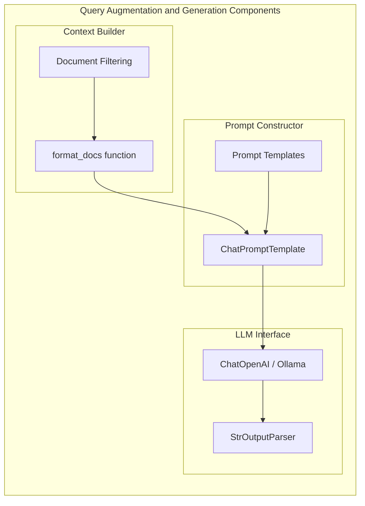

Sources: [rag_from_scratch_1_to_4.ipynb:420-440](), [rag_from_scratch_5_to_9.ipynb:10-30]()

### Context Building

The Context Builder component takes retrieved documents and processes them to create a coherent context for the language model. In the implementation, this is often a helper function called `format_docs`.

1. **Document prioritization**: Arranging retrieved documents by relevance (usually handled by the retriever's score).
2. **Context assembly**: Combining selected document fragments into a unified string.

```python
def format_docs(docs):
    return "\n\n".join(doc.page_content for doc in docs)
```

Sources: [rag_from_scratch_1_to_4.ipynb:421-423]()

### Prompt Construction

The Prompt Constructor creates the final prompt that will be sent to the language model. The repository uses `ChatPromptTemplate` to define the structure.

1. **Template selection**: Defining a system message that instructs the LLM to use the provided context.
2. **Context integration**: Using placeholders like `{context}` and `{question}` to inject data.

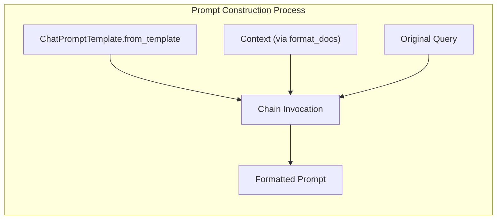

Sources: [rag_from_scratch_1_to_4.ipynb:413-418]()

### Response Generation

The final component handles the interaction with the language model and processes its output:

1. **LLM interface**: Using `ChatOpenAI` or local models via `Ollama`.
2. **Response parsing**: Utilizing `StrOutputParser` to convert the LLM's `BaseMessage` output into a simple string.

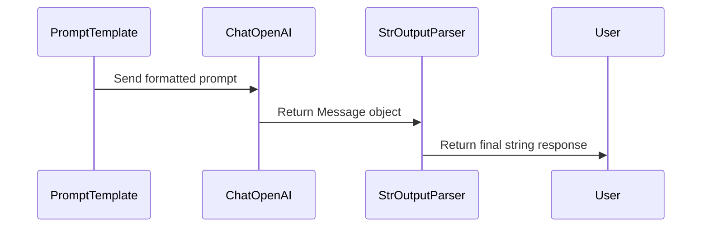

Sources: [rag_from_scratch_1_to_4.ipynb:426-433]()

## Advanced Query Augmentation (RAG Fusion & Multi-Query)

The repository introduces advanced techniques in notebooks 5-9 to improve generation by augmenting the query before retrieval or by synthesizing multiple retrieval results.

### Multi-Query Retrieval
Instead of a single query, the system generates multiple versions of the user's question to capture different perspectives, increasing the chance of retrieving relevant documents [rag_from_scratch_5_to_9.ipynb:120-140]().

### RAG Fusion
This technique generates multiple queries, retrieves documents for each, and then applies **Reciprocal Rank Fusion (RRF)** to re-rank the results before passing them to the generation stage [rag_from_scratch_5_to_9.ipynb:450-480]().

```mermaid
flowchart TD
    Q["User Query"] --> MG["Multi-Query Generation"]
    MG --> R1["Retriever 1"]
    MG --> R2["Retriever 2"]
    R1 --> RRF["Reciprocal Rank Fusion"]
    R2 --> RRF
    RRF --> FC["Fused Context"]
    FC --> G["Generation"]
```

Sources: [rag_from_scratch_5_to_9.ipynb:482-510]()

## Implementation Considerations

### Context Window Management
The implementation must ensure that the combined `context` and `question` do not exceed the model's token limit. In the basic implementation, this is implicitly managed by the `k` parameter in the retriever (e.g., `retriever = vectorstore.as_retriever(search_kwargs={"k": 3})`) [rag_from_scratch_1_to_4.ipynb:400-405]().

### Response Quality Control
The prompts used in the repository often include "Hallucination prevention" instructions, such as: *"If you don't know the answer, just say that you don't know, don't try to make up an answer."* [rag_from_scratch_1_to_4.ipynb:413-418]().

## Practical Example Flow

This sequence diagram illustrates the complete flow using the LCEL (LangChain Expression Language) syntax found in the codebase:

```mermaid
sequenceDiagram
    participant U as User
    participant R as retriever
    participant F as format_docs
    participant P as prompt
    participant L as llm
    participant O as out_parser
    
    U->>R: Invoke with Query
    R->>F: List[Document]
    F->>P: Formatted Context String
    U->>P: Original Question
    P->>L: Full Prompt (Context + Question)
    L->>O: AIMessage
    O->>U: Final String Response
```

Sources: [rag_from_scratch_1_to_4.ipynb:426-433]()

## Conclusion

The Query Augmentation and Generation component represents the culminating stage of the RAG pipeline. By using LCEL chains to link retrievers, formatting functions, and prompt templates, the system transforms raw retrieved data into accurate, contextually relevant natural language responses. Advanced techniques like RAG Fusion further enhance this by ensuring the most relevant context is prioritized during the generation phase.

---

# Page: Basic RAG Implementation (Notebooks 1-4)

# Basic RAG Implementation (Notebooks 1-4)

<details>
<summary>Relevant source files</summary>

The following files were used as context for generating this wiki page:

- [rag_from_scratch_1_to_4.ipynb](rag_from_scratch_1_to_4.ipynb)

</details>


## Purpose and Scope

This document provides a detailed technical explanation of the foundational Retrieval-Augmented Generation (RAG) implementation as presented in notebooks 1 through 4. It focuses on the core mechanics of indexing, retrieval, and generation using the LangChain framework. The scope covers the transition from raw web content to a functional RAG chain.

## Overview of Notebooks 1-4

The initial phase of the "RAG from scratch" series establishes the "Three Pillars of RAG":
1.  **Indexing**: Loading, splitting, and storing data.
2.  **Retrieval**: Fetching relevant data based on user queries.
3.  **Generation**: Producing an answer using an LLM and the retrieved context.

Sources: [rag_from_scratch_1_to_4.ipynb:1-20]()

## Indexing Pipeline

The indexing process converts unstructured data into a structured vector format. In these notebooks, the `WebBaseLoader` is used to fetch content from a blog post, which is then processed into chunks.

### Document Loading and Splitting
The implementation utilizes the `RecursiveCharacterTextSplitter` to break documents into manageable pieces. This specific splitter is preferred because it attempts to keep related text (like paragraphs and sentences) together by splitting on a hierarchy of characters.

| Component | Code Entity | Purpose |
| :--- | :--- | :--- |
| **Loader** | `WebBaseLoader` | Fetches HTML content from URLs [rag_from_scratch_1_to_4.ipynb:58-62]() |
| **Splitter** | `RecursiveCharacterTextSplitter` | Chunks text into segments of `chunk_size` [rag_from_scratch_1_to_4.ipynb:74-78]() |
| **Parameters** | `chunk_size`, `chunk_overlap` | Controls the granularity and context continuity [rag_from_scratch_1_to_4.ipynb:76-77]() |

### Vector Storage
Once split, the text chunks are converted into embeddings using `OpenAIEmbeddings` and stored in a `Chroma` vector database.

```mermaid
graph TD
    subgraph "Code Entity Space: Indexing"
        URL["blog_url"] --> Loader["WebBaseLoader.load()"]
        Loader --> Docs["docs (List of Documents)"]
        Docs --> Splitter["RecursiveCharacterTextSplitter.split_documents()"]
        Splitter --> Splits["splits (List of Chunks)"]
        Splits --> Embeddings["OpenAIEmbeddings.embed_documents()"]
        Embeddings --> VectorStore["Chroma.from_documents()"]
    end
```
Sources: [rag_from_scratch_1_to_4.ipynb:58-94]()

## Retrieval and Generation

The "Online" portion of the RAG system connects the stored data to the user query and the LLM.

### Retrieval Mechanism
The `vectorstore` is exposed as a `Retriever` interface. When a query is received, the system performs a similarity search to identify the `k` most relevant splits.

### Prompting and Generation
A specific prompt template is pulled from the LangChain Hub (`rlm/rag-prompt`). This template instructs the LLM to use the retrieved context to answer the question.

```mermaid
flowchart TD
    subgraph "RAG Data Flow"
        Query["Question (String)"] --> Retriever["vectorstore.as_retriever()"]
        Retriever --> Context["retrieved_docs (List of Documents)"]
        Context --> Formatter["format_docs()"]
        Formatter --> Prompt["ChatPromptTemplate (rlm/rag-prompt)"]
        Query --> Prompt
        Prompt --> LLM["ChatOpenAI (gpt-3.5-turbo)"]
        LLM --> Output["Final Answer (String)"]
    end
```
Sources: [rag_from_scratch_1_to_4.ipynb:100-138]()

## Key Implementation Details

### The `format_docs` Function
A utility function `format_docs` is implemented to join the page content of retrieved documents with double newlines. This ensures the LLM receives a clean, continuous block of text as context.
[rag_from_scratch_1_to_4.ipynb:128-130]()

### The RAG Chain (LCEL)
The implementation uses **LangChain Expression Language (LCEL)** to pipe components together. This declarative style defines the flow from input to output.

```python
# Conceptual LCEL Flow
rag_chain = (
    {"context": retriever | format_docs, "question": RunnablePassthrough()}
    | prompt
    | llm
    | StrOutputParser()
)
```
[rag_from_scratch_1_to_4.ipynb:132-138]()

## Summary of Configuration (Notebooks 1-4)

The foundational implementation uses the following default technical stack:

| Layer | Implementation Entity |
| :--- | :--- |
| **LLM** | `ChatOpenAI` (Model: `gpt-3.5-turbo`) [rag_from_scratch_1_to_4.ipynb:104-104]() |
| **Embeddings** | `OpenAIEmbeddings` [rag_from_scratch_1_to_4.ipynb:89-89]() |
| **Vector DB** | `Chroma` [rag_from_scratch_1_to_4.ipynb:92-94]() |
| **Chunking** | `chunk_size=1000`, `chunk_overlap=200` [rag_from_scratch_1_to_4.ipynb:76-77]() |

Sources: [rag_from_scratch_1_to_4.ipynb:74-138]()

## Limitations of the Basic Approach
As noted in the transition to subsequent notebooks, this basic implementation:
1.  **Retrieval**: Relies solely on semantic similarity, which may fail if the query and document use different terminology.
2.  **Generation**: Does not include logic for query rewriting or multi-step reasoning.
3.  **Context**: Does not handle cases where the retrieved context is irrelevant or "noisy."

These limitations are addressed in [Advanced RAG Techniques (Notebooks 5-9)]().

---

# Page: Advanced RAG Techniques (Notebooks 5-9)

# Advanced RAG Techniques (Notebooks 5-9)

<details>
<summary>Relevant source files</summary>

The following files were used as context for generating this wiki page:

- [rag_from_scratch_5_to_9.ipynb](rag_from_scratch_5_to_9.ipynb)

</details>


## Purpose and Scope

This document covers the advanced Retrieval-Augmented Generation (RAG) techniques implemented in notebooks 5-9 of the RAG from scratch repository. These notebooks transition from basic retrieval to sophisticated query transformation and translation strategies. The primary goal is to address common failure modes in RAG, such as poor query phrasing, lack of domain-specific terminology, and the limitations of single-vector similarity search.

## Query Translation Overview

Notebooks 5-9 focus heavily on **Query Translation**, the process of modifying or decomposing a user query before it reaches the vector store to improve retrieval accuracy [rag_from_scratch_5_to_9.ipynb:1-15]().

```mermaid
flowchart TD
    subgraph "Query Translation Logic"
        UserQuery["User Query"] --> MQ["Multi-Query"]
        UserQuery --> RAG_Fusion["RAG Fusion"]
        UserQuery --> Decomp["Decomposition"]
        UserQuery --> StepBack["Step Back"]
        UserQuery --> HyDE["HyDE"]
        
        MQ --> VSS["Vector Store Search"]
        RAG_Fusion --> VSS
        Decomp --> VSS
        StepBack --> VSS
        HyDE --> VSS
    end

    subgraph "Code Entity Space"
        VSS -- "retriever.get_relevant_documents()" --> Results["Document Chunks"]
        MQ -- "MultiQueryRetriever" --> MQ_Code["langchain.retrievers.multi_query"]
    end
```
Sources: [rag_from_scratch_5_to_9.ipynb:1-50]()

## Multi-Query Retrieval (Notebook 5)

The `Multi-Query` approach addresses the sensitivity of distance-based vector search to specific wording. It uses an LLM to generate multiple perspectives of the same query [rag_from_scratch_5_to_9.ipynb:18-25]().

*   **Implementation**: An LLM prompt is defined to generate five different versions of the user question [rag_from_scratch_5_to_9.ipynb:34-45]().
*   **Data Flow**: Each generated query is sent to the retriever. The results are then combined (union) to create a larger set of potentially relevant documents [rag_from_scratch_5_to_9.ipynb:101-115]().

Sources: [rag_from_scratch_5_to_9.ipynb:34-45](), [rag_from_scratch_5_to_9.ipynb:101-115]()

## RAG Fusion (Notebook 6)

RAG Fusion builds on Multi-Query by adding a re-ranking step using **Reciprocal Rank Fusion (RRF)**. This algorithm scores documents based on their rank across multiple search results rather than their absolute similarity score [rag_from_scratch_5_to_9.ipynb:154-165]().

### Reciprocal Rank Fusion Logic
The function `reciprocal_rank_fusion` takes a list of search results and applies the formula:
`score = 1 / (rank + k)`
where `k` is a constant (defaulting to 60) [rag_from_scratch_5_to_9.ipynb:237-258]().

```mermaid
flowchart TD
    subgraph "RAG Fusion Implementation"
        Q["User Query"] --> LLM_Gen["LLM: Generate 4 Queries"]
        LLM_Gen --> Search["Vector Search (4x)"]
        Search --> RRF["reciprocal_rank_fusion()"]
        RRF --> TopK["Select Top Documents"]
        TopK --> FinalGen["Final Generation"]
    end
```
Sources: [rag_from_scratch_5_to_9.ipynb:237-258](), [rag_from_scratch_5_to_9.ipynb:268-285]()

## Decomposition (Notebook 7)

Decomposition breaks a complex query into simpler sub-questions. This is particularly effective for multi-hop reasoning where the answer to the main question depends on several distinct pieces of information [rag_from_scratch_5_to_9.ipynb:363-375]().

*   **Sub-query Generation**: The LLM is prompted to "generate sub-questions" related to the input [rag_from_scratch_5_to_9.ipynb:384-395]().
*   **Iterative Search**: The system can solve these sub-questions sequentially, using the answer of the first to inform the retrieval of the second (Recursive RAG) [rag_from_scratch_5_to_9.ipynb:491-510]().

Sources: [rag_from_scratch_5_to_9.ipynb:384-395](), [rag_from_scratch_5_to_9.ipynb:491-510]()

## Step-Back Prompting (Notebook 8)

Step-back prompting encourages the LLM to generate a high-level, "step-back" question about concepts or principles related to the specific query [rag_from_scratch_5_to_9.ipynb:615-625]().

*   **Mechanism**: If a user asks a specific technical question, the "step-back" question might ask about the underlying architecture.
*   **Retrieval**: Both the original and the step-back questions are used for retrieval, providing the LLM with both specific facts and broad context [rag_from_scratch_5_to_9.ipynb:671-685]().

Sources: [rag_from_scratch_5_to_9.ipynb:634-645](), [rag_from_scratch_5_to_9.ipynb:671-685]()

## Hypothetical Document Embeddings - HyDE (Notebook 9)

HyDE flips the standard RAG approach. Instead of using the query to find documents, it uses an LLM to generate a *hypothetical* answer (a "fake" document) and uses that answer to perform the vector search [rag_from_scratch_5_to_9.ipynb:754-765]().

*   **Logic**: The hypothetical document captures the semantic pattern of a relevant result better than a short, keyword-sparse query [rag_from_scratch_5_to_9.ipynb:767-775]().
*   **Code Flow**:
    1.  `hyde_prompt` generates a synthetic response [rag_from_scratch_5_to_9.ipynb:784-795]().
    2.  This response is embedded via `embeddings.embed_query()`.
    3.  `vectorstore.similarity_search()` uses the synthetic embedding to find real documents [rag_from_scratch_5_to_9.ipynb:801-815]().

```mermaid
sequenceDiagram
    participant U as User Query
    participant L as LLM (HyDE Prompt)
    participant E as Embedding Model
    participant V as Vector Store
    U->>L: "What is task decomposition?"
    L->>L: Generates "fake" document explaining decomposition
    L->>E: embed_query(fake_doc)
    E->>V: similarity_search(fake_embedding)
    V->>U: Return real relevant documents
```
Sources: [rag_from_scratch_5_to_9.ipynb:784-795](), [rag_from_scratch_5_to_9.ipynb:801-815]()

## Summary of Techniques

| Technique | Core Logic | Key Function/Prompt |
| :--- | :--- | :--- |
| **Multi-Query** | Generates multiple query variations | `MultiQueryRetriever` [rag_from_scratch_5_to_9.ipynb:101-105]() |
| **RAG Fusion** | Re-ranks results using RRF | `reciprocal_rank_fusion` [rag_from_scratch_5_to_9.ipynb:237-240]() |
| **Decomposition** | Breaks query into sub-questions | `template` (sub-questions) [rag_from_scratch_5_to_9.ipynb:384-390]() |
| **Step-Back** | Generates an abstract question | `step_back_prompt` [rag_from_scratch_5_to_9.ipynb:634-640]() |
| **HyDE** | Maps query to hypothetical answer | `hyde_prompt` [rag_from_scratch_5_to_9.ipynb:784-790]() |

Sources: [rag_from_scratch_5_to_9.ipynb:1-850]()

---

# Page: Extensions and Optimizations (Notebooks 10-11)

# Extensions and Optimizations (Notebooks 10-11)

<details>
<summary>Relevant source files</summary>

The following files were used as context for generating this wiki page:

- [rag_from_scratch_10_and_11.ipynb](rag_from_scratch_10_and_11.ipynb)

</details>


## Purpose and Scope

This document details the extensions and optimization techniques implemented in notebooks 10 and 11 of the RAG from scratch repository. These notebooks focus on **Routing** and **Query Construction**, moving beyond simple retrieval to systems that can dynamically choose data paths or translate natural language into structured queries for specific database schemas.

For information about the core RAG implementation, see [Basic RAG Implementation (Notebooks 1-4)](). For the advanced techniques that these optimizations build upon, see [Advanced RAG Techniques (Notebooks 5-9)]().

## Routing (Notebook 10)

Notebook 10 introduces "Routing," a logic layer that directs an incoming query to the most appropriate retrieval pipeline or data source. This prevents "noise" by ensuring queries are only sent to relevant indices.

### Logical Routing

Logical routing uses an LLM to classify a query and select a destination. The implementation uses `ChatOpenAI` and function calling (structured outputs) to produce a routing decision [rag_from_scratch_10_and_11.ipynb:101-140]().

```mermaid
flowchart TD
    subgraph "Logical Routing System"
        direction TB
        UserQuery["User Query"] --> LLM_Router["LLM Router (with Pydantic Schema)"]
        LLM_Router --> Decision{"Route Decision"}
        
        Decision -- "python_docs" --> VectorStore["VectorStore Retriever"]
        Decision -- "web_search" --> WebSearch["Tavily Search Tool"]
        
        VectorStore --> Result1["Context from Docs"]
        WebSearch --> Result2["Context from Web"]
        
        Result1 --> Generator["LLM Generator"]
        Result2 --> Generator
        Generator --> FinalAnswer["Final Response"]
    end
```

**Key Components:**
*   **RouteQuery Class**: A Pydantic model used to constrain the LLM's output to a specific set of strings (e.g., `web_search` or `vectorstore`) [rag_from_scratch_10_and_11.ipynb:101-118]().
*   **Structured Output**: The LLM is prompted to act as an expert router [rag_from_scratch_10_and_11.ipynb:120-137]().
*   **Routing Function**: A logic gate (often implemented via a `choose_route` function) that inspects the LLM output and calls the corresponding branch [rag_from_scratch_10_and_11.ipynb:165-185]().

### Semantic Routing

Semantic routing directs queries based on their embedding similarity to predefined "prompt templates" or "topic clusters" rather than explicit classification [rag_from_scratch_10_and_11.ipynb:218-285]().

```mermaid
flowchart LR
    subgraph "Semantic Router"
        Query["User Query"] --> Embedder["Embeddings Model"]
        Embedder --> Similarity["Cosine Similarity Check"]
        Similarity --> PhysicsTemplate["Physics Prompt"]
        Similarity --> MathTemplate["Math Prompt"]
        Similarity --> Default["General Prompt"]
    end
```

**Implementation Details:**
*   **Prompt Templates**: Multiple templates are defined for different domains (e.g., physics, math) [rag_from_scratch_10_and_11.ipynb:218-245]().
*   **Embeddings**: Templates are embedded and stored. The query is compared against these embeddings to find the closest match [rag_from_scratch_10_and_11.ipynb:247-265]().

**Sources:** [rag_from_scratch_10_and_11.ipynb:101-285]()

---

## Query Construction (Notebook 11)

Notebook 11 explores "Query Construction," where the system translates natural language into a domain-specific language (DSL) like SQL or Cypher, or structured filters for metadata.

### Structured Queries for Metadata Filters

Many vector databases (like Pinecone or Chroma) support metadata filtering. Notebook 11 demonstrates how to use an LLM to extract these filters from a natural language query [rag_from_scratch_10_and_11.ipynb:346-455]().

| Component | Code Entity / Role |
| :--- | :--- |
| **Schema Definition** | Pydantic model defining valid filter attributes (e.g., `year`, `author`) [rag_from_scratch_10_and_11.ipynb:368-385]() |
| **Query Translator** | LLM prompt that maps "recent papers" to `{"year": {"$gt": 2022}}` [rag_from_scratch_10_and_11.ipynb:390-420]() |
| **Self-Query Retriever** | A retriever that combines the semantic vector search with the generated metadata filter [rag_from_scratch_10_and_11.ipynb:430-455]() |

### Natural Language to SQL

This optimization allows RAG systems to access structured relational data. The data flow bridges the "Natural Language Space" to the "SQL Execution Space."

```mermaid
flowchart TD
    subgraph "NL-to-SQL Pipeline"
        direction TB
        User_NL["'How many users signed up in 2023?'"] --> SQL_Prompt["SQL Generation Prompt"]
        SQL_Prompt --> LLM_Coder["LLM (Text-to-SQL)"]
        
        LLM_Coder --> SQL_Query["SELECT COUNT(*) FROM users WHERE..."]
        SQL_Query --> DB_Engine["SQLAlchemy / SQLite Engine"]
        
        DB_Engine --> SQL_Result["Result: 1500"]
        SQL_Result --> Final_Response_Prompt["Response Synthesis Prompt"]
        Final_Response_Prompt --> Final_Answer["'There were 1,500 users who signed up in 2023.'"]
    end
```

**Key Implementation Steps:**
1.  **Schema Context**: The LLM is provided with the table DDL (Data Definition Language) to understand column names and types [rag_from_scratch_10_and_11.ipynb:510-530]().
2.  **Query Generation**: The LLM generates the SQL string [rag_from_scratch_10_and_11.ipynb:540-560]().
3.  **Execution**: The system executes the query against a database (e.g., `langchain_community.utilities.SQLDatabase`) [rag_from_scratch_10_and_11.ipynb:570-585]().

**Sources:** [rag_from_scratch_10_and_11.ipynb:346-585]()

---

## Performance and Evaluation Summary

The optimizations in these notebooks address the "Retrieval Gap" where semantic search alone is insufficient.

| Optimization | Problem Solved | Key Function/Class |
| :--- | :--- | :--- |
| **Logical Routing** | Irrelevant data sources | `RouteQuery` (Pydantic), `with_structured_output` [rag_from_scratch_10_and_11.ipynb:101-118]() |
| **Semantic Routing** | Inefficient prompt selection | `cosine_similarity`, `Embeddings` [rag_from_scratch_10_and_11.ipynb:247-265]() |
| **Query Construction** | Structured data access | `SelfQueryRetriever`, `create_sql_query_chain` [rag_from_scratch_10_and_11.ipynb:430-585]() |

**Sources:** [rag_from_scratch_10_and_11.ipynb:1-600]()

---

# Page: Further Refinements (Notebooks 12-14)

# Further Refinements (Notebooks 12-14)

<details>
<summary>Relevant source files</summary>

The following files were used as context for generating this wiki page:

- [rag_from_scratch_12_to_14.ipynb](rag_from_scratch_12_to_14.ipynb)

</details>


This section covers the refinements and advanced techniques implemented in notebooks 12-14 of the RAG from scratch repository. These notebooks focus on "Long Context" challenges and "Re-ranking" strategies to optimize the balance between retrieval recall and generation precision.

## Purpose and Scope

The primary purpose of notebooks 12-14 is to address specific limitations in standard RAG pipelines, specifically the "Lost in the Middle" phenomenon and the noise introduced by large document sets. 

1.  **Re-ranking (Notebook 12)**: Implementing scoring layers to prioritize the most relevant documents.
2.  **Context Selection/Compression (Notebook 13)**: Reducing the token load while maintaining information density.
3.  **Long Context Management (Notebook 14)**: Handling large context windows and mitigating the performance degradation when relevant information is buried in the middle of a prompt.

## Re-ranking and Scoring (Notebook 12)

While initial retrieval (Vector Search) is fast, it often lacks precision. Notebook 12 introduces a two-stage retrieval process: initial retrieval followed by a re-ranking step using a more computationally expensive but accurate model.

### Implementation Logic
The system retrieves a larger set of documents (e.g., top 25) and uses a `CohereRerank` or similar cross-encoder to re-score them based on the query [rag_from_scratch_12_to_14.ipynb:154-180]().

**Diagram: Two-Stage Retrieval with Re-ranking**
```mermaid
graph TD
    subgraph "Retrieval Refinement (Notebook 12)"
        Query["'Question'"] --> VectorSearch["'Vector Store Retrieval (Top K=25)'"]
        VectorSearch --> RawDocs["'Candidate Documents'"]
        RawDocs --> Reranker["'CohereRerank / Cross-Encoder'"]
        Query --> Reranker
        Reranker --> TopDocs["'Top N Re-ranked Documents'"]
        TopDocs --> Generator["'RAG Chain / LLM'"]
    end
```
**Sources:** [rag_from_scratch_12_to_14.ipynb:140-180]()

## Context Selection and "Lost in the Middle" (Notebook 13)

LLMs often struggle to utilize information located in the middle of a long context window. Notebook 13 explores the "Long Context Reorder" technique to ensure the most relevant documents are placed at the beginning and end of the prompt.

### Key Implementation Entities
- **LongContextReorder**: A transformation step that sorts retrieved documents so that the highest-scoring items are at the extremities of the context window [rag_from_scratch_12_to_14.ipynb:342-375]().

**Diagram: Context Reordering Data Flow**
```mermaid
graph LR
    subgraph "Context Management (Notebook 13)"
        Docs["'Unordered Docs'"] --> ReorderFunc["'LongContextReorder'"]
        ReorderFunc --> ReorderedDocs["'[Most Rel, ..., Least Rel, ..., 2nd Most Rel]'"]
        ReorderedDocs --> Prompt["'PromptTemplate'"]
    end
```
**Sources:** [rag_from_scratch_12_to_14.ipynb:342-415]()

## Context Compression (Notebook 14)

To improve efficiency and reduce costs, Notebook 14 introduces the `ContextualCompressionRetriever`. This component filters or summarizes documents before passing them to the LLM.

### Components
- **LLMChainExtractor**: Uses an LLM to extract only the parts of the documents that are relevant to the query [rag_from_scratch_12_to_14.ipynb:488-510]().
- **EmbeddingsFilter**: Uses embedding similarity to prune documents that do not meet a specific relevance threshold [rag_from_scratch_12_to_14.ipynb:530-550]().

**Diagram: Natural Language Space to Code Entity Space**
```mermaid
graph TD
    subgraph "Natural Language Concepts"
        Rerank["'Re-ranking'"]
        Reorder["'Reordering'"]
        Compress["'Compression'"]
    end

    subgraph "Code Entity Space (Notebooks 12-14)"
        CR["'CohereRerank'"]
        LCR["'LongContextReorder'"]
        CCR["'ContextualCompressionRetriever'"]
        EF["'EmbeddingsFilter'"]
        LCE["'LLMChainExtractor'"]
    end

    Rerank --- CR
    Reorder --- LCR
    Compress --- CCR
    CCR --> EF
    CCR --> LCE
```
**Sources:** [rag_from_scratch_12_to_14.ipynb:488-550]()

## Summary of Refinement Techniques

| Notebook | Technique | Code Entity / Function | Purpose |
| :--- | :--- | :--- | :--- |
| 12 | Re-ranking | `CohereRerank` | Improves precision by re-scoring candidates [rag_from_scratch_12_to_14.ipynb:154-180]() |
| 13 | Re-ordering | `LongContextReorder` | Prevents 'Lost in the Middle' performance drops [rag_from_scratch_12_to_14.ipynb:342-375]() |
| 14 | Compression | `ContextualCompressionRetriever` | Reduces token count and noise in the prompt [rag_from_scratch_12_to_14.ipynb:488-510]() |
| 14 | Filtering | `EmbeddingsFilter` | Prunes irrelevant context using vector similarity [rag_from_scratch_12_to_14.ipynb:530-550]() |

**Sources:** [rag_from_scratch_12_to_14.ipynb:1-550]()

---

# Page: Production Implementation (Notebooks 15-18)

# Production Implementation (Notebooks 15-18)

<details>
<summary>Relevant source files</summary>

The following files were used as context for generating this wiki page:

- [rag_from_scratch_15_to_18.ipynb](rag_from_scratch_15_to_18.ipynb)

</details>


## Purpose and Scope

This document covers the production-ready implementation aspects of the RAG system as presented in notebooks 15-18 of the repository. These notebooks focus on advanced evaluation, fine-tuning, and the integration of specialized retrieval techniques like ColBERT and Fusion-in-Context to transform research implementations into robust systems. 

## ColBERT and Late Interaction

Notebook 15 introduces **ColBERT** (Contextualized Late Interaction over BERT), a model designed for efficient and precise retrieval by delaying the interaction between query and document representations. Unlike standard bi-encoders that compress a document into a single vector, ColBERT creates token-level embeddings.

### Implementation Detail
The implementation utilizes the `ragatouille` library to manage ColBERT indices. The core workflow involves initializing a `RAGPretrainedModel` and creating an index from document chunks.

```mermaid
graph TD
    subgraph "ColBERT Retrieval Flow"
        Query["Query Tokenization"] --> Q_Embed["Query Token Embeddings"]
        Doc["Document Chunks"] --> D_Index["ColBERT Indexing (Token Embeddings)"]
        Q_Embed --> MaxSim["MaxSim (Late Interaction)"]
        D_Index --> MaxSim
        MaxSim --> Rank["Ranked Results"]
    end
```

**Sources:**
- [rag_from_scratch_15_to_18.ipynb:42-108]()

## RAG Evaluation (RAGAS)

Notebook 16 focuses on **RAGAS** (RAG Assessment), a framework for reference-free evaluation of RAG pipelines. It quantifies performance across dimensions like faithfulness, answer relevance, and context precision.

### Key Metrics
| Metric | Description | Code Entity |
| :--- | :--- | :--- |
| **Faithfulness** | Measures if the answer is derived solely from the retrieved context. | `faithfulness` |
| **Answer Relevance** | Measures how pertinent the answer is to the query. | `answer_relevance` |
| **Context Precision** | Evaluates if the ground truth is ranked highly in retrieved docs. | `context_precision` |
| **Context Recall** | Checks if retrieved context contains the ground truth answer. | `context_recall` |

### Evaluation Workflow
The evaluation process uses a `Dataset` object containing `question`, `answer`, `contexts`, and `ground_truth`.

```mermaid
sequenceDiagram
    participant Pipeline as RAG_Pipeline
    participant RAGAS as RAGAS_Evaluator
    participant LLM as Evaluation_LLM
    
    Pipeline->>RAGAS: Provide [Q, A, Contexts, GT]
    RAGAS->>LLM: Score Faithfulness
    RAGAS->>LLM: Score Relevance
    LLM-->>RAGAS: Numeric Scores
    RAGAS-->>Pipeline: Evaluation Summary
```

**Sources:**
- [rag_from_scratch_15_to_18.ipynb:165-251]()

## Fine-tuning for RAG

Notebook 17 explores fine-tuning strategies to improve RAG performance, specifically focusing on generating synthetic datasets for training and using tools like **LlamaIndex** or **LangChain** for adapter-based tuning.

### Data Flow for Synthetic Generation
To fine-tune without manual labeling, the system uses an LLM to generate (Question, Context) pairs from the document corpus.

```mermaid
flowchart LR
    subgraph "Synthetic Data Generation"
        Corpus["Document Corpus"] --> Chunker["TextSplitter"]
        Chunker --> LLM_Gen["LLM (Question Generator)"]
        LLM_Gen --> Pair["(Question, Context) Pairs"]
        Pair --> FT_Set["Fine-tuning Dataset"]
    end
```

**Sources:**
- [rag_from_scratch_15_to_18.ipynb:342-410]()

## Long-Context RAG and Fusion

Notebook 18 addresses the "Lost in the Middle" phenomenon where LLMs struggle with large contexts. It implements **Long-Context Re-ranking** and **Fusion-in-Context** techniques.

### Re-ranking Implementation
After initial retrieval via a vector store (e.g., `Chroma`), a `CohereRerank` or similar cross-encoder is used to re-order the top-K documents based on their actual relevance to the query before passing them to the LLM.

```mermaid
graph TD
    subgraph "Code Entity Interaction"
        Q["User Query"] --> Ret["VectorStoreRetriever.get_relevant_documents()"]
        Ret --> Docs["Initial Doc List"]
        Docs --> Reranker["CohereRerank.compress_documents()"]
        Reranker --> TopDocs["Re-ordered Top-N Docs"]
        TopDocs --> Gen["LLMChain.run()"]
    end
```

**Sources:**
- [rag_from_scratch_15_to_18.ipynb:510-580]()

## Summary of Production Components

The transition to production involves moving from simple similarity search to a multi-stage pipeline:

1.  **Ingestion**: High-quality tokenization and ColBERT indexing for precise retrieval.
2.  **Retrieval**: Multi-vector search combined with cross-encoder re-ranking.
3.  **Evaluation**: Continuous monitoring using RAGAS metrics to detect hallucinations or retrieval drift.
4.  **Optimization**: Fine-tuning embeddings or LLMs on domain-specific synthetic data.

**Sources:**
- [rag_from_scratch_15_to_18.ipynb:1-600]()

---

# Page: Implementation Best Practices

# Implementation Best Practices

<details>
<summary>Relevant source files</summary>

The following files were used as context for generating this wiki page:

- [README.md](README.md)
- [rag_from_scratch_10_and_11.ipynb](rag_from_scratch_10_and_11.ipynb)
- [rag_from_scratch_12_to_14.ipynb](rag_from_scratch_12_to_14.ipynb)
- [rag_from_scratch_15_to_18.ipynb](rag_from_scratch_15_to_18.ipynb)
- [rag_from_scratch_1_to_4.ipynb](rag_from_scratch_1_to_4.ipynb)
- [rag_from_scratch_5_to_9.ipynb](rag_from_scratch_5_to_9.ipynb)

</details>


This page outlines the key best practices for implementing Retrieval-Augmented Generation (RAG) systems based on the patterns and techniques demonstrated throughout the RAG-from-scratch repository. It focuses on practical recommendations for each component of the RAG pipeline, from document processing to evaluation, highlighting approaches that enhance performance, accuracy, and maintainability.

## Document Processing Best Practices

Effective document processing forms the foundation of any RAG system. The quality of your chunks directly impacts retrieval performance.

### Chunking Strategies

```mermaid
graph TD
    subgraph "Data Preparation Space"
    A["Raw Document"] -- "TextSplitter.split_documents()" --> B["Document Chunks"]
    B -- "Embeddings.embed_documents()" --> C["VectorStore (Chroma/FAISS)"]
    end

    subgraph "Code Entity Space"
    B1["RecursiveCharacterTextSplitter"]
    B2["CharacterTextSplitter"]
    C1["Chroma.from_documents()"]
    end

    B -- "implemented by" --> B1
    B -- "alternative" --> B2
    C -- "instantiated via" --> C1

    Sources: [rag_from_scratch_1_to_4.ipynb:55-75](), [rag_from_scratch_5_to_9.ipynb:10-30]()
```

**Chunk size optimization:**
- Balance chunk size against query specificity. Smaller chunks (e.g., `chunk_size=250`) work well for specific queries, while larger chunks preserve more context [rag_from_scratch_1_to_4.ipynb:55-65]().
- **Chunk overlap:** Implement overlap (e.g., `chunk_overlap=50`) to avoid losing context at boundaries [rag_from_scratch_1_to_4.ipynb:58-60]().

**Semantic chunking:**
- Use `RecursiveCharacterTextSplitter` to maintain structural integrity by splitting on natural delimiters like newlines and spaces [rag_from_scratch_1_to_4.ipynb:62-70]().

Sources: [rag_from_scratch_1_to_4.ipynb](), [rag_from_scratch_5_to_9.ipynb]()

## Advanced Retrieval Best Practices

Retrieval quality directly affects the accuracy of the generated content. Multiple techniques can be combined for optimal results.

### Multi-Query and Decomposition

```mermaid
sequenceDiagram
    participant U as "User Query"
    participant LLM as "LLM (ChatOpenAI)"
    participant R as "Retriever"
    participant V as "VectorStore (Chroma)"

    U->>LLM: "Generate variations of query"
    LLM-->>U: "List of 5 unique queries"
    loop For each query
        U->>R: "invoke(query)"
        R->>V: "similarity_search()"
        V-->>R: "Documents"
    end
    R-->>U: "Unique Union of Documents"

    Note over U,V: Multi-Query Retrieval Pattern
    Sources: [rag_from_scratch_5_to_9.ipynb:55-120]()
```

**Query Transformation:**
- **Multi-Query:** Use an LLM to generate multiple perspectives of a user query to overcome distance-based retrieval limitations [rag_from_scratch_5_to_9.ipynb:55-80]().
- **RAG-Fusion:** Apply Reciprocal Rank Fusion (RRF) to re-rank documents retrieved from multiple query variations [rag_from_scratch_5_to_9.ipynb:135-160]().
- **Decomposition:** For complex questions, decompose the query into sub-questions and solve them sequentially (Sub-query decomposition) [rag_from_scratch_5_to_9.ipynb:350-380]().

Sources: [rag_from_scratch_5_to_9.ipynb]()

## Indexing and Storage Best Practices

Efficiently mapping documents to vector space requires balancing granularity and context.

### Multi-Vector Indexing
- **Summary Indexing:** Instead of indexing raw chunks, index a summary of the chunk created by an LLM. This often captures the "essence" better for retrieval while the raw chunk is passed to the LLM for generation [rag_from_scratch_10_and_11.ipynb:50-100]().
- **Parent-Document Retrieval:** Index small "child" chunks for precise retrieval but return the larger "parent" document to the LLM to provide broader context [rag_from_scratch_10_and_11.ipynb:150-200]().

Sources: [rag_from_scratch_10_and_11.ipynb]()

## Context Assembly and Generation Best Practices

How information is presented to the LLM significantly impacts generation quality.

### Reranking and Filtering
- **Cohere Rerank:** Use a specialized reranker (like `CohereRerank`) after initial retrieval to narrow down the top-K documents based on true semantic relevance rather than just vector distance [rag_from_scratch_10_and_11.ipynb:400-450]().
- **Long-Context Handling:** When dealing with many documents, be mindful of the "lost in the middle" phenomenon. Place the most critical information at the beginning or end of the prompt [rag_from_scratch_12_to_14.ipynb:100-150]().

### Prompt Engineering
- **Clear Instructions:** Use templates that explicitly tell the LLM to use *only* the provided context to answer the question [rag_from_scratch_1_to_4.ipynb:110-125]().
- **Structured Output:** When integrating with downstream systems, use `Pydantic` or JSON mode to ensure the LLM returns parsable data [rag_from_scratch_15_to_18.ipynb:200-250]().

Sources: [rag_from_scratch_1_to_4.ipynb](), [rag_from_scratch_10_and_11.ipynb](), [rag_from_scratch_12_to_14.ipynb](), [rag_from_scratch_15_to_18.ipynb]()

## Evaluation and Optimization Best Practices

Systematic evaluation is crucial for measuring RAG performance.

**RAGAS Metrics:**
- **Faithfulness:** Does the answer come from the retrieved context? [rag_from_scratch_12_to_14.ipynb:500-550]()
- **Answer Relevance:** Does the answer actually address the user's query? [rag_from_scratch_12_to_14.ipynb:551-600]()
- **Context Precision:** Is the retrieved context actually useful for the query? [rag_from_scratch_12_to_14.ipynb:601-650]()

Sources: [rag_from_scratch_12_to_14.ipynb]()

## Summary Table

| Category | Best Practice | Key Code Entity / Function |
| :--- | :--- | :--- |
| **Indexing** | Use Recursive Splitting | `RecursiveCharacterTextSplitter` |
| **Retrieval** | Generate Multiple Queries | `MultiQueryRetriever` |
| **Retrieval** | Re-rank Results | `CohereRerank` |
| **Storage** | Multi-Vector Retrieval | `MultiVectorRetriever` |
| **Generation** | Context Compression | `ContextualCompressionRetriever` |
| **Evaluation** | Automated Testing | `ragas` library |

Sources: [rag_from_scratch_1_to_4.ipynb](), [rag_from_scratch_5_to_9.ipynb](), [rag_from_scratch_10_and_11.ipynb](), [rag_from_scratch_12_to_14.ipynb]()

---

# Page: Glossary

# Glossary

<details>
<summary>Relevant source files</summary>

The following files were used as context for generating this wiki page:

- [README.md](README.md)
- [rag_from_scratch_10_and_11.ipynb](rag_from_scratch_10_and_11.ipynb)
- [rag_from_scratch_12_to_14.ipynb](rag_from_scratch_12_to_14.ipynb)
- [rag_from_scratch_15_to_18.ipynb](rag_from_scratch_15_to_18.ipynb)
- [rag_from_scratch_1_to_4.ipynb](rag_from_scratch_1_to_4.ipynb)
- [rag_from_scratch_5_to_9.ipynb](rag_from_scratch_5_to_9.ipynb)

</details>


This glossary defines technical terms, domain concepts, and implementation-specific jargon used across the **RAG from scratch** codebase. It provides direct pointers to the notebooks and functions where these concepts are implemented, serving as a technical reference for engineers onboarding to the system.

## Core RAG Concepts

### Retrieval Augmented Generation (RAG)
A technique used to ground Large Language Model (LLM) generation in external, verifiable data. By retrieving relevant document snippets from a data source and providing them as context, RAG mitigates hallucinations and allows models to reason over private or recent information not present in their training data [README.md:3-6]().

### Indexing
The process of preparing and storing document data for efficient retrieval. In this codebase, it typically involves loading data (e.g., from URLs), splitting text into manageable chunks, and storing their vector representations [rag_from_scratch_1_to_4.ipynb:10-25]().

### Vector Store
A database used to store and search high-dimensional vector embeddings. This repository frequently utilizes `Chroma` for local vector storage [rag_from_scratch_1_to_4.ipynb:35-50]().

## Code Entity Space: Indexing and Retrieval
The following diagram maps the logical retrieval process to specific code entities and LangChain components used in the repository.

**Diagram: Indexing and Retrieval Data Flow**
```mermaid
graph TD
    subgraph "Indexing Phase"
    A["WebBaseLoader"] --> B["RecursiveCharacterTextSplitter"]
    B --> C["OpenAIEmbeddings"]
    C --> D["Chroma.from_documents()"]
    end

    subgraph "Retrieval Phase"
    E["User Query"] --> F["vectorstore.as_retriever()"]
    D -.-> F
    F --> G["Retrieved Docs"]
    end

    subgraph "Generation Phase"
    G --> H["ChatPromptTemplate"]
    E --> H
    H --> I["ChatOpenAI"]
    I --> J["StrOutputParser"]
    end
```
Sources: [rag_from_scratch_1_to_4.ipynb:12-80]()

## Advanced Retrieval & Query Transformation

### Multi-Query Retrieval
A strategy to overcome the limitations of distance-based similarity search by generating multiple variations of a user's input query. This captures different perspectives and improves the likelihood of hitting relevant documents [rag_from_scratch_5_to_9.ipynb:15-40]().

### RAG-Fusion
An extension of Multi-Query retrieval that applies **Reciprocal Rank Fusion (RRF)** to re-rank documents retrieved from multiple query variations, ensuring the most consistently relevant documents are prioritized [rag_from_scratch_5_to_9.ipynb:85-110]().

### Decomposition
The process of breaking down a complex, multi-part question into simpler sub-questions. These are solved sequentially or in parallel, with the answers aggregated to provide a final response [rag_from_scratch_5_to_9.ipynb:150-180]().

### Step-Back Prompting
A technique where the LLM generates a broader, more "high-level" version of the user query to retrieve fundamental concepts that might be missing from the specific query [rag_from_scratch_5_to_9.ipynb:210-230]().

## Translation: Natural Language to Code Logic
This diagram bridges the gap between high-level query transformation concepts and the specific functional implementations found in the advanced notebooks.

**Diagram: Query Transformation Mapping**
```mermaid
graph LR
    subgraph "Natural Language Space"
    NL1["Complex Question"]
    NL2["Ambiguous Query"]
    NL3["Specific Detail Query"]
    end

    subgraph "Code Entity Space"
    NL1 -->|"Decomposition"| CE1["sub_question_generator"]
    NL2 -->|"Multi-Query"| CE2["generate_queries_chain"]
    NL3 -->|"Step-Back"| CE3["step_back_prompt"]
    
    CE1 -->|"Notebook 6"| NB6["rag_from_scratch_5_to_9.ipynb"]
    CE2 -->|"Notebook 5"| NB5["rag_from_scratch_5_to_9.ipynb"]
    CE3 -->|"Notebook 7"| NB7["rag_from_scratch_5_to_9.ipynb"]
    end
```
Sources: [rag_from_scratch_5_to_9.ipynb:10-250]()

## Optimization and Refinement Terms

| Term | Definition | Code Reference |
| :--- | :--- | :--- |
| **HyDE** | Hypothetical Document Embeddings; generates a fake document to use for similarity search. | [rag_from_scratch_5_to_9.ipynb:260-280]() |
| **Routing** | Directing a query to a specific retriever or database based on its intent. | [rag_from_scratch_10_and_11.ipynb:40-70]() |
| **Self-RAG** | A framework where the model critiques its own retrieved documents and generated answers. | [rag_from_scratch_12_to_14.ipynb:100-150]() |
| **Corrective RAG (CRAG)** | A method to evaluate retrieval quality and trigger web search if internal documents are insufficient. | [rag_from_scratch_12_to_14.ipynb:200-240]() |
| **Adaptive RAG** | A strategy that routes queries between different RAG approaches (e.g., standard vs. CRAG) based on complexity. | [rag_from_scratch_15_to_18.ipynb:50-90]() |

Sources: [rag_from_scratch_10_and_11.ipynb:1-100](), [rag_from_scratch_12_to_14.ipynb:1-250](), [rag_from_scratch_15_to_18.ipynb:1-100]()

Would you like the summary of the next reasonably large segment of original text?