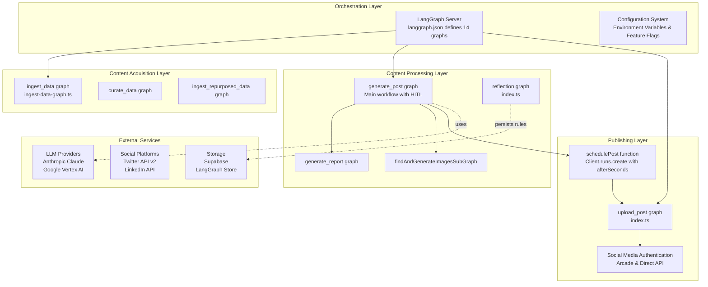

<!-- source: DeepWiki mcp.deepwiki.com · repo langchain-ai/social-media-agent · page 1 Overview · fetched 2026-10-26 -->

# Overview

Relevant source files

The following files were used as context for generating this wiki page:

- [.vscode/settings.json](.vscode/settings.json)
- [README.md](README.md)
- [langgraph.json](langgraph.json)
- [package.json](package.json)
- [scripts/generate-post.ts](scripts/generate-post.ts)
- [src/agents/reflection/index.ts](src/agents/reflection/index.ts)
- [src/utils/reflections.ts](src/utils/reflections.ts)
- [static/agent_flow.png](static/agent_flow.png)
- [static/graph_screenshot.png](static/graph_screenshot.png)
- [yarn.lock](yarn.lock)

The Social Media Agent is an AI-powered automation platform that generates and publishes content to Twitter and LinkedIn from various content sources including Slack channels, GitHub repositories, YouTube videos, Reddit posts, and general web pages. The system features a human-in-the-loop (HITL) workflow that allows users to review, modify, and approve generated posts before publication, with continuous learning from feedback to improve future generations. [README.md:1-5]()

The platform is built on **LangGraph**, which orchestrates 14 specialized graphs that handle different aspects of the content pipeline, from ingestion and verification to generation, human review, scheduling, and publishing. [langgraph.json:4-19]()

**Key capabilities:**
- Multi-source content ingestion (Slack, GitHub, Twitter, Reddit, YouTube, web pages)
- AI-powered content analysis and post generation using Anthropic Claude and Google Vertex AI
- Automated image discovery, validation, and AI generation with brand templates
- Human-in-the-loop review with multiple action options via Agent Inbox
- Scheduled post publishing to Twitter and LinkedIn
- Continuous learning from user feedback via a reflection system
- Content repurposing for multiple posts from single sources

For detailed information about specific components, refer to these child pages:
- [System Architecture](#1.1)
- [Features and Capabilities](#1.2)
- [Key Dependencies](#1.3)

## System Architecture

The Social Media Agent is built on **LangGraph Server**, which orchestrates 14 distinct graphs defined in `langgraph.json`. Each graph handles a specialized aspect of the content pipeline, from data acquisition through publishing and continuous learning. [langgraph.json:1-24]()

### Complete System Architecture

### Graph Definitions

The system defines 14 named graphs in [langgraph.json:4-19](). For more details, see [System Architecture](#1.1).

| Graph Name | Purpose | Entry Point |
|------------|---------|-------------|
| `ingest_data` | Fetches content from Slack, Twitter, Reddit, GitHub | [src/agents/ingest-data/ingest-data-graph.ts:5]() |
| `generate_post` | Main workflow: verification → generation → HITL → scheduling | [src/agents/generate-post/generate-post-graph.ts:6]() |
| `upload_post` | Publishes posts to Twitter and LinkedIn | [src/agents/upload-post/index.ts:7]() |
| `reflection` | Learns from user feedback to optimize prompts | [src/agents/reflection/index.ts:8]() |
| `repurposer` | Creates multiple posts from single content | [src/agents/repurposer/index.ts:15]() |
| `supervisor` | Consolidates reports from multiple sources | [src/agents/supervisor/supervisor-graph.ts:13]() |
| `generate_thread` | Generates Twitter threads | [src/agents/generate-thread/index.ts:9]() |

Sources: [langgraph.json:4-19](), [package.json:37-72]()

## Features and Capabilities

The agent provides a robust suite of tools for content creators and marketing teams. Key features include:

### Multi-Source Ingestion
The system can ingest data from diverse platforms including Slack, GitHub, YouTube, and Reddit. It uses specialized verification nodes to extract structured content like READMEs, transcripts, and comment threads. [README.md:39-43]()

### Human-in-the-Loop (HITL)
A central feature is the ability for users to review generated content before it goes live. Users can:
- **Accept**: Schedule the post for publishing.
- **Rewrite**: Modify the text of the generated post.
- **Modify Date**: Change the scheduled publishing time.
- **Reject**: Discard the post entirely.
[README.md:3]()

### Reflection and Continuous Learning
The `reflectionGraph` analyzes user feedback and modifications to generate new "rules" stored in the LangGraph Store. These rules guide future generations to better align with user preferences. [src/agents/reflection/index.ts:14-105]()

For a full breakdown of features, see [Features and Capabilities](#1.2).

Sources: [README.md:1-5](), [src/agents/reflection/index.ts:30-50]()

## Key Dependencies

The system relies on several core technologies and external APIs:

### Orchestration and AI
- **LangGraph**: Used for state management and workflow orchestration. [package.json:45]()
- **Anthropic Claude**: Primary LLM for text generation and reasoning. [package.json:41]()
- **Google Vertex AI**: Used for image validation, generation, and YouTube transcript processing. [package.json:44]()

### Social and Integration
- **Arcade AI**: Provides a unified OAuth interface for social media platforms. [package.json:38]()
- **Twitter & LinkedIn APIs**: Used for direct publishing and media uploads. [package.json:68]()
- **Supabase**: Used for storing generated images. [package.json:51]()
- **FireCrawl**: Used for high-quality web scraping and content extraction. [package.json:48]()

For a complete list of dependencies and their roles, see [Key Dependencies](#1.3).

Sources: [package.json:37-72](), [README.md:155-166]()

---

