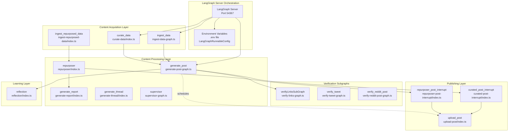
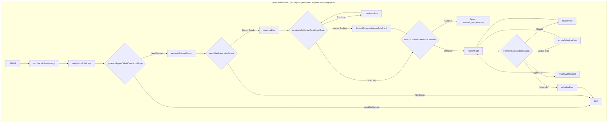
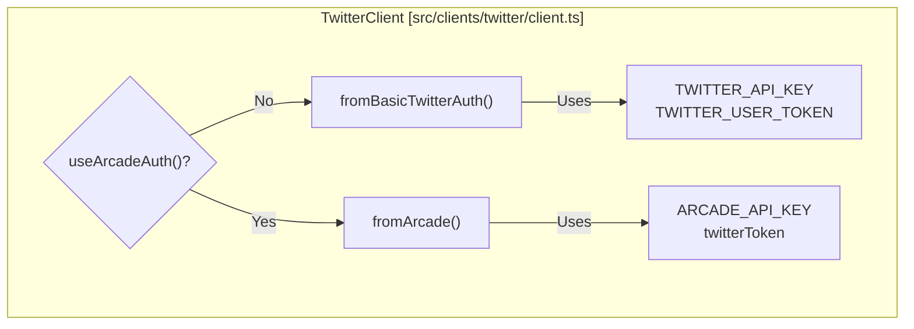
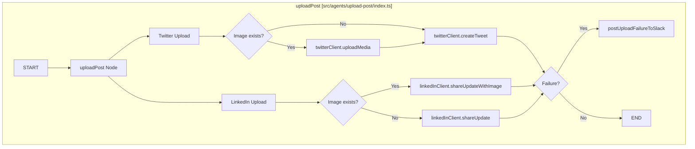
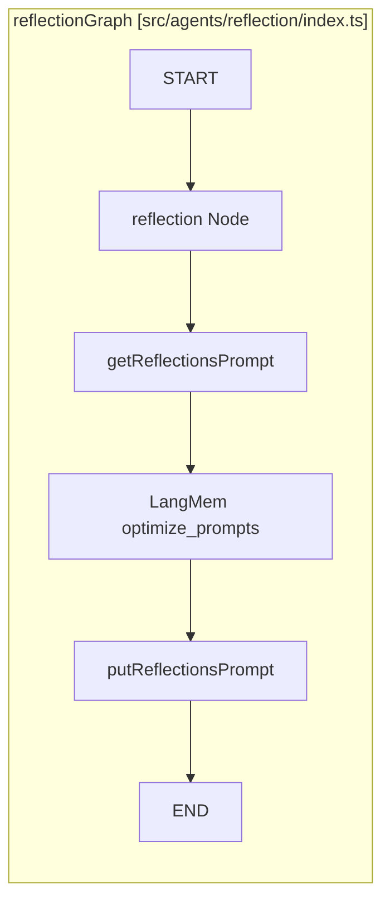

<!-- source: DeepWiki mcp.deepwiki.com · repo langchain-ai/social-media-agent · page 1.1 System Architecture · fetched 2026-10-26 -->

# System Architecture

<details>
<summary>Relevant source files</summary>

The following files were used as context for generating this wiki page:

- [langgraph.json](langgraph.json)
- [src/agents/generate-post/generate-post-graph.ts](src/agents/generate-post/generate-post-graph.ts)
- [src/agents/generate-post/generate-post-state.ts](src/agents/generate-post/generate-post-state.ts)
- [src/agents/reflection/index.ts](src/agents/reflection/index.ts)
- [src/agents/upload-post/index.ts](src/agents/upload-post/index.ts)
- [src/agents/utils.ts](src/agents/utils.ts)
- [src/agents/verify-tweet/nodes/get-tweet-content.ts](src/agents/verify-tweet/nodes/get-tweet-content.ts)
- [src/clients/twitter/client.ts](src/clients/twitter/client.ts)
- [src/clients/twitter/types.ts](src/clients/twitter/types.ts)
- [src/utils/reflections.ts](src/utils/reflections.ts)

</details>


This document provides an overview of the Social Media Agent's system architecture, detailing the core components, data flows, and interactions that enable the automated creation and publishing of social media content. It explains how the system's different parts work together to ingest content, verify its relevance, generate posts, facilitate human review, and publish to social media platforms.

## Overall Architecture

The Social Media Agent is built on LangGraph Server, which orchestrates 14 distinct graph workflows. The system follows a layered architecture with five main components: orchestration (LangGraph Server), content acquisition (ingestion and curation), content processing (generation with human oversight), publishing (scheduling and uploading), and continuous learning (reflection and repurposing).

### Core Architecture Layers



Sources: [langgraph.json:1-24](), [src/agents/generate-post/generate-post-graph.ts:185-243](), [src/agents/upload-post/index.ts:287-293](), [src/agents/reflection/index.ts:98-105]()

### LangGraph Server Configuration

The system is deployed as a LangGraph Server instance configured via `langgraph.json`. The server exposes 14 graph entry points, defining the mapping between graph names and their implementation files.

Sources: [langgraph.json:1-24]()

### Architectural Patterns

The architecture implements several key patterns:

1.  **Graph Orchestration**: Uses LangGraph's `StateGraph` and conditional edges for workflow control. Graphs can spawn other graphs using the LangGraph SDK `Client`. [src/agents/generate-post/generate-post-graph.ts:158-183]()
2.  **State Management**: Each graph defines its state using `Annotation.Root()`. State flows through nodes via shared state interfaces like `GeneratePostState`. [src/agents/generate-post/generate-post-state.ts:26-108]()
3.  **Human-in-the-Loop**: Implements interrupts via `humanNode` which pauses execution for user review and feedback. [src/agents/generate-post/generate-post-graph.ts:198-198]()
4.  **Modular Verification**: Content verification is delegated to specialized subgraphs or nodes based on URL type. [src/agents/generate-post/generate-post-graph.ts:191-191]()
5.  **Dual Authentication**: Supports both direct API credentials and Arcade OAuth flows via the `TwitterClient` and `LinkedInClient`. [src/clients/twitter/client.ts:45-60]()
6.  **Learning System**: The `reflectionGraph` uses LangMem to optimize prompt rules based on user feedback stored in the LangGraph Store. [src/agents/reflection/index.ts:52-96]()

Sources: [src/agents/generate-post/generate-post-graph.ts:158-243](), [src/agents/generate-post/generate-post-state.ts:26-108](), [src/clients/twitter/client.ts:45-60](), [src/agents/reflection/index.ts:52-96]()

## LangGraph Workflow Architecture

The system defines 14 graph workflows in `langgraph.json`.

### Complete Graph Registry

| Graph Name | Type | File Path | Primary Purpose |
| :--- | :--- | :--- | :--- |
| `ingest_data` | Entry Point | `ingest-data/ingest-data-graph.ts` | Ingests Slack messages and triggers post generation. |
| `generate_post` | Entry Point | `generate-post/generate-post-graph.ts` | Main workflow for post creation and human review. |
| `upload_post` | Entry Point | `upload-post/index.ts` | Publishes content to Twitter and LinkedIn. |
| `reflection` | Entry Point | `reflection/index.ts` | Optimizes prompts based on user feedback. |
| `curate_data` | Entry Point | `curate-data/index.ts` | Aggregates content from various social sources. |
| `verify_tweet` | Entry Point | `verify-tweet/verify-tweet-graph.ts` | Specialized verification for Twitter content. |
| `verify_reddit_post` | Entry Point | `verify-reddit-post-graph.ts` | Specialized verification for Reddit content. |
| `repurposer` | Entry Point | `repurposer/index.ts` | Generates multiple posts from a single source. |

Sources: [langgraph.json:1-19]()

### Graph Spawning Pattern

Graphs often trigger other workflows asynchronously. For instance, the `generate_post` graph can spawn a `curated_post_interrupt` if the origin is `curate-data`, allowing for specialized human-in-the-loop handling.

```typescript
// From src/agents/generate-post/generate-post-graph.ts:162-177
if (config.configurable?.origin === "curate-data") {
    const client = new Client({
      apiUrl: process.env.LANGGRAPH_API_URL,
      apiKey: process.env.LANGCHAIN_API_KEY,
    });

    const { thread_id } = await client.threads.create();
    await client.runs.create(thread_id, "curated_post_interrupt", {
      input: state,
      // ... configuration
    });

    return END;
}
```

Sources: [src/agents/generate-post/generate-post-graph.ts:162-180]()

## Post Generation Process

The `generate_post` graph is the central workflow for transforming content into social media updates.

### Generate Post Graph Structure



Sources: [src/agents/generate-post/generate-post-graph.ts:185-243](), [src/agents/generate-post/generate-post-graph.ts:62-155]()

### Conditional Routing Logic

The graph utilizes several key decision functions:
*   `generateReportOrEndConditionalEdge`: Checks if URLs were previously used via `checkIfUrlsArePreviouslyUsed` and ends the graph if so to avoid duplicates. [src/agents/generate-post/generate-post-graph.ts:128-151]()
*   `condenseOrHumanConditionalEdge`: Checks if the post length exceeds 280 characters. If so, it routes to `condensePost` (up to 3 times). [src/agents/generate-post/generate-post-graph.ts:90-106]()
*   `rewriteOrEndConditionalEdge`: Routes based on the `state.next` value set during the human interrupt phase. [src/agents/generate-post/generate-post-graph.ts:71-88]()

Sources: [src/agents/generate-post/generate-post-graph.ts:71-151]()

## Authentication and Social Media Integration

The system supports dual authentication modes for Twitter and LinkedIn, managed via specialized client classes.

### Twitter Authentication Logic

The `TwitterClient` handles both direct API keys and Arcade OAuth.



Sources: [src/clients/twitter/client.ts:61-105](), [src/clients/twitter/client.ts:153-187]()

### LinkedIn Integration

The `LinkedInClient` manages posting to either a personal profile or an organization page, depending on the `POST_TO_LINKEDIN_ORGANIZATION` configuration.

Sources: [src/agents/upload-post/index.ts:244-246](), [src/agents/utils.ts:521-530]()

## Publishing Layer: Upload Post Graph

The `upload_post` graph is responsible for the final delivery of content to social platforms.

### Upload Post Flow



Sources: [src/agents/upload-post/index.ts:236-280](), [src/agents/upload-post/index.ts:187-234]()

The `uploadPost` node handles media conversion via `imageUrlToBuffer` before calling platform-specific clients. If an upload fails, `postUploadFailureToSlack` sends a detailed error report to a configured Slack channel. [src/agents/upload-post/index.ts:187-234]()

## Reflection and Learning System

The `reflectionGraph` allows the system to persist rules across runs by analyzing user feedback.



Sources: [src/agents/reflection/index.ts:52-96](), [src/utils/reflections.ts:14-43]()

The system uses the LangGraph `store` to persist these rules under the `["reflection_rules"]` namespace. The `reflection` node invokes a specialized LangMem agent (`optimize_prompts`) to distill natural language feedback into structured rules. [src/agents/reflection/index.ts:60-93]()

## Content Verification and Extraction

Before generation, the system extracts content from various sources. For Twitter content, the `getTweetContent` node fetches the full thread and media.

| Source | Extraction Logic | File Reference |
| :--- | :--- | :--- |
| Twitter | Fetches thread text and media URLs via `TwitterClient`. | `src/agents/verify-tweet/nodes/get-tweet-content.ts` |
| Web Pages | Uses `cheerio` to extract body text and image alts. | `src/agents/utils.ts:getPageText` |
| Slack | Extracts URLs using regex for `<link\|text>` formats. | `src/agents/utils.ts:extractUrlsFromSlackText` |

Sources: [src/agents/verify-tweet/nodes/get-tweet-content.ts:12-71](), [src/agents/utils.ts:105-168](), [src/agents/utils.ts:26-30]()

---

