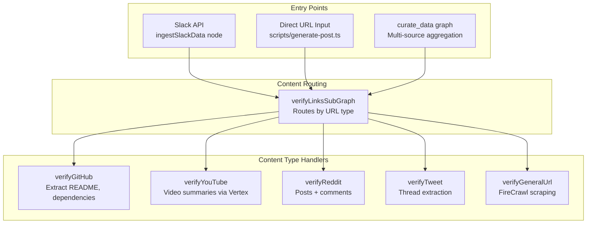
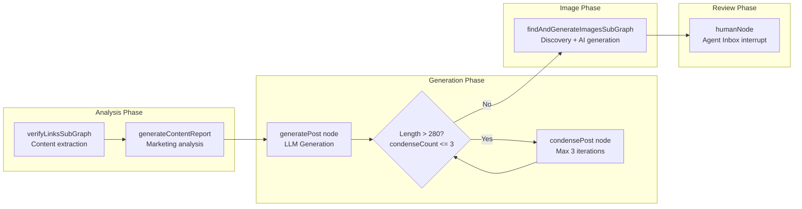
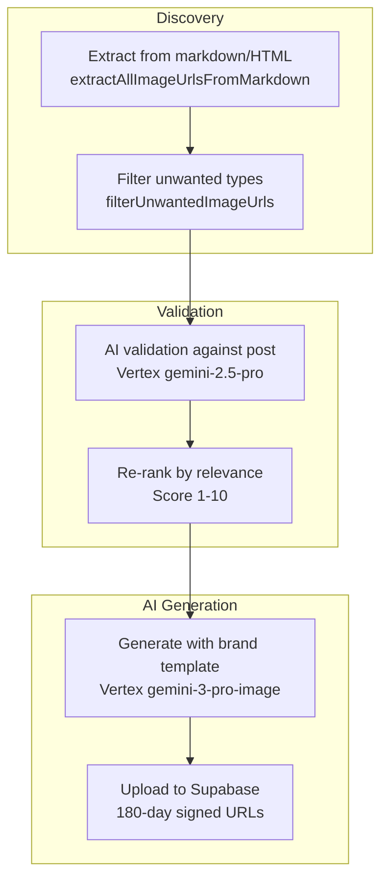

<!-- source: DeepWiki mcp.deepwiki.com · repo langchain-ai/social-media-agent · page 1.2 Features and Capabilities · fetched 2026-10-26 -->

# Features and Capabilities

Relevant source files

The following files were used as context for generating this wiki page:

- [.env.full.example](.env.full.example)
- [.env.quickstart.example](.env.quickstart.example)
- [.vscode/settings.json](.vscode/settings.json)
- [FEATURES.md](FEATURES.md)
- [README.md](README.md)
- [scripts/generate-post.ts](scripts/generate-post.ts)
- [src/agents/shared/stores/post-subject-urls.ts](src/agents/shared/stores/post-subject-urls.ts)
- [static/agent_flow.png](static/agent_flow.png)
- [static/graph_screenshot.png](static/graph_screenshot.png)

This document provides a comprehensive overview of the features and capabilities available in the social media agent system. It focuses on what the system can do and how these capabilities are implemented at the code level.

## Overview

The social media agent is an AI-powered automation platform that generates and publishes social media content with human oversight. The system supports end-to-end content workflows from ingestion through publication, with extensive customization and quality control mechanisms.

**Core Capabilities:**
- Ingests content from 7+ different sources (Slack, GitHub, YouTube, Reddit, Twitter, Luma, and general web).
- Generates marketing-optimized posts using multiple LLM providers (Anthropic, OpenAI, Google Vertex AI).
- Processes and generates images with AI, including brand-aware templates.
- Provides human-in-the-loop review and modification via the Agent Inbox.
- Publishes to Twitter and LinkedIn with sophisticated scheduling and rate-limiting.
- Learns from user feedback using a reflection graph to optimize future generations.
- Repurposes single content sources into multi-post campaigns.

Sources: [README.md:1-42](), [README.md:150-166](), [src/agents/generate-post/generate-post-graph.ts:1-246]()

---

## Content Ingestion Capabilities

The system can ingest and process content from multiple sources, each with specialized verification and extraction logic.

### Supported Content Sources

**Content Type Detection and Routing**

| Source Type | Detection Logic | Handler Node | Capabilities |
|-------------|----------------|--------------|--------------|
| GitHub | `hostname.includes("github")` | `verifyGitHub` | README extraction, dependency analysis, trending repos |
| YouTube | `hostname.includes("youtube")` or `youtu.be` | `verifyYouTube` | Video metadata, transcripts via Vertex AI |
| Reddit | `hostname.includes("reddit")` | `verifyReddit` | Post content, comment threads via Snoowrap |
| Twitter | `hostname.includes("twitter")` or `x.com` | `verifyTweet` | Tweet text, thread retrieval, media |
| General Web | All others | `verifyGeneralUrl` | Page scraping via FireCrawl API |

The `getUrlType` function in [src/agents/utils.ts:392-437]() performs URL classification, returning one of: `"github"`, `"youtube"`, `"twitter"`, `"reddit"`, `"luma"`, or `"general"`.

### Slack Message Ingestion

The `ingest_data` graph [src/agents/ingest-data/ingest-data-graph.ts:1-85]() provides automated Slack channel monitoring:

- Fetches messages from a configured Slack channel via `ingestSlackData` node.
- Extracts URLs using `extractUrlsFromSlackText` [src/agents/utils.ts:26-30]().
- Creates parallel `generate_post` runs for each URL with staggered delays to respect rate limits.
- Supports rate limiting with 30-second base delays [src/agents/utils.ts:553-573]().

Sources: [src/agents/utils.ts:392-437](), [src/agents/ingest-data/ingest-data-graph.ts:1-85](), [src/agents/utils.ts:26-30](), [README.md:298-310]()

---

## Post Generation Capabilities

The system generates marketing-optimized social media posts through a multi-stage pipeline with iterative refinement.

### Generation Pipeline Architecture

### Content Report Generation

The `generateContentReport` node produces structured marketing analysis, validating content matches the configured `BUSINESS_CONTEXT` [FEATURES.md:54-56]().

### Post Generation Features

| Feature | Implementation | Configuration |
|---------|---------------|---------------|
| **Length Optimization** | Iterative condensation (max 3 attempts) | `condenseCount` in state [src/agents/generate-post/generate-post-state.ts:104-107]() |
| **URL Handling** | Removes URLs from length calculation | `removeUrls` [src/agents/utils.ts:81-84]() |
| **Duplicate Prevention** | Checks stored URLs before generation | `getSavedUrls` [src/agents/shared/stores/post-subject-urls.ts:48-64]() |
| **Style Control** | Few-shot examples + structure instructions | `TWEET_EXAMPLES`, `POST_STRUCTURE_INSTRUCTIONS` [README.md:407-422]() |
| **Exclusion Logic** | Skips specific URLs based on business rules | `shouldExclude<type>Content` [FEATURES.md:87-95]() |

The length check in [src/agents/generate-post/generate-post-graph.ts:62-78]() uses `removeUrls(state.post).length > 280` to exclude URLs from character count, as Twitter displays URLs with fixed length.

Sources: [src/agents/generate-post/generate-post-graph.ts:1-246](), [src/agents/generate-post/generate-post-state.ts:1-153](), [src/agents/utils.ts:81-84](), [FEATURES.md:18-31](), [src/agents/shared/stores/post-subject-urls.ts:48-64]()

---

## Image Processing Capabilities

The `findAndGenerateImagesSubGraph` provides comprehensive image handling.

### Image Pipeline Stages

### Image Discovery and Filtering

The `filterUnwantedImageUrls` function [src/agents/utils.ts:367-377]() removes SVGs, icons, and badge images (like `img.shields.io`). If `TEXT_ONLY_MODE` is enabled, the entire image pipeline is skipped [src/agents/utils.ts:512-519]().

### AI-Powered Image Validation and Generation

- **Validation**: Uses Google Vertex AI to score images (1-10) based on relevance to the post content.
- **Generation**: If no suitable image is found, the system uses `gemini-3-pro-image` to generate one.
- **Storage**: Images are stored in Supabase with signed URLs [README.md:288-297]().

Sources: [src/agents/utils.ts:334-377](), [src/agents/utils.ts:512-519](), [README.md:288-297]()

---

## Human-in-the-Loop Capabilities

The system provides comprehensive human review through the Agent Inbox interface.

### Available User Actions

The `humanNode` [src/agents/generate-post/generate-post-graph.ts:43-60]() allows users to:
- **Accept**: Proceed to scheduling/upload.
- **Rewrite**: Provide feedback for regeneration.
- **Modify Date**: Change the scheduled post time using natural language.
- **Reject**: Terminate the workflow.
- **Split URL**: Move the link to a separate tweet in a thread (Complex Post).

### Duplicate Prevention

Once a run reaches the `humanNode`, all URLs are stored in the LangGraph store [FEATURES.md:20-22](). Future runs check this store via `getSavedUrls` to prevent duplicate content generation unless `SKIP_USED_URLS_CHECK` is true [src/agents/shared/stores/post-subject-urls.ts:17-40]().

Sources: [src/agents/generate-post/generate-post-graph.ts:43-60](), [FEATURES.md:18-31](), [src/agents/shared/stores/post-subject-urls.ts:17-40]()

---

## Scheduling and Publishing Capabilities

The system handles publication to Twitter and LinkedIn with platform-specific logic.

### Scheduling Mechanism

The `schedulePost` node creates delayed LangGraph runs using the `afterSeconds` parameter [src/agents/ingest-data/ingest-data-graph.ts:44-59](). Delay times are calculated based on URL type and count to prevent rate limiting [src/agents/utils.ts:553-573]().

### Multi-Platform Authentication

The system supports two authentication modes:
1. **Arcade Mode**: Uses `ARCADE_API_KEY` for simplified OAuth handling [README.md:204-210]().
2. **Direct Mode**: Uses developer account secrets (e.g., `TWITTER_API_KEY`, `LINKEDIN_CLIENT_ID`) [README.md:214-255]().

**Platform Specifics:**
- **Twitter**: Requires OAuth 1.0a for media uploads even if using Arcade for text [README.md:222-226]().
- **LinkedIn**: Supports posting as a Person or an Organization (`POST_TO_LINKEDIN_ORGANIZATION`) [README.md:257-275]().

Sources: [src/agents/utils.ts:553-573](), [README.md:204-275](), [src/agents/ingest-data/ingest-data-graph.ts:44-59]()

---

## Learning and Optimization

The system includes a **Reflection Graph** that learns from human edits. When a user rewrites or edits a post in the Agent Inbox, the reflection graph:
1. Compares the original AI generation with the human-edited version.
2. Extracts "rules" or preferences (e.g., "don't use emojis", "keep it technical").
3. Stores these rules in the LangGraph Store (namespace `reflection_rules`).
4. Automatically injects these rules into future generation prompts to improve alignment with user style.

Sources: [README.md:3](), [FEATURES.md:3]() (General system behavior)

---

## Configuration and Flags

| Flag | Description | Implementation |
|------|-------------|----------------|
| `SKIP_CONTENT_RELEVANCY_CHECK` | Bypasses the AI check for business relevance. | [FEATURES.md:54-56]() |
| `SKIP_USED_URLS_CHECK` | Disables duplicate URL prevention. | [src/agents/shared/stores/post-subject-urls.ts:22-24]() |
| `TEXT_ONLY_MODE` | Disables image extraction and generation. | [src/agents/utils.ts:512-519]() |
| `USE_ARCADE_AUTH` | Toggles between Arcade and Direct API authentication. | [src/agents/utils.ts:611-613]() |
| `USE_LANGCHAIN_PROMPTS` | Enables specific exclusion logic and prompts for LangChain. | [FEATURES.md:91-93]() |

Sources: [FEATURES.md:54-95](), [src/agents/utils.ts:512-613](), [src/agents/shared/stores/post-subject-urls.ts:22-24]()

---

